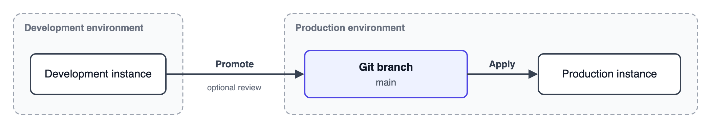

<!-- 简体中文翻译；来源 n8n-io/n8n-docs；原文版本见 upstream.json。 -->

# 环境管理（Environments） 

环境管理功能让工作流及凭据、变量、数据表等 n8n 资源，依次经过开发、生产等发布阶段。你可以在一个实例上构建和测试变更，再将其晋级到下一个阶段。


**功能可用范围**

Environments are available on:

- **n8n Cloud：**Enterprise。
- **自托管：**Enterprise。

只有实例所有者和实例管理员可以设置环境、执行晋级、应用变更以及审核晋级。



**预览状态**

环境管理处于预览阶段，未来版本可能更改。在为生产实例设置此功能前，请先在测试实例上试用。



**企业级就绪程度有限**

环境管理的**企业级就绪程度有限**。有关尚未支持的企业功能，请参阅[企业级就绪程度](known-limitations.md#enterprise-readiness)。


## 为什么使用环境 

独立的环境让你可以修改工作流，同时避免影响生产环境中正在运行的工作流。常见配置如下：

- **开发：**构建和修改工作流。
- **生产：**运行正式工作流。

## 环境如何运作 

变更通过环境在实例之间流转：

1. 在开发实例上，将变更晋级到生产环境。
2. 可选：由其他人在[晋级审核](promotion-reviews.md)中批准变更，变更才会进入该环境。
3. 在生产实例上，应用生产环境中的变更。

使用基于 Git 的晋级时，晋级操作会将变更提交到生产环境的 Git 分支。

## 概念 

### 环境 

从概念上说，环境是发布流程中的一个阶段及运行该阶段的实例，例如预发布实例或生产实例。你将变更晋级到下一个环境，再由该环境的实例应用变更。

从技术上说，使用基于 Git 的晋级时，已晋级的变更会保存在远程 Git 仓库的分支中，直到实例应用它们。在执行晋级的实例上，晋级环境配置指向该仓库和分支，并定义变更进入分支的方式，例如推送功能分支或创建合并请求。在应用变更的实例上，应用环境配置指向同一仓库和分支。

### 晋级与应用 

晋级和应用是变更流转的两个操作：

- **晋级（Promote）**将变更从当前实例发送到某个环境。
- **应用（Apply）**将某个环境中的变更引入当前实例。

执行晋级的实例是源实例，应用变更的实例是目标实例。

可以在两个级别执行晋级或应用：

- **项目：**晋级或应用一个团队项目。你可以选择要包含的变更。
- **实例：**晋级或应用实例上的所有团队项目。


实例级应用会覆盖实例上的每个团队项目，使其与环境一致，同时删除环境中不存在的项目。


### 晋级的内容 

工作流是晋级的主要单位。选择工作流后，n8n 会包含其依赖资源：凭据、变量、数据表和标签。n8n 绝不会把凭据密钥、数据表中的行或执行记录写入仓库。变量及其值会一起传递。

晋级和应用使用 [n8n 包](../../build/manage-workflows/n8n-packages/README.md)导出和导入内容。有关应用操作会对实例作出哪些修改，请参阅[应用变更](apply-changes.md#what-apply-changes-on-the-instance)。

### 晋级模型 

晋级模型决定变更如何在环境之间流转。n8n 目前支持基于 Git 的晋级，即通过 Git 仓库传递变更。未来可能支持其他模型，例如直接在两个实例之间晋级。请参阅[基于 Git 的晋级](git-based-promotion/README.md)。

### 提供方 

提供方保存 n8n 连接 Git 托管服务并进行身份验证所需的信息，例如访问令牌或 SSH 密钥。多个环境可以使用同一个提供方。所选 Git 提供方类型决定可用的附加功能，例如列出该提供方可以访问的仓库和分支。

## 环境管理与经典环境 

环境管理取代了早期的源代码管理功能[经典环境（Environments Classic）](../use-source-control-and-environments/README.md)。同一实例只能使用其中一种。请参阅[从经典环境升级](upgrade-from-environments-classic.md)。

## 本节内容 

- [规划环境](plan-your-environments.md)：选择实例与环境的连接方式。
- [首次晋级](first-promotion.md)：首次将工作内容引入新的目标实例。
- [晋级变更](promote-changes.md)：将项目或整个实例发送到某个环境。
- [应用变更](apply-changes.md)：将某个环境中的变更引入项目或整个实例。
- [保护生产实例](protect-a-production-instance.md)：限制仅用于应用变更的实例上的界面修改。
- [晋级审核](promotion-reviews.md)：在已晋级的变更进入环境分支前进行批准。
- [基于 Git 的晋级](git-based-promotion/README.md)：了解环境如何使用 Git，以及支持哪些 Git 提供方。
- [已知限制](known-limitations.md)：了解环境管理尚未支持的内容及替代处理方式。
- [从经典环境升级](upgrade-from-environments-classic.md)：比较两个版本、迁移实例以及切换回旧版。

## 相关资源 

- [管理](../)
- [设置权限和角色](../manage-users-and-access/set-permissions-and-roles-rbac/README.md)
- [n8n 包](../../build/manage-workflows/n8n-packages/README.md)
