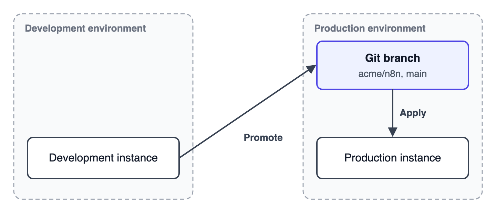
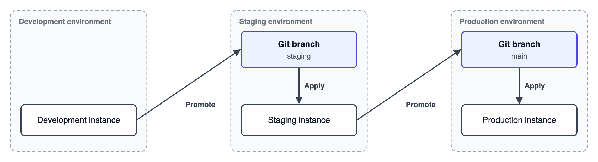

<!-- 简体中文翻译；来源 n8n-io/n8n-docs；原文版本见 upstream.json。 -->

# 规划环境 

开始设置之前，先确定哪些实例执行晋级、哪些实例应用变更，以及每个环境对应的仓库和分支。


**预览状态**

环境管理处于预览阶段，未来版本可能更改。在为生产实例设置此功能前，请先在测试实例上试用。


## 实例与环境的关系 

每个实例属于一个环境，并向下一个环境晋级。需要在每个实例的 **Settings（设置）** > **Environments（环境）**中单独配置，最多设置两项环境配置：

- **Apply（应用）：**实例所属的环境，实例从此环境应用变更。
- **Promote（晋级）：**下一个环境，实例向此环境晋级变更。

使用[基于 Git 的晋级](git-based-promotion/README.md)时，每项环境配置都使用一个提供方、仓库和分支。不同方向或不同实例之间不必完全相同，多项配置可以共享提供方。实例可以从一个仓库应用变更，向另一个仓库晋级，也可以使用同一仓库中的不同分支。无论由 n8n 直接提交，还是由其他人合并，只要变更进入下一个实例读取的分支，就可以传递到该实例。要在变更进入分支前批准变更，请使用 GitLab 的[晋级审核](promotion-reviews.md)。

按发布流程中的阶段命名环境，例如 Staging（预发布）或 Production（生产）。以下模式是常见配置，并非唯一选择。

## 开发与生产 

如果团队在一个实例上构建工作流，在另一个实例上运行，请使用此模式。

| 实例 | 晋级变更目标 | 应用变更来源 |
|---|---|---|
| 开发 | 生产：仓库 `acme/n8n`，分支 `main` | 无 |
| 生产 | 无 | 生产：仓库 `acme/n8n`，分支 `main` |

在开发实例上添加生产环境的晋级配置，在生产实例上添加生产环境的应用配置，两者指向同一个仓库和分支。

## 开发、预发布与生产 

如果变更进入生产环境前需要先在预发布实例上测试，请使用此模式。预发布实例配置两个环境：从预发布环境应用变更，并向生产环境晋级。

| 实例 | 晋级变更目标 | 应用变更来源 |
|---|---|---|
| 开发 | 预发布：分支 `staging` | 无 |
| 预发布 | 生产：分支 `main` | 预发布：分支 `staging` |
| 生产 | 无 | 生产：分支 `main` |

在开发实例上添加预发布环境的晋级配置；在预发布实例上添加预发布环境的应用配置和生产环境的晋级配置；在生产实例上添加生产环境的应用配置。同一个环境的配置指向同一个仓库和分支。

预发布和生产可以使用同一仓库的两个分支（如表中所示），也可以使用两个仓库中的分支。如果两个阶段分别由不同团队负责，或者在 Git 托管服务上需要不同的访问规则，请使用两个仓库。

## 设置新的目标实例 

首次将工作内容引入新的目标实例，请按照[首次晋级](first-promotion.md)操作。如果实例使用经典环境，请按照[从经典环境迁移](upgrade-from-environments-classic.md#migrate-from-environments-classic)操作。

## 保护仅应用变更的实例 

对于生产等仅应用变更的实例，请开启 **Protected instance（受保护实例）**。请参阅[保护生产实例](protect-a-production-instance.md)。

## 相关资源 

- [环境管理](./)
- [首次晋级](first-promotion.md)
- [保护生产实例](protect-a-production-instance.md)
- [晋级变更](promote-changes.md)
- [应用变更](apply-changes.md)
- [晋级审核](promotion-reviews.md)
- [基于 Git 的晋级](git-based-promotion/README.md)
- [已知限制](known-limitations.md)
- [从经典环境升级](upgrade-from-environments-classic.md)
