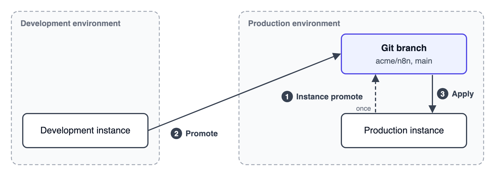

<!-- 简体中文翻译；来源 n8n-io/n8n-docs；原文版本见 upstream.json。 -->

# 从经典环境升级 

环境管理改进并取代了早期的源代码管理功能[经典环境（Environments Classic）](../use-source-control-and-environments/README.md)。每个实例只能使用经典环境或新版环境管理中的一种；在新版处于预览阶段时，可以切换回经典环境。


**预览状态**

环境管理处于预览阶段，未来版本可能更改。在为生产实例设置此功能前，请先在测试实例上试用。


## 比较经典环境与新版环境管理 

| | 经典环境（Environments Classic） | 环境管理（Environments） |
|---|---|---|
| 模型 | 实例向一个分支推送，并从该分支拉取。 | 实例向一个环境晋级，并从另一个环境应用变更；两个方向可分别使用自己的仓库和分支。 |
| Git 托管服务 | 通过 SSH 或 HTTPS 使用任意 Git 托管服务。 | 与经典环境一样，通过通用 Git 使用任意 Git 托管服务。GitLab 额外提供仓库和分支列表。 |
| 审核 | 在 Git 托管服务上手动进行。 | 基于 n8n 在 GitLab 上创建的合并请求，在 n8n 中进行晋级审核，并查看可视化差异。 |
| 选择变更 | 可以选择推送内容，拉取会引入全部内容。 | 通过项目级晋级和应用，在两个方向上选择变更；也可通过实例级晋级和应用，传递所有团队项目。 |
| 依赖资源 | 选择工作流、凭据和数据表，n8n 添加标签和变量占位项。 | n8n 包含选定工作流使用的所有资源，计划在未来支持自行选择依赖资源。 |
| 变更写入前 | 确认后，拉取可能覆盖本地变更。 | 应用操作先检查阻碍问题，并要求确认破坏性变更。 |
| 凭据 | 不含值的占位项。 | 必须已存在于目标实例，或在应用时创建。 |
| 变量 | 不含值的占位项。 | 携带值写入仓库；必须已存在于目标实例，或在应用时创建。 |
| 使用角色 | 实例所有者和管理员，项目管理员可以推送。 | 实例所有者和管理员；计划在未来允许项目管理员执行项目级晋级和应用。 |
| 个人项目 | 包含。 | 不包含。 |
| 自动化 | 公共 API 中的源代码管理端点，以及 n8n CLI 中的拉取命令。 | 公共 API 中的晋级端点，以及 n8n CLI 中的晋级命令。 |

## 新版环境管理尚未支持的经典环境功能 

新版环境管理还未覆盖经典环境的全部功能。升级前请检查以下内容：

- **个人项目：**经典环境包含个人项目，新版只晋级团队项目。
- **项目管理员：**经典环境允许项目管理员推送；新版只有实例所有者和实例管理员可以晋级和应用。计划在未来支持项目管理员执行项目级晋级和应用。
- **自动发布：**经典环境可以在拉取时发布工作流。应用操作不会改变工作流是否已发布。计划在未来支持自动发布。
- **实例颜色：**经典环境允许设置实例颜色，新版没有此设置。
- **选择依赖资源：**经典环境允许单独推送凭据和数据表。新版会包含选定工作流的所有依赖，无法自行选择依赖资源。计划在未来支持此功能。
- **跨项目移动：**经典环境拉取会将工作流移至其在 Git 中所属的项目。项目级晋级和应用无法跨项目移动工作流或文件夹，因此请使用实例级晋级和实例级应用。请参阅[在项目之间移动工作流和文件夹](known-limitations.md#moving-workflows-and-folders-between-projects)。
- **工作流描述：**经典环境会同步描述，新版不会。
- **凭据设置：**经典环境会同步凭据是否与所有用户和项目共享，以及是否由每位用户连接自己的账号。新版不会同步，需要在目标实例上重新设置。


新版环境管理也有与经典环境无关的限制。请参阅[已知限制](known-limitations.md)。


## 从经典环境迁移 

经典环境和新版环境管理在 Git 中使用不同的内容格式，因此应用操作无法读取经典环境推送的内容。技术上两者可以共享仓库，但 n8n 建议创建新仓库或使用空分支。

请先在测试实例上尝试。经典环境配置会在后台保持连接，因此可以切换回去。

开始之前：

1. 将调用公共 API 中经典环境端点的 CI 流水线，改为调用晋级端点。升级只改变界面，因此经典端点仍会执行旧版推送和拉取。n8n 计划在使用新版环境管理的实例上禁用这些端点。
2. 在开发、生产等每个实例上，进入 **Settings（设置）** > **Environments (Classic)（经典环境）**，选择 **Upgrade（升级）**并确认。
3. 为生产环境创建新仓库或空分支。
4. 按照[开发与生产](plan-your-environments.md#development-and-production)添加环境配置。分支为空时，不要在生产实例上执行应用操作。

然后通过以下两种方式之一填充分支。

### 从开发实例开始 

如果开发实例中没有尚未准备好进入生产的变更，请从第 3 步开始按照[首次晋级](first-promotion.md#promote-and-apply)操作。

### 从生产实例开始 

如果开发实例中存在尚未准备好进入生产的变更，请改为从生产实例填充分支。这样分支会先与生产保持一致，之后再在变更准备好时从开发实例晋级。

1. 在生产实例上，添加指向同一仓库和分支的生产环境晋级配置，并执行[实例级晋级](promote-changes.md#instance-promote)，然后从生产实例中移除该晋级配置。
2. 此后，在开发变更准备好时，使用[项目级晋级](promote-changes.md#project-promote)发送变更。实例级晋级还会发送尚未准备好的变更。
3. 在生产实例上[应用](apply-changes.md)这些变更。

在这两种情况下，经典环境的拉取操作都已保留源内容的 ID，因此应用操作会原位更新生产内容。工作流保留版本历史和执行记录，变量保留其值，凭据保留密钥。完成后，请[保护生产实例](protect-a-production-instance.md)。

## 切换回经典环境 

1. 前往 **Settings**（设置）> **Environments**（环境）。
2. 选择 **Switch back（切换回旧版）**并确认。

切换回旧版只影响当前实例，随时可以再次升级。

## 相关资源 

- [环境管理](./)
- [规划环境](plan-your-environments.md)
- [首次晋级](first-promotion.md)
- [晋级变更](promote-changes.md)
- [应用变更](apply-changes.md)
- [晋级审核](promotion-reviews.md)
- [基于 Git 的晋级](git-based-promotion/README.md)
- [已知限制](known-limitations.md)
- [经典环境](../use-source-control-and-environments/README.md)
