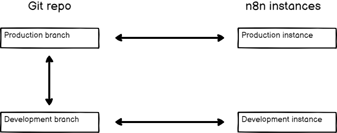
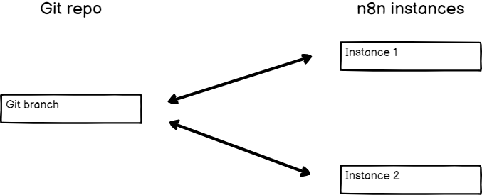
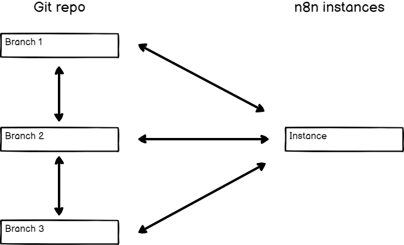

<!-- 简体中文翻译；来源 n8n-io/n8n-docs；原文版本见 upstream.json。 -->

# 分支模式 

n8n 实例与 Git 分支之间的关系很灵活，可以根据需要建立不同配置。



## 多实例、多分支 

此模式使用多个 n8n 实例，每个实例连接自己的分支。

可以使用此模式建立环境。例如，创建开发和生产两个 n8n 实例，分别连接各自的分支。从开发实例推送工作到其分支，通过拉取请求将工作合并到生产分支，然后拉取到生产实例。



## 多实例、单分支 

如果希望各处使用相同的工作流、标签和变量，但在不同 n8n 实例中使用，可以选择此模式。

可以使用此模式建立环境。例如，创建开发和生产两个 n8n 实例，都连接到同一分支。从开发实例推送工作，再拉取到生产实例。

此模式也适合测试 n8n 新版本：创建运行新版本的 n8n 实例，连接到 Git 分支进行测试。生产实例则继续运行旧版本，直到确认可以安全升级。



## 单实例、多分支 

实例所有者可以更改实例连接的 Git 分支。整体配置可能仍采用[多实例、多分支](#multiple-instances-multiple-branches)模式，但其中一个实例会在分支间切换。

这适合审核工作。例如，不同用户可在各自的实例中工作，并推送到各自的分支。审核者在审核实例中切换分支，加载不同用户的工作。


**不会清理内容**

更换分支时，n8n 不会清理实例中已有内容。在此模式下切换分支，会使各分支中的工作流都留在实例中。


## 单实例、单分支 

这是最简单的模式。

## 相关资源 

* [使用源代码管理与环境](./)
* [理解源代码管理](understand-source-control.md)
* [使用环境](work-with-environments.md)
* [在 n8n 中使用 Git](use-git-in-n8n.md)
* [设置源代码管理](set-up-source-control.md)
* [推送和拉取更改](push-and-pull-changes.md)
* [比较版本](compare-versions.md)
* [在环境间迁移工作](move-work-between-environments.md)
* [通过公共 API 以编程方式使用环境](use-environments-via-api.md)
* [教程：使用源代码管理创建环境](tutorial-create-environments-with-source-control.md)
