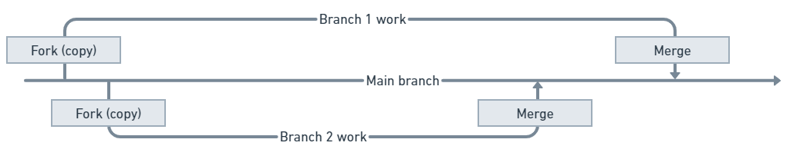

<!-- 简体中文翻译；来源 n8n-io/n8n-docs；原文版本见 upstream.json。 -->

# Git 与 n8n 

n8n 使用 Git 提供源代码管理。了解基本 Git 概念有助于使用此功能。n8n 并未实现 Git 的全部功能，不应将 n8n 源代码管理视为完整的版本控制。


**刚接触 Git 和源代码管理？**

如果刚接触 Git，也不必担心：使用 n8n 不要求先学会 Git。本文会介绍你需要的概念。不过，设置源代码管理需要在 Git 托管平台上操作，因此设置者需要具备一些 Git 知识。


**已经熟悉 Git 和源代码管理？**

如果已熟悉 Git，也不要假定行为完全相同。尤其需要注意：n8n 源代码管理不支持类似拉取请求的审核与合并流程，除非在 n8n 之外的 Git 托管平台中完成。


本页介绍 n8n 中使用的 Git 概念和术语，并不涵盖设置和管理仓库所需的全部知识。执行[设置](set-up-source-control.md)的人应熟悉一些 Git 及其托管平台的用法。


**这是一份简要介绍**

Git 是一个复杂主题。本节简要介绍在 n8n 中使用环境所需的关键术语。如需深入学习，请参阅 [GitHub | Git 与 GitHub 学习资源](https://docs.github.com/en/get-started/quickstart/git-and-github-learning-resources)。


## Git 概览 

[Git](https://git-scm.com/) 是用于管理、跟踪文档的多个版本并开展协作的工具，是 [GitHub](https://github.com/)、[GitLab](https://about.gitlab.com/) 等常用平台的基础。

## 分支：项目的多个副本 

Git 使用分支并行维护文档的多个副本，每个分支都有自己的版本。常见做法是建立一个主分支，让每位贡献者在自己的分支（副本）上工作。工作完成后，再将其分支合并回主分支。

## 本地与远程：在自己的机器与 Git 托管平台间迁移工作 

使用 Git 的常见方式是在自己的计算机上安装 Git，并通过 GitHub 等托管平台在云端使用 Git。也就是说，GitHub 上保存 Git 仓库（项目），你在本地机器上使用它的副本工作。

n8n 的源代码管理采用此模式：在 n8n 实例中处理工作流，再将其发送到 Git 托管平台保存。

## 推送、拉取与提交 

n8n 使用三个关键 Git 操作：

* **Push**（推送）：将工作从实例发送到 Git，把工作流和标签，以及凭据、变量存根的副本保存到 Git。可以选择要保存的工作流。
* **Pull**（拉取）：从 Git 获取工作流、标签和变量，并加载到 n8n。对于更新内容中的凭据或变量存根，需要补填相应的值。 

    

<strong>拉取会覆盖你的工作</strong>

如果在 n8n 中修改了工作流，必须先将更改推送到 Git，再进行拉取。拉取会覆盖尚未保存在 Git 中的更改。

		
* **Commit**（提交）：n8n 中的一次提交，就是将工作推送到 Git 的一次操作。在 n8n 中，提交与推送同时发生。

有关 n8n 与 Git 交互方式的详细说明，请参阅[推送和拉取](push-and-pull-changes.md)。

## 相关资源 

* [使用源代码管理与环境](./)
* [理解源代码管理](understand-source-control.md)
* [使用环境](work-with-environments.md)
* [选择分支模式](choose-branching-patterns.md)
* [设置源代码管理](set-up-source-control.md)
* [推送和拉取更改](push-and-pull-changes.md)
* [比较版本](compare-versions.md)
* [在环境间迁移工作](move-work-between-environments.md)
* [通过公共 API 以编程方式使用环境](use-environments-via-api.md)
* [教程：使用源代码管理创建环境](tutorial-create-environments-with-source-control.md)
