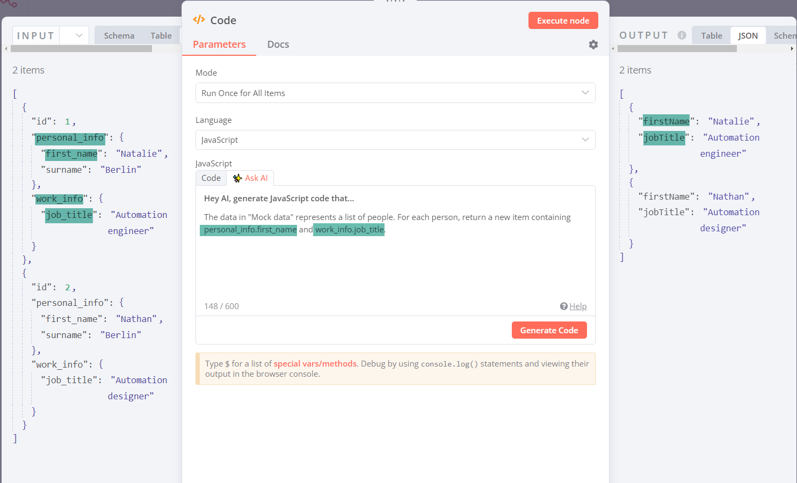

<!-- 简体中文翻译；来源 n8n-io/n8n-docs；原文版本见 upstream.json。 -->


# 获取 AI 编程帮助 <a id="get-coding-help-from-ai"></a>

## 在 Code 节点中使用 AI <a href="#use-ai-in-the-code-node" id="use-ai-in-the-code-node"></a>



## 使用限制 <a href="#usage-limits" id="usage-limits"></a>

试用阶段没有使用量限制。如果 n8n 将此功能正式推出，可能会根据定价套餐设置使用上限。

## 功能限制 <a href="#feature-limits" id="feature-limits"></a>

n8n 中的 ChatGPT 实现有以下限制：

* AI 编写的代码用于操作 n8n 工作流中的数据，不能要求它从其他来源获取数据。
* AI 只知道数据结构，不知道实际数据，因此需要告诉它如何找到要提取的数据、如何检查空值等。
* 提交 AI 请求前，Code 节点之前的节点必须已执行，并将数据传递给 Code 节点。
* 不适用于大型传入数据结构。
* Code 节点前面有大量节点时，可能出现问题。

## 编写有效提示词 <a href="#writing-good-prompts" id="writing-good-prompts"></a>

好的提示词能提高获得有用代码的概率。

一般建议如下：

* 提供示例：尽可能给出预期输出样例，帮助 AI 理解想要的数据转换或逻辑。
* 描述处理步骤：如果数据需要特定处理步骤或逻辑，按顺序列出。例如：“首先过滤掉所有未满 18 岁的用户，再按姓氏排序剩余用户。”
* 避免歧义：虽然 AI 能理解多种指令，但清晰、直接的表述有助于获得更准确的代码。例如，将“获取年长用户”改为“筛选年龄不小于 60 岁的用户”。
* 明确预期输出：希望转换、筛选、聚合还是排序数据？尽可能详细说明。

针对 n8n，还有以下建议：

* 考虑输入数据：确保 ChatGPT 清楚需要访问哪些数据，以及传入数据代表什么。可能还需要说明有哪些 n8n 内置方法和变量可用。
* 说明节点交互：如果逻辑涉及多个节点，明确它们如何交互，例如“根据 userID 属性合并 Node A 和 Node B 的输出”。如果希望使用特定节点或忽略其他节点，也要说明，例如“仅考虑 Purchases 节点的数据，忽略 Refunds 节点”。
* 确保输出兼容 n8n。n8n 要求的数据格式见[数据结构](../work-with-data/understand-n8ns-data-structure.md)。

### 提示词示例 <a href="#example-prompts" id="example-prompts"></a>

以下示例展示多种提示词和任务。

#### 示例 1：在第二个数据集中查找某条数据 <a href="#example-1-find-a-piece-of-data-inside-a-second-dataset" id="example-1-find-a-piece-of-data-inside-a-second-dataset"></a>

要自行尝试，下载示例工作流并导入 n8n：


示例工作流


在第三个 Code 节点中输入以下提示词：

> Slack 数据只有一个数据项。输入数据代表所有 Notion 用户。保存邮箱的 person 属性有时为 null。我想找到该 Slack 用户的 notionId 并返回。

查看 AI 生成的代码。

所需 JavaScript 如下：

```js
const slackUser = $("Mock Slack").all()[0];
const notionUsers = $input.all();
const slackUserEmail = slackUser.json.email;

const notionUser = notionUsers.find(
  (user) => user.json.person && user.json.person.email === slackUserEmail
);

return notionUser ? [{ json: { notionId: notionUser.json.id } }] : [];
```

#### 示例 2：数据转换 <a href="#example-2-data-transformation" id="example-2-data-transformation"></a>

要自行尝试，下载示例工作流并导入 n8n：


示例工作流


在 **Join items** Code 节点中输入以下提示词：

> 返回一行文本，用逗号分隔列出所有用户名，每个用户名都用双引号括起。

查看 AI 生成的代码。

所需 JavaScript 如下：

```js
const items = $input.all();
const usernames = items.map((item) => `"${item.json.username}"`);
const result = usernames.join(", ");
return [{ json: { usernames: result } }];
```

#### 示例 3：汇总数据并创建 Slack 消息 <a href="#example-3-summarize-data-and-create-a-slack-message" id="example-3-summarize-data-and-create-a-slack-message"></a>

要自行尝试，下载示例工作流并导入 n8n：


示例工作流


在 **Summarize** Code 节点中输入以下提示词：

> 为 Slack 创建一段 Markdown 文本，统计提交了多少个想法、功能和故障。提交类型保存在 property\_type 字段中。功能的类型为“Feature”，故障的类型为“Bug”，想法的类型为“Idea”。还要在消息中列出得票最多的前五项提交。使用“\<url|text>”作为链接的 Markdown 格式。

查看 AI 生成的代码。

所需 JavaScript 如下：

```js
const submissions = $input.all();

// Count the number of ideas, features, and bugs
let ideaCount = 0;
let featureCount = 0;
let bugCount = 0;

submissions.forEach((submission) => {
  switch (submission.json.property_type[0]) {
    case "Idea":
      ideaCount++;
      break;
    case "Feature":
      featureCount++;
      break;
    case "Bug":
      bugCount++;
      break;
  }
});

// Sort submissions by votes and take the top 5
const topSubmissions = submissions
  .sort((a, b) => b.json.property_votes - a.json.property_votes)
  .slice(0, 5);

let topSubmissionText = "";
topSubmissions.forEach((submission) => {
  topSubmissionText += `<${submission.json.url}|${submission.json.name}> with ${submission.json.property_votes} votes\n`;
});

// Construct the Slack message
const slackMessage = `*Summary of Submissions*\n
Ideas: ${ideaCount}\n
Features: ${featureCount}\n
Bugs: ${bugCount}\n
Top 5 Submissions:\n
${topSubmissionText}`;

return [{ json: { slackMessage } }];
```

### 显式引用传入节点数据 <a href="#reference-incoming-node-data-explicitly" id="reference-incoming-node-data-explicitly"></a>

传入数据含有嵌套字段时，使用点表示法引用，有助于 AI 理解需要哪些数据。



要自行尝试，下载示例工作流并导入 n8n：


示例工作流


在第二个 Code 节点中输入以下提示词：

> “Mock data”中的数据代表人员列表。对每个人，返回一个包含 personal\_info.first\_name 和 work\_info.job\_title 的新数据项。

所需 JavaScript 如下：

```js
const items = $input.all();
const newItems = items.map((item) => {
  const firstName = item.json.personal_info.first_name;
  const jobTitle = item.json.work_info.job_title;
  return {
    json: {
      firstName,
      jobTitle,
    },
  };
});
return newItems;
```

## 修正代码 <a href="#fixing-the-code" id="fixing-the-code"></a>

AI 生成的代码可能无需修改即可运行，也可能需要编辑。应了解 n8n 的[数据结构](../work-with-data/understand-n8ns-data-structure.md)，内置方法和变量也可能有帮助。

### 相关资源 <a href="#related-resources" id="related-resources"></a>

* [在 n8n 中编写代码](./)
* [使用 Code 节点](using-the-code-node.md)
* [使用内置快捷方法](use-built-in-shortcuts.md)
* [定义自定义变量](define-custom-variables.md)
* [实用示例](cookbook/README.md)

Pluralsight 提供了一份简短的[使用 ChatGPT 编写代码指南](https://www.pluralsight.com/blog/software-development/how-use-chatgpt-programming-coding)，其中包含提示词示例。
