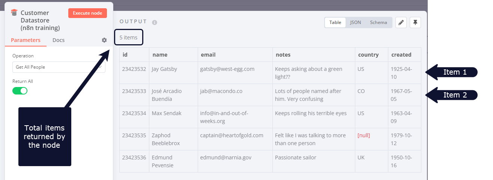
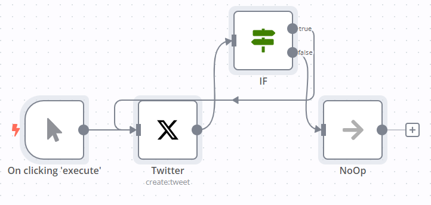

<!-- 简体中文翻译；来源 n8n-io/n8n-docs；原文版本见 upstream.json。 -->

# n8n 中的循环 

需要处理多个数据项或重复执行操作时，循环非常有用，例如向通讯录中的每位联系人发送消息。n8n 会自动处理这类重复操作，因此无需在工作流中专门构建循环。但[某些节点](#node-exceptions)是例外。

循环是 n8n [流程逻辑](./)的一部分，其他部分还包括数据流的[分支](split-with-conditionals.md)和[合并](merge-data.md)，以及执行之间的[等待](wait.md)。

## 在 n8n 中使用循环 

n8n 节点可以接收任意数量的数据项作为输入，处理这些数据项后输出结果。可以将每个数据项理解为一个数据点，或节点输出表中的一行。

节点通常会针对每个数据项执行一次。例如，如果要将 Customer Datastore 节点中客户的姓名和备注作为消息发送到 Slack，可以：

1. 将 Slack 节点连接到 Customer Datastore 节点。
2. 配置参数。
3. 执行节点。

你会收到五条消息，每个数据项对应一条。

这样就能处理多个数据项，无需显式地将节点连接成循环。

### 仅执行节点一次 

如果不希望节点处理收到的所有数据项，例如只给第一位客户发送 Slack 消息，可以在该节点的 **Settings（设置）** 标签页中开启 **Execute Once（仅执行一次）**。当传入数据包含多个数据项，而你只想处理第一个时，此设置很有用。

## 创建循环 

n8n 通常会遍历处理所有传入数据项。但在某些场景下，需要自行创建循环来遍历所有数据项。不会自动遍历全部传入数据项的节点列表，请参阅[例外节点](#node-exceptions)。

### 循环直到满足条件 

要在 n8n 工作流中创建循环，将一个节点的输出连接到前面某个节点的输入。添加 [IF](../../integrations/builtin/core-nodes/n8n-nodes-base.if.md) 节点，检查何时停止循环。

这个[示例工作流](https://n8n.io/workflows/1130)使用 `IF` 节点实现循环：

### 循环直到处理完所有数据项 

要循环处理直至完成所有数据项，请使用 [Loop Over Items](../../integrations/builtin/core-nodes/n8n-nodes-base.splitinbatches.md) 节点。要逐项处理，将 **Batch Size（批次大小）** 设为 `1`。

可以将数据分成多个批次进行处理。这种方式适合在传入数据量较大时避免触发 API 速率限制，也适合只处理返回数据中的某一组数据项。在批次之间配合 [Wait](wait.md) 节点，可以进一步降低处理速度。

Loop Over Items 节点在所有传入数据项都已分批并传递给工作流中的下一个节点后，会停止执行，因此无需添加 IF 节点来停止循环。

## 例外节点 

使用以下节点和操作时，需要在工作流中自行设计循环：

* [CrateDB](../../integrations/builtin/app-nodes/n8n-nodes-base.cratedb.md) 的 `insert` 和 `update` 操作只执行一次。
* 处于 **Run Once for All Items（为所有数据项运行一次）** 模式的 [Code](../../integrations/builtin/core-nodes/n8n-nodes-base.code/README.md) 节点：根据输入的代码片段处理所有数据项。
* 处于 **Run Once for All Items（为所有数据项运行一次）** 模式的 [Execute Workflow](../../integrations/builtin/core-nodes/n8n-nodes-base.executeworkflow.md) 节点。
* [HTTP Request](../../integrations/builtin/core-nodes/n8n-nodes-base.httprequest/README.md)：必须自行处理分页。如果 API 调用返回分页结果，需要创建循环，每次获取一页。
* [Microsoft SQL](../../integrations/builtin/app-nodes/n8n-nodes-base.microsoftsql.md) 的 `insert`、`update` 和 `delete` 操作只执行一次。
* [MongoDB](../../integrations/builtin/app-nodes/n8n-nodes-base.mongodb.md) 的 `insert` 和 `update` 操作只执行一次。
* [QuestDB](../../integrations/builtin/app-nodes/n8n-nodes-base.questdb.md) 的 `insert` 操作只执行一次。
* [Redis](../../integrations/builtin/app-nodes/n8n-nodes-base.redis.md)：
	* Info：无论传入数据包含多少个数据项，此操作都只执行一次。
* [RSS Read](../../integrations/builtin/core-nodes/n8n-nodes-base.rssfeedread.md) 对请求的 URL 只执行一次。
* [TimescaleDB](../../integrations/builtin/app-nodes/n8n-nodes-base.timescaledb.md) 的 `insert` 和 `update` 操作只执行一次。

## 相关资源 

* [流程逻辑](./)
* [按条件分支](split-with-conditionals.md)
* [合并数据](merge-data.md)
* [等待](wait.md)
* [理解执行顺序](understand-execution-order.md)
* [将工作流拆分为更小的部分](break-workflows-into-smaller-parts.md)
* [转换为子工作流](convert-to-sub-workflows.md)
* [妥善处理错误](handle-errors-gracefully.md)
