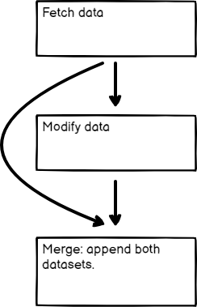

<!-- 简体中文翻译；来源 n8n-io/n8n-docs；原文版本见 upstream.json。 -->

# 合并数据 

合并用于将多条数据流汇集到一起，是 n8n [流程逻辑](./)的一部分。根据工作流需求，可以使用不同节点实现。

- 合并不同数据流或节点的数据：使用 [Merge](../../integrations/builtin/core-nodes/n8n-nodes-base.merge.md) 节点将多个来源的数据合并为一份。
- 合并多次节点执行的数据：对于需要合并某个节点多次执行结果或多个节点数据的复杂场景，使用 [Code](../../integrations/builtin/core-nodes/n8n-nodes-base.code/README.md) 节点。
- 比较并合并数据：使用 [Compare Datasets](../../integrations/builtin/core-nodes/n8n-nodes-base.comparedatasets.md) 节点比较、合并数据流，并根据比较结果输出数据。

以下各节将详细介绍这些方法。

## 合并不同数据流的数据 

如果工作流发生了[分支](split-with-conditionals.md)，可以将分开的数据流重新合并为一条。

这个[示例工作流](https://n8n.io/workflows/1747-joining-different-datasets/)展示了不同的合并方式：追加数据集、仅保留新增数据项和仅保留已有数据项。[Merge 节点](../../integrations/builtin/core-nodes/n8n-nodes-base.merge.md)文档详细介绍了各项合并操作。



## 合并不同节点的数据 

即使工作流没有拆分为不同数据流，也可以使用 Merge 节点合并前面两个节点的数据。当需要把多个节点生成的数据组成单个数据集时，这会很有用。

<figure>

<figcaption>合并前面两个节点的数据</figcaption>
</figure>

## 合并多次节点执行的数据 

使用 Code 节点合并多次节点执行的数据。这在一些[循环](loop.md)场景中很有用。


**节点执行与工作流执行**

本节介绍如何合并多次节点执行的数据，即同一个节点在一次工作流执行中运行多次的情况。

这个[示例工作流](https://n8n.io/workflows/1814-merge-multiple-runs-into-one/)使用 Loop Over Items 和 Wait，主动创建多次节点执行。



## 比较、合并并再次分支 

[Compare Datasets](../../integrations/builtin/core-nodes/n8n-nodes-base.comparedatasets.md) 节点会先比较数据流，再将其合并。最多可输出四条不同的数据流。

用法示例请参阅这个[示例工作流](https://n8n.io/workflows/1943-comparing-data-with-the-compare-datasets-node/)。



## 相关资源 

* [流程逻辑](./)
* [按条件分支](split-with-conditionals.md)
* [循环](loop.md)
* [等待](wait.md)
* [理解执行顺序](understand-execution-order.md)
* [将工作流拆分为更小的部分](break-workflows-into-smaller-parts.md)
* [转换为子工作流](convert-to-sub-workflows.md)
* [妥善处理错误](handle-errors-gracefully.md)
