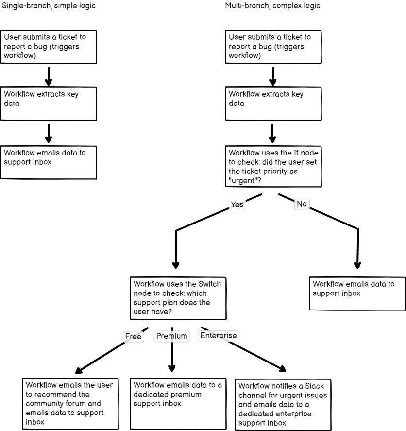

<!-- 简体中文翻译；来源 n8n-io/n8n-docs；原文版本见 upstream.json。 -->

# 使用条件节点对工作流进行分支 

分支通过 [IF](../../integrations/builtin/core-nodes/n8n-nodes-base.if.md) 或 [Switch](../../integrations/builtin/core-nodes/n8n-nodes-base.switch.md) 节点实现，将单分支工作流转为多分支工作流。这是 n8n [流程逻辑](./)的重要组成部分。

比较以下两个工作流：

第一个工作流是线性的：用户提交故障后，工作流向支持团队发送邮件。第二个工作流的起点相同，但会根据用户是否将问题标为紧急而分支，再根据用户的支持套餐进一步分支。

这展示了 n8n 中分支和条件节点的作用。

使用详情请参阅 [IF](../../integrations/builtin/core-nodes/n8n-nodes-base.if.md) 或 [Switch](../../integrations/builtin/core-nodes/n8n-nodes-base.switch.md) 文档。

分支之后，可以[将分支重新合并](merge-data.md)。多分支工作流的[执行顺序](understand-execution-order.md)取决于画布上的分支布局。

## 相关资源 

* [流程逻辑](./)
* [合并数据](merge-data.md)
* [循环](loop.md)
* [等待](wait.md)
* [理解执行顺序](understand-execution-order.md)
* [将工作流拆分为更小的部分](break-workflows-into-smaller-parts.md)
* [转换为子工作流](convert-to-sub-workflows.md)
* [妥善处理错误](handle-errors-gracefully.md)
