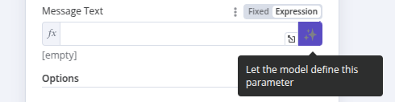

<!-- 简体中文翻译；来源 n8n-io/n8n-docs；原文版本见 upstream.json。 -->


# 让 AI 指定工具参数 <a href="#let-ai-specify-the-tool-parameters" id="let-ai-specify-the-tool-parameters"></a>

配置连接到 Tools Agent 的工具[^1]时，许多参数可以由 AI 模型自行填写。模型会利用任务上下文和其他已连接工具提供的信息，填写适当的内容。

有两种方式可以实现，并且可以相互切换。

## 让模型填写参数 <a href="#let-the-model-fill-in-the-parameter" id="let-the-model-fill-in-the-parameter"></a>

在工具的编辑对话框中，适用的参数字段末尾会多出一个按钮：



启用此按钮后，[AI Agent](#user-content-fn-2)[^2] 会为你填写表达式，无需进一步输入。
字段中会显示一条消息，说明参数已由模型自动定义。

如果想自行定义参数，请点击框内的“X”，恢复为用户定义的值。此时“Expression（表达式）”字段仍包含该功能生成的表达式，你可以继续编辑，按下一节的方法补充更多细节。


启用此功能会覆盖此前添加的任何手动定义。


## 使用 `$fromAI()` 函数 <a href="#use-the-dollarfromai-function" id="use-the-dollarfromai-function"></a> <a id="use-the-fromai-function"></a>

`$fromAI()` 函数通过 AI，为连接到 [Tools AI 智能体](../../../integrations/builtin/cluster-nodes/root-nodes/n8n-nodes-langchain.agent/tools-agent.md)的工具动态填写参数。


**仅适用于工具**

`$fromAI()` 函数仅适用于连接到 AI Agent 节点的工具。`$fromAI()` 函数不适用于 [Code](../../../integrations/builtin/cluster-nodes/sub-nodes/n8n-nodes-langchain.toolcode.md) 工具或[其他非工具类集群子节点](../../../integrations/builtin/cluster-nodes/sub-nodes/README.md)。


使用 `$fromAI()` 函数时，需传入必需的 `key` 参数：

```javascript
{{ $fromAI('email') }}
```

`key` 参数及传给 `$fromAI()` 函数的其他参数，并不是对已有值的引用。可以将它们理解为提示，AI 模型会据此填写合适的数据。

例如，选择名为 `email` 的键后，AI 模型会在上下文、其他工具和输入数据中查找电子邮件地址。在聊天工作流中，如果无法从其他地方找到，可能会向用户询问。也可以传入 `description` 等其他可选参数，为模型提供更多上下文。

### 参数 <a href="#parameters" id="parameters"></a>

`$fromAI()` 函数接受以下参数：


| 参数 | 类型 | 是否必需 | 说明 |
| --------- | ---- | --------- | ----------- |
| `key` | string | ✅ | 表示参数键名或名称的字符串，长度必须为 1 到 64 个字符，只能包含大小写字母、数字、下划线和连字符。 |
| `description` | string | ❌ | 描述参数的字符串。 |
| `type` | string | ❌ | 指定数据类型的字符串，可为 string、number、boolean 或 json，默认为 string。 |
| `defaultValue` | any | ❌ | 参数的默认值。 |


### 示例 <a href="#examples" id="examples"></a>

例如，可以使用以下 `$fromAI()` 表达式，为字段动态填写姓名：

```javascript
$fromAI("name", "The commenter's name", "string", "Jane Doe")
```

如果不需要可选参数，可以简化为：

```javascript
$fromAI("name")
```

要动态填写库存中的商品数量，可以使用以下 `$fromAI()` 表达式：

```javascript
$fromAI("numItemsInStock", "Number of items in stock", "number", 5)
```

如果只想用模型生成的动态值填写字段的一部分，也可以在普通表达式中使用。例如，希望模型填写邮件的 `subject` 参数，但始终为生成值加上字符串 ‘Generated by AI:’ 前缀，可以使用以下表达式：

```javascript
Generated by AI: {{ $fromAI("subject") }}
```

### 模板 <a href="#templates" id="templates"></a>

以下模板[^3]展示了 `$fromAI()` 函数的实际用法：

* [Angie：支持 Telegram 语音和文本的个人 AI 助手](https://n8n.io/workflows/2462-angie-personal-ai-assistant-with-telegram-voice-and-text/)
* [使用 AI 文本分类器自动解决客户支持问题](https://n8n.io/workflows/2468-automate-customer-support-issue-resolution-using-ai-text-classifier/)
* [通过 Pitch Deck AI Vision、聊天机器人和 QDrant 向量存储扩展项目来源](https://n8n.io/workflows/2464-scale-deal-flow-with-a-pitch-deck-ai-vision-chatbot-and-qdrant-vector-store/)

[^1]: 在 AI 场景中，工具是一种附加资源，AI 响应请求时可以利用它获取特定信息或功能。AI 模型可以通过工具与外部系统交互，或完成具体、专门的任务。
<a id="user-content-fn-2"></a>
[^2]: AI 智能体是能够响应请求、做出决策并为用户执行现实任务的人工智能系统。它们使用大语言模型（LLM）理解用户输入，并根据可用信息和资源，决定如何更好地处理请求。
[^3]: n8n 模板是 n8n 和社区成员设计的预构建工作流，可以导入到自己的 n8n 实例中。使用模板时，可能需要填写凭据并调整配置，以满足实际需求。

## 相关资源 <a id="related-resources"></a>

* [AI 示例](../ai-examples.md)
* [使用 Google Sheets 作为数据源](use-google-sheets-as-a-data-source.md)
* [调用 API](call-apis.md)
* [使用网站内容](use-website-content.md)
* [为工具添加人工审核](human-in-the-loop-for-tools.md)
* [为 AI 工作流设置人工兜底](set-a-human-fallback-for-ai-workflows.md)
