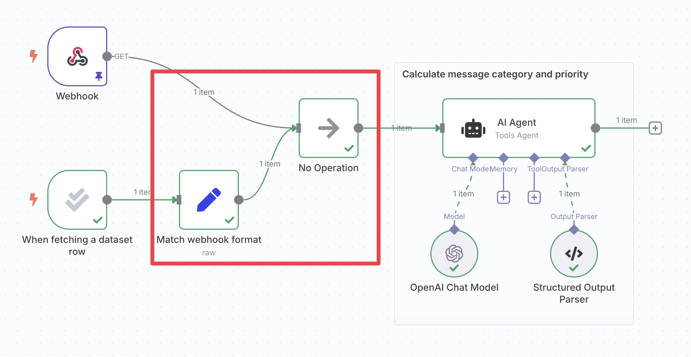
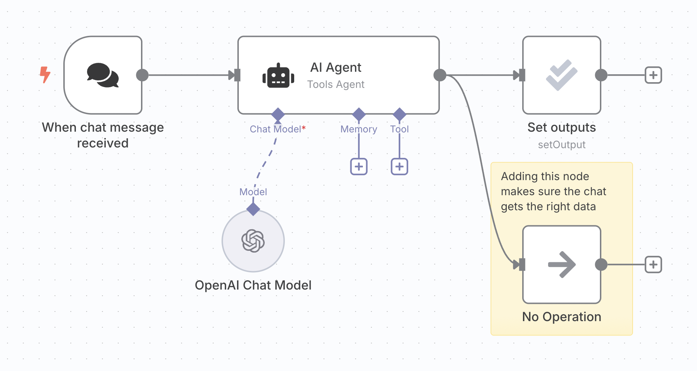
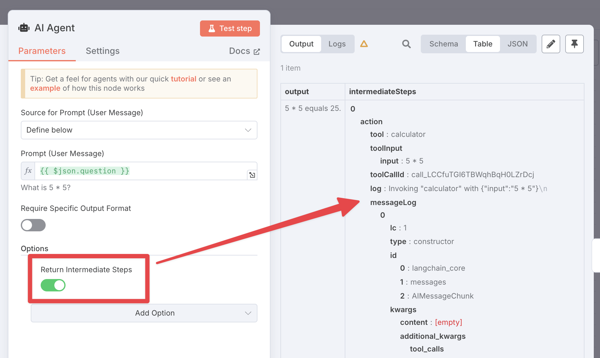

<!-- 简体中文翻译；来源 n8n-io/n8n-docs；原文版本见 upstream.json。 -->

# 技巧与常见问题 

## 组合多个触发器 

如果工作流已有其他触发器，就会有两个可能的起点：原有触发器和[评估触发器](../../../integrations/builtin/core-nodes/n8n-nodes-base.evaluationtrigger.md)。为确保无论哪个触发器执行，工作流都能按预期运行，需要将这两个分支合并。

<figure>

<figcaption>将两个触发器分支合并，使其数据格式一致，并可从同一个节点引用的逻辑。</figcaption>
</figure>

操作步骤：

1. **获取另一个触发器的数据格式**：
	* 执行另一个触发器。
    * 打开该节点，进入输出面板的 JSON 视图。
    * 点击右侧的 **copy（复制）**按钮。
2. **调整评估触发器的数据，使其格式一致**：
    * 在评估触发器后插入一个 [Edit Fields (Set) 节点](../../../integrations/builtin/core-nodes/n8n-nodes-base.set.md)，并将两者连接。
    * 将模式改为 **JSON**。
    * 将数据粘贴到“JSON”字段，删除第一行和最后一行的 `[` 和 `]`。
    * 将字段类型切换为 **Expression（表达式）**。
    * 从输入面板拖入触发器数据，完成映射。
    * 对于字符串，请替换整个值，包括引号，并在表达式末尾添加 `.toJsonString()`。
3. **使用 No-op 节点合并分支**：插入一个 [No-op 节点](../../../integrations/builtin/core-nodes/n8n-nodes-base.noop.md)，将另一个触发器和 Set 节点都连接到它。No-op 节点会原样输出收到的输入。
4. **在工作流其余部分引用 No-op 节点的输出**：两条路径都将以相同格式经过此节点，从而确保始终能够获取输入数据。

## 避免评估破坏聊天功能 

n8n 内置聊天会读取工作流中最后执行节点的输出。添加采用 [Set outputs（设置输出）操作](../../../integrations/builtin/core-nodes/n8n-nodes-base.evaluation.md#set-outputs)的评估节点后，这些数据可能不再符合预期格式，甚至不包含聊天回复。

解决方法是从智能体额外引出一个分支。在 n8n 中，[位置较低的分支会较晚执行](../../flow-logic/understand-execution-order.md)，因此接到该分支的节点会最后执行。这里可以使用 No-op 节点，因为只需原样传递智能体输出。

## 计算指标时访问工具数据 

有时需要了解智能体已执行的子节点中发生了什么，例如检查它是否执行了工具。无法直接通过表达式引用这些节点，但可以在智能体中启用 **Return intermediate steps（返回中间步骤）**。这样会增加名为 `intermediateSteps` 的输出字段，供后续节点使用：

## 在同一个工作流中设置多个评估 

每个工作流只能设置一个评估，换句话说，每个工作流只能有一个评估触发器。

不过，仍可将工作流的不同部分放入[子工作流](../../flow-logic/break-workflows-into-smaller-parts.md)，分别评估各个子工作流，从而使用不同评估测试不同部分。

## 处理结果不一致的情况 

指标经常存在噪声：即使评估的是完全相同的工作流，不同运行的结果也可能不同。这可能是工作流本身返回了不同结果，也可能是基于 LLM 的指标存在自然波动。

可以复制数据集中的行，让每行出现多次。这样每个输入实际上都会运行多次，有助于平滑波动。

## 相关资源 

* [测试和改进 AI 工作流](./)
* [理解为什么要测试](understand-why-to-test.md)
* [运行快速评估](run-quick-evaluations.md)
* [使用指标衡量质量](use-metrics-to-measure-quality.md)
