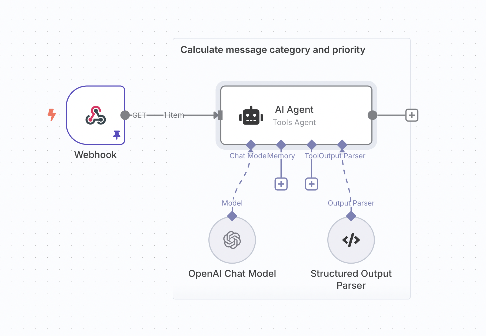
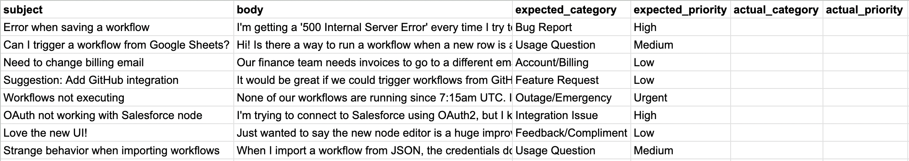
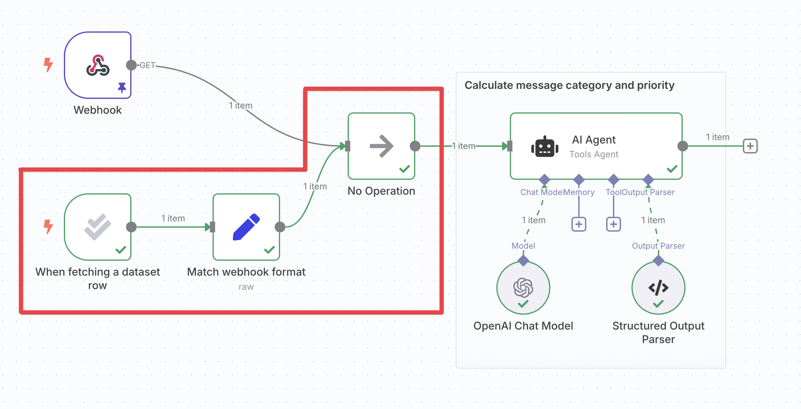
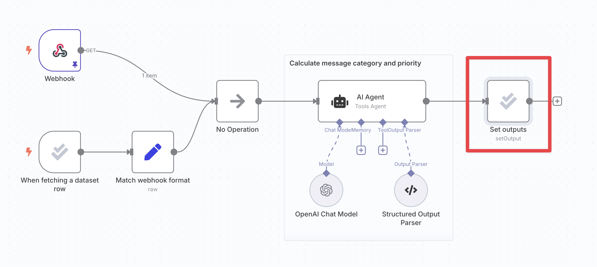
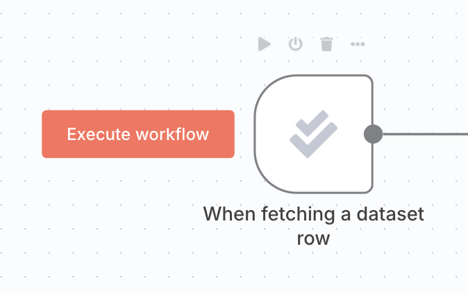

<!-- 简体中文翻译；来源 n8n-io/n8n-docs；原文版本见 upstream.json。 -->

# 轻量评估 


**功能可用范围**

轻量评估可用于：

- **n8n Cloud：**所有套餐。
- **自托管：**已注册的社区版、商业版、企业版。


## 什么是轻量评估？ 

构建工作流时，通常希望先用少量示例测试，了解其表现并进行改进。在这一开发阶段，逐个查看示例的工作流输出通常已经足够，设置更[正式的评分或指标](use-metrics-to-measure-quality.md)带来的收益尚不足以抵消投入。

轻量评估会将测试数据集中的示例逐个输入工作流，再把输出写回数据集。随后可以并排查看输出，并在提供了预期输出时，直观比较两者。

## 工作原理 


**Google Sheets 凭据**

评估使用数据表或 Google Sheets 存储测试数据集。要使用 Google Sheets 作为数据集来源，请配置 [Google Sheets 凭据](../../../integrations/builtin/credentials/google/README.md)。


轻量评估在工作流的“Editor（编辑器）”标签页中进行，设置说明则位于“Evaluations（评估）”标签页。

步骤如下：

1. 创建数据集。
2. 将数据集连接到工作流。
3. 将工作流输出写回数据集。
4. 运行评估。

以下说明使用一个示例工作流，为收到的支持工单分配类别和优先级。

### 1. 创建数据集 

创建一个数据表或 Google 表格，放入工作流所需的少量示例。数据集应包含以下列：

- 工作流输入。
- （可选）预期或正确的工作流输出。
- 实际输出。

实际输出列暂时留空，评估时会填入。

<figure>

<figcaption>支持工单分类工作流的<a href="https://docs.google.com/spreadsheets/d/1uuPS5cHtSNZ6HNLOi75A2m8nVWZrdBZ_Ivf58osDAS8/edit?gid=294497137#gid=294497137">示例数据集</a>。</figcaption>
</figure>

### 2. 将数据集连接到工作流 

#### 插入评估触发器以读取数据集 

[评估触发器](../../../integrations/builtin/core-nodes/n8n-nodes-base.evaluationtrigger.md)每次运行时，输出一个表示数据集某一行的数据项。

点击评估触发器左侧的“Evaluate all（全部评估）”按钮，会按顺序多次运行工作流，数据集中的每行对应一次执行。这是评估触发器特有的行为。

连接触发器时，通常只想运行一次。可以采用以下任一方式：

- 将触发器的“Max rows to process（最多处理行数）”设为 1。
- 点击触发器上的“Execute node（执行节点）”按钮，而非“Evaluate all（全部评估）”。

#### 将触发器连接到工作流 

现在可以将评估触发器连接到工作流的其他部分，并引用它输出的数据。至少需要在后续工作流中使用数据集的输入列。

如果工作流有多个触发器，需要[合并其分支](fix-common-issues.md#combining-multiple-triggers)。

<figure>

<figcaption>添加并连接了评估触发器的支持工单分类工作流。</figcaption>
</figure>

### 3. 将工作流输出写回数据集 

要在评估运行时填充数据集的输出列：

- 添加[评估节点](../../../integrations/builtin/core-nodes/n8n-nodes-base.evaluation.md)的“Set outputs（设置输出）”操作。
- 将其连接到工作流中已经产生待评估输出的位置之后。
- 在节点参数中，将工作流输出映射到正确的数据集列。

<figure>

<figcaption>添加并连接了“Set outputs（设置输出）”节点的支持工单分类工作流。</figcaption>
</figure>

### 4. 运行评估 

点击评估触发器左侧的 **Execute workflow（执行工作流）**按钮。工作流会多次执行，数据集中的每行对应一次执行：

在数据表或 Google 表格中检查每次执行的输出，必要时通过工作流的“Executions（执行记录）”标签页查看执行详情。

当数据集不再只有少量示例时，可以考虑[基于指标的评估](use-metrics-to-measure-quality.md)，用数值了解表现。也可参阅[技巧与常见问题](fix-common-issues.md)。

## 相关资源 

* [测试和改进 AI 工作流](./)
* [理解为什么要测试](understand-why-to-test.md)
* [使用指标衡量质量](use-metrics-to-measure-quality.md)
* [解决常见问题](fix-common-issues.md)
