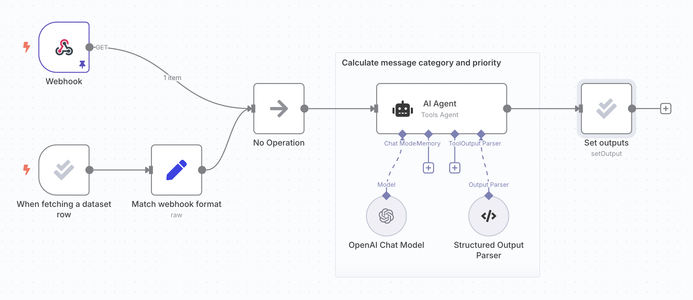
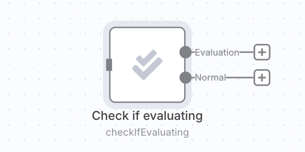
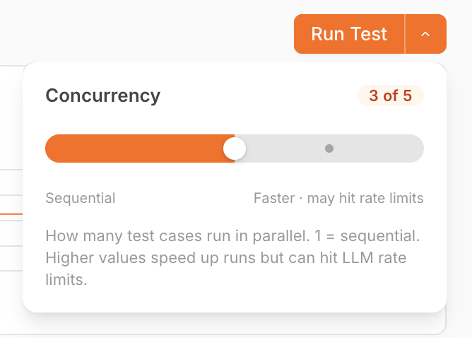

<!-- 简体中文翻译；来源 n8n-io/n8n-docs；原文版本见 upstream.json。 -->

# 基于指标的评估 


**功能可用范围**

基于指标的评估可用于：

- **n8n Cloud：**Pro、Enterprise。
- **自托管：**企业版。

已注册的社区版和 Starter 套餐用户也可以在单个工作流中使用此功能。


### 什么是基于指标的评估？ 

工作流准备好部署后，通常希望使用比[构建阶段](run-quick-evaluations.md)更多的示例进行测试。

例如，生产执行开始出现边界情况时，可以将它们加入测试数据集，确保测试覆盖这些情况。

对于从生产数据中建立的大型数据集，只凭肉眼查看结果很难了解表现，需要进行量化衡量。基于指标的评估为每次测试运行分配一个或多个分数，便于与之前的运行比较。各个分数汇总后，可衡量整个数据集上的表现。

通过此功能，可以运行会计算指标的评估，跟踪指标在不同运行之间的变化，并深入查看变化原因。

指标可以是确定性函数，例如两个字符串之间的距离，也可以通过 AI 计算。指标通常检查实际输出与*参考输出*（也称标准答案或 ground truth）之间的差异，因此数据集中需要包含参考输出。不过，有些评估不需要参考输出，例如检查文本情绪或有害性。

## 工作原理 


**Google Sheets 凭据**

评估使用数据表或 Google Sheets 存储测试数据集。要使用 Google Sheets 作为数据集来源，请配置 [Google Sheets 凭据](../../../integrations/builtin/credentials/google/README.md)。


1. 设置[轻量评估](run-quick-evaluations.md)。
2. 为工作流添加指标。
3. 运行评估并查看结果。

### 1. 设置轻量评估 

按照[设置说明](run-quick-evaluations.md)创建数据集，将其连接到工作流，并将输出写回数据集。

以下步骤沿用轻量评估文档中的支持工单分类工作流：

### 2. 为工作流添加指标 

指标是为工作流输出评分的维度，通常将实际输出与参考输出进行比较。常见做法是通过 AI 计算指标，有时也可以仅使用代码。在 n8n 中，指标始终是数字。

需要在工作流产生输出后，添加计算指标的逻辑。指标使用的参考输出可以作为数据集中的列加入，这样评估触发器会输出这些数据，供工作流使用。

使用 **Set Metrics（设置指标）**操作计算：

* **Correctness (AI-based)（正确性，基于 AI）**：回答的含义是否与提供的参考答案一致。评分为 1 到 5，5 为最佳。
* **Helpfulness (AI-based)（有用性，基于 AI）**：响应是否回答了给定查询。评分为 1 到 5，5 为最佳。
* **String Similarity（字符串相似度）**：逐字符衡量答案与参考答案的接近程度，即编辑距离。返回 0 到 1 之间的分数。
* **Categorization（分类）**：答案是否与参考答案完全匹配。匹配返回 1，否则返回 0。
* **Tools Used（工具使用）**：执行是否使用了工具。返回 0 到 1 之间的分数。

也可以添加自定义指标。先在工作流中计算指标，再将其映射到 Evaluation 节点。使用 **Set Metrics（设置指标）**操作，将 Metric 设为 **Custom Metrics（自定义指标）**，然后设置要返回的指标名称和值。

例如：

* [RAG 文档相关性](https://n8n.io/workflows/4273)：使用向量数据库时，检索出的文档是否与问题相关。

计算指标可能增加延迟和成本，因此你可能只希望评估时计算，生产执行时跳过。可以将指标逻辑放在 [Check if evaluating（检查是否正在评估）操作](../../../integrations/builtin/core-nodes/n8n-nodes-base.evaluation.md#check-if-evaluating)之后。

### 3. 运行评估并查看结果 

切换到工作流的 **Evaluations（评估）**标签页，点击 **Run Test（运行测试）**。评估结束后，会显示每项指标的汇总分数。

点击测试运行所在行，可以查看各个测试用例的结果。点击单个测试用例，会在新标签页中打开产生该结果的执行。

#### 并行运行测试用例 

在支持并发的套餐中，**Run Test（运行测试）**是一个分体按钮。点击右侧箭头可打开浮层，通过滑块控制同时运行的测试用例数量。

<figure>

<figcaption>并发设置浮层中，最多允许 5 个测试用例并行，滑块当前设为 3。</figcaption>
</figure>

默认上限取决于套餐：

| 套餐 | 最多并行测试用例数 |
| :--- | :-------------------------- |
| 自托管社区版、n8n Cloud Pro | 1（顺序运行） |
| 自托管商业版 | 3 |
| n8n Cloud Enterprise、自托管企业版 | 5 |

最大值为 `1` 时，箭头和浮层会隐藏，**Run Test（运行测试）**显示为普通按钮，按顺序运行，与早期版本相同。

自托管实例无论使用哪种套餐，都可以通过 [`N8N_CONCURRENCY_EVALUATION_LIMIT`](../../../deploy/host-n8n/configure-n8n/basic-configuration/use-environment-variables/executions.md) 环境变量覆盖此上限。


**LLM 速率限制**

提高并发可以加快评估，但也更容易触发上游 LLM 的速率限制。如果出现限流错误，请调低滑块设置。


## 相关资源 

* [测试和改进 AI 工作流](./)
* [理解为什么要测试](understand-why-to-test.md)
* [运行快速评估](run-quick-evaluations.md)
* [解决常见问题](fix-common-issues.md)
