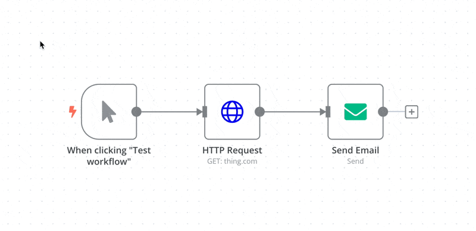

<!-- 简体中文翻译；来源 n8n-io/n8n-docs；原文版本见 upstream.json。 -->

# 导出和导入 

n8n 以 JSON 格式保存工作流。可以将工作流导出为 JSON 文件，也可以将 JSON 文件导入 n8n 工作流库。导出和导入有多种方式。



## 复制粘贴 

选择要复制到剪贴板的节点（`Ctrl + c` 或 `cmd +c`），再将其粘贴（`Ctrl + v` 或 `cmd + v`）到编辑器界面中，即可复制整个工作流或其中一部分。

要选择所有节点或一组节点，可以点击并拖动：

## 通过编辑器菜单 

在画布顶部选择 Workflow menu（工作流菜单），可以看到以下选项：

* **Download（下载）**：将当前工作流作为 JSON 文件下载到计算机。
* **Import from URL（从 URL 导入）**：从 URL 导入工作流 JSON，例如 [GitHub 上的这个工作流 JSON 文件](https://raw.githubusercontent.com/n8n-io/self-hosted-ai-starter-kit/refs/heads/main/n8n/demo-data/workflows/srOnR8PAY3u4RSwb.json)。
* **Import from File（从文件导入）**：从计算机导入 JSON 格式的工作流文件。

## 通过命令行 

### 使用 n8n CLI 

`n8n-cli package` 命令会将工作流打包为可移植的 `.n8np` 文件，供其他实例导入。可用选项请参阅 [n8n 软件包](n8n-packages/README.md)和[导出软件包](n8n-packages/export-a-package.md)。n8n 软件包处于预览阶段，未来版本中可能发生变化。


n8n 推荐使用 n8n CLI，通过命令行在实例之间迁移工作流。它可以在任何有网络访问能力的计算机上运行，携带工作流所需的文件夹、项目和引用，并在写入任何内容前检查导入。


### 使用 Server CLI 

* 导出：导出工作流或凭据的方法，请参阅[导出命令](../../deploy/host-n8n/configure-n8n/use-the-command-line.md#export-entities)。
* 导入：导入工作流或凭据的方法，请参阅[导入命令](../../deploy/host-n8n/configure-n8n/use-the-command-line.md#import-entities)。


对于新的迁移任务，n8n 推荐使用 [n8n CLI](#using-the-n8n-cli)，而不是 Server CLI 的导出和导入命令。官方计划弃用 Server CLI 的导出和导入命令，但尚未确定时间。


## 通过 n8n API 

n8n API 可以导出和导入 [n8n 软件包](n8n-packages/README.md)，其中包含工作流及其所需的文件夹、项目和引用。n8n 软件包处于预览阶段，未来版本中可能发生变化。

如果只希望以 JSON 格式迁移单个工作流，请使用 [n8n API](../../connect/n8n-api/README.md) 中的工作流接口。

## 相关资源 

* [管理工作流](./)
* [配置工作流设置](configure-workflow-settings.md)
* [为工作流添加标签](tag-workflows.md)
* [收藏项目](favorite-items.md)
* [查看更改历史](view-change-history.md)
* [审核工作流](workflow-reviews.md)
* [n8n 软件包](n8n-packages/README.md)
* [与他人共享](share-with-others.md)
