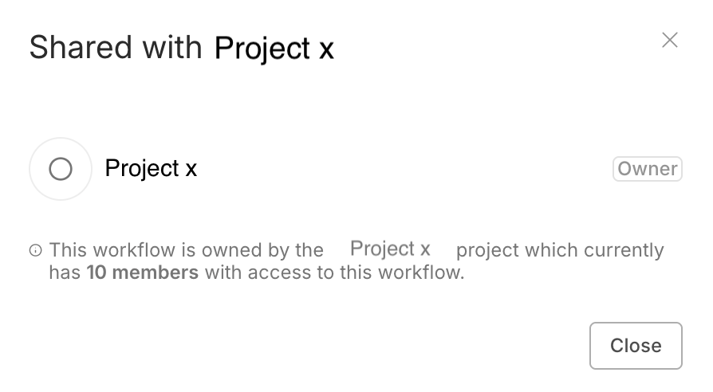

<!-- 简体中文翻译；来源 n8n-io/n8n-docs；原文版本见 upstream.json。 -->

# 共享工作流 


**功能可用范围**

以下套餐支持工作流共享：

- **n8n Cloud：** 所有套餐
- **自托管：** Business、Enterprise


工作流共享可以在同一个 n8n 实例的用户之间共享工作流。

用户可以共享自己创建的工作流。实例所有者和具有管理员角色的用户，可以查看和共享实例中的所有工作流。所有者和管理员的更多信息，请参阅[实例角色](../../administer/manage-users-and-access/understand-instance-roles.md)。

## 共享工作流 

1. 打开要共享的工作流。
2. 选择 **Share（共享）**。
3. 在 **Add users（添加用户）** 中，查找并选择要共享给的用户。
4. 选择 **Save（保存）**。

**注意：** 仅当工作流位于 **Personal（个人）** 工作空间时，此选项才可用。对**项目内**的工作流使用“Add users（添加用户）”选项时，会显示以下弹窗：

这是预期行为，表示该工作流已共享给所属项目中的所有成员。此时应将用户添加到工作流所在的项目，而不是直接添加到工作流。

## 查看共享的工作流 

可以在 **Workflows（工作流）** 列表中浏览和搜索工作流。列表中的内容取决于所在项目：

* **Overview（概览）** 列出所有你有权访问的工作流，包括：
	* 你自己的工作流。
	* 共享给你的工作流。
	* 你所属项目中的工作流。
	* 以实例所有者或管理员身份登录时：实例中的所有工作流。
* 其他项目：项目中的所有工作流。

## 工作流角色和权限 

工作流有两种角色：创建者和编辑者。创建者是创建工作流的用户，编辑者是其他有权访问工作流的用户。

除删除用户时外，不能更改工作流所有者。


**凭据**

工作流共享允许编辑者使用该工作流中的所有凭据[^1]，包括未通过[凭据共享](../../administer/manage-credentials/share-credentials-securely.md)显式共享给他们的凭据。


### 权限 

| 权限 | 创建者 | 编辑者 |
| ----------- | ------- | ------ | 
| 查看工作流（只读） | ✅ | ✅ |
| 查看执行 | ✅ | ✅ |
| 更新（包括标签） | ✅ | ✅ |
| 运行 | ✅ | ✅ |
| 共享 | ✅ | ❌ |
| 导出 | ✅ | ✅ |
| 删除 | ✅ | ❌ |

## 使用未共享凭据时的节点编辑限制 

n8n 的共享遵循最小权限原则。如果用户将工作流共享给你，但没有共享凭据，你就无法编辑工作流中使用这些凭据的节点。你仍然可以查看和运行工作流，并编辑不使用未共享凭据的节点。

共享凭据的方法，请参阅[凭据共享](../../administer/manage-credentials/share-credentials-securely.md)。

[^1]: 在 n8n 中，凭据存储用于连接特定应用和服务的身份验证信息。使用用户名和密码、API 密钥、OAuth 密钥等身份验证信息创建凭据后，即可通过关联的应用节点与服务交互。

## 相关资源 

* [管理工作流](./)
* [配置工作流设置](configure-workflow-settings.md)
* [为工作流添加标签](tag-workflows.md)
* [收藏项目](favorite-items.md)
* [查看更改历史](view-change-history.md)
* [审核工作流](workflow-reviews.md)
* [导出和导入](export-and-import.md)
* [n8n 软件包](n8n-packages/README.md)
