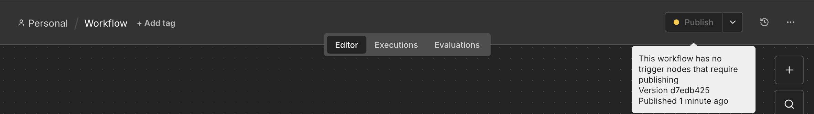
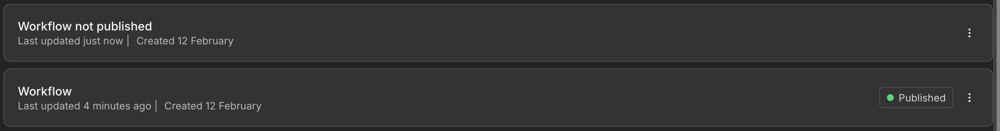
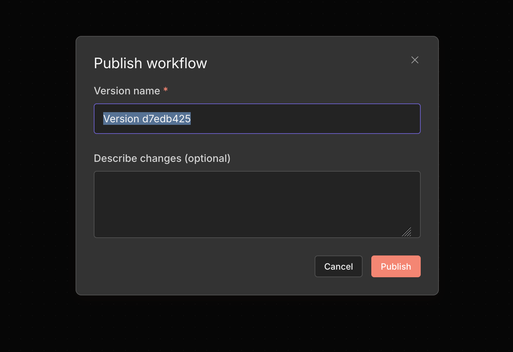
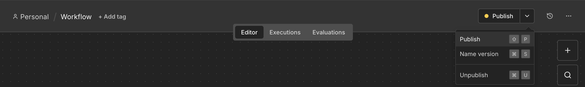

<!-- 简体中文翻译；来源 n8n-io/n8n-docs；原文版本见 upstream.json。 -->

# 保存和发布工作流 

编辑工作流时，n8n 会自动保存。准备将工作流投入生产时，再发布工作流。这种方式既可以避免意外修改生产环境，又便于安全地迭代和审核。

## 保存机制 

编辑时，更改会自动保存，通常需要 1 至 5 秒。无需手动点击保存按钮。所有编辑内容在发布前都保留为草稿。

## 发布机制 

发布会使工作流上线，并将其固定在特定版本。生产执行会使用已发布版本，而不是最新的编辑内容。发布工作流后，将启用以下功能：

* Webhook 和表单触发器使用生产 URL
* 计划任务按照定义的时间运行
* 已连接应用的事件触发此工作流

发布以异步方式进行。发布时，n8n 会判断上一个已发布版本与新版本之间哪些触发器发生了变化，然后在后台仅应用这些变化。未变化的触发器会持续运行，不受中断。新版本会在此过程中上线。**Publish（发布）** 按钮在 n8n 确认结果之前显示为 **Publishing（发布中）**。n8n 会将此状态保存在服务器上，因此即使在发布过程中刷新页面，按钮仍会显示 **Publishing**，并在结果返回时更新。

**初始状态**：打开没有可发布更改的工作流时，Publish 按钮处于禁用状态。

**可发布**：工作流尚未发布且存在更改时，按钮变为可用状态。

**已发布且为最新版本**：工作流当前已发布，自上次发布以来没有新更改。

**已发布但存在更改**：工作流已发布，但自上次发布以来所做的更改尚未上线。

**已发布但更改无效**：工作流已发布，但当前状态不满足重新发布的条件（没有需要发布的触发器）。

**已发布但存在错误**：工作流已发布，但最近的更改中存在错误，需要修复后才能再次发布。

**发布中**：提交发布后，n8n 会在后台注册触发器。在 n8n 确认结果之前，按钮会一直显示此状态。

**已发布但部分生效**：n8n 已发布新版本，但至少一个触发器未能激活，例如连接的应用暂时不可用。工作流会继续运行已成功激活的触发器，n8n 不会取消发布。将鼠标悬停在按钮上，可以查看哪些触发器失败；再次发布即可重试。

**发布失败**：工作流的所有触发器都未能激活，因此工作流没有运行。已发布版本的设置会保留，可以再次发布以重试。

## 协作机制 

同一时间只能有一个人编辑工作流。如果其他人正在编辑：

* 你会以只读模式查看工作流
* 对方停止编辑或处于非活跃状态时，编辑锁会释放
* 此后，你可以基于最新更改接手编辑

## 检查发布状态 

在 **Workflows（工作流）** 页面中，如果工作流已发布，其卡片上会显示相应标记。

## 发布工作流 

只要存在未发布的更改，画布顶部的 **Publish（发布）** 按钮就会启用。

每次更改工作流时，n8n 都会自动将更改保存为一个新版本。只有在更改后发布工作流，这些保存的版本才会在生产环境中生效。

1. 点击 **Publish（发布）** 按钮（或使用快捷键 `Shift` + `p`），打开发布弹窗。
2. 版本名称默认为 UUID。可以按需自定义名称，并添加版本说明。
3. 点击 **Publish（发布）**，使更改在生产环境中生效。生产执行始终使用当前已发布的版本。

    如果只更新工作流设置，n8n 会自动重新发布该版本，无需额外操作。


**工作流审核**

如果实例启用了工作流审核，可以提交某个版本供审核，而不是立即发布。审核尚未结束时，n8n 会禁止发布该工作流。支持的套餐及审核机制，请参阅[工作流审核](../manage-workflows/workflow-reviews.md)。


## 为版本命名 


**功能可用范围**

以下套餐支持命名版本：

- **n8n Cloud：** Pro、Enterprise
- **自托管：** Business、Enterprise


命名版本可以为任意工作流版本设置有意义的名称和说明，便于识别工作流开发过程中的重要里程碑。命名版本还会受到保护，不会被自动[清理版本历史](../manage-workflows/view-change-history.md)，因此可以永久保留。

从画布顶部为版本命名：

1. 选择 **Publish（发布）** 按钮旁的下拉箭头（或使用快捷键 `Cmd/Ctrl` + `s`）。
2. 选择 **Name version（为版本命名）**。
3. 输入名称，并按需填写说明。
4. 选择 **Save（保存）**。

从版本历史页面为版本命名：

1. 选择页面顶部的历史图标，打开版本历史。
2. 在要命名的版本上，选择 **Options（选项）** 。
3. 选择 **Name version（为版本命名）**。
4. 输入名称，并按需填写说明。
5. 选择 **Save（保存）**。

## 管理版本历史 

点击页面顶部的历史图标，可以查看和管理版本历史。在版本历史视图中，可以进行以下操作：

* 取消发布工作流，使其退出生产运行
* 恢复以前的版本。恢复后可以编辑该版本，而不影响生产执行。
* 发布工作流的另一个版本
* 为版本命名，防止其被清理

## 如何取消发布工作流 

可以通过以下任意位置取消发布工作流：

* 画布顶部 **Publish（发布）** 按钮旁的下拉箭头（或使用快捷键 `Cmd/Ctrl` + `u`）。
* 工作流列表
* 版本历史页面（已发布版本上的取消发布操作）

## 相关资源 

* [理解工作流](./)
* [创建和运行工作流](create-and-run-workflows.md)
* [创建和编辑凭据](create-and-edit-credentials.md)
* [使用 Gateway 额度](use-gateway-credits.md)
* [工作流组件](workflow-components/README.md)
* [理解执行](understand-executions/README.md)
