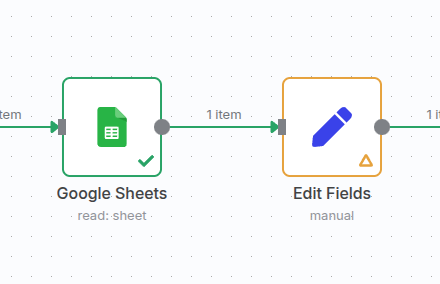
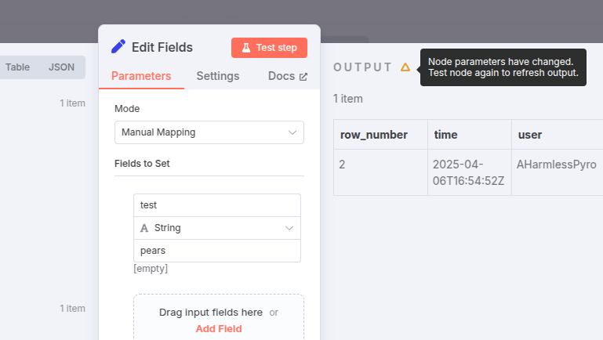
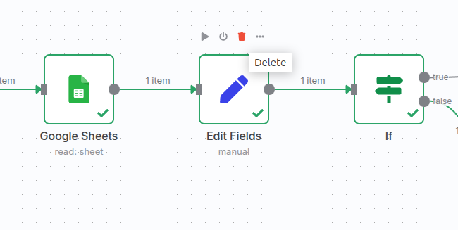
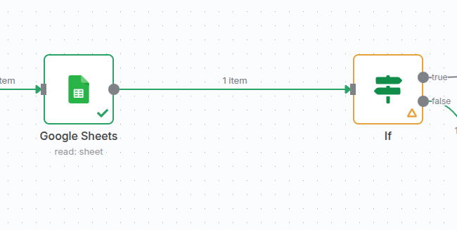
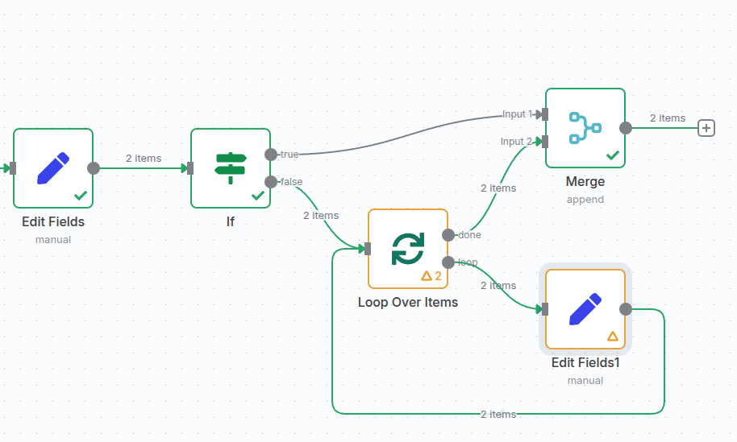

<!-- 简体中文翻译；来源 n8n-io/n8n-docs；原文版本见 upstream.json。 -->

# 脏节点 

**脏节点（dirty node）** 是指过去曾成功执行，但当前输出被 n8n 视为过期或不可靠的节点。此标记表示如果再次执行节点，输出可能不同。它也可能成为[部分执行](types-of-executions.md#partial-executions)的起点。

## 如何识别脏节点数据 

在工作流编辑器的画布中，脏节点的边框颜色与其他节点不同，原先的绿色勾号会被黄色三角形替代。例如：

在节点编辑器视图中，输出面板也会显示黄色三角形。将鼠标悬停在三角形上，会出现提示，进一步说明 n8n 为何认为数据已过期：

## n8n 为什么将节点标记为脏节点 

n8n 可能因多种原因将执行数据标记为过期，例如：

- 插入或删除节点：将该位置之后的第一个节点标记为脏节点。
- 修改节点参数：将修改的节点标记为脏节点。
- 添加连接：将新连接的目标节点标记为脏节点。
- 停用节点：将停用节点之后的第一个节点标记为脏节点。

n8n 将节点标记为脏节点的其他原因

- 取消固定节点：将该节点标记为脏节点。
- 修改固定数据：将固定数据之后的节点标记为脏节点。
- 如果上述任意操作发生在循环内部，也会将循环的第一个节点标记为脏节点。

对于子节点，发生以下情况时，还会将已执行的所有父节点（一直到根节点，含根节点）标记为脏节点：

- 编辑已执行的子节点
- 添加新子节点
- 断开或删除子节点
- 停用子节点
- 激活子节点

-   删除工作流中已连接的节点时：

    

-   序列中的下一个节点变为脏节点：

    

使用循环（通过 [Loop over Items](../../../integrations/builtin/core-nodes/n8n-nodes-base.splitinbatches.md) 节点）时，只要循环内任意节点为脏节点，循环的起始节点也会被视为脏节点：

## 清除脏节点状态 

重新执行节点即可清除其脏节点状态。可以手动触发整个工作流，也可以在该节点或后续任意节点上选择 **Execute step（执行步骤）**，进行[部分执行](types-of-executions.md#partial-executions)。

## 相关资源 

* [理解执行](./)
* [手动执行、部分执行与生产执行](types-of-executions.md)
* [查看所有执行](view-all-executions.md)
* [查看单个工作流的执行](view-executions-for-a-single-workflow.md)
* [调试并重新运行以往执行](debug-executions.md)
* [自定义执行数据](customize-executions-data.md)
* [流式传输实时响应](stream-real-time-responses.md)
