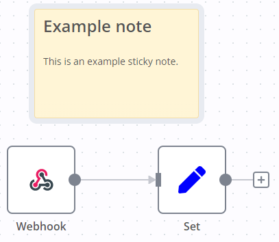
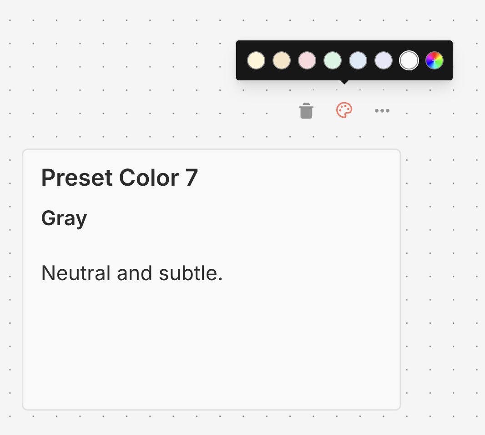

<!-- 简体中文翻译；来源 n8n-io/n8n-docs；原文版本见 upstream.json。 -->


# 添加笔记和说明 <a id="add-notes-and-documentation"></a>

便笺可以为工作流添加注释和说明。

n8n 建议在模板工作流[^1]中使用便笺，帮助其他用户理解工作流。



## 创建便笺 <a href="#create-a-sticky-note" id="create-a-sticky-note"></a>

便笺属于核心节点。添加新便笺的步骤如下：

1. 打开节点面板。
2. 搜索 `note`。
3. 点击 **Sticky Note（便笺）** 节点。n8n 会向画布添加一张新便笺。

## 编辑便笺 <a href="#edit-a-sticky-note" id="edit-a-sticky-note"></a>

1. 双击要编辑的便笺。
2. 编写笔记。[本指南](https://commonmark.org/help/)介绍如何使用 Markdown 设置文本格式。n8n 使用实现了 CommonMark 规范的 [markdown-it](https://github.com/markdown-it/markdown-it)。
3. 点击便笺外部，或按 `Esc`，结束编辑。

## 更改颜色 <a href="#change-the-color" id="change-the-color"></a>

更改便笺颜色的步骤如下：

1. 将鼠标悬停在便笺上。
2. 选择 **Change color（更改颜色）** 。
3. 从七种预设颜色中选择，或点击彩虹渐变按钮选择自定义颜色。



### 自定义颜色 <a href="#custom-colors" id="custom-colors"></a>

除七种预设颜色外，还可以为便笺选择任意自定义颜色：

1. 点击带有彩虹渐变和加号图标的按钮。
2. 使用颜色选择器选择所需颜色，或输入十六进制颜色代码，例如 `#FF5733`。
3. 点击 **Apply（应用）** 设置颜色。

n8n 会自动保存最近使用的自定义颜色（最多八种），并将其显示在颜色选择器中，方便快速选用。

自定义颜色配有随主题调整的边框，在浅色和深色模式下都会自动调整，以保持清晰可见。

## 调整便笺位置 <a href="#sticky-note-positioning" id="sticky-note-positioning"></a>

你可以：

* 将便笺拖动到画布上的任意位置。
* 将便笺拖动到节点后方，以此在视觉上将节点分组。
* 将鼠标悬停在便笺边缘，再拖动以调整大小。
* 更改颜色：选择 **Options（选项）** 菜单 ，打开颜色选择器。

## 使用 Markdown 编写内容 <a href="#writing-in-markdown" id="writing-in-markdown"></a>

便笺支持 Markdown 格式。本节介绍一些常用写法。

```
The text in double asterisks will be **bold**

The text in single asterisks will be *italic*

Use # to indicate headings:
# This is a top-level heading <a href="#this-is-a-top-level-heading" id="this-is-a-top-level-heading"></a>
## This is a sub-heading <a href="#this-is-a-sub-heading" id="this-is-a-sub-heading"></a>
### This is a smaller sub-heading <a href="#this-is-a-smaller-sub-heading" id="this-is-a-smaller-sub-heading"></a>

You can add links:
[Example](https://example.com/)

Create lists with asterisks:

* Item one
* Item two

Or created ordered lists with numbers:

1. Item one
2. Item two
```

详细指南请参阅 [CommonMark 帮助](https://commonmark.org/help/)。n8n 使用实现了 CommonMark 规范的 [markdown-it](https://github.com/markdown-it/markdown-it)。

## 让图片占满宽度 <a href="#make-images-full-width" id="make-images-full-width"></a>

在文件名后添加 `#full-width`，可以强制图片宽度为便笺宽度的 100%：

```markdown

```

## 嵌入 YouTube 视频 <a href="#embed-a-youtube-video" id="embed-a-youtube-video"></a>

要在便笺中显示 YouTube 视频，使用 `@[youtube](<video-id>)` 指令并提供视频 ID。视频创建者必须允许嵌入，此功能才能生效。

例如：

```markdown
@[youtube](ZCuL2e4zC_4)
```

要嵌入自己的视频，复制上面的语法，并将 `ZCuL2e4zC_4` 替换为你的视频 ID。YouTube 视频 ID 是 YouTube URL 中 `v=` 后面的字符串。

有关可以添加到工作流的其他元素，请参阅[工作流组件](README.md)。

[^1]: n8n 模板是由 n8n 和社区成员设计的预构建工作流，可以导入自己的 n8n 实例。使用模板时，可能需要填写凭据并按需求调整配置。

## 相关资源 <a id="related-resources"></a>

* [工作流组件](./)
* [使用节点](work-with-nodes.md)
* [连接节点](connect-nodes-together.md)
* [画布分组](canvas-groups.md)
* [查找工作流 ID](find-your-workflow-id.md)
