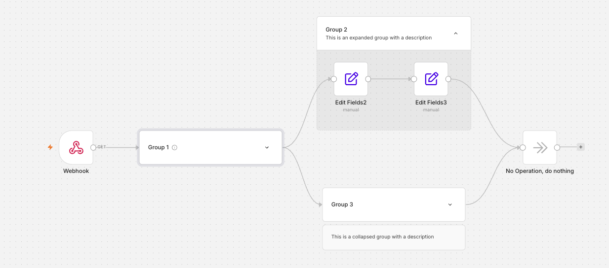

<!-- 简体中文翻译；来源 n8n-io/n8n-docs；原文版本见 upstream.json。 -->

# 画布分组 


**功能可用范围**

画布分组从 n8n 2.28.0 开始逐步推出，自 n8n 2.31.0 起在所有实例中可用。


画布分组（Canvas Groups）可以将相关节点组织成画布上的一个命名组。把负责工作流某一部分的节点编组并命名，需要更简洁的视图时即可折叠。分组结构随工作流保存，因此任何打开工作流的人都能看到相同结构。是否折叠分组属于个人偏好，保存在浏览器中。还可以为分组添加说明，让阅读工作流的人一眼就能了解这一部分的作用。

## 创建画布分组 

1. 选择要编组的节点。可以拖动选择框框选，也可以按住 `Ctrl/Cmd` 并逐个点击节点。
2. 选择选区上方工具栏中的 **Group nodes（节点编组）** 图标 ，或在选区右键菜单中选择 **Group nodes**，也可以按 `Ctrl/Cmd` + `G`。
3. n8n 会创建画布分组，并高亮名称字段，方便立即输入名称。

只有所选内容符合有效画布分组的要求时，才能编组。规则请参阅[可编组的内容](#what-you-can-group)。

## 为画布分组命名 

创建画布分组时，n8n 会自动分配默认名称（例如“Group 1”）并高亮显示。可以立即将其替换为更具描述性的名称，也可以保留建议名称。

之后如需重命名，选择分组并按 `Space`，或在右键菜单中选择 **Rename group（重命名分组）**。对于展开的分组，名称会高亮显示，可以直接编辑；对于折叠的分组，会打开名称编辑对话框。也可以直接点击展开分组的名称进行编辑。点击分组外任意位置即可保存。分组名称不能为空。

## 为画布分组添加说明 

可以为画布分组添加最多 145 个字符的说明，让阅读者无需展开就能了解这一部分工作流的作用。说明随工作流保存，创建分组副本或复制粘贴分组时也会保留。

展开的画布分组会在名称下方显示说明。点击 **Add description（添加说明）**，输入内容后按 `Enter` 保存。

折叠的画布分组会在名称旁显示信息图标。将鼠标悬停在图标上即可阅读说明。

要让说明保持显示而无需悬停，可以选择说明卡片上的眼睛图标，将其固定打开；也可以右键点击分组，选择 **Show group description（显示分组说明）**。要同时显示或隐藏所有说明，使用画布右键菜单中的 **Show group descriptions（显示分组说明）** / **Hide group descriptions（隐藏分组说明）**。与折叠状态一样，说明的可见性属于保存在浏览器中的个人偏好。

当缩放比例足够小时（大约低于三分之二），说明会隐藏。如果导入的工作流包含超过 145 个字符的说明，n8n 会截短说明并显示警告。

## 折叠和展开画布分组 

折叠画布分组可以隐藏内部节点，只显示名称，以及已有的说明（请参阅[为画布分组添加说明](#add-a-description-to-a-canvas-group)）。这样可以将大型工作流简化为更易读的视图。

点击画布分组的标题即可折叠或展开。要同时操作多个分组，可以使用画布右键菜单中的 **Expand all groups（展开所有分组）** / **Collapse all groups（折叠所有分组）**；也可以按 `Alt` + `G` 展开，按 `Shift` + `Alt` + `G` 折叠。选中分组或组内节点时，快捷键只作用于对应分组；未选中任何内容时，作用于所有画布分组。

n8n 会记住已展开的画布分组，重新打开工作流时保留相同视图。此偏好保存在浏览器中，仅属于当前用户和设备，不随工作流保存，也不会同步到其他浏览器或其他用户。

## 取消编组 

要将画布分组还原为独立节点，选择分组上方的 **Ungroup（取消编组）** 图标 ，或在右键菜单中选择 **Ungroup nodes（取消节点编组）**，也可以按 `Ctrl/Cmd` + `Shift` + `G`。节点会保留在画布上。

## 上下文菜单中的分组操作 

右键点击画布分组，打开其上下文菜单。顶部是 **Rename group（重命名分组）** 和 **Ungroup nodes（取消节点编组）**，之后是与多节点选区相同的操作，但名称针对分组调整，例如 **Copy group（复制分组）**、**Delete group（删除分组）** 等。折叠的分组也支持此菜单，操作会作用于组内隐藏的节点。

右键点击画布空白处，可以使用 **Expand all groups（展开所有分组）** 和 **Collapse all groups（折叠所有分组）**。如果选区包含分组，上下文菜单会改为提供 **Expand selected（展开选中分组）** 和 **Collapse selected（折叠选中分组）**。

## 可编组的内容 

并非所有选区都能成为画布分组。选择节点后，n8n 会检查若干规则，仅在全部满足时显示 **Group nodes（节点编组）** 图标 。如果图标未出现，请检查选区是否满足以下规则：

- 节点尚未属于其他画布分组。
- 选区不包含触发器节点。触发器确定工作流的起点，必须保留在画布分组之外。
- 节点形成一条相连的链。不能把彼此不相邻的节点添加到同一个画布分组。
- 画布分组外的节点只能连接其第一个或最后一个节点，不能直接连接中间节点。
- AI 节点及其子节点（聊天模型、记忆和工具）必须位于同一个画布分组中。子节点连接不能跨越分组边界。
- 选区至少包含两个项目。不能创建只包含单个节点的画布分组。
- 便笺可以与节点一起加入画布分组。

如果保存的工作流包含不符合这些规则的画布分组（例如导入在其他地方编辑过的工作流后），n8n 会在保存工作流时自动取消这些分组，并显示警告。节点会保留在画布上。

## 只读工作流中的画布分组 

工作流以只读方式显示时，例如在工作流历史或共享视图中，画布分组默认展开，方便查看整个工作流。

## 键盘快捷键 

| 操作 | 快捷键 |
| ------ | -------- |
| 将选中节点编组 | `Ctrl/Cmd` + `G` |
| 取消选中节点的编组 | `Ctrl/Cmd` + `Shift` + `G` |
| 展开画布分组（选中的分组或全部分组） | `Alt` + `G` |
| 折叠画布分组（选中的分组或全部分组） | `Shift` + `Alt` + `G` |
| 重命名选中的画布分组 | `Space` |

## 相关资源 

* [工作流组件](./)
* [使用节点](work-with-nodes.md)
* [连接节点](connect-nodes-together.md)
* [添加笔记和说明](add-notes-and-documentation.md)
* [查找工作流 ID](find-your-workflow-id.md)
