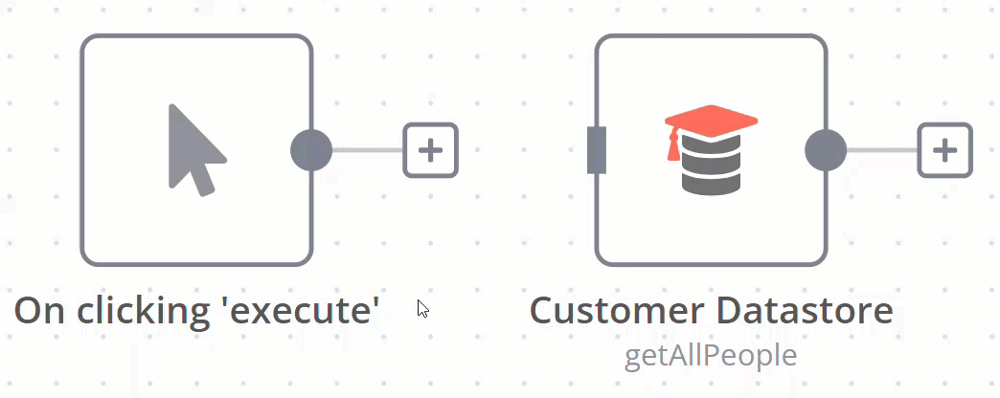

<!-- 简体中文翻译；来源 n8n-io/n8n-docs；原文版本见 upstream.json。 -->

# 连接节点 

连接在节点之间建立链接，让数据在工作流中流转。两个节点之间的连接会将数据从一个节点的输出传递到另一个节点的输入。

## 创建连接 

要连接两个节点，选择节点右侧的灰点或 **Add node（添加节点）** ，将箭头拖动到下一个节点左侧的灰色矩形上。

## 删除连接 

将鼠标悬停在连接上，再选择 **Delete（删除）** 。

## 相关资源 

* [工作流组件](./)
* [使用节点](work-with-nodes.md)
* [添加笔记和说明](add-notes-and-documentation.md)
* [画布分组](canvas-groups.md)
* [查找工作流 ID](find-your-workflow-id.md)
