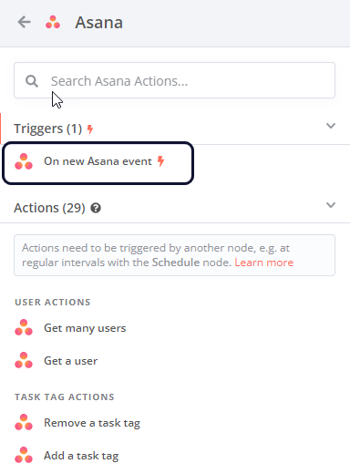

<!-- 简体中文翻译；来源 n8n-io/n8n-docs；原文版本见 upstream.json。 -->

# 使用节点 

节点[^1]是工作流[^2]的核心构建模块，可以执行多种操作，包括：

* 启动工作流。
* 获取和发送数据。
* 处理和操作数据。

n8n 提供了一系列内置节点，也支持创建自己的节点。请参阅：

* [内置集成](../../../integrations/builtin/node-types.md)：浏览节点库。
* [社区节点](../../../integrations/community-nodes/installation-and-management/README.md)：了解如何查找和安装社区创建的节点。
* [创建节点](../../../connect/create-nodes/overview.md)：开始构建自己的节点。

## 向工作流添加节点 

### 向空工作流添加节点 

1. 选择 **Add first step（添加第一步）**。n8n 会打开节点面板，可以在其中搜索或浏览[触发器节点](#user-content-fn-3)[^3]。
2. 选择要使用的触发器。 

    

<strong>选择正确的应用事件</strong>

如果选择 <strong>On App Event（应用事件发生时）</strong>，n8n 会列出所有支持的服务。通过此列表，可以浏览 n8n 集成，并让工作流在所选服务发生事件时触发。并非所有集成都提供触发器。要查看某个节点是否可以用作触发器，请选择该节点。如果有触发器，它会显示在可用操作列表的顶部。

例如，以下是 Asana 的触发器：

### 向现有工作流添加节点 

选择 **Add node（添加节点）**  连接点。n8n 会打开节点面板，可以在其中搜索或浏览所有节点。



## 节点控件 

要查看节点控件，将鼠标悬停在画布上的节点上：

* **Execute step（执行步骤）** ：运行节点。
* **Deactivate（停用）** ：停用节点。
* **Delete（删除）** ：删除节点。
* **Node context menu（节点上下文菜单）** ：选择节点操作。可用操作包括：
  * Open node（打开节点）
  * Execute step（执行步骤）
  * Rename node（重命名节点）
  * Deactivate node（停用节点）
  * Pin node（固定节点）
  * Copy node（复制节点）
  * Duplicate node（创建节点副本）
  * Tidy up workflow（整理工作流）
  * Convert node to sub-workflow（将节点转换为子工作流）
  * Select all（全选）
  * Clear selection（清除选择）
  * Delete node（删除节点）

## 节点设置 

通过 **Settings（设置）** 标签页中的节点设置，可以控制节点行为并添加节点备注。

启用或设置后，各选项的作用如下：

* **Always Output Data（始终输出数据）**：即使节点在执行时没有返回数据，也会返回一个空数据项。在 IF 节点上启用此选项时需谨慎，否则可能导致无限循环。
* **Execute Once（仅执行一次）**：节点使用收到的第一个数据项执行一次，不处理其他数据项。
* **Retry On Fail（失败时重试）**：执行失败时，节点会重新运行，直到成功。
* **On Error（发生错误时）**：
  * **Stop Workflow（停止工作流）**：发生错误时停止整个工作流，不再执行后续节点。
  * **Continue（继续）**：忽略错误，使用最后的有效数据继续执行下一个节点。
  * **Continue (using error output)（继续并使用错误输出）**：继续执行工作流，将错误信息传递给下一个节点，以便后续处理。
* **Custom Span Attributes（自定义 Span 属性）**：为节点的 OpenTelemetry Span 添加自定义键值属性。键为纯文本，值支持表达式。仅在启用 OpenTelemetry 跟踪且拥有自托管 Enterprise 许可证时显示此设置。详情请参阅[自定义 Span 属性](../../../deploy/host-n8n/keep-n8n-running/trace-executions-with-opentelemetry.md#custom-span-attributes)。

可以使用节点备注为工作流添加说明：

* **Notes（备注）**：随节点一起保存的备注。
* **Display note in flow（在流程中显示备注）**：启用后，n8n 会在工作流中以副标题形式显示备注。

[^1]: 在 n8n 中，节点是组成工作流的独立组件。节点用于定义工作流何时运行，获取、发送和处理数据，定义流程控制逻辑，以及连接外部服务。
[^2]: n8n 工作流由一组节点组成，用于自动化处理流程。触发条件满足时，工作流开始执行，并按顺序运行节点以完成复杂任务。

[^3]: 触发器节点是一种特殊节点，负责在特定条件满足时启动工作流。所有生产工作流都至少需要一个触发器，以确定何时运行。

## 相关资源 

* [工作流组件](./)
* [连接节点](connect-nodes-together.md)
* [添加笔记和说明](add-notes-and-documentation.md)
* [画布分组](canvas-groups.md)
* [查找工作流 ID](find-your-workflow-id.md)
