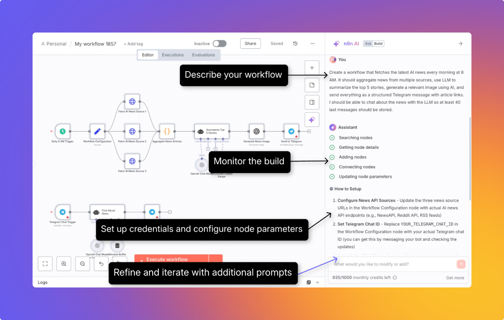

<!-- 简体中文翻译；来源 n8n-io/n8n-docs；原文版本见 upstream.json。 -->

# 使用 AI 工作流构建器 

AI 工作流构建器（AI Workflow Builder）可以根据你用自然语言描述的目标，创建、改进和调试工作流。

它负责整个工作流构建过程，包括节点选择、布局和配置，从而缩短构建可用工作流所需的时间。

AI 工作流构建器的价格和可用范围，请参阅 [n8n 套餐与定价](https://n8n.io/pricing/)。

## 使用构建器 

1. **描述工作流：** 选择示例提示词，或用自然语言描述需求。
2. **观察构建过程：** 构建器会在多个阶段提供实时反馈。
3. **检查并改进生成的工作流：** 检查所需凭据和其他参数，使用提示词进一步改进工作流。

    

### 构建器中可运行的命令 

* `/clear`：清空大语言模型的上下文，让你重新开始。

## 理解额度 

### 额度如何计算 

每次向构建器发送消息，要求创建或修改工作流，都计为一次**交互**，消耗一个**额度**。

✅ **计为交互**

* 发送消息创建新工作流
* 要求构建器修改已有工作流
* 工作流构建完成后，点击构建器窗口中的 **Execute and refine（执行并改进）** 按钮

❌ **不计为交互**

* 失败或产生生成错误的消息
* 点击停止按钮手动中止的请求

### 获取更多额度 

如果已用完每月额度，可以升级到更高套餐。

套餐和价格详情，请参阅 [n8n 套餐与定价](https://n8n.io/pricing/)。

## AI 模型和数据处理 

以下数据会发送给大语言模型：

* 你为创建、改进或调试工作流提供的文本提示词
* 节点定义、参数、连接以及当前工作流定义。
* 使用构建器时加载的任何模拟执行数据

以下数据不会发送：

* 所用凭据的详细信息
* 工作流以往的执行记录
