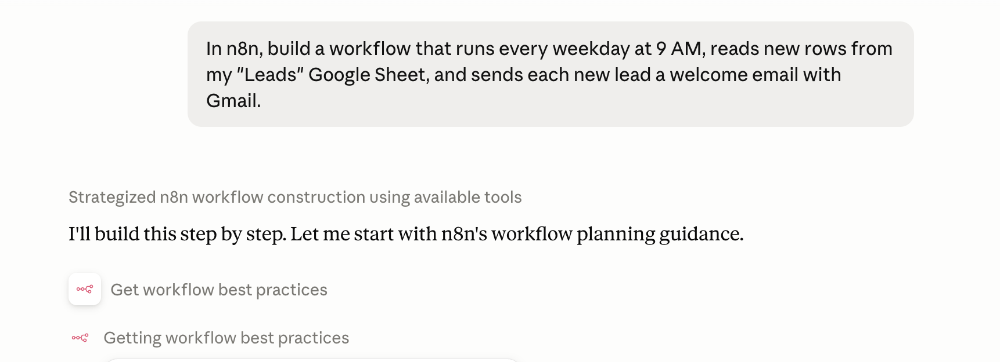

<!-- 简体中文翻译；来源 n8n-io/n8n-docs；原文版本见 upstream.json。 -->

# 使用 n8n MCP 服务器 

模型上下文协议（Model Context Protocol，MCP）是 AI 工具连接其他应用的标准方式。n8n 内置 MCP 服务器，因此可以在喜欢的 AI 工具中（如 Claude、ChatGPT 或编程智能体）描述所需工作流，让工具直接连接 n8n 实例，代为构建和运行。

本页概述在 n8n 中使用 MCP 构建工作流的方式。设置、身份验证和客户端配置，请按照**连接**分区的 MCP 指南操作。


**准备开始设置？** 完整操作指南位于“连接”分区：

* [连接 n8n MCP 服务器](../../connect/connect-to-n8n-mcp-server.md)：启用服务器、验证客户端身份并开放工作流。
* [MCP 服务器工具参考](../../connect/connect-to-n8n-mcp-server/mcp-server-tools-reference.md)：MCP 客户端可以调用的所有工具。


## 什么是 MCP？ 

模型上下文协议（MCP）是连接 AI 应用与外部系统的开放标准，定义了两种角色：

* **MCP 服务器**提供一组工具和资源。n8n 内置 MCP 服务器，让 AI 应用能够与 n8n 工作流及资源交互。
* **MCP 客户端**（例如 Claude Desktop、Claude Code、Codex 或自定义智能体）连接该服务器，并代表你调用工具。

## 在 n8n 中使用 MCP 构建意味着什么 

将 AI 工具连接到 n8n MCP 服务器后，n8n 实例就成为该工具可以直接构建内容的地方。无需手动将节点拖到画布并连接，只要用自然语言向喜欢的 AI 工具描述所需工作流，它就会在 n8n 中代为构建。

* 根据描述**创建新工作流**，并**编辑已有工作流**（从 n8n 2.13 起）。
* **构建和管理数据表**，在工作流之间存储和复用数据。
* **边构建边迭代：** 运行和测试已构建内容，查看结果并改进，全程在同一次对话中完成，无需切回编辑器。
* **搜索和运行**你已有权限访问的工作流。
* **遵循你的偏好：** 客户端在构建前读取已保存的[偏好](../agentic-context-management/preferences.md)，当你提出长期适用的规则时，也可以保存新偏好（从 n8n 2.42.0 起，处于预览阶段）。

[启用实例级 MCP](../../connect/connect-to-n8n-mcp-server.md#enabling-mcp-access)，即可从 AI 应用开始构建、测试和运行 n8n 工作流。

### 相关 MCP 功能 

实例级 MCP 并不是 n8n 使用 MCP 的唯一方式：

* [**MCP Server Trigger 节点**](../../integrations/builtin/core-nodes/n8n-nodes-langchain.mcptrigger.md)**：** 构建一个作为独立 MCP 服务器的工作流，只开放你在其中设计的工具。可用于精心定制供其他 AI 应用调用的 MCP 服务器。
* [**MCP Client Tool 节点**](../../integrations/builtin/cluster-nodes/sub-nodes/n8n-nodes-langchain.toolmcp.md)**：** 反向使用，让 n8n 工作流充当 MCP 客户端，调用外部 MCP 服务器。

## 了解更多 

* [连接 n8n MCP 服务器](../../connect/connect-to-n8n-mcp-server.md)：设置实例级 MCP 访问、验证客户端身份（OAuth 或 API 密钥），以及开放工作流。
* [MCP 客户端连接示例](../../connect/connect-to-n8n-mcp-server/mcp-client-examples.md)：Lovable、Claude Desktop、Claude Code、Codex、Gemini CLI、Cursor、VS Code、Windsurf 和 Google ADK 智能体的具体命令与配置。
* [MCP 服务器工具参考](../../connect/connect-to-n8n-mcp-server/mcp-server-tools-reference.md)：所有可用工具及其参数。
* [MCP Server Trigger 节点](../../integrations/builtin/core-nodes/n8n-nodes-langchain.mcptrigger.md)：开放单个工作流中的工具。

## 相关资源 

* [构建工作流的方式](./)
* [使用 n8n Assistant](n8n-assistant.md)
* [使用模板](use-templates.md)
* [使用 Ask n8n AI](use-the-ai-assistant.md)
* [使用 Chat Hub](chat-hub.md)
