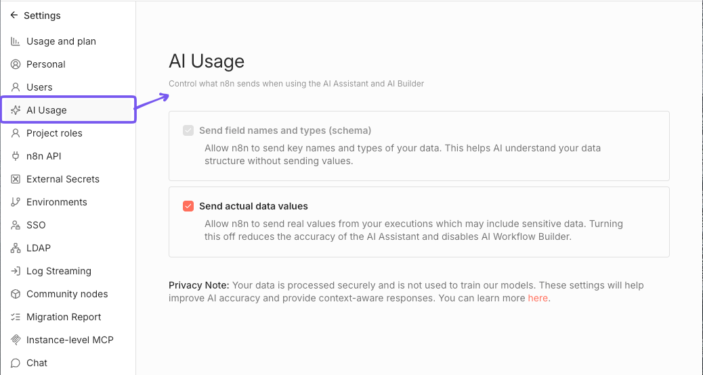

<!-- 简体中文翻译；来源 n8n-io/n8n-docs；原文版本见 upstream.json。 -->

# Ask n8n AI 

Ask n8n AI 帮助你构建、调试和优化工作流。从回答 n8n 问题，到提供代码和表达式[^1]帮助，它可以协助你使用 n8n 的各项能力。


Ask n8n AI 是 n8n 内置的帮助助手，目前不再积极开发。要通过聊天构建、编辑和运行工作流，请参阅[使用 n8n Assistant](n8n-assistant.md)。


## 当前能力 

Ask n8n AI 提供一系列辅助工具：

* **调试帮助**：识别和排查工作流中的节点执行问题，帮助保持正常运行。
* **回答 n8n 问题**：即时回答与 n8n 相关的问题，包括具体功能和一般能力。
* **代码支持**：提供 SQL、JSON 等代码指导，优化节点和数据处理。
* **表达式帮助**：学习如何创建和改进[表达式](../work-with-data/expressions-versus-data-nodes.md)，充分发挥工作流能力。
* **凭据设置建议**：了解如何安全、高效地设置和管理节点[凭据](../../integrations/builtin/credentials/README.md)。

## 充分利用助手的建议 

1. **展开对话**：Ask n8n AI 可以与你逐步协作。如果建议不符合需求，直接告诉它。提供的上下文越充分，建议就越有针对性。
2. **提出具体问题**：尽量聚焦，例如“如何为 Google Sheets 设置凭据？”。清晰的问题能让助手更好地发挥作用。
3. **迭代建议**：可以在回复基础上继续完善。尝试不同方法，根据反馈不断改进，逐步接近理想方案。
4. **可以尝试**：
   * 调试遇到的错误
   * 询问如何设置凭据
   * “解释这个工作流的作用。”
   * “我需要你帮忙编写代码：\[在此说明代码需求]”
   * “如何在 n8n 中构建 X？”

## AI 使用设置 


**功能可用范围**

AI 使用设置从 n8n 2.7.0 起可用。


在 n8n 实例中，进入 **Settings（设置）** > **AI Usage（AI 使用）**，即可管理 AI 使用设置，控制向 Ask n8n AI 共享哪些数据。

这些设置仅对实例所有者和管理员开放，并适用于实例上的所有用户。

选择是否向 Ask n8n AI 共享实际工作流数据，例如节点名称、参数和结构。禁用此选项会限制助手根据工作流上下文提供帮助的能力。

AI 工作流构建器必须访问工作流数据才能运行，因此**禁用此选项也会禁用 AI 工作流构建器功能**。

### 禁止发送数据 

要停止向 Ask n8n AI 发送实际数据值，在 **AI Usage（AI 使用）** 设置页面关闭 **Send actual data values（发送实际数据值）** 复选框。

## 常见问题 

### 助手可以获取哪些上下文？ 

Ask n8n AI 可以访问 n8n 屏幕上显示的所有元素，但不包括客户信息等实际输入和输出数据值。n8n 向其共享哪些数据的更多信息，请参阅 [n8n 中的 AI](../../privacy-and-security/README.md#ai-in-n8n)。

### 谁可以使用助手？ 

所有 n8n Cloud 套餐均可使用助手，自托管环境不提供。

### 助手如何工作？ 

助手的底层逻辑使用 n8n 的高级 AI 能力构建，结合了专注于 n8n 不同领域的多个智能体[^2]、从文档和社区论坛收集知识的 RAG，以及自定义提示词、记忆[^3]和上下文。

[^1]: 在 n8n 中，表达式通过执行 JavaScript 代码动态填充节点参数。你可以使用 n8n 表达式语法，根据前面节点、其他工作流或 n8n 环境中的数据定义值，而不是提供静态值。
[^2]: AI 智能体是能够响应请求、作出决策并代表用户执行现实任务的人工智能系统。它们使用大语言模型（LLM）理解用户输入，并利用可用信息和资源，决定如何处理请求。
[^3]: 在 AI 场景中，记忆让工具能够在多次交互之间保留消息上下文。例如，可以与 AI 智能体持续对话，而无需每条消息都重新提交上下文。在 n8n 中，AI 智能体节点可以使用记忆，但 AI 链不能。

## 相关资源 

* [构建工作流的方式](./)
* [使用 n8n Assistant](n8n-assistant.md)
* [使用 n8n MCP 服务器](connect-to-n8n-mcp-server.md)
* [使用模板](use-templates.md)
* [使用 Chat Hub](chat-hub.md)
