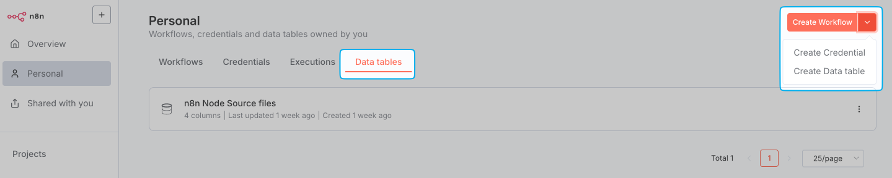

<!-- 简体中文翻译；来源 n8n-io/n8n-docs；原文版本见 upstream.json。 -->

# 数据表 

## 概述 

数据表将数据存储整合进 n8n 环境，让你无需依赖外部数据库，就能直接在工作流中保存、管理和操作数据，适用于以下场景：

- 在同一项目的工作流之间持久保存数据
- 保存标记，防止重复运行或控制工作流触发
- 在工作流之间复用提示词或消息
- 保存 AI 工作流的评估数据
- 保存工作流执行生成的数据
- 结合不同来源的数据，丰富数据集
- 创建查询表，为工作流提供快速参考

## 使用数据表 

可以通过三种方式创建、筛选和管理数据表及其数据：**Data Table 节点**、**DataTable API 端点**和 **Data tables（数据表）标签页**。

### Data Table 节点 

在工作流内使用数据表保存和管理数据，随工作流运行自动创建、查询、更新和删除数据。

完整说明请参阅 [Data Table 节点](../../integrations/builtin/core-nodes/n8n-nodes-base.datatable/README.md)。

### DataTable API 端点 

通过 n8n API 的 `/datatables` 端点，以编程方式操作数据表。

完整说明请参阅 [API 参考](../../connect/n8n-api/data-table.md)。

### 数据表标签页 

通过可视化界面直接查看和操作数据表，无需构建工作流，即可浏览、编辑数据并管理表。

1. 在 n8n 项目中，选择 **Data tables（数据表）** 标签页。
2. 点击右上角的分段按钮，选择 **Create Data table（创建数据表）**。

    

3. 输入具有描述性的表名。

4. 选择创建方式：
    - **From scratch（从头创建）**：通过可视化界面手动定义列并添加行。
    - **Import CSV（导入 CSV）**：上传 CSV 文件，自动创建表结构并填入文件数据。
   
    在随后显示的表格视图中，可以：
    
    * 重命名或删除数据表及其列
    * 添加列并调整顺序，组织数据
    * 添加、删除和更新行
    * 编辑已有数据
    * [收藏数据表](../manage-workflows/favorite-items.md)，方便快速访问

## 导出和导入数据 

在 **Data tables（数据表）** 标签页中，可以：

- 按[上一节](#data-table-tab)所述，将 CSV 数据直接导入数据表
- 下载数据表的 CSV 文件。点击左上角三点菜单，选择 **Download CSV（下载 CSV）**。

## 数据表的注意事项与限制 

- 数据表适合轻到中等规模的数据存储。默认情况下，实例内所有数据表的总存储上限为 200 MiB。自托管环境可以通过 `N8N_DATA_TABLES_MAX_SIZE_BYTES` 环境变量修改。
- 数据表接近存储上限的 80% 时，n8n 会显示警告。达到上限时会显示最后警告。超出上限后，将无法手动添加表数据，工作流尝试插入或更新数据时也会出现执行错误。
- 默认情况下，项目中创建的数据表对该项目的所有团队成员可用。
- 管理员和所有者可以查看所有用户的数据表。
- 不支持从 Code 节点直接以编程方式访问数据表，也不能通过内置方法或变量访问数据表值。

## 数据表与变量 

| 功能 | 数据表 | 变量 |
|---------|-------------|-----------|
| 统一表格视图 | ✓ | ✗ |
| 行列关系 | ✓ | ✗ |
| 跨项目访问 | ✗ | ✓ |
| 单值显示 | ✗ | ✓ |
| 针对短值优化 | ✗ | ✓ |
| 结构化数据 | ✓ | ✗ |
| 限定在项目内 | ✓ | ✗ |
| 将值用于表达式 | ✗ | ✓ |

译注：本表关于变量不支持项目作用域的说法，与同一原文版本中的“自定义变量”章节存在差异。该章节说明，自 n8n 1.118.0 起支持仅在指定项目内可用的项目变量。此处保留原表，并提示这一差异。

## 相关资源 

* [处理数据](./)
* [理解 n8n 的数据结构](understand-n8ns-data-structure.md)
* [表达式与数据节点](expressions-versus-data-nodes.md)
* [引用数据](reference-data/README.md)
* [转换数据](transform-data/README.md)
* [过滤不需要的数据](filter-out-unwanted-data.md)
* [固定和模拟数据](pin-and-mock-data.md)
* [处理特殊数据类型](handle-special-data-types/README.md)
