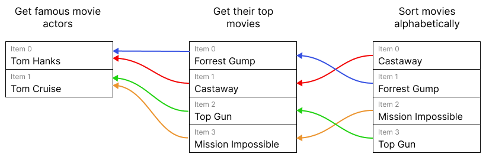

<!-- 简体中文翻译；来源 n8n-io/n8n-docs；原文版本见 upstream.json。 -->

# 数据项关联错误 

在 n8n 中，可以引用任意前面节点的数据，不必是紧邻前一节点，也可以是链上更早的节点。引用较早节点时，使用表达式语法 `$(node_name).item`。

<figure markdown>

<figcaption markdown>不同数据项的关联链示意图。通过数据项关联，可以使用 `$('Get famous movie actors').item` 获取每部电影对应的演员。</figcaption>
</figure>

前面节点可能包含多个数据项，因此 n8n 需要确定该使用哪一个。使用 `.item` 时，n8n 会在后台自动判断。详细机制见[数据项关联概念](how-items-link-through-workflows.md)。

信息缺失时，`.item` 会失败。为确定使用哪个数据项，n8n 为每个数据项维护一条向前回溯节点的关联链，记录前面节点的哪些数据项生成了它。查找指定前置节点的匹配数据项时，n8n 会沿链回溯，直到该节点。

使用 `.item` 时，以下情况会显示错误：

- 关联链断裂
- 关联链指向前面节点的多个数据项，无法确定该使用哪一个
- 引用节点与当前数据项位于不同分支

解决方法是避免使用 `.item`，或修复根本原因。

要避免使用 `.item`，可以改用 `.first()`、`.last()` 或 `.all()[index]`，但需要知道目标数据项在目标节点输出中的位置。各方法详见[引用前面的节点](../reference-previous-nodes.md)。

具体修复方式取决于错误。

### 修复“Info for expressions missing from previous node” 

如果看到以下错误：

> ERROR: Info for expression missing from previous node（前一节点缺少表达式所需的关联信息）

链上有节点没有返回配对信息。解决方式取决于前一节点的类型：

- Code 节点：确保返回用于生成每个输出数据项的输入数据项信息。详见[在 Code 节点中保留关联](preserving-linking-in-the-code-node.md)。
- 自定义或社区节点：节点开发者需要更新节点，返回用于生成各输出数据项的输入数据项信息。详见[节点开发者的数据项关联说明](item-linking-for-node-creators.md)。

### 修复“Multiple matching items for expression” 

错误消息如下：

> ERROR: Multiple matching items for expression（表达式存在多个匹配的数据项）

n8n 有时会用多个数据项生成单个数据项，例如 Summarize、Aggregate 和 Merge 节点，它们可以合并多个数据项的信息。

使用 `.item` 且存在多个可能匹配时，n8n 无法确定使用哪一个。可以：

- 改用 `.first()`、`.last()` 或 `.all()[index]`。各方法详见[引用前面的节点](../reference-previous-nodes.md)。
- 引用包含相同信息、但不存在多个匹配数据项的其他节点。

### 修复“Node is on another branch” 

错误消息如下：

> `ERROR: '<node-name>' is on another branch`

通过 `.item` 引用的节点位于当前节点上游，但当前数据项并非来自该节点，因此 n8n 无法将当前数据项匹配到其中某项。两个分支重新汇合、但数据项仍保持分离时，会出现这种情况。

例如，**Merge** 节点在 **Append（追加）** 模式下，先输出 **Input 1（输入 1）** 的数据项，再输出 **Input 2（输入 2）**。每个输出数据项仍只关联到一个输入。如果 **Input 2** 来自名为 **Get orders** 的节点，`{{ $('Get orders').item.json.total }}` 对来自 **Input 2** 的数据项能正常解析，对来自 **Input 1** 的数据项则会失败。

表达式会解析为 `null`，节点仍然成功，因此执行不会停止。n8n 会在编辑器的表达式预览中显示错误。

解决方法可以是：

- 使用 `.first()`、`.last()` 或 `.all()[index]` 代替 `.item`。各方法详见[引用前面的节点](../reference-previous-nodes.md)。
- 如果由 **Merge** 节点合并分支，将其设为 **Combine（组合）** 模式，让每个输出数据项都包含两个分支的数据。

## 相关资源 

* [关联数据项](./)
* [数据项如何在工作流中关联](how-items-link-through-workflows.md)
* [在 Code 节点中访问关联的数据项](accessing-linked-items-in-the-code-node.md)
* [在 Code 节点中保留关联](preserving-linking-in-the-code-node.md)
* [节点开发者的数据项关联说明](item-linking-for-node-creators.md)
