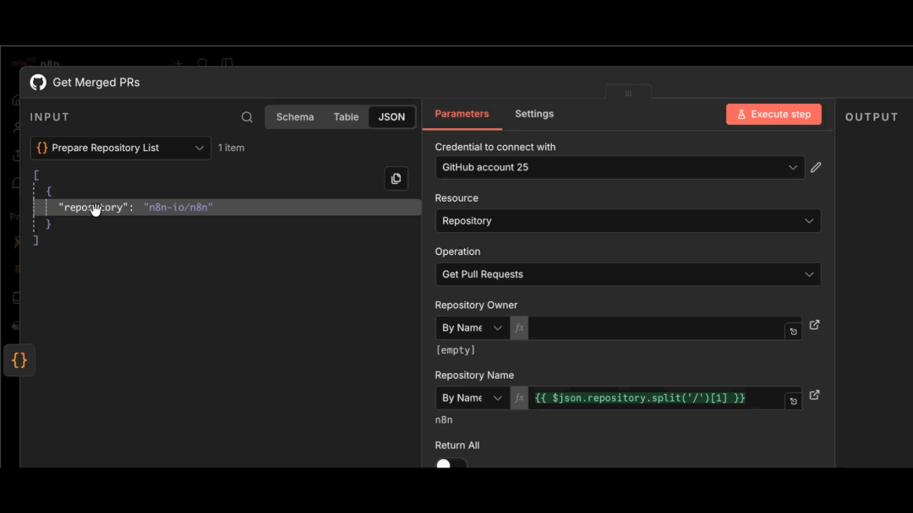

<!-- 简体中文翻译；来源 n8n-io/n8n-docs；原文版本见 upstream.json。 -->

# 在界面中引用数据 

数据映射是引用前面节点的数据，不包含修改或转换，只进行引用。

需要工作流中特定节点的数据时，可以[按名称引用节点](reference-previous-nodes.md)。工作流有多个分支，或需要访问更早步骤的数据时，这很有用。

可以通过以下方式映射数据：

* 使用表达式编辑器。
* 从 **INPUT（输入）** 面板拖动数据到节点参数，由 n8n 自动生成表达式。

映射和关联数据项的错误说明，请参阅[数据项关联错误](link-data-items/item-linking-errors.md)。

参阅[常见引用方式](reference-previous-nodes.md#common-ways-of-referencing)。

## 相关资源 

* [引用数据](./)
* [引用前面的节点](reference-previous-nodes.md)
* [关联数据项](link-data-items/README.md)
