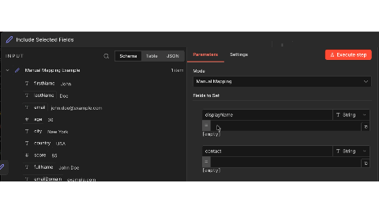

<!-- 简体中文翻译；来源 n8n-io/n8n-docs；原文版本见 upstream.json。 -->


# 使用表达式转换数据 <a href="#expressions-for-data-transformation" id="expressions-for-data-transformation"></a>

在 n8n 支持表达式的任意位置，都可以使用表达式转换函数。

如果主要目的是通过表达式转换数据，而不执行其他操作，应使用 **Edit Fields (Set)** 节点。此节点专为数据转换设计，提供清晰界面，可以：

* 添加值由表达式计算的新字段
* 通过转换函数修改已有字段值
* 移除或重命名字段

将数据转换与业务逻辑分开，可以让工作流更有条理，便于理解和维护。

**最佳实践**：先使用 Edit Fields 准备数据，再将转换后的数据传给后续节点，避免在不同节点的多个参数中添加复杂表达式。

要在界面中构建表达式，先将字段切换到表达式模式，再从 **INPUT（输入）** 面板拖入值，或直接输入表达式。



更多信息和示例请参阅[表达式参考](expression-reference/README.md)。

### 示例：从 Webhook 请求体获取数据 <a href="#example-get-data-from-webhook-body" id="example-get-data-from-webhook-body"></a>

假设 Webhook 触发器通过请求体接收数据，你希望提取其中一部分用于工作流。

Webhook 数据类似如下：


```json
[
  {
    "headers": {
      "host": "n8n.instance.address",
      ...
    },
    "params": {},
    "query": {},
    "body": {
      "name": "Jim",
      "age": 30,
      "city": "New York"
    }
  }
]
```


在工作流的下一个节点中，只需要获取 `city` 值，可以使用以下表达式：


```js
{{$json.body.city}}
```

此表达式会：

1. 使用 n8n 自定义变量 `$json` 访问传入的 JSON 数据。
2. 查找 `city` 的值，本例为“New York”。此示例通过 JavaScript 属性访问查询 JSON 数据。也可以将表达式写为 `{{$json['body']['city']}}`。

### 在凭据中使用表达式 <a href="#using-expressions-in-credentials" id="using-expressions-in-credentials"></a>

凭据字段也支持表达式。通过表达式引用数据时，例如 `{{$json.body.city}}` 或 `{{ $('Webhook').item.json.headers.authorization }}`，n8n 会在当前工作流执行的上下文中求值。

这意味着：

- 凭据中的表达式可以访问当前执行上下文中的数据，包括前面节点的数据。
- 每次工作流执行都有自己的数据上下文。
- 表达式针对每次执行分别求值，不同执行之间不会共享数据。

例如，Webhook 节点收到访问令牌后，如果在凭据字段中通过表达式引用，其值就会根据该次工作流运行的执行数据解析。

## 示例：在表达式中编写较长 JavaScript <a href="#example-writing-longer-javascript-as-expressions" id="example-writing-longer-javascript-as-expressions"></a>

表达式中可以进行变量赋值或编写多条语句，但需要使用立即调用函数表达式（IIFE）语法包裹代码。

以下代码使用 Luxon 日期时间库，计算两个日期相隔多少个月。代码同时包裹在表达式的双花括号和 IIFE 语法中。

```js
{{(()=>{
  let end = DateTime.fromISO('2017-03-13');
  let start = DateTime.fromISO('2017-02-13');
  let diffInMonths = end.diff(start, 'months');
  return diffInMonths.toObject();
})()}}
```

## 常见问题 <a href="#common-issues" id="common-issues"></a>

以下介绍与[表达式](../expressions-versus-data-nodes.md)有关的常见错误，以及解决和排查步骤。

### The 'JSON Output' in item 0 contains invalid JSON（数据项 0 的 JSON Output 包含无效 JSON） <a href="#the-json-output-in-item-0-contains-invalid-json" id="the-json-output-in-item-0-contains-invalid-json"></a>

使用 JSON 模式但未提供有效 JSON 对象时，会出现此错误。根据具体问题，有时错误显示为 `The 'JSON Output' in item 0 does not contain a valid JSON object`。

解决方法是确认提供的内容为有效 JSON：

- 使用 [JSON 验证器](https://jsonlint.com/)检查。
- 确认 JSON 对象没有引用未定义的输入数据。如果传入数据不总是包含相同字段，就可能发生这种情况。

### Can't get data for expression（无法获取表达式的数据） <a href="#cant-get-data-for-expression" id="cant-get-data-for-expression"></a>

n8n 无法获取表达式引用的数据时，会出现此错误，通常是因为前置节点尚未运行。

另一种形式可能显示为 `Referenced node is unexecuted`。此时，完整错误文本会按以下格式指出尚未执行的具体节点：

> An expression references the node '&lt;node-name&gt;', but it hasn't been executed yet. Either change the expression, or re-wire your workflow to make sure that node executes first.（表达式引用的节点“&lt;node-name&gt;”尚未执行。请修改表达式，或重新连接工作流，确保该节点先执行。）

开始排查时，先测试工作流，直到执行到指定节点。

对于使用 JavaScript 或其他自定义代码的节点，在读取前一节点的值之前，可以先通过以下方式检查它是否已执行：

```javascript
$("<node-name>").isExecuted
```

例如，以下 JSON 引用了输入数据的参数。如果未连接其他节点就测试此步骤，会出现该错误：

```javascript
{
  "my_field_1": {{ $input.params }}
}
```

### Invalid syntax（语法无效） <a href="#invalid-syntax" id="invalid-syntax"></a>

表达式存在语法错误时，会出现此错误。

例如，以下 JSON 中的表达式末尾多了一个句点，导致语法无效：

```jsx
{
  "my_field_1": "value",
  "my_field_2": {{ $('If').item.json. }}
}
```

要解决错误，请检查[表达式语法](../expressions-versus-data-nodes.md)，确保符合预期格式。

## 相关资源 <a id="related-resources"></a>

* [转换数据](./)
* [数据转换方式](approaches-for-transforming-data.md)
* [表达式参考](expression-reference/README.md)
