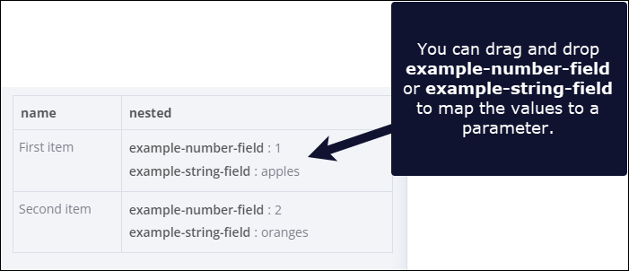

<!-- 简体中文翻译；来源 n8n-io/n8n-docs；原文版本见 upstream.json。 -->


# n8n 如何组织数据 <a href="#how-n8n-structures-data" id="how-n8n-structures-data"></a>

理解 n8n 如何组织数据及在节点之间传递数据，是构建工作流的基础。本指南介绍数据结构格式，以及数据在工作流中的流转方式。

## 数据结构 <a href="#data-structure" id="data-structure"></a>

n8n 节点间传递的所有数据都是对象数组，结构如下：

```json
[
	{
		// For most data:
		// Wrap each item in another object, with the key 'json'
		"json": {
			// Example data
			"apple": "beets",
			"carrot": {
				"dill": 1
			}
		},
		// For binary data:
		// Wrap each item in another object, with the key 'binary'
		"binary": {
			// Example data
			"apple-picture": {
				"data": "....", // Base64 encoded binary data (required)
				"mimeType": "image/png", // Best practice to set if possible (optional)
				"fileExtension": "png", // Best practice to set if possible (optional)
				"fileName": "example.png", // Best practice to set if possible (optional)
			}
		}
	},
]
```


**省略 `json` 键和数组语法**

从 0.166.0 起，使用 Function 或 Code 节点时，如果缺少 `json` 键，n8n 会自动添加；必要时，也会自动将数据项包裹在数组（`[]`）中。这仅适用于 Function 和 Code 节点。自行开发节点时，仍必须确保返回数据包含 `json` 键。


## 数据如何在节点中流转 <a href="#how-data-flows-within-nodes" id="how-data-flows-within-nodes"></a>

在工作流中连接节点后，数据会自动从一个节点传递到下一个。

节点会自动处理多个数据项。收到数据项数组时，节点会逐项处理，分别执行配置的操作。

例如，将 Trello 节点设为 `Create-Card`，并通过表达式设置 `Name`，表达式使用传入数据中的 `name-input-value` 属性时，节点会为每个数据项创建一张卡片，每次使用当前数据项的 `name-input-value`。

例如，以下输入会创建两张卡片，分别名为 `test1` 和 `test2`：

```json
[
	{
		"name-input-value": "test1"
	},
	{
		"name-input-value": "test2"
	}
]
```

## 理解拖放映射的内容 <a href="#understand-what-youre-mapping-with-drag-and-drop" id="understand-what-youre-mapping-with-drag-and-drop"></a>

数据映射会映射字段路径，并加载字段值。例如，对于以下数据：

```js
[
	{
		"fruit": "apples",
		"color": "green"
	}
]
```

将 **INPUT（输入）** 中的 **fruit** 拖到需要使用其值的字段，即可映射 `fruit`，生成表达式 `{{ $json.fruit }}`。节点遍历输入数据项时，该字段会依次使用各数据项的 `fruit` 值。

## 理解嵌套数据 <a href="#understand-nested-data" id="understand-nested-data"></a>

对于以下数据：

```js
[
  {
    "name": "First item",
    "nested": {
      "example-number-field": 1,
      "example-string-field": "apples"
    }
  },
  {
    "name": "Second item",
    "nested": {
      "example-number-field": 2,
      "example-string-field": "oranges"
    }
  }
]
```

n8n 会按如下表格显示，并将 `nested` 字段加粗，表示它包含嵌套数据：



## 相关资源 <a id="related-resources"></a>

* [处理数据](./)
* [表达式与数据节点](expressions-versus-data-nodes.md)
* [引用数据](reference-data/README.md)
* [转换数据](transform-data/README.md)
* [过滤不需要的数据](filter-out-unwanted-data.md)
* [固定和模拟数据](pin-and-mock-data.md)
* [处理特殊数据类型](handle-special-data-types/README.md)
* [数据表](data-tables.md)

