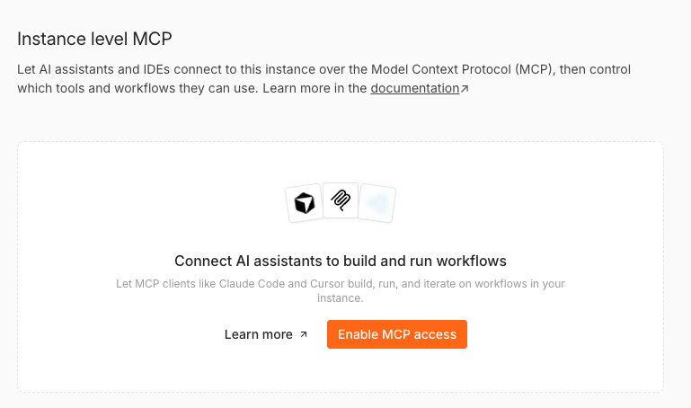
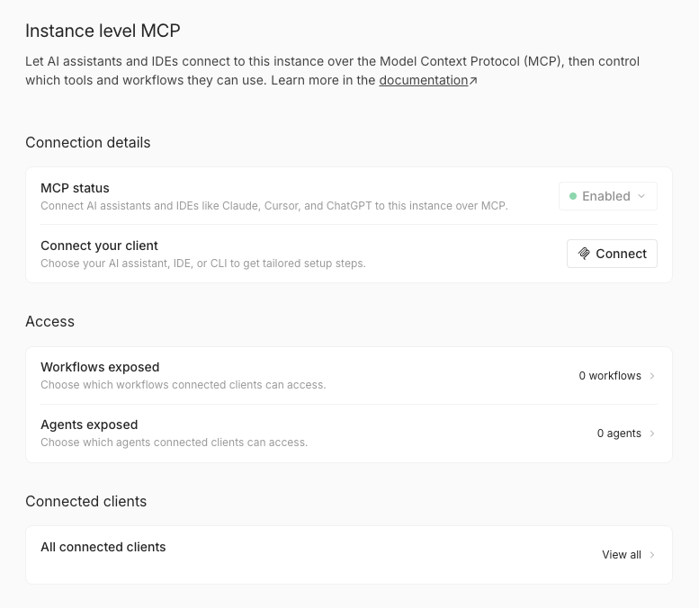
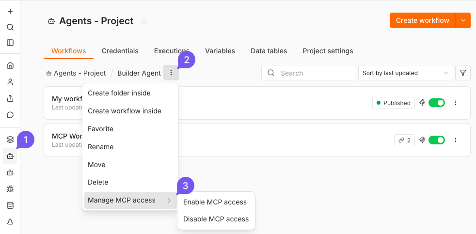
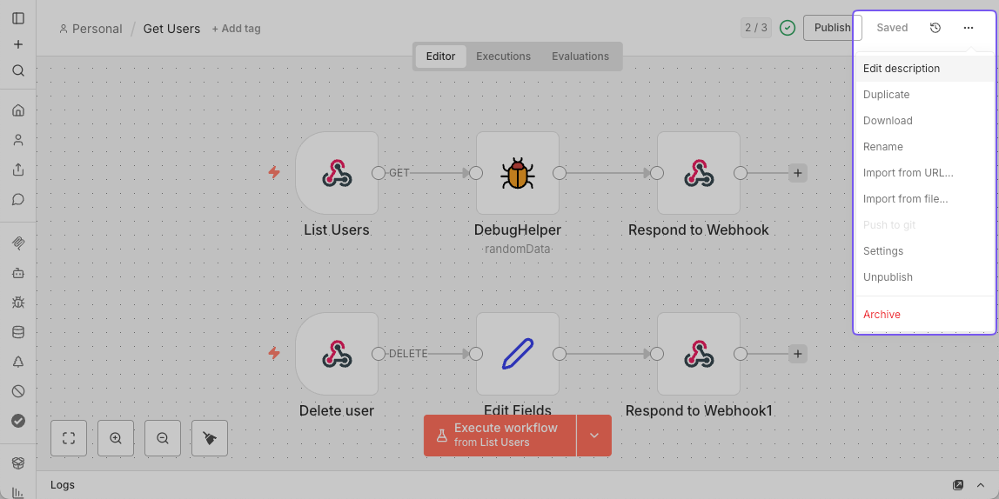

<!-- 简体中文翻译；来源 n8n-io/n8n-docs；原文版本见 upstream.json。 -->

# 连接 n8n MCP 服务器 

n8n 内置 MCP 服务器，让 Lovable、Claude Desktop 等支持的客户端能够安全连接到 n8n 实例。连接后，这些客户端可以：

* 搜索你的工作流。
* 与已标记为可在 MCP 中访问的工作流交互。
* 触发和测试已开放的工作流。
* 创建和编辑工作流及数据表。

## 本节内容 

* [MCP 客户端连接示例](connect-to-n8n-mcp-server/mcp-client-examples.md)：特定 MCP 客户端的具体命令和配置。
* [MCP 服务器工具参考](connect-to-n8n-mcp-server/mcp-server-tools-reference.md)：可用工具及其参数的完整列表。


**要连接 Claude Desktop 等聊天客户端？**

1. 在实例上[启用 MCP 访问](connect-to-n8n-mcp-server.md#enabling-mcp-access)。
2. 从 **Settings > Instance-level MCP > Connect a client**（设置 > 实例级 MCP > 连接客户端）复制 **Server URL**（服务器 URL）。它以 `/mcp-server/http` 结尾。
3. 将其粘贴到客户端。各客户端的具体步骤请参阅 [MCP 客户端连接示例](connect-to-n8n-mcp-server/mcp-client-examples.md)。

本页后续内容介绍这些步骤涉及的设置、权限及故障排查。


## 实例级 MCP 访问与 MCP Server Trigger 节点的区别 

实例级 MCP 访问允许为每个 n8n 实例创建一个连接，使用集中式身份验证，并选择开放哪些工作流。启用的工作流可以轻松发现和运行，无需逐个额外配置。

相比之下，MCP Server Trigger 节点配置在单个工作流内，只开放该工作流中的工具。当你希望在一个工作流内定制 MCP 服务器行为时，这种方式很适合。

### 使用实例级 MCP 访问的重要事项 

* MCP 支持两类工作流交互：使用工作流执行工具运行已有工作流，以及构建或编辑工作流（自 n8n 2.13.0 起提供）。
* 它不会直接开放实例中的全部工作流。必须先在实例级别启用 MCP，再逐个为工作流启用。唯一的例外是 `search_workflows`，它可访问当前用户有权查看的全部工作流，但仅返回预览，不返回完整工作流数据。
* 访问范围不按 MCP 客户端划分。所有已连接的客户端（例如 Claude Desktop 和 ChatGPT）都能看到你为 MCP 开放的全部工作流，无法将特定工作流限制给特定客户端。在用户级别，可见范围仍受用户权限限制：用户只能看到自己有权访问且已启用 MCP 的工作流。
* 大多数 MCP 工具可用于未发布的工作流，例外是 `execute_workflow`，它默认使用生产模式并运行工作流的已发布版本。它也支持 `manual` 执行模式，用于运行当前（未发布）版本。

译注：本页原文称 execute_workflow 默认使用生产模式，但同一版本的 MCP 工具参考将 executionMode 标为必填，且没有列出默认值。此处保留两处原文，调用时应显式提供所需执行模式，不据此假定省略参数后的实际行为。

## 启用 MCP 访问 


**功能可用范围**

下文介绍的设置布局（**Connection details**（连接详情）、**Access**（访问）、**Connected clients**（已连接客户端））、**Connect a client**（连接客户端）对话框和 **Allowed callback URLs**（允许的回调 URL），自 n8n 2.33.0 起提供，替代了之前的单页 MCP 设置界面。较旧版本的布局更简单，不包含按客户端区分的设置步骤。


### Cloud 与自托管实例 

1. 前往 **Settings > Instance-level MCP**（设置 > 实例级 MCP）。
2. 选择 **Enable MCP access**（启用 MCP 访问），需要实例所有者或管理员权限。

启用后，页面将设置分为三部分：

* **Connection details**（连接详情）：显示 **MCP status**（MCP 状态）和 **Connect**（连接）按钮，点击后打开所用 MCP 客户端的设置步骤。
* **Access**（访问）：显示向 MCP 客户端开放的工作流数量；如果实例具有智能体功能，也显示智能体数量。请参阅[向 MCP 客户端开放工作流](connect-to-n8n-mcp-server.md#exposing-workflows-to-mcp-clients)及[向 MCP 客户端开放智能体](connect-to-n8n-mcp-server.md#exposing-agents-to-mcp-clients)。实例所有者和管理员还会看到 **Allowed callback URLs**（允许的回调 URL），请参阅[限制 OAuth 回调 URL](connect-to-n8n-mcp-server.md#restricting-oauth-callback-urls)。
* **Connected clients**（已连接客户端）：最多预览你自己连接的三个客户端及其权限，并显示当前有权访问的客户端数量。选择客户端可打开详情，选择 **Revoke access**（撤销访问）可断开连接。选择 **View all**（查看全部），可[查看或撤销各客户端的访问](connect-to-n8n-mcp-server.md#revoking-client-access)。

**要禁用：**在 **Connection details**（连接详情）中，选择 **MCP status**（MCP 状态）控件，再选择 **Disable**（禁用）。由于禁用会断开所有已连接客户端并撤销其访问，n8n 会要求确认。之后可重新开启 MCP 访问。


**环境变量（仅自托管）**

自托管实例也可通过环境变量管理 MCP 设置，请参阅[使用环境变量管理实例设置](../deploy/host-n8n/configure-n8n/manage-settings-using-environment-variables.md#mcp)。


### 自托管：彻底禁用 

要完全移除此功能，请设置环境变量：

`N8N_DISABLED_MODULES=mcp`

此操作会移除 MCP 端点，并隐藏全部相关界面元素。

## 连接 MCP 客户端 


**功能可用范围**

自 n8n 2.33.0 起提供各客户端专用的连接设置步骤。较早版本不显示这些步骤，请改用 [MCP 客户端连接示例](connect-to-n8n-mcp-server/mcp-client-examples.md)中的手动说明配置。


在 **Connection details**（连接详情）中，选择 **Connect**（连接），打开 **Connect a client**（连接客户端）对话框，再选择身份验证方式：[OAuth（推荐）](connect-to-n8n-mcp-server.md#using-oauth2)或 [API 密钥](connect-to-n8n-mcp-server.md#using-access-token)。

### 使用 OAuth（推荐） 

1. 前往 **Settings > Instance-level MCP**（设置 > 实例级 MCP）。
2. 在 **Connection details**（连接详情）中，选择 **Connect**（连接），打开 **Connect a client**（连接客户端）对话框。
3. 确认当前位于 **OAuth (recommended)**（OAuth，推荐）选项卡。
4. 在 **Your client**（你的客户端）下拉菜单中，选择 AI 助手、IDE 或 CLI。n8n 将客户端分为 **CLI**（Claude Code、Codex、Gemini CLI）、**Web**（Claude.ai、ChatGPT、Mistral Vibe）和 **IDE**（Cursor、VS Code、Windsurf），并根据选择显示相应设置步骤。
5. 根据客户端类型，按照显示的步骤操作：
   * **Web 客户端**：选择 **One-click setup**（一键设置），直接将 n8n 添加到客户端；也可复制 **Server URL**（服务器 URL），手动粘贴到客户端自身的连接器设置中。
   * **CLI 客户端**：运行显示的安装命令，或将手动配置片段添加到客户端配置文件。无论采用哪种方式，最后都要完成 **Authenticate**（身份验证）步骤以进行 OAuth 登录。准确命令请参阅 [Claude Code](connect-to-n8n-mcp-server/mcp-client-examples.md#connecting-claude-code-to-n8n-mcp-server) 和 [Codex](connect-to-n8n-mcp-server/mcp-client-examples.md#connecting-codex-cli-to-n8n-mcp-server) 示例。
   * **IDE 客户端**：如果编辑器支持，选择一键安装链接；也可复制 **Server URL**（服务器 URL），自行将手动配置片段添加到编辑器。
6. 客户端重定向到 n8n 时，批准访问以完成连接。

#### 查看和撤销客户端访问 

每个已连接客户端仅拥有连接时授予的权限，例如可以读取工作流，但不能创建或运行。查看或撤销客户端访问的步骤如下：

1. 前往 **Settings > Instance-level MCP**（设置 > 实例级 MCP）。
2. 在 **Connected clients**（已连接客户端）中，选择预览的客户端打开详情，或选择 **Revoke access**（撤销访问）断开连接。未在预览中显示的客户端，可通过 **View all**（查看全部）查看。查看其他用户的客户端时，切换到全部用户视图。表格会显示已连接的 OAuth 客户端、访问级别和连接时间。使用 API 密钥的客户端不会出现在此处，因为它们通过 Bearer 令牌而非 OAuth 连接进行身份验证。
3. 选择客户端所在行打开详情，查看授予它的全部权限；也可直接选择该行的 **Revoke access**（撤销访问）。
4. 确认撤销。n8n 会立即断开客户端连接；如需恢复访问，客户端必须重新连接并登录。

### 使用 API 密钥 

1. 前往 **Settings > Instance-level MCP**（设置 > 实例级 MCP）。
2. 在 **Connection details**（连接详情）中，选择 **Connect**（连接），打开 **Connect a client**（连接客户端）对话框。
3. 切换到 **API key**（API 密钥）选项卡。首次打开时，n8n 会自动生成与你的用户账号关联的个人访问令牌。
4. 复制所需内容：**Configuration JSON**（配置 JSON）块中已填入服务器 URL，以及携带令牌的 `Authorization: Bearer` 请求头；如果客户端不使用该 JSON 格式（例如 Codex 使用 TOML 配置），则分别复制 **Server URL**（服务器 URL）和访问令牌。离开此选项卡后，n8n 只显示经过遮蔽的令牌值，除非[轮换令牌](connect-to-n8n-mcp-server.md#rotating-your-token)，否则无法再次复制。
5. 将复制的内容粘贴到 MCP 客户端配置：对于接受 `mcpServers` JSON 片段的客户端，可直接粘贴 **Configuration JSON**（配置 JSON）；需要其他格式的客户端，则分别使用 **Server URL**（服务器 URL）和令牌。此选项卡不区分客户端，因此无论设置哪种客户端都可使用相同的值。各客户端格式请参阅 [MCP 客户端连接示例](connect-to-n8n-mcp-server/mcp-client-examples.md)。

#### 轮换访问令牌 

如果丢失令牌或需要轮换：

1. 前往 **Settings > Instance-level MCP**（设置 > 实例级 MCP）。
2. 在 **Connection details**（连接详情）中，选择 **Connect**（连接），打开 **Connect a client**（连接客户端）对话框。
3. 切换到 **API key**（API 密钥）选项卡。
4. 使用遮蔽值旁的按钮生成新令牌。

    生成新令牌时，n8n 会撤销旧令牌。
5. 为所有已连接的 MCP 客户端更新令牌值。

## 向 MCP 客户端开放工作流 

MCP 客户端可使用 `search_workflows`，发现当前用户有权访问的全部工作流预览。除非为某个工作流显式启用 MCP 访问，否则客户端无法获取其完整数据、执行或修改该工作流。

### 为单个工作流启用访问 

#### 方式一：从 Workflows enabled 页面启用 

可通过 **Workflows enabled**（已启用的工作流）页面，为单个工作流启用访问。该页面自 n8n 2.2.0 起提供，在 n8n 2.42.0 中由 **Workflows exposed**（已开放的工作流）更名：

1. 前往 **Settings > Instance-level MCP**（设置 > 实例级 MCP）。
2. 选择 **Workflows enabled**（已启用的工作流）。
3. 点击 **Enable workflows**（启用工作流）按钮，位于工作流表格顶部或表格空状态中。
4. 按名称或描述搜索所需工作流，并从列表中选择。
5. 点击 **Enable**（启用）确认。

#### 方式二：从工作流编辑器启用 

1. 打开工作流。
2. 点击右上角的主 **Workflow menu**（工作流菜单，`...`）。
3. 选择 **Settings**（设置）。
4. 切换 **Available in MCP**（可在 MCP 中访问）开关。

#### 方式三：从工作流列表启用 

1. 前往 **Workflows**（工作流）。
2. 打开工作流卡片上的菜单。
3. 选择 **Enable MCP access**（启用 MCP 访问）。

### 为项目或文件夹启用访问 


**功能可用范围**

自 n8n 2.24.0 起提供项目和文件夹级别的 MCP 访问控制。


可通过工作流列表中的 **Options**（选项）菜单 ，切换当前项目或文件夹内全部工作流的 MCP 访问：

1. 进入所需项目，从顶部菜单选择 **Workflows**（工作流），必要时再打开子文件夹。
2. 选择项目或文件夹名称旁的 **Options**（选项）菜单 。
3. 选择 **Manage MCP access**（管理 MCP 访问），再选择 **Enable MCP**（启用 MCP）或 **Disable MCP**（禁用 MCP）。


**注意**

此操作会切换所选项目或文件夹中**当前已有**的全部工作流的 MCP 访问，并跳过已处于目标状态的工作流。要自动开放之后创建的工作流，无需逐个切换，请使用[自动开放新工作流](connect-to-n8n-mcp-server.md#auto-exposing-new-workflows)。


### 自动开放新工作流 


**功能可用范围**

自动开放新工作流功能自 n8n 2.36.0 起逐步推出，部分实例可能尚未显示此设置。


无需为每个工作流逐一启用 MCP 访问，也可以自动开放所有新建工作流：

1. 前往 **Settings > Instance-level MCP**（设置 > 实例级 MCP）。
2. 打开 **Auto-expose new workflows**（自动开放新工作流）。

此设置默认关闭，开启后仅影响之后创建的工作流。已有工作流保留当前设置，可通过[为单个工作流启用访问](connect-to-n8n-mcp-server.md#enabling-access-for-individual-workflows)或[为项目或文件夹启用访问](connect-to-n8n-mcp-server.md#enabling-access-for-projectsfolders)来开放。

只有实例所有者和管理员可以更改此设置。通过环境变量管理 MCP 访问的实例中，此设置只读。


**注意**

实例的 MCP 访问处于禁用状态时，开启此设置不会开放任何内容。


### 管理访问 

**Workflows enabled**（已启用的工作流）页面位于 **Access > Workflows enabled**（访问 > 已启用的工作流），列出 MCP 客户端可以访问和操作的全部工作流。可在此列表中：

* 直接打开工作流、其所属项目或父文件夹。
* 通过操作菜单撤销访问，也可在工作流卡片菜单中选择 **Disable MCP access**（禁用 MCP 访问）。
* 通过操作菜单更新工作流描述，也可使用工作流编辑器中的菜单。
* 通过 **Enable workflows**（启用工作流）按钮开放更多工作流，自 n8n 2.2.0 起可用。

### 工作流描述 

为帮助 MCP 客户端识别工作流，可按以下方式添加自由文本描述：

1. 方式一：从 **Workflows enabled**（已启用的工作流）页面添加。
   1. 前往 **Settings > Instance-level MCP**（设置 > 实例级 MCP）。
   2. 选择 **Workflows enabled**（已启用的工作流）。
   3. 使用所需工作流所在行的操作菜单，选择 **Edit description**（编辑描述）。
   4. 也可直接点击描述文本，打开编辑对话框。
2. 方式二：从工作流编辑器添加。

    1. 打开工作流。
    2. 点击右上角的主 **Workflow menu**（工作流菜单，`...`）。
    3. 选择 **Edit description**（编辑描述）。

    

## 向 MCP 客户端开放智能体 


**功能可用范围**

智能体与工作流是独立功能，详情请参阅[构建和管理智能体](../build/build-and-manage-agents/README.md)。自 n8n 2.34.0 起，MCP 客户端可以管理智能体。在 n8n Cloud 中，使用最新稳定版本的账号默认启用智能体。自托管时，本节仅适用于已启用 `agents` 模块的实例。



**预览状态**

智能体处于预览阶段，未来版本可能更改，请避免在生产工作流中依赖此功能。


如果实例具有智能体功能，**Access**（访问）部分还会显示 **Agents exposed**（已开放的智能体）。与工作流一样，除非显式为智能体启用 MCP 访问，否则 MCP 客户端无法读取或管理它。

### 为单个智能体启用访问 

#### 方式一：从 MCP 设置页面启用 

1. 前往 **Settings > Instance-level MCP**（设置 > 实例级 MCP）。
2. 选择 **Agents exposed**（已开放的智能体）。
3. 选择 **Enable agents**（启用智能体）。
4. 按名称搜索所需智能体，并从列表中选择。
5. 选择 **Enable**（启用）确认。

#### 方式二：从智能体构建器启用 

1. 在智能体构建器中打开智能体。
2. 打开其 MCP 设置。
3. 切换 **Available in MCP**（可在 MCP 中访问）开关。

### 管理智能体访问 

**Agents exposed**（已开放的智能体）页面显示所有已向 MCP 客户端开放访问的智能体，包括名称及其所在项目或文件夹。可在此列表中：

* 直接打开智能体或其所属项目。
* 从单个智能体所在行移除访问，也可选择多个智能体，一次性移除其访问。
* 使用 **Enable agents**（启用智能体）按钮开放更多智能体。

## 限制 OAuth 回调 URL 

实例所有者和管理员可以限制 OAuth 客户端登录后重定向到哪些 URL。默认情况下，n8n 允许任何回调 URL，安全性较低。

1. 前往 **Settings > Instance-level MCP**（设置 > 实例级 MCP）。
2. 在 **Access**（访问）中选择 **Allowed callback URLs**（允许的回调 URL）。
3. 选择模式：
   * **All callback URLs**（所有回调 URL）：任何 URL 都可以完成 OAuth 登录。
   * **Only trusted URLs**（仅可信 URL）：只有列出的 URL 可以完成 OAuth 登录。
4. 如果选择 **Only trusted URLs**（仅可信 URL），请添加每个可信 URL，再选择 **Save**（保存）。

## 工具与资源 


可考虑使用 Claude Code、Google ADK 智能体等编程智能体作为 MCP 客户端。它们擅长生成和验证 TypeScript 代码，适合以编程方式构建工作流。


n8n MCP 服务器提供工作流管理、工作流构建、智能体管理、用户偏好和数据表工具。可用工具及参数的完整列表，请参阅 [MCP 服务器工具参考](connect-to-n8n-mcp-server/mcp-server-tools-reference.md)。

## 面向编程智能体的 n8n Skills 

编程智能体连接到 n8n MCP 服务器后，能够构建和编辑工作流，但不会自动了解 n8n 的表达式、节点配置、错误处理等约定。n8n Skills 为智能体提供这些知识，帮助它首次构建时就采用正确做法。

n8n Skills 是发布在 [n8n-io/skills](https://github.com/n8n-io/skills) 仓库中的一组能力模块，可与实例级 MCP 服务器配合使用，包括：

* **13 个能力技能**，覆盖工作流最佳实践，包括子工作流、表达式、循环、AI 智能体、错误处理、凭据、数据表和调试。
* **50 多份参考文档和示例**，提供各节点指南、决策树和可直接复制的工作流片段。
* **钩子**，自动加载合适的指南，使智能体在进行影响较大的 MCP 调用前阅读相关技能。

第 14 个元技能 `using-n8n-skills-official` 会根据每项任务，将智能体引导到匹配的能力技能。

### 为什么使用技能 

技能会在智能体需要时加载指南，帮助它：

* 遵循正在使用的 n8n 节点或功能的最佳实践。
* 避免表达式语法错误、缺少错误处理等常见问题。
* 生成需要较少反复修改的工作流。

技能使用纯 Markdown 编写，可自行阅读、派生和修改，以符合自己的约定。

### 安装技能 

[n8n-io/skills](https://github.com/n8n-io/skills) 仓库提供 Claude Code、Codex 及其他编程智能体的最新安装说明。请按照仓库 README 中的步骤，将技能添加到智能体。

## 示例 

Lovable、Claude Desktop、Claude Code、Codex、Gemini CLI、Cursor、VS Code、Windsurf 和 Google ADK 智能体的具体连接命令与配置，请参阅 [MCP 客户端连接示例](connect-to-n8n-mcp-server/mcp-client-examples.md)。

## 故障排查 

如果将 MCP 客户端连接到 n8n 实例时遇到问题，请检查：

* 使用云端 MCP 客户端时，确保 n8n 实例可从公网访问。
* 确认已在 n8n 设置中启用 MCP 访问。
* 检查待执行或修改的工作流是否标记为 **Available in MCP**（可在 MCP 中访问）。
* 确认 MCP 客户端中的身份验证方式（OAuth 或 API 密钥）配置正确。
* 如果实例位于反向代理、负载均衡器或 Web 应用防火墙之后，确保其不会移除 MCP 请求头。请参阅 [MCP 请求头](connect-to-n8n-mcp-server.md#mcp-request-headers)。
* 检查 n8n 服务器日志中是否有 MCP 连接相关错误。

### 客户端授权时提示权限不足 

客户端将你引导到 n8n 批准访问，但页面显示 **You do not have sufficient permissions to authorize this request**（你没有足够权限批准此请求）。

对于实例 MCP 服务器，这表示实例尚未开启 MCP 访问。消息没有明确说明这一点，但不存在其他原因。服务器运行时，任何已登录用户都可批准客户端；关闭时，n8n 会拒绝所有人。

请让实例所有者或管理员开启访问，参阅[启用 MCP 访问](connect-to-n8n-mcp-server.md#enabling-mcp-access)，然后重新连接客户端。

### MCP 请求头 


**功能可用范围**

自 n8n 2.36.0 起，n8n 的 CORS 策略允许以下路由请求头。


MCP 客户端会向 n8n MCP 端点发送以下请求头：

* `MCP-Protocol-Version`
* `Mcp-Method`
* `Mcp-Name`

如果 n8n 部署在会移除未知请求头或仅转发允许列表请求头的反向代理、负载均衡器或 Web 应用防火墙之后，请将这三个请求头加入允许列表。否则客户端可能连接失败，或回退到较旧协议版本。

## 相关资源 

* [连接](./)
* [n8n API](n8n-api/)
* [n8n CLI](n8n-cli.md)
* [连接 n8n 文档 MCP 服务器](connect-to-n8n-docs-mcp-server.md)
* [创建节点](create-nodes/)
