<!-- 简体中文翻译；来源 n8n-io/n8n-docs；原文版本见 upstream.json。 -->


# 节点界面元素 <a id="node-ui-elements"></a>

n8n 提供一组基于 JSON 文件定义的预设界面组件，供用户输入各种数据类型。以下是 n8n 支持的界面元素。

## 字符串（String） <a href="#string" id="string"></a>

基本配置：

```typescript
{
	displayName: Name, // The value the user sees in the UI
	name: name, // The name used to reference the element UI within the code
	type: string,
	required: true, // Whether the field is required or not
	default: 'n8n',
	description: 'The name of the user',
	displayOptions: { // the resources and operations to display this element with
		show: {
			resource: [
				// comma-separated list of resource names
			],
			operation: [
				// comma-separated list of operation names
			]
		}
	},
}
```

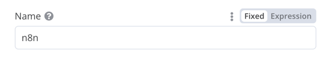

用于输入密码的字符串字段：

```typescript
{
	displayName: 'Password',
	name: 'password',
	type: 'string',
	required: true,
	typeOptions: {
		password: true,
	},
	default: '',
	description: `User's password`,
	displayOptions: { // the resources and operations to display this element with
		show: {
			resource: [
				// comma-separated list of resource names
			],
			operation: [
				// comma-separated list of operation names
			]
		}
	},
}
```

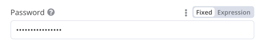

多行字符串字段：

```typescript
{
	displayName: 'Description',
	name: 'description',
	type: 'string',
	required: true,
	typeOptions: {
		rows: 4,
	},
	default: '',
	description: 'Description',
	displayOptions: { // the resources and operations to display this element with
		show: {
			resource: [
				// comma-separated list of resource names
			],
			operation: [
				// comma-separated list of operation names
			]
		}
	},
}
```

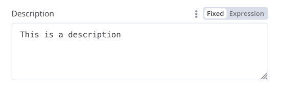

### 支持拖放数据键 <a href="#support-drag-and-drop-for-data-keys" id="support-drag-and-drop-for-data-keys"></a>

用户可以通过拖放数据值，将其映射到字段。拖放操作会创建表达式[^1]，用于加载数据值，n8n 会自动支持此行为。

要支持拖放数据键，需要添加额外的配置选项：

* `requiresDataPath: 'single'`：用于要求单个字符串的字段。
* `requiresDataPath: 'multiple'`：用于接受逗号分隔字符串列表的字段。

示例见 [Compare Datasets 节点代码](https://github.com/n8n-io/n8n/blob/master/packages/nodes-base/nodes/CompareDatasets/CompareDatasets.node.ts)。

## 数字（Number） <a href="#number" id="number"></a>

带小数位的数字字段：

```typescript
{
	displayName: 'Amount',
	name: 'amount',
	type: 'number',
	required: true,
	typeOptions: {
		maxValue: 10,
		minValue: 0,
		numberPrecision: 2,
	},
	default: 10.00,
	description: 'Your current amount',
	displayOptions: { // the resources and operations to display this element with
		show: {
			resource: [
				// comma-separated list of resource names
			],
			operation: [
				// comma-separated list of operation names
			]
		}
	},
}
```

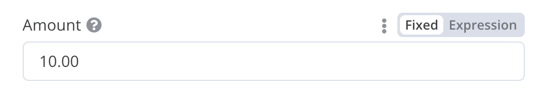

## 集合（Collection） <a href="#collection" id="collection"></a>

需要显示可选字段时，请使用 `collection` 类型。

```typescript
{
	displayName: 'Filters',
	name: 'filters',
	type: 'collection',
	placeholder: 'Add Field',
	default: {},
	options: [
		{
			displayName: 'Type',
			name: 'type',
			type: 'options',
			options: [
				{
					name: 'Automated',
					value: 'automated',
				},
				{
					name: 'Past',
					value: 'past',
				},
				{
					name: 'Upcoming',
					value: 'upcoming',
				},
			],
			default: '',
		},
	],
	displayOptions: { // the resources and operations to display this element with
		show: {
			resource: [
				// comma-separated list of resource names
			],
			operation: [
				// comma-separated list of operation names
			]
		}
	},
}
```

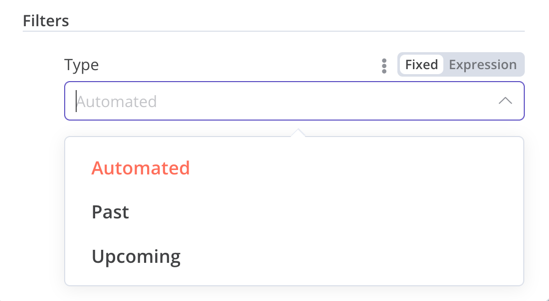

## 日期时间（DateTime） <a href="#datetime" id="datetime"></a>

`dateTime` 类型提供日期选择器。

```typescript
{
	displayName: 'Modified Since',
	name: 'modified_since',
	type: 'dateTime',
	default: '',
	description: 'The date and time when the file was last modified',
	displayOptions: { // the resources and operations to display this element with
		show: {
			resource: [
				// comma-separated list of resource names
			],
			operation: [
				// comma-separated list of operation names
			]
		}
	},
}
```

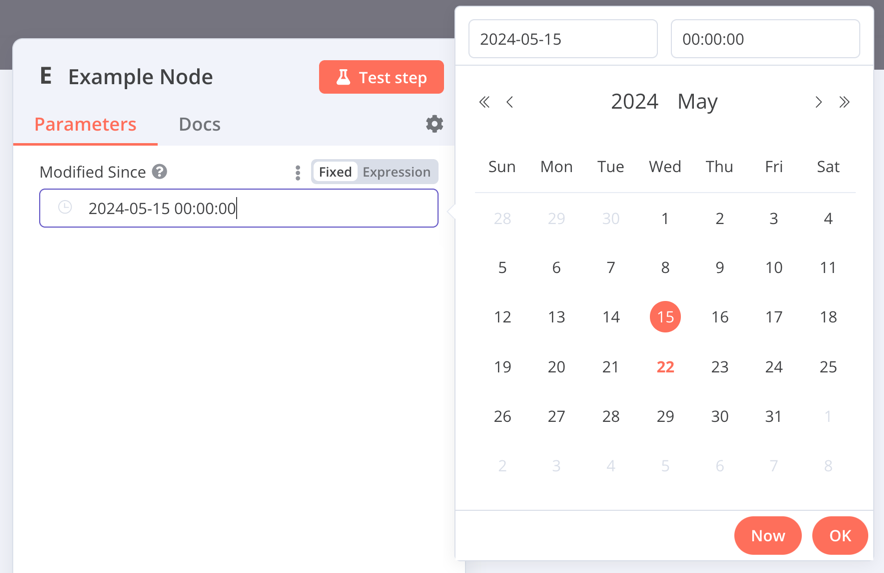

## 布尔值（Boolean） <a href="#boolean" id="boolean"></a>

`boolean` 类型添加一个开关，供用户输入 true 或 false。

```typescript
{
	displayName: 'Wait for Image',
	name: 'waitForImage',
	type: 'boolean',
	default: true, // Initial state of the toggle
	description: 'Whether to wait for the image or not',
	displayOptions: { // the resources and operations to display this element with
		show: {
			resource: [
				// comma-separated list of resource names
			],
			operation: [
				// comma-separated list of operation names
			]
		}
	},
}
```

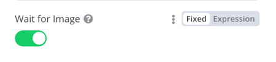

## 颜色（Color） <a href="#color" id="color"></a>

`color` 类型提供颜色选择器。

```typescript
{
	displayName: 'Background Color',
	name: 'backgroundColor',
	type: 'color',
	default: '', // Initially selected color
	displayOptions: { // the resources and operations to display this element with
		show: {
			resource: [
				// comma-separated list of resource names
			],
			operation: [
				// comma-separated list of operation names
			]
		}
	},
}
```

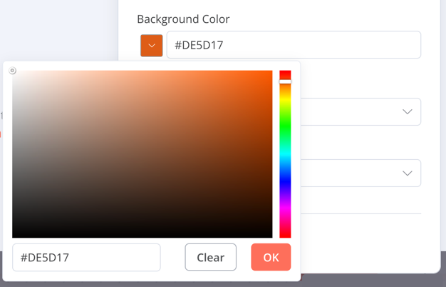

## 单选（Options） <a href="#options" id="options"></a>

`options` 类型添加一个选项列表，用户可选择单个值。

```typescript
{
	displayName: 'Resource',
	name: 'resource',
	type: 'options',
	options: [
		{
			name: 'Image',
			value: 'image',
		},
		{
			name: 'Template',
			value: 'template',
		},
	],
	default: 'image', // The initially selected option
	description: 'Resource to consume',
	displayOptions: { // the resources and operations to display this element with
		show: {
			resource: [
				// comma-separated list of resource names
			],
			operation: [
				// comma-separated list of operation names
			]
		}
	},
}
```

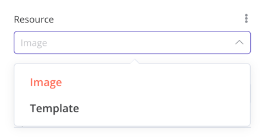

## 多选（Multi-options） <a href="#multi-options" id="multi-options"></a>

`multiOptions` 类型添加一个选项列表，用户可选择多个值。

```typescript
{
	displayName: 'Events',
	name: 'events',
	type: 'multiOptions',
	options: [
		{
			name: 'Plan Created',
			value: 'planCreated',
		},
		{
			name: 'Plan Deleted',
			value: 'planDeleted',
		},
	],
	default: [], // Initially selected options
	description: 'The events to be monitored',
	displayOptions: { // the resources and operations to display this element with
		show: {
			resource: [
				// comma-separated list of resource names
			],
			operation: [
				// comma-separated list of operation names
			]
		}
	},
}
```

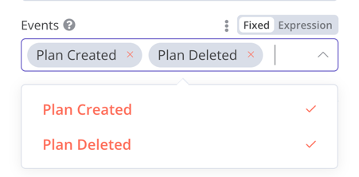

## 筛选器（Filter） <a href="#filter" id="filter"></a>

使用此组件对传入数据进行条件判断、匹配或筛选。

以下代码来自 n8n 的 If 节点，展示筛选器组件如何与[集合](node-ui-elements.md#collection)组件配合，让用户配置筛选器的行为。

```typescript
{
	displayName: 'Conditions',
	name: 'conditions',
	placeholder: 'Add Condition',
	type: 'filter',
	default: {},
	typeOptions: {
		filter: {
			// Use the user options (below) to determine filter behavior
			caseSensitive: '={{!$parameter.options.ignoreCase}}',
			typeValidation: '={{$parameter.options.looseTypeValidation ? "loose" : "strict"}}',
		},
	},
},
{
displayName: 'Options',
name: 'options',
type: 'collection',
placeholder: 'Add option',
default: {},
options: [
	{
		displayName: 'Ignore Case',
		description: 'Whether to ignore letter case when evaluating conditions',
		name: 'ignoreCase',
		type: 'boolean',
		default: true,
	},
	{
		displayName: 'Less Strict Type Validation',
		description: 'Whether to try casting value types based on the selected operator',
		name: 'looseTypeValidation',
		type: 'boolean',
		default: true,
	},
],
},
```

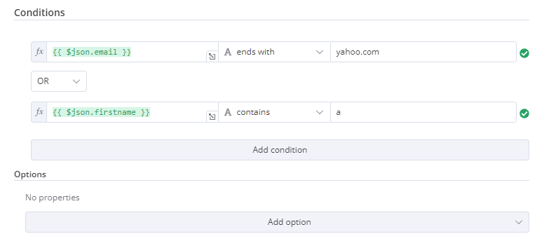

## 赋值集合（拖放） <a href="#assignment-collection-drag-and-drop" id="assignment-collection-drag-and-drop"></a>

需要让用户通过一次拖放操作同时填入名称和值参数时，请使用拖放组件。

```typescript
{
	displayName: 'Fields to Set',
	name: 'assignments',
	type: 'assignmentCollection',
	default: {},
},
```

示例见 n8n 的 [Edit Fields (Set) 节点](https://github.com/n8n-io/n8n/tree/0faeab1228e26d69a2a93bdb2f89523cca1e4036/packages/nodes-base/nodes/Set/v2)：

.gif>)

## 固定集合（Fixed collection） <a href="#fixed-collection" id="fixed-collection"></a>

使用 `fixedCollection` 类型，将语义相关的字段归为一组。

```typescript
{
	displayName: 'Metadata',
	name: 'metadataUi',
	placeholder: 'Add Metadata',
	type: 'fixedCollection',
	default: '',
	typeOptions: {
		multipleValues: true,
	},
	description: '',
	options: [
		{
			name: 'metadataValues',
			displayName: 'Metadata',
			values: [
				{
					displayName: 'Name',
					name: 'name',
					type: 'string',
					default: 'Name of the metadata key to add.',
				},
				{
					displayName: 'Value',
					name: 'value',
					type: 'string',
					default: '',
					description: 'Value to set for the metadata key.',
				},
			],
		},
	],
	displayOptions: { // the resources and operations to display this element with
		show: {
			resource: [
				// comma-separated list of resource names
			],
			operation: [
				// comma-separated list of operation names
			]
		}
	},
}
```

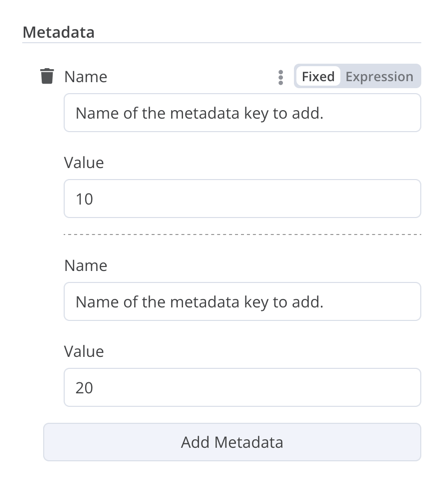

## 资源定位器（Resource locator） <a href="#resource-locator" id="resource-locator"></a>

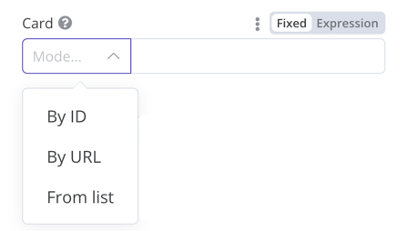

资源定位器帮助用户查找外部服务中的指定资源，例如 Trello 中的卡片或标签。

可用选项：

* ID
* URL
* List（列表）：允许用户从预先填充的列表中选择或搜索。此选项需要更多代码，因为你必须填充列表，并在支持搜索时处理搜索逻辑。

可以自行选择包含哪些类型。

示例：

```typescript
{
	displayName: 'Card',
	name: 'cardID',
	type: 'resourceLocator',
	default: '',
	description: 'Get a card',
	modes: [
		{
			displayName: 'ID',
			name: 'id',
			type: 'string',
			hint: 'Enter an ID',
			validation: [
				{
					type: 'regex',
					properties: {
						regex: '^[0-9]',
						errorMessage: 'The ID must start with a number',
					},
				},
			],
			placeholder: '12example',
			// How to use the ID in API call
			url: '=http://api-base-url.com/?id={{$value}}',
		},
		{
			displayName: 'URL',
			name: 'url',
			type: 'string',
			hint: 'Enter a URL',
			validation: [
				{
					type: 'regex',
					properties: {
						regex: '^http',
						errorMessage: 'Invalid URL',
					},
				},
			],
			placeholder: 'https://example.com/card/12example/',
			// How to get the ID from the URL
			extractValue: {
				type: 'regex',
				regex: 'example.com/card/([0-9]*.*)/',
			},
		},
		{
			displayName: 'List',
			name: 'list',
			type: 'list',
			typeOptions: {
				// You must always provide a search method
				// Write this method within the methods object in your base file
				// The method must populate the list, and handle searching if searchable: true
				searchListMethod: 'searchMethod',
				// If you want users to be able to search the list
				searchable: true,
				// Set to true if you want to force users to search
				// When true, users can't browse the list
				// Or false if users can browse a list
				searchFilterRequired: true,
			},
		},
	],
	displayOptions: {
		// the resources and operations to display this element with
		show: {
			resource: [
				// comma-separated list of resource names
			],
			operation: [
				// comma-separated list of operation names
			],
		},
	},
},
```

实际示例请参阅：

* n8n Trello 节点中的 [`CardDescription.ts`](https://github.com/n8n-io/n8n/blob/master/packages/nodes-base/nodes/Trello/CardDescription.ts) 和 [`Trello.node.ts`](https://github.com/n8n-io/n8n/blob/master/packages/nodes-base/nodes/Trello/Trello.node.ts)，展示了支持搜索且包含 `searchFilterRequired: true` 的列表。
* [`GoogleDrive.node.ts`](https://github.com/n8n-io/n8n/blob/master/packages/nodes-base/nodes/Google/Drive/GoogleDrive.node.ts)，展示了允许用户浏览列表或搜索的用法。

## 资源映射器（Resource mapper） <a href="#resource-mapper" id="resource-mapper"></a>

如果节点执行插入、更新或 upsert 操作，就需要按所集成服务支持的格式发送数据。常见做法是在发送数据的节点前添加 Set 节点，将数据转换为符合目标服务结构的格式。资源映射器界面组件可以直接在节点内将数据转换为所需格式，无需另加 Set 节点。它还可以根据节点提供的结构定义验证输入数据，并将输入数据转换为预期类型。


**映射与匹配**

映射是设置更新行时用作字段值的输入数据；匹配则是使用列名确定要更新哪些行。


```js
{
	displayName: 'Columns',
	name: 'columns', // The name used to reference the element UI within the code
	type: 'resourceMapper', // The UI element type
	default: {
		// mappingMode can be defined in the component (mappingMode: 'defineBelow')
		// or you can attempt automatic mapping (mappingMode: 'autoMapInputData')
		mappingMode: 'defineBelow',
		// Important: always set default value to null
		value: null,
	},
	required: true,
	// See "Resource mapper type options interface" below for the full typeOptions specification
	typeOptions: {
		resourceMapper: {
			resourceMapperMethod: 'getMappingColumns',
			mode: 'update',
			fieldWords: {
				singular: 'column',
				plural: 'columns',
			},
			addAllFields: true, 
			multiKeyMatch: true,
			supportAutoMap: true,
			matchingFieldsLabels: {
				title: 'Custom matching columns title',
				description: 'Help text for custom matching columns',
				hint: 'Below-field hint for custom matching columns',
			},
		},
	},
},
```

使用数据库结构的实际示例，请参阅 [Postgres 节点（版本 2）](https://github.com/n8n-io/n8n/tree/master/packages/nodes-base/nodes/Postgres/v2)。

使用无固定结构服务的实际示例，请参阅 [Google Sheets 节点（版本 2）](https://github.com/n8n-io/n8n/tree/master/packages/nodes-base/nodes/Google/Sheet/v2)。

### 资源映射器类型选项接口 <a href="#resource-mapper-type-options-interface" id="resource-mapper-type-options-interface"></a>

`typeOptions` 部分必须实现以下接口：

```js
export interface ResourceMapperTypeOptions {
	// The name of the method where you fetch the schema
	// Refer to the Resource mapper method section for more detail
	resourceMapperMethod: string;
	// Choose the mode for your operation
	// Supported modes: add, update, upsert
	mode: 'add' | 'update' | 'upsert';
	// Specify labels for fields in the UI
	fieldWords?: { singular: string; plural: string };
	// Whether n8n should display a UI input for every field when node first added to workflow
	// Default is true
	addAllFields?: boolean;
	// Specify a message to show if no fields are fetched from the service 
	// (the call is successful but the response is empty)
	noFieldsError?: string;
	// Whether to support multi-key column matching
	// multiKeyMatch is for update and upsert only
	// Default is false
	// If true, the node displays a multi-select dropdown for the matching column selector
	multiKeyMatch?: boolean;
	// Whether to support automatic mapping
	// If false, n8n hides the mapping mode selector field and sets mappingMode to defineBelow
	supportAutoMap?: boolean;
	// Custom labels for the matching columns selector
	matchingFieldsLabels?: {
		title?: string;
		description?: string;
		hint?: string;
	};
}
```

### 资源映射器方法 <a href="#resource-mapper-method" id="resource-mapper-method"></a>

此方法包含节点特有的数据结构获取逻辑。每个节点都必须自行实现获取结构定义的逻辑，并根据结构设置各个界面字段。

返回值必须实现 `ResourceMapperFields` 接口：

```js
interface ResourceMapperField {
	// Field ID as in the service
	id: string;
	// Field label
	displayName: string;
	// Whether n8n should pre-select the field as a matching field
	// A matching field is a column used to identify the rows to modify
	defaultMatch: boolean;
	// Whether the field can be used as a matching field
	canBeUsedToMatch?: boolean;
	// Whether the field is required by the schema
	required: boolean;
	// Whether to display the field in the UI
	// If false, can't be used for matching or mapping
	display: boolean;
	// The data type for the field
	// These correspond to UI element types
	// Supported types: string, number, dateTime, boolean, time, array, object, options
	type?: FieldType;
	// Added at runtime if the field is removed from mapping by the user
	removed?: boolean;
	// Specify options for enumerated types
	options?: INodePropertyOptions[];
}
```

实际示例请参阅 [Postgres 资源映射方法](https://github.com/n8n-io/n8n/blob/master/packages/nodes-base/nodes/Postgres/v2/methods/resourceMapping.ts)和 [Google Sheets 资源映射方法](https://github.com/n8n-io/n8n/blob/master/packages/nodes-base/nodes/Google/Sheet/v2/methods/resourceMapping.ts)。

## JSON <a href="#json" id="json"></a>

```typescript
{
	displayName: 'Content (JSON)',
	name: 'content',
	type: 'json',
	default: '',
	description: '',
	displayOptions: { // the resources and operations to display this element with
		show: {
			resource: [
				// comma-separated list of resource names
			],
			operation: [
				// comma-separated list of operation names
			]
		}
	},
}
```

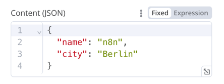

## HTML <a href="#html" id="html"></a>

HTML 编辑器允许用户在工作流中创建 HTML 模板，支持标准 HTML、`<style>` 标签内的 CSS，以及用 `{{}}` 包裹的表达式。用户还可以添加 `<script>` 标签引入额外的 JavaScript，但 n8n 不会在工作流执行期间运行这些 JavaScript。

```js
{
	displayName: 'HTML Template', // The value the user sees in the UI
	name: 'html', // The name used to reference the element UI within the code
	type: 'string',
	typeOptions: {
		editor: 'htmlEditor',
	},
	default: placeholder, // Loads n8n's placeholder HTML template
	noDataExpression: true, // Prevent using an expression for the field
	description: 'HTML template to render',
},
```

实际示例请参阅 [`Html.node.ts`](https://github.com/n8n-io/n8n/blob/master/packages/nodes-base/nodes/Html/Html.node.ts)。

## 提示框（Notice） <a href="#notice" id="notice"></a>

显示一个黄色框，用于提供提示或额外信息。如何编写清晰的提示和说明文字，请参阅[节点界面设计](../../plan-your-node/node-ui-design.md)。

```js
{
  displayName: 'Your text here',
  name: 'notice',
  type: 'notice',
  default: '',
},
```

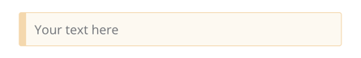

## 提示（Hints） <a href="#hints" id="hints"></a>

提示分为参数提示和节点提示两类：

* 参数提示是用户输入字段下方的简短文字。
* 节点提示比[提示框](node-ui-elements.md#notice)更强大、更灵活，可在输入面板、输出面板或节点详情视图中显示较长的提示。

### 添加参数提示 <a href="#add-a-parameter-hint" id="add-a-parameter-hint"></a>

为界面元素添加 `hint` 参数：

```ts
{
	displayName: 'URL',
	name: 'url',
	type: 'string',
	hint: 'Enter a URL',
	...
}
```

### 添加节点提示 <a href="#add-a-node-hint" id="add-a-node-hint"></a>

在节点的 `hints` 属性中定义提示，该属性位于节点 `description` 内：

```ts
description: INodeTypeDescription = {
	...
	hints: [
		{
			// The hint message. You can use HTML.
			message: "This node has many input items. Consider enabling <b>Execute Once</b> in the node\'s settings.",
			// Choose from: info, warning, danger. The default is 'info'.
			// Changes the color. info (grey), warning (yellow), danger (red)
			type: 'info',
			// Choose from: inputPane, outputPane, ndv. By default n8n displays the hint in both the input and output panels.
			location: 'outputPane',
			// Choose from: always, beforeExecution, afterExecution. The default is 'always'
			whenToDisplay: 'beforeExecution',
			// Optional. An expression. If it resolves to true, n8n displays the message. Defaults to true.
			displayCondition: '={{ $parameter["operation"] === "select" && $input.all().length > 1 }}'
		}
	]
	...
}
```

### 为编程式节点添加动态提示 <a href="#add-a-dynamic-hint-to-a-programmatic-style-node" id="add-a-dynamic-hint-to-a-programmatic-style-node"></a>

在编程式节点中，可以创建包含节点执行信息的动态消息。由于它依赖节点输出数据，这类提示只能在执行后显示。

```ts
if (operation === 'select' && items.length > 1 && !node.executeOnce) {
    // Expects two parameters: NodeExecutionData and an array of hints
	return new NodeExecutionOutput(
		[returnData],
		[
			{
				message: `This node ran ${items.length} times, once for each input item. To run for the first item only, enable <b>Execute once</b> in the node settings.`,
				location: 'outputPane',
			},
		],
	);
}
return [returnData];
```

编程式节点动态提示的实际示例，请参阅 [Split Out 节点代码](https://github.com/n8n-io/n8n/blob/master/packages/nodes-base/nodes/Transform/SplitOut/SplitOut.node.ts#L266)。

[^1]: 在 n8n 中，表达式通过执行 JavaScript 代码，动态填充节点参数。你无需提供固定值，而可以使用 n8n 表达式语法，根据前序节点、其他工作流或 n8n 环境中的数据来定义值。

## 相关资源 <a id="related-resources"></a>

* [节点构建参考](./)
