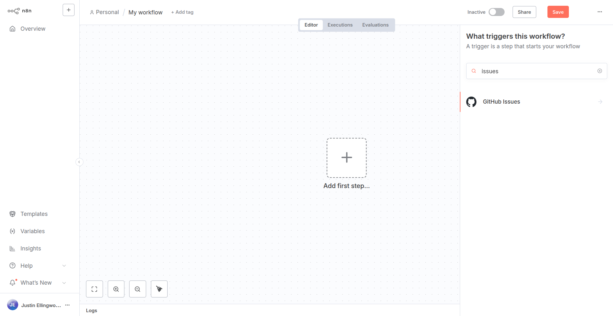

<!-- 简体中文翻译；来源 n8n-io/n8n-docs；原文版本见 upstream.json。 -->


# 使用 n8n-node 工具 <a href="#using-the-n8n-node-tool" id="using-the-n8n-node-tool"></a>

`n8n-node` 是为 n8n 开发社区节点的官方 CLI，可用于生成新节点脚手架、构建项目，并在开发过程中运行节点。

使用 `n8n-node`，可以创建符合[已验证社区节点指南](reference/verification-guidelines.md)的节点。

## 获取 n8n-node <a href="#get-n8n-node" id="get-n8n-node"></a>

### 无需安装即可运行 n8n-node <a href="#run-n8n-node-without-installing" id="run-n8n-node-without-installing"></a>

可直接创建 `n8n-node` 项目，无需安装：通过包管理器使用 [`@n8n/create-node` 初始化器](https://www.npmjs.com/package/@n8n/create-node)即可。

```shell
npm create @n8n/node@latest
```

这样会在本地设置初始项目文件，也可选择先在本地安装 `n8n-node`，再显式运行 [`new` 命令](#new)。之后，在项目目录中通过包管理器的脚本运行器执行其他 `n8n-node` 命令，例如 `npm run dev`。

### 全局安装 n8n-node <a href="#install-n8n-node-globally" id="install-n8n-node-globally"></a>

全局安装 `n8n-node` 可使用 `npm`：

```shell
npm install --global @n8n/node-cli
```

输入以下命令，确认可以调用：

```shell
n8n-node --version
```

## 命令概览 <a href="#command-overview" id="command-overview"></a>

`n8n-node` 工具提供以下命令：

### new <a href="#new" id="new"></a>

`new` 命令为新节点创建文件系统结构和元数据，初始化的结构与[无需安装即可运行 n8n-node](#run-n8n-node-without-installing)所述相同。

调用时会交互式询问项目详情，以定制初始代码。你需要提供项目名称、选择节点类型，以及最适合需求的初始模板。`n8n-node` 工具会创建项目文件结构，并可选安装初始项目依赖。

`new` 命令的更多用法，请参阅[创建新节点](#creating-a-new-node)。

### build <a href="#build" id="build"></a>

`build` 命令编译节点并复制所有必需资源。

`build` 命令的更多用法，请参阅[构建节点](#building-your-node)。


### dev <a href="#dev" id="dev"></a>


`dev` 命令启动加载了你的节点的 n8n，并监控项目目录，发现更改时自动重建实时预览。

`dev` 命令的更多用法，请参阅[在 n8n 中测试节点](#testing-your-node-in-n8n)。

### lint <a href="#lint" id="lint"></a>

`lint` 命令检查当前目录中的节点代码。可选用 `--fix` 选项，尝试自动修复发现的问题。

`lint` 命令的更多用法，请参阅[对节点执行 lint 检查](#lint-your-node)。

### release <a href="#release" id="release"></a>

`release` 命令将社区节点软件包发布到 npm，使用 [`release-it`](https://github.com/release-it/release-it) 先清理、检查并执行干净构建，再发布。

`release` 命令的更多用法，请参阅[发布节点](#release-your-node)。

## 创建新节点 <a href="#creating-a-new-node" id="creating-a-new-node"></a>

要使用 `n8n-node` 创建新节点，请调用 `n8n-node new`。可完全交互式操作，也可在命令行提供详情。


**无需安装即可创建新节点**

创建 `n8n-node` 项目时，也可不安装 `n8n-node`，改用包管理器的 [`@n8n/create-node` 初始化器](https://www.npmjs.com/package/@n8n/create-node)。

以下命令中，请将 `n8n-node new` 替换为 `npm create @n8n/node@latest`。使用这种形式时，必须先添加双连字符（`--`），再提供选项（例如 `--template`）。示例：

```shell
npm create @n8n/node@latest n8n-nodes-mynode -- --template declarative/custom
```


命令会询问节点尚缺的信息，再生成项目结构。默认随后安装初始项目依赖，可通过 `--skip-install` 选项禁用。

### 交互式设置节点详情 <a href="#setting-node-details-interactively" id="setting-node-details-interactively"></a>

不带参数调用时，`n8n-node new` 会交互式询问新节点详情：

```shell
n8n-node new
```

交互提示会让你定义项目详情：

* **What is your node called?**（节点叫什么？）：节点名称会影响项目目录、软件包和 n8n 节点自身的名称。必须使用以下格式之一：
    * `n8n-nodes-<YOUR_NODE_NAME>`
    * `@<YOUR_ORG>/n8n-nodes-<YOUR_NODE_NAME>`
* **What kind of node are you building?**（构建哪类节点？）：要使用的[节点开发方式](../plan-your-node/choose-a-node-building-style.md)：
    * **HTTP API**：低代码的声明式节点结构，面向更快通过 n8n Cloud 审核的场景。
    * **Other**（其他）：完全灵活的编程式节点。触发节点应选择此项，因为声明式不支持触发器。要向已有声明式节点的软件包添加触发节点，请在同一软件包中使用编程式编写。
* **What template do you want to use?**（使用哪个模板？）：选择 HTTP API 时，可选以下初始模板：
    * **GitHub Issues API**：包含多种操作和凭据的示例节点，帮助熟悉节点结构与约定。
    * **Start from scratch**（从零开始）：空白模板，通过后续提示引导你自定义设置。

选择 HTTP API > Start from scratch 时，`n8n-node` 会询问：

* **What's the base URL of the API?**（API 基础 URL 是什么？）：计划集成的 API 根 URL。
* **What type of authentication does your API use?**（API 使用哪种身份验证？）：节点应提供的身份验证方式：
    * **API Key**（API 密钥）：通过请求头、查询参数或请求体发送密钥。
    * **Bearer Token**（Bearer 令牌）：通过 Authorization 请求头（`Authorization: Bearer <token>`）发送令牌。
    * **OAuth2**：使用 OAuth 2.0 流程，代表用户或应用获取访问令牌。
    * **Basic Auth**（基本身份验证）：通过 Authorization 请求头发送 Base64 编码的用户名和密码。
    * **Custom**（自定义）：创建自己的凭据逻辑。会生成可按需定制的空凭据类。
    * **None**（无）：无需身份验证，不为节点创建凭据类。

完成选择后，`n8n-node` 会在当前目录创建节点的新项目目录。默认安装初始项目依赖，可通过 `--skip-install` 选项禁用。

### 在命令行提供节点详情 <a href="#providing-node-details-on-the-command-line" id="providing-node-details-on-the-command-line"></a>

可在命令行提供部分节点详情，以跳过提示。

可将节点名称作为参数传入：

```shell
n8n-node new n8n-nodes-myproject
```


**节点名称格式**

节点名称必须使用以下格式之一：

* `@<YOUR_ORG>/n8n-nodes-<YOUR_NODE_NAME>`
* `n8n-nodes-<YOUR_NODE_NAME>`


如果提前确定模板，也可通过 `--template` 选项传入：

```shell
n8n-node new --template declarative/custom
```

模板必须为以下值之一：

* `declarative/github-issues`：包含多种操作和凭据的示例节点，帮助熟悉节点结构与约定。
* `declarative/custom`：空白模板，通过后续提示引导你自定义设置。
* `programmatic/example`：完全灵活的编程式节点。

## 构建节点 <a href="#building-your-node" id="building-your-node"></a>

在项目根目录运行 `build` 命令即可构建节点：

```shell
n8n-node build
```

`n8n-node` 会编译 TypeScript 文件并打包其他项目资源。也可通过包管理器调用 `build` 脚本。例如，使用 `npm` 时，下列命令效果相同：

```shell
npm run build
```

## 对节点执行 lint 检查 <a href="#lint-your-node" id="lint-your-node"></a>

`n8n-node` 工具还会自动为项目创建 `lint` 脚本，可通过包管理器运行。例如：

```shell
n8n-node lint
```

也可通过包管理器的脚本运行器执行：

```shell
npm run lint
```

添加 `--fix` 选项（也可通过 `npm run lint:fix` 调用）后，`n8n-node` 会尝试修复发现的问题：

```shell
n8n-node lint --fix
```

## 在 n8n 中测试节点 <a href="#testing-your-node-in-n8n" id="testing-your-node-in-n8n"></a>

要在 n8n 中测试节点，请在项目根目录运行 `dev` 命令：

```shell
n8n-node dev
```

与 `build` 命令一样，也可通过包管理器执行。例如：

```shell
npm run dev
```

`n8n-node` 会编译项目，再启动加载了你的节点的本地 n8n 实例。自 n8n 3.0 起，实例在容器中启动，因此需要安装 Docker 或 Podman。若希望自行运行实例，可通过 `n8n-node dev --external-n8n` 指向使用 `N8N_DEV_RELOAD=true` 启动的 n8n；此方式无需 Docker 或 Podman。

访问 `localhost:5678`，登录 n8n 实例。打开工作流后，可在节点面板中找到你的节点：



然后可将其加入工作流，在开发过程中测试功能。

## 发布节点 <a href="#release-your-node" id="release-your-node"></a>

要发布节点，请在项目目录运行 `release` 命令。此命令通过 [`release-it`](https://github.com/release-it/release-it) 构建并发布节点。


**登录 npm**

使用 `release` 命令前，必须通过 `npm login` 命令登录 npm，否则 `n8n-node` 无权发布项目文件。


```shell
n8n-node release
```

通过 `npm` 运行时，输入：

```shell
npm run release
```

运行 `release` 命令时，`n8n-node` 会执行以下操作：

* 构建节点。
* 对文件执行 lint 检查。
* 更新变更记录。
* 创建 Git 标签。
* 创建 GitHub release。
* 将软件包发布到 npm。

## 相关资源 <a id="related-resources"></a>

* [构建节点](./)
* [设置开发环境](set-up-your-development-environment.md)
* [教程：构建声明式节点](tutorial-build-a-declarative-style-node.md)
* [教程：构建编程式节点](tutorial-build-a-programmatic-style-node.md)
* [参考](reference/README.md)
