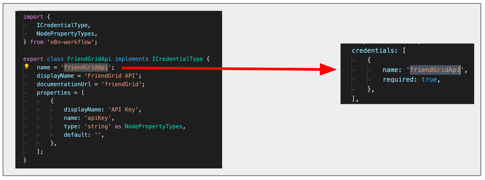

<!-- 简体中文翻译；来源 n8n-io/n8n-docs；原文版本见 upstream.json。 -->


# 故障排查 <a href="#troubleshooting" id="troubleshooting"></a>

## 凭据 <a href="#credentials" id="credentials"></a>


### 错误消息：'Credentials of type "*" aren't known' <a href="#error-message-credentials-of-type-arent-known" id="error-message-credentials-of-type-arent-known"></a>


检查 credentials 数组中的名称，是否与凭据类的 name 属性一致。例如，以下凭据类将 `name` 设为 `friendGridApi`：

```typescript
export class FriendGridApi implements ICredentialType {
	name = 'friendGridApi';
	displayName = 'FriendGrid API';
	documentationUrl = 'friendGrid';
	properties = [
		{
			displayName: 'API Key',
			name: 'apiKey',
			type: 'string' as NodePropertyTypes,
			default: '',
		},
	];
}
```

节点的 `credentials` 数组必须引用相同的 `name` 值：

```typescript
credentials: [
	{
		name: 'friendGridApi',
		required: true,
	},
],
```




## 编辑器界面 <a href="#editor-ui" id="editor-ui"></a>


### 错误消息：'There was a problem loading init data: API-Server can not be reached. It's probably down' <a href="#error-message-there-was-a-problem-loading-init-data-api-server-can-not-be-reached-its-probably-down" id="error-message-there-was-a-problem-loading-init-data-api-server-can-not-be-reached-its-probably-down"></a>


- 检查节点文件名、节点目录名和类名，是否与添加到 `packages/nodes-base/package.json` 的路径匹配。
- 检查 `displayOptions` 属性使用的名称，是否与节点界面元素的名称一致。


### 节点图标未显示在添加节点菜单和编辑器界面中 <a href="#node-icon-doesnt-show-up-in-the-add-node-menu-and-the-editor-ui" id="node-icon-doesnt-show-up-in-the-add-node-menu-and-the-editor-ui"></a>


- 检查图标是否与节点位于同一目录。
- 检查图标格式是否为 PNG 或 SVG。
- `icon` 属性引用图标文件时，应包含扩展名（`.png` 或 `.svg`），并使用 `file:` 前缀，例如 `file:friendGrid.png` 或 `file:friendGrid.svg`。

### 节点图标尺寸不合适 <a href="#node-icon-doesnt-fit" id="node-icon-doesnt-fit"></a>

- 使用 SVG 时，请确保画布为正方形。可参考 [GIMP 调整画布大小指南](https://docs.gimp.org/2.10/en/gimp-image-resize.html)修改 SVG 画布尺寸。
- 使用 PNG 时，请确保尺寸为 60×60 像素。

### 节点未显示在添加节点菜单中 <a href="#node-doesnt-show-up-in-the-add-node-menu" id="node-doesnt-show-up-in-the-add-node-menu"></a>

检查是否已在项目的 `package.json` 文件中注册节点。


### 刷新后，description 属性的更改未显示在界面中 <a href="#changes-to-the-description-properties-dont-show-in-the-ui-on-refreshing" id="changes-to-the-description-properties-dont-show-in-the-ui-on-refreshing"></a>


每次更改 description 属性后，都需要停止当前 `n8n-node dev` 进程（`ctrl` + `c`）并重新运行。

### linter 错误警告文件名大小写 <a href="#linter-incorrectly-warning-about-file-name-case" id="linter-incorrectly-warning-about-file-name-case"></a>

节点 linter 对文件名有规则，包括大小写。Windows 用户重命名文件后，可能仍持续收到警告。这是由 Windows 在仅更改文件名大小写时的一个[已知问题](https://answers.microsoft.com/en-us/windows/forum/all/file-renaming-when-changing-case-doesnt-work/aa15ff7c-dd2d-4ed3-bcce-799ca90d4e58)导致的。

## 相关资源 <a id="related-resources"></a>

* [测试节点](./)
* [在本地运行节点](run-your-node-locally.md)
* [节点 linter](node-linter.md)
