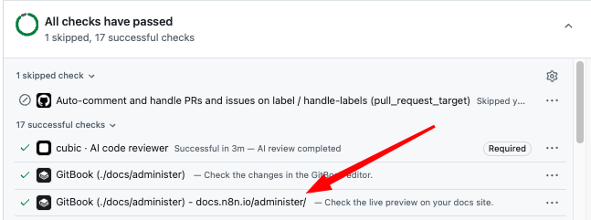
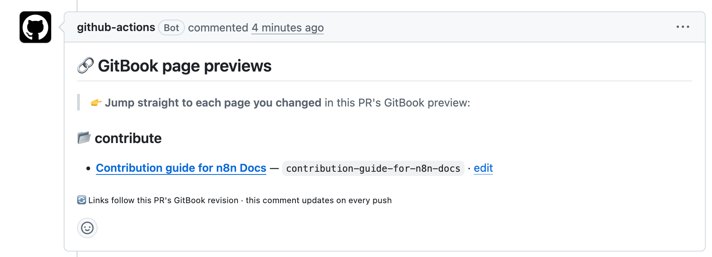

<!-- 简体中文翻译；来源 n8n-io/n8n-docs；原文版本见 upstream.json。 -->


# n8n 文档贡献指南 <a id="contribution-guide-for-n8n-docs"></a>

n8n 文档欢迎所有人贡献内容。本指南介绍贡献流程及应遵循的规范。

## 简介 <a id="introduction"></a>

n8n Docs 是 [n8n](https://n8n.io) 的官方文档，涵盖从入门到高级工作流自动化的内容。文档由 n8n 团队维护，社区可以通过完善说明、更新内容、修复错误等方式提供帮助。

所有贡献都必须遵守[行为准则](https://github.com/n8n-io/n8n-docs/blob/main/CODE_OF_CONDUCT.md)，以及本贡献指南和风格指南中的标准，以确保 n8n 文档的质量和一致性。

n8n 文档内容在 [GitHub](https://github.com/n8n-io/n8n-docs) 仓库中管理，网站由 [GitBook](https://www.gitbook.com/) 生成。页面使用 [Markdown](https://commonmark.org/) 编写，并使用 GitBook 专用组件，例如提示框、标签页和结构化页面元素。

## 本节内容 <a id="in-this-section"></a>

* [n8n 文档风格指南](style-guide-for-n8n-docs.md)：应遵循的写作风格、格式和结构规则。
* [术语与命名](terminology.md)：应使用的 n8n 官方术语，以及应避免的非官方用词。
* [面向智能体的友好文档](agent-friendly-docs.md)：n8n Docs 如何定义对智能体友好的文档，以及它与风格指南的关系。

## 贡献类型 <a id="types-of-contribution"></a>

主要参与方式如下：

**修复拼写和小错误：**修正拼写错误、失效链接或细微的不准确之处。

**改进已有页面：**如果说明不清晰、内容过时，或页面缺少重要信息，可以提出修改和补充。

**提议新页面：**如果认为文档完全缺少某项内容，请先创建 issue 描述所需内容，再开始撰写。这样团队可以确认内容属于文档范围，避免与正在进行的工作重复。如果希望在获批后自行撰写，请在 issue 中说明。

**随代码变更更新文档：**如果正在向 [n8n 主仓库](https://github.com/n8n-io/n8n)提交 PR，例如添加节点、更改配置选项，或修复影响文档所述行为的缺陷，请同时提交文档 PR，反映相应变化。

**报告问题：**如果发现文档问题，但无法自行修复，可以创建 issue 描述具体问题，由 n8n 文档团队处理。

## 不接受的提交 <a id="what-not-to-submit"></a>

以下类型的贡献不予接受：

* 修改**完全自动生成的页面**。这些页面通过 n8n 工作流自动生成并更新。如果发现问题，请创建 issue，不要直接编辑页面。可通过 frontmatter 中的 `generated: true` 字段识别完全自动生成的页面。
* 任何形式的**推广或商业内容**，包括向精选兼容选项列表中添加供应商或工具。文档中的这类列表通常只涵盖最常用的选项，并非完整目录。我们力求保持供应商中立，只在有明确理由时扩充列表。
* **个人偏好式修改：**对已经符合风格指南的内容，仅为了换成自己偏爱的措辞或风格而进行的编辑。
* **忽视这些规范的贡献。**如果明显看出提交者没有尝试遵循风格指南或贡献规范，我们可能直接关闭提交而不予审核。

## 写作指导 <a id="writing-guidance"></a>

n8n 文档遵循 [Microsoft 写作风格指南](https://learn.microsoft.com/en-us/style-guide/welcome/)，使用通俗直接的语言、第二人称“你”、现在时和主动语态。句子保持简短，避免行话，英文中使用缩略形式。

完整细则请参阅 n8n 风格指南。

## 内容类型 <a id="content-types"></a>

n8n 文档使用几种不同的页面类型。明确正在编写的类型，有助于采用正确结构和模板。各类型模板位于 [`document-templates/`](https://github.com/n8n-io/n8n-docs/tree/main/document-templates) 文件夹：

* **集成节点：**节点参考文档，使用与节点类型匹配的模板：[应用节点](https://github.com/n8n-io/n8n-docs/blob/main/document-templates/app-nodes.md)、[核心节点](https://github.com/n8n-io/n8n-docs/blob/main/document-templates/core-nodes.md)、[触发器节点](https://github.com/n8n-io/n8n-docs/blob/main/document-templates/trigger-nodes.md)或[集群节点](https://github.com/n8n-io/n8n-docs/blob/main/document-templates/cluster-nodes.md)。
* **凭据：**介绍如何对集成进行身份验证（[模板](https://github.com/n8n-io/n8n-docs/blob/main/document-templates/credentials.md)）。
* **常见问题：**节点的已知问题和解决办法（[模板](https://github.com/n8n-io/n8n-docs/blob/main/document-templates/common-issues.md)）。
* **功能：**n8n 功能的操作指南和参考文档（[模板](https://github.com/n8n-io/n8n-docs/blob/main/document-templates/feature.md)）。
* **教程：**按步骤完成某项构建任务的指南（[模板](https://github.com/n8n-io/n8n-docs/blob/main/document-templates/tutorial.md)）。

## 使用 AI 起草贡献内容 <a id="using-ai-to-draft-contributions"></a>

欢迎使用 AI 工具帮助起草或改进贡献内容。

建议将你选用的 AI 工具与 [`skills/n8n-docs-author/SKILL.md`](https://github.com/n8n-io/n8n-docs/tree/main/skills/n8n-docs-author) 中的 n8n 文档技能文件配合使用。该文件提炼了风格指南，为智能体提供 n8n 文档风格和写作约定的上下文，有助于从一开始就生成更好的内容，减少后续修改。

**工作原理**

如果在 n8n Docs GitHub 仓库的本地 fork 中使用 AI 编程智能体，该技能可以自动加载。例如，仓库根目录的 `CLAUDE.md` 文件会指引 Claude Code 使用该技能，无需额外操作。

如果没有 fork 仓库，或使用的工具不会自动加载技能，仍可使用此文件。将 [`SKILL.md`](https://github.com/n8n-io/n8n-docs/blob/main/skills/n8n-docs-author/SKILL.md)、[reference.md](https://github.com/n8n-io/n8n-docs/blob/main/skills/n8n-docs-author/reference.md) 和风格指南的内容复制到智能体上下文中，再要求它在编写或审核文档贡献时遵循这些指导。

**使用方式**

像平时一样请智能体编写或审核文档，也可以明确指定模式：

* **编写：**“为 X 编写触发器节点页面。”
* **编辑：**“编辑此页面，修复不符合风格指南的地方。”
* **审核：**“对照风格指南审核此页面。”

执行审核时，智能体会返回按严重程度分组的问题表格，并给出修改建议。

## 贡献方式 <a id="contribution-methods"></a>

可以通过多种方式贡献内容：

### 在浏览器中编辑页面 <a id="edit-a-page-in-your-browser"></a>

此方式最适合快速修改单个页面。GitHub 会引导你修改并创建拉取请求，也称 PR，即正式提议将更改加入文档。

**前提条件：**拥有 [GitHub](https://github.com/) 账户。

1. 打开任意 n8n 文档页面顶部的 **Copy**（复制）下拉菜单，选择 **Edit on GitHub**（在 GitHub 上编辑），进入 [n8n Docs GitHub 仓库](https://github.com/n8n-io/n8n-docs)中的对应页面。
2. 单击铅笔图标编辑页面。

如果是外部贡献者，GitHub 会在修改前提示 fork 仓库。单击 **Fork this repository**（派生此仓库），GitHub 就会自动创建 fork。

3. 在文本编辑器中修改，然后单击 **Commit changes**（提交更改）> **Propose changes**（提议更改）。

GitHub 会为你准备一个[拉取请求](https://docs.github.com/en/pull-requests/collaborating-with-pull-requests/proposing-changes-to-your-work-with-pull-requests/about-pull-requests)。

4. 检查拉取请求的标题和描述，按需修改。确认后，单击 **Create pull request**（创建拉取请求）。

确保符合通用检查清单的全部要求；如有遗漏，请修改 PR。n8n 文档团队会审核拉取请求，接受后将其合并，即发布你建议的修改。

### 在本地 fork 仓库 <a id="fork-the-repository-locally"></a>

此方式适合较大修改、新建页面或涉及多个文件的工作。

**前提条件：**拥有 [GitHub 账户](https://github.com/)，并在本地安装 [Git](https://git-scm.com/) 及文本编辑器或 IDE。

1. 在 GitHub 上 [fork n8n Docs 仓库](https://github.com/n8n-io/n8n-docs/fork)，并[克隆到本地](https://docs.github.com/en/repositories/creating-and-managing-repositories/cloning-a-repository)。
2. 为修改创建新分支。
3. 修改相关页面。添加新页面时，将其加入所属空间的 `SUMMARY.md` 文件，使其出现在导航中。请参阅风格指南中的页面导航部分。
4. 使用 [Vale](https://vale.sh) 检查文字。先安装工具（macOS 上使用 `brew install vale`；其他系统请参阅 [Vale 安装指南](https://vale.sh/docs/install)），再从仓库根目录运行：

    ```bash
    vale docs/                 # lint a directory
    vale docs/path/to/file.md  # lint a single file
    ```

    仓库已附带 Vale 风格规则，无需额外配置。继续之前，请修复全部错误和警告。
5. 提交修改，并将分支推送到 GitHub。
6. 从你的 fork 向 `main` 创建[拉取请求](https://github.com/n8n-io/n8n-docs/pulls)。

确保符合通用检查清单的全部要求；如有遗漏，请修改 PR。n8n 文档团队会审核拉取请求，接受后将其合并。

**预览更改**

创建拉取请求后，GitBook 会自动构建修改预览，并在 PR 中提供链接。在 PR 的 **Conversation**（对话）标签页中，找到底部的检查区域，单击所编辑空间对应的 **Check the live preview on your docs site**（查看文档网站实时预览）：



然后即可检查修改在文档网站中的渲染效果。

预览构建完成后，机器人还会在 PR 中发布 **GitBook page previews**（GitBook 页面预览）评论，直接链接到每个修改过的页面，无需在导航中查找。每次推送后，该评论都会更新。



无法在本地构建该网站。

### 创建 issue <a id="open-an-issue"></a>

如果发现问题但不想自行编辑，或希望在撰写前提议新内容，可以创建 GitHub issue。

1. 进入 [n8n Docs 的 issues 页面](https://github.com/n8n-io/n8n-docs/issues)。
2. 创建前先搜索现有未关闭 issue，检查是否已有相同问题。
3. 单击 **New issue**（新建 issue），选择最相关的问题类型。
4. 填写标题和描述，尽量提供详细信息，包括页面 URL、错误或缺失之处，以及你的建议。
5. 单击 **Submit new issue**（提交新 issue）。

n8n 文档团队会对 issue 分类处理，如需更多信息会继续联系你。

## 通用检查清单 <a id="general-checklist"></a>

提交修改 n8n 文档的拉取请求前，请确保满足以下全部要求：

* 包含所有必要文件和图片。
* 新页面已加入所属空间的 `SUMMARY.md`，能够出现在导航中。
* 所有格式符合风格指南。
* 修改通过 [Vale](https://vale.sh) 文字检查，且没有错误；此项适用于本地贡献，参阅“在本地 fork 仓库”。
* 所有链接有效，且指向正确位置。
* PR 说明了做了哪些修改，以及修改的必要性。
* 未提交不被接受的贡献类型。
* 已阅读并接受[行为准则](https://github.com/n8n-io/n8n-docs/blob/main/CODE_OF_CONDUCT.md)和[贡献者许可协议](https://github.com/n8n-io/n8n-docs/blob/main/CONTRIBUTOR_LICENSE_AGREEMENT.md)。

## 审核流程 <a id="review-process"></a>

创建拉取请求后，n8n 文档团队会审核，并选择合并、要求修改或关闭。流程说明如下：

**时间：**团队会尽快审核拉取请求。复杂或大规模贡献可能需要更长时间。与主代码库 PR 关联的贡献，会在主 PR 合并后才开始审核。

**标签：**团队通过标签说明 PR 状态：

| 标签 | 含义 |
| --------------------------- | ------------------------------------------------------------------------------------------------------------------------------------------------------- |
| `action:awaiting-author` | 团队已提供反馈，正在等待你回复或修改。 |
| `action:needs-review` | PR 已进入队列，等待技术文档作者审核。 |
| `action:needs-sme` | PR 需要由相关领域专家审核后才能合并。 |
| `status:pending-dev` | PR 关联的代码变更尚未合并，待其合并后再审核。 |
| `status:awaiting-release` | 关联代码变更已合并但尚未发布，PR 将很快接受审核。 |
| `status:dev-cancelled` | PR 关联的代码变更已取消，文档 PR 将被关闭。 |
| `status:duplicate` | PR 与已有 PR 或 issue 重复，将被关闭。 |
| `status:outdated` | 后续文档变更已使 PR 过时，PR 将被关闭。 |
| `quality:low-effort-usable` | PR 勉强达到接受标准，建议在审核前进一步改进。 |
| `quality:unusable` | PR 不符合贡献规范，将被关闭。若多次贡献都被标记为此标签，你将被禁止继续贡献。 |
| `quality:disruptive` | PR 中的修改会直接损害文档质量，你将立即被禁止继续贡献。 |

完整标签列表见 [GitHub 仓库](https://github.com/n8n-io/n8n-docs/labels)。

**PR 可能被关闭的原因：**内容超出范围、与已有文档重复、不符合风格或贡献规范，或在收到修改要求后未更新，都可能导致 PR 不被合并而直接关闭。如果认为 PR 被误关，可以留言请求说明。

创建拉取请求即表示你同意“许可证”部分所述条款。

## 许可证 <a id="license"></a>

n8n 使用 fair-code 许可证。为 n8n 文档贡献内容时，贡献内容也采用相同许可证。更多信息请参阅许可证文档。

## 获取帮助 <a id="get-help"></a>

如果对贡献内容有疑问，可以通过以下渠道求助：

* [**社区论坛**](https://community.n8n.io/)**：**在文档分类中发布关于内容、风格或贡献流程的问题。
* [**Discord**](https://discord.gg/n8n)**：**加入 `#docs` 频道，提出非正式问题或快速获取反馈。

如需特别提醒文档团队，请在拉取请求或 issue 中标记 `@n8n-io/docs`。

## 相关资源 <a id="related-resources"></a>

* [为 n8n 作贡献](../)
* [获取帮助的途径](../where-to-get-help.md)
