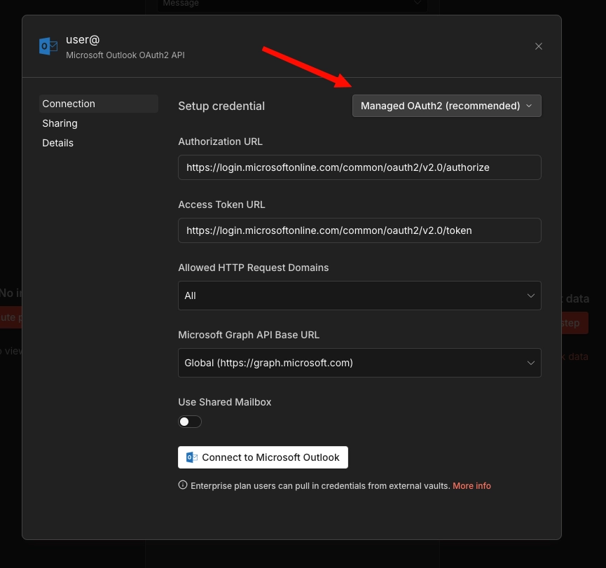

<!-- 简体中文翻译；来源 n8n-io/n8n-docs；原文版本见 upstream.json。 -->


# 预配置 Microsoft OAuth 凭据 <a href="#pre-configure-microsoft-oauth-credentials" id="pre-configure-microsoft-oauth-credentials"></a>

[创建具有委派访问权限的 Microsoft Entra ID 应用注册](../../../../../integrations/builtin/credentials/microsoftentra.md#delegated-access-for-organisation-wide-microsoft-integrations)后，可以通过[凭据覆盖](../../../../../administer/manage-credentials/credential-overwrites.md)，在 n8n 启动时注入客户端 ID 和客户端密钥。这样，组织中的用户无需自行注册 OAuth 应用，即可连接 Microsoft 服务。

n8n 支持三个用于凭据覆盖的环境变量。本指南使用 `CREDENTIALS_OVERWRITE_DATA_FILE`。完整变量参考请参阅[凭据环境变量](../use-environment-variables/credentials.md)。

## 创建凭据文件 <a href="#create-the-credentials-file" id="create-the-credentials-file"></a>

在运行 n8n 的主机上，将名为 `credentials-overwrite.json` 的文件创建在与 `docker-compose.yaml` 相同的目录中。

文件包含一个 JSON 对象，以 n8n 凭据类型名称作为键。例如，预配置 Microsoft Outlook：

```json
{
  "microsoftOutlookOAuth2Api": {
    "clientId": "YOUR_CLIENT_ID",
    "clientSecret": "YOUR_CLIENT_SECRET"
  }
}
```

要同时预配置多个 Microsoft 服务，请将每种凭据类型分别作为键添加：

```json
{
  "microsoftOutlookOAuth2Api": {
    "clientId": "YOUR_CLIENT_ID",
    "clientSecret": "YOUR_CLIENT_SECRET"
  },
  "microsoftOneDriveOAuth2Api": {
    "clientId": "YOUR_CLIENT_ID",
    "clientSecret": "YOUR_CLIENT_SECRET"
  }
}
```


**压缩后的 JSON**

n8n 要求使用压缩后的 JSON，不包含空格或换行。以上示例为了便于阅读而进行了格式化。请确认实际文件没有多余空白：

```json
{"microsoftOutlookOAuth2Api":{"clientId":"YOUR_CLIENT_ID","clientSecret":"YOUR_CLIENT_SECRET"}}
```


各 Microsoft 服务的凭据类型名称，请参阅[各集成所需的作用域](../../../../../integrations/builtin/credentials/microsoftentra.md#required-scopes-by-integration)。

## Docker Compose <a href="#docker-compose" id="docker-compose"></a>

将凭据文件以只读卷挂载，并在 `compose.yaml` 中设置环境变量：

```yaml
services:
  n8n:
    image: n8nio/n8n:latest
    container_name: n8n
    restart: always
    ports:
      - "5678:5678"
    environment:
      - GENERIC_TIMEZONE=America/New_York
      - TZ=America/New_York
      - N8N_ENFORCE_SETTINGS_FILE_PERMISSIONS=true
      - N8N_LOG_LEVEL=debug
      - N8N_LOG_OUTPUT=file,console
      - N8N_LOG_FILE_COUNT_MAX=5
      - CREDENTIALS_OVERWRITE_DATA_FILE=/run/secrets/credentials-overwrite.json
    volumes:
      - n8n_data:/home/node/.n8n
      - ./credentials-overwrite.json:/run/secrets/credentials-overwrite.json:ro
    networks:
      - default
volumes:
  n8n_data:
    name: ${N8N_VOLUME:-n8n_data}
    external: true
```

重启容器以应用修改：

```bash
docker compose up -d
```

## 验证覆盖配置已生效 <a href="#verify-the-overwrite-is-applied" id="verify-the-overwrite-is-applied"></a>

n8n 启动后，让用户为某个已预配置服务创建新凭据，例如 Microsoft Outlook。凭据选择中应显示 **Managed OAuth2 (recommended)（托管 OAuth2，推荐）**选项。



用户可以点击 **Connect to Microsoft Outlook（连接到 Microsoft Outlook）**，无需进行身份验证。随后应显示 **Account connected（账号已连接）**消息。

如果没有 **Managed OAuth 2（托管 OAuth 2）**选项，说明环境变量未正确应用。请检查卷挂载中的文件路径是否与 `CREDENTIALS_OVERWRITE_DATA_FILE` 的值一致。

## Kubernetes <a href="#kubernetes" id="kubernetes"></a>

在 Kubernetes 部署中，用 Kubernetes 原生机制替代 Docker 卷挂载。不同云提供商的做法有所差异，请选择与你的环境对应的部分。

### 普通 Kubernetes Secret（EKS / AKS / GKE） <a href="#plain-kubernetes-secret-eks-aks-gke" id="plain-kubernetes-secret-eks-aks-gke"></a>

此方法适用于三种托管 Kubernetes 服务，无需额外依赖。

**1. 创建 Secret：**

```yaml
apiVersion: v1
kind: Secret
metadata:
  name: n8n-credentials-overwrite
  namespace: your-namespace
type: Opaque
stringData:
  credentials-overwrite.json: '{"microsoftOutlookOAuth2Api":{"clientId":"YOUR_CLIENT_ID","clientSecret":"YOUR_CLIENT_SECRET"}}'
```

**2. 在 Deployment 中挂载 Secret：**

```yaml
spec:
  containers:
    - name: n8n
      image: n8nio/n8n:latest
      env:
        - name: CREDENTIALS_OVERWRITE_DATA_FILE
          value: /run/secrets/credentials-overwrite.json
        # ...your other env vars
      volumeMounts:
        - name: credentials-overwrite
          mountPath: /run/secrets/credentials-overwrite.json
          subPath: credentials-overwrite.json
          readOnly: true
  volumes:
    - name: credentials-overwrite
      secret:
        secretName: n8n-credentials-overwrite
```

`subPath` 字段很重要。缺少此字段时，Kubernetes 会替换整个 `/run/secrets/` 目录，而不是仅挂载单个文件。


**替代方式：直接使用环境变量**

如果不想挂载卷，可以直接将 Secret 引用为环境变量：

```yaml
env:
  - name: CREDENTIALS_OVERWRITE_DATA
    valueFrom:
      secretKeyRef:
        name: n8n-credentials-overwrite
        key: credentials-overwrite.json
```


```yaml
stringData:
  credentials-json: '{"microsoftOutlookOAuth2Api":{"clientId":"...","clientSecret":"..."}}'
```

对于单个服务，这样更简洁。但有些 Kubernetes 环境会限制环境变量大小，例如每个变量最多 128KB。如果有大量凭据覆盖配置，使用文件的方式更稳妥。


### AWS Secrets Manager（EKS） <a href="#aws-secrets-manager-eks" id="aws-secrets-manager-eks"></a>

此方法通过 [AWS Secrets Store CSI Driver](https://docs.aws.amazon.com/secretsmanager/latest/userguide/integrating_csi_driver.html)，将 AWS Secrets Manager 中的密钥直接挂载到 Pod，提供轮换支持、CloudTrail 审计日志和集中式密钥管理。

**前提条件：**

- 集群已安装 Secrets Store CSI Driver 和 ASCP（AWS Secrets and Configuration Provider）。
- 已为集群配置 IAM OIDC 提供商，IRSA 需要此配置。
- 一个具有 `secretsmanager:GetSecretValue` 和 `secretsmanager:DescribeSecret` 权限的 IAM 角色。

**1. 在 AWS Secrets Manager 中创建密钥：**

```bash
aws secretsmanager create-secret \
  --name n8n/credentials-overwrite \
  --description "n8n credential overwrites for Microsoft OAuth" \
  --secret-string '{"microsoftOutlookOAuth2Api":{"clientId":"YOUR_CLIENT_ID","clientSecret":"YOUR_CLIENT_SECRET"}}'
```

**2. 创建 IAM 策略：**

```json
{
  "Version": "2012-10-17",
  "Statement": [
    {
      "Effect": "Allow",
      "Action": [
        "secretsmanager:GetSecretValue",
        "secretsmanager:DescribeSecret"
      ],
      "Resource": "arn:aws:secretsmanager:REGION:ACCOUNT_ID:secret:n8n/credentials-overwrite-*"
    }
  ]
}
```

```bash
aws iam create-policy \
  --policy-name n8n-credentials-overwrite-read \
  --policy-document file://policy.json
```

**3. 创建使用 IRSA 的服务账号：**

```bash
eksctl create iamserviceaccount \
  --name n8n-sa \
  --namespace your-namespace \
  --cluster your-cluster \
  --attach-policy-arn arn:aws:iam::ACCOUNT_ID:policy/n8n-credentials-overwrite-read \
  --approve
```

**4. 创建 SecretProviderClass：**

```yaml
apiVersion: secrets-store.csi.x-k8s.io/v1
kind: SecretProviderClass
metadata:
  name: n8n-credentials-overwrite
  namespace: your-namespace
spec:
  provider: aws
  parameters:
    objects: |
      - objectName: "n8n/credentials-overwrite"
        objectType: "secretsmanager"
        objectAlias: "credentials-overwrite.json"
```

**5. 更新 n8n Deployment：**

```yaml
apiVersion: apps/v1
kind: Deployment
metadata:
  name: n8n
  namespace: your-namespace
spec:
  template:
    spec:
      serviceAccountName: n8n-sa
      containers:
        - name: n8n
          image: n8nio/n8n:latest
          env:
            - name: CREDENTIALS_OVERWRITE_DATA_FILE
              value: /run/secrets/credentials-overwrite.json
          volumeMounts:
            - name: credentials-overwrite
              mountPath: /run/secrets/credentials-overwrite.json
              subPath: credentials-overwrite.json
              readOnly: true
      volumes:
        - name: credentials-overwrite
          csi:
            driver: secrets-store.csi.k8s.io
            readOnly: true
            volumeAttributes:
              secretProviderClass: n8n-credentials-overwrite
```

**轮换密钥：**

更新凭据时，修改 Secrets Manager 中的值：

```bash
aws secretsmanager update-secret \
  --secret-id n8n/credentials-overwrite \
  --secret-string '{"microsoftOutlookOAuth2Api":{"clientId":"NEW_CLIENT_ID","clientSecret":"NEW_CLIENT_SECRET"}}'
```

CSI 驱动会按轮询间隔同步更新的值，默认为两分钟。由于 n8n 在启动时读取凭据文件，需要重启 n8n Pod 才能读取更新后的文件。

### Azure Key Vault（AKS） <a href="#azure-key-vault-aks" id="azure-key-vault-aks"></a>

此方法通过 [Secrets Store CSI Driver 的 Azure Key Vault Provider](https://learn.microsoft.com/en-us/azure/aks/csi-secrets-store-driver)，将 Azure Key Vault 中的密钥挂载到 Pod。

**前提条件：**

- AKS 集群已启用 Secrets Store CSI Driver 和 Azure Key Vault Provider 附加组件。
- 一个 Azure Key Vault 实例。
- 一个有权访问保管库的托管标识或服务主体。
- 集群已启用 Workload Identity，推荐使用它而非 Pod Identity。

**1. 创建或使用现有 Key Vault：**

```bash
az keyvault create \
  --name n8n-credentials-vault \
  --resource-group your-resource-group \
  --location your-region
```

**2. 在 Key Vault 中创建密钥：**

```bash
az keyvault secret set \
  --vault-name n8n-credentials-vault \
  --name n8n-credentials-overwrite \
  --value '{"microsoftOutlookOAuth2Api":{"clientId":"YOUR_CLIENT_ID","clientSecret":"YOUR_CLIENT_SECRET"}}'
```

**3. 设置 Workload Identity：**

创建托管标识并建立联合凭据：

```bash
# Create a managed identity <a href="#create-a-managed-identity" id="create-a-managed-identity"></a>
az identity create \
  --name n8n-workload-identity \
  --resource-group your-resource-group \
  --location your-region

# Get the identity client ID <a href="#get-the-identity-client-id" id="get-the-identity-client-id"></a>
CLIENT_ID=$(az identity show \
  --name n8n-workload-identity \
  --resource-group your-resource-group \
  --query clientId -o tsv)

# Grant the identity access to the Key Vault <a href="#grant-the-identity-access-to-the-key-vault" id="grant-the-identity-access-to-the-key-vault"></a>
az keyvault set-policy \
  --name n8n-credentials-vault \
  --secret-permissions get \
  --spn "$CLIENT_ID"

# Get the OIDC issuer URL for your cluster <a href="#get-the-oidc-issuer-url-for-your-cluster" id="get-the-oidc-issuer-url-for-your-cluster"></a>
OIDC_ISSUER=$(az aks show \
  --name your-cluster \
  --resource-group your-resource-group \
  --query "oidcIssuerProfile.issuerUrl" -o tsv)

# Create the federated credential <a href="#create-the-federated-credential" id="create-the-federated-credential"></a>
az identity credential create \
  --name n8n-workload-identity \
  --resource-group your-resource-group \
  --issuer "$OIDC_ISSUER" \
  --subject system:serviceaccount:your-namespace:n8n-sa \
  --audience api://AzureADTokenExchange
```

**4. 创建 Kubernetes ServiceAccount：**

```yaml
apiVersion: v1
kind: ServiceAccount
metadata:
  name: n8n-sa
  namespace: your-namespace
  annotations:
    azure.workload.identity/client-id: "YOUR_MANAGED_IDENTITY_CLIENT_ID"
  labels:
    azure.workload.identity/use: "true"
```

**5. 创建 SecretProviderClass：**

```yaml
apiVersion: secrets-store.csi.x-k8s.io/v1
kind: SecretProviderClass
metadata:
  name: n8n-credentials-overwrite
  namespace: your-namespace
spec:
  provider: azure
  parameters:
    usePodIdentity: "false"
    useWorkloadIdentity: "true"
    clientID: "YOUR_MANAGED_IDENTITY_CLIENT_ID"
    keyvaultName: "n8n-credentials-vault"
    objects: |
      array:
        - |
          objectName: n8n-credentials-overwrite
          objectType: secret
          objectAlias: credentials-overwrite.json
    tenantId: "YOUR_TENANT_ID"
```

**6. 更新 n8n Deployment：**

```yaml
apiVersion: apps/v1
kind: Deployment
metadata:
  name: n8n
  namespace: your-namespace
spec:
  template:
    spec:
      serviceAccountName: n8n-sa
      containers:
        - name: n8n
          image: n8nio/n8n:latest
          env:
            - name: CREDENTIALS_OVERWRITE_DATA_FILE
              value: /run/secrets/credentials-overwrite.json
          volumeMounts:
            - name: credentials-overwrite
              mountPath: /run/secrets/credentials-overwrite.json
              subPath: credentials-overwrite.json
              readOnly: true
      volumes:
        - name: credentials-overwrite
          csi:
            driver: secrets-store.csi.k8s.io
            readOnly: true
            volumeAttributes:
              secretProviderClass: n8n-credentials-overwrite
```

**轮换密钥：**

```bash
az keyvault secret set \
  --vault-name n8n-credentials-vault \
  --name n8n-credentials-overwrite \
  --value '{"microsoftOutlookOAuth2Api":{"clientId":"NEW_CLIENT_ID","clientSecret":"NEW_CLIENT_SECRET"}}'
```

CSI 驱动按轮询间隔同步，默认为两分钟。之后重启 n8n Pod，让 n8n 读取更新后的文件。

### Google Secret Manager（GKE） <a href="#google-secret-manager-gke" id="google-secret-manager-gke"></a>

此方法通过 [Secrets Store CSI Driver 的 GCP 提供商](https://github.com/GoogleCloudPlatform/secrets-store-csi-driver-provider-gcp)，将 Google Secret Manager 中的密钥挂载到 Pod。

**前提条件：**

- 已启用 Workload Identity Federation 的 GKE 集群。
- 项目已启用 Secret Manager API。
- 一个具有 `secretmanager.secretAccessor` 角色的 Google 服务账号。

**1. 启用 Secret Manager API：**

```bash
gcloud services enable secretmanager.googleapis.com \
  --project your-project-id
```

**2. 创建密钥：**

```bash
echo -n '{"microsoftOutlookOAuth2Api":{"clientId":"YOUR_CLIENT_ID","clientSecret":"YOUR_CLIENT_SECRET"}}' | \
  gcloud secrets create n8n-credentials-overwrite \
    --data-file=- \
    --project your-project-id
```

**3. 设置 Workload Identity Federation：**

```bash
# Create a Google service account <a href="#create-a-google-service-account" id="create-a-google-service-account"></a>
gcloud iam service-accounts create n8n-secret-reader \
  --display-name="n8n Secret Reader" \
  --project your-project-id

# Grant it access to the secret <a href="#grant-it-access-to-the-secret" id="grant-it-access-to-the-secret"></a>
gcloud secrets add-iam-policy-binding n8n-credentials-overwrite \
  --member="serviceAccount:n8n-secret-reader@your-project-id.iam.gserviceaccount.com" \
  --role="roles/secretmanager.secretAccessor" \
  --project your-project-id

# Bind the Kubernetes service account to the Google service account <a href="#bind-the-kubernetes-service-account-to-the-google-service-account" id="bind-the-kubernetes-service-account-to-the-google-service-account"></a>
gcloud iam service-accounts add-iam-policy-binding \
  n8n-secret-reader@your-project-id.iam.gserviceaccount.com \
  --role="roles/iam.workloadIdentityUser" \
  --member="serviceAccount:your-project-id.svc.id.goog[your-namespace/n8n-sa]"
```

**4. 创建 Kubernetes ServiceAccount：**

```yaml
apiVersion: v1
kind: ServiceAccount
metadata:
  name: n8n-sa
  namespace: your-namespace
  annotations:
    iam.gke.io/gcp-service-account: n8n-secret-reader@your-project-id.iam.gserviceaccount.com
```

**5. 安装 CSI Driver 和 GCP 提供商：**

```bash
# Install the CSI driver <a href="#install-the-csi-driver" id="install-the-csi-driver"></a>
helm repo add secrets-store-csi-driver https://kubernetes-sigs.github.io/secrets-store-csi-driver/charts
helm install csi-secrets-store secrets-store-csi-driver/secrets-store-csi-driver \
  --namespace kube-system

# Install the GCP provider <a href="#install-the-gcp-provider" id="install-the-gcp-provider"></a>
kubectl apply -f https://raw.githubusercontent.com/GoogleCloudPlatform/secrets-store-csi-driver-provider-gcp/main/deploy/provider-gcp-plugin.yaml
```

**6. 创建 SecretProviderClass：**

```yaml
apiVersion: secrets-store.csi.x-k8s.io/v1
kind: SecretProviderClass
metadata:
  name: n8n-credentials-overwrite
  namespace: your-namespace
spec:
  provider: gcp
  parameters:
    secrets: |
      - resourceName: "projects/your-project-id/secrets/n8n-credentials-overwrite/versions/latest"
        path: "credentials-overwrite.json"
```

**7. 更新 n8n Deployment：**

```yaml
apiVersion: apps/v1
kind: Deployment
metadata:
  name: n8n
  namespace: your-namespace
spec:
  template:
    spec:
      serviceAccountName: n8n-sa
      containers:
        - name: n8n
          image: n8nio/n8n:latest
          env:
            - name: CREDENTIALS_OVERWRITE_DATA_FILE
              value: /run/secrets/credentials-overwrite.json
          volumeMounts:
            - name: credentials-overwrite
              mountPath: /run/secrets/credentials-overwrite.json
              subPath: credentials-overwrite.json
              readOnly: true
      volumes:
        - name: credentials-overwrite
          csi:
            driver: secrets-store.csi.k8s.io
            readOnly: true
            volumeAttributes:
              secretProviderClass: n8n-credentials-overwrite
```

**轮换密钥：**

创建密钥的新版本：

```bash
echo -n '{"microsoftOutlookOAuth2Api":{"clientId":"NEW_CLIENT_ID","clientSecret":"NEW_CLIENT_SECRET"}}' | \
  gcloud secrets versions add n8n-credentials-overwrite \
    --data-file=- \
    --project your-project-id
```

由于 SecretProviderClass 引用了 `versions/latest`，CSI 驱动会在下次同步时获取新版本。重启 n8n Pod，让 n8n 读取更新后的文件。

## 相关资源 <a id="related-resources"></a>

* [配置示例](./)
