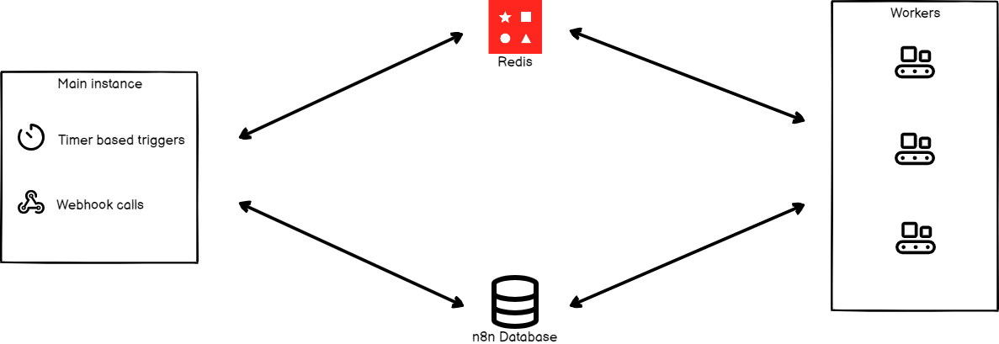

<!-- 简体中文翻译；来源 n8n-io/n8n-docs；原文版本见 upstream.json。 -->


# 队列模式 <a href="#queue-mode" id="queue-mode"></a>

你可以根据需要以不同模式运行 n8n。队列模式提供最佳扩展能力。


**二进制数据存储**

n8n 不支持在队列模式下将二进制数据存储到文件系统。如果工作流需要在队列模式下持久化二进制数据，可以使用 [S3 外部存储](use-external-storage.md)。


## 工作原理 <a href="#how-it-works" id="how-it-works"></a>

队列模式下需要设置多个 n8n 实例：一个主实例接收触发器等工作流信息，工作进程实例负责执行。

每个工作进程都是独立的 Node.js 实例，以 `main` 模式运行；由于每秒输入输出操作数（IOPS）较高，可以同时处理多个工作流执行。

通过工作进程实例和队列模式，可以按需增加或移除工作进程，扩大或缩小 n8n 规模，以应对工作负载。

处理流程如下：

1. n8n 主实例处理定时器和 webhook 调用，生成工作流执行，但不运行。
1. 主实例将执行 ID 传递给消息代理 [Redis](#start-redis)。Redis 维护待执行队列，让下一个可用工作进程领取执行。
1. 工作进程池中的一个工作进程从 Redis 领取消息。
1. 工作进程使用执行 ID，从数据库获取工作流信息。
1. 工作流执行完成后，工作进程会：
	- 将结果写入数据库。
	- 向 Redis 发送执行已完成的通知。
1. Redis 通知主实例。




## 配置工作进程 <a href="#configuring-workers" id="configuring-workers"></a>

工作进程是实际完成任务的 n8n 实例。它们从 n8n 主进程接收需要运行的工作流信息，执行工作流，并在每次执行完成后更新状态。


**每个进程的事件日志文件**

如果工作进程共享可写文件系统，请为每个工作进程配置唯一的事件日志路径。详情请参阅[每个进程的事件日志文件](../../../../administer/observe-and-log/stream-logs-to-external-systems.md#per-process-event-log-files)。


### 设置加密密钥 <a href="#set-encryption-key" id="set-encryption-key"></a>

n8n 首次启动时会自动生成加密密钥。也可以根据需要通过[环境变量](../basic-configuration/use-environment-variables/README.md)提供自定义密钥。

n8n 主实例的加密密钥必须与所有工作进程和 webhook 处理器节点共享，确保这些工作节点能访问数据库中存储的凭据。

通过[配置文件](../basic-configuration.md)或相应环境变量，为每个工作节点设置加密密钥：

```bash
export N8N_ENCRYPTION_KEY=<main_instance_encryption_key>
```

### 设置执行模式 <a href="#set-executions-mode" id="set-executions-mode"></a>


**数据库注意事项**
n8n 支持的 PostgreSQL 版本，请参阅[支持的 PostgreSQL 版本](../choose-n8ns-database.md#supported-postgresql-versions)。

不建议在使用 SQLite 数据库时，将 n8n 执行模式设为 `queue`。


使用以下命令，在主实例和所有工作进程上将环境变量 `EXECUTIONS_MODE` 设为 `queue`。

```bash
export EXECUTIONS_MODE=queue
```

也可以在[配置文件](../basic-configuration/use-environment-variables/README.md)中将 `executions.mode` 设为 `queue`。

### 启动 Redis <a href="#start-redis" id="start-redis"></a>


**在独立机器上运行 Redis**

可以在独立机器上运行 Redis，只需确保 n8n 实例能访问它。


要在 Docker 容器中运行 Redis，请按以下说明操作：

运行以下命令启动 Redis 实例：

```
docker run --name some-redis -p 6379:6379  -d redis
```

Redis 默认运行在 `localhost`，端口为 `6379`，且未设置密码。根据 Redis 配置，为 n8n 主进程设置以下配置，使 n8n 能与 Redis 交互。

| 使用配置文件 | 使用环境变量 | 说明 |
| ------ | ------ | ----- |
| `queue.bull.redis.host:localhost` | `QUEUE_BULL_REDIS_HOST=localhost` | Redis 默认运行在 `localhost`。 |
| `queue.bull.redis.port:6379` | `QUEUE_BULL_REDIS_PORT=6379` | 默认端口为 `6379`。如果 Redis 使用其他端口，请配置此值。 |

还可以设置以下可选配置：

| 使用配置文件 | 使用环境变量 | 说明 |
| ------ | ------ | ----- |
| `queue.bull.redis.username:USERNAME` | `QUEUE_BULL_REDIS_USERNAME` | Redis 默认不要求用户名。如果使用特定用户，请配置此变量。 |
| `queue.bull.redis.password:PASSWORD` | `QUEUE_BULL_REDIS_PASSWORD` | Redis 默认不要求密码。如果使用密码，请配置此变量。 |
| `queue.bull.redis.db:0` | `QUEUE_BULL_REDIS_DB` | 默认值为 `0`。如果更改此值，请更新配置。 |
| `queue.bull.redis.timeoutThreshold:10000ms` | `QUEUE_BULL_REDIS_TIMEOUT_THRESHOLD` | 指定 Redis 不可用时，n8n 在退出前等待的时长，默认 `10000` 毫秒。 |
| `queue.bull.gracefulShutdownTimeout:30` | `N8N_GRACEFUL_SHUTDOWN_TIMEOUT` | 工作进程在终止前等待作业执行完毕的优雅关闭超时时间，默认 `30` 秒。 |


现在可以启动 n8n 实例，它会连接到 Redis 实例。

### 启动工作进程 <a href="#start-workers" id="start-workers"></a>

需要启动工作进程，n8n 才能执行工作流。要在独立机器上托管工作进程，请在该机器上安装 n8n，并确保它连接到 Redis 实例和 n8n 数据库。

在根目录运行以下命令，启动工作进程：

```
./packages/cli/bin/n8n worker
```

如果使用 Docker，请运行以下命令：

```
docker run --name n8n-queue -p 5679:5678 n8nio/n8n worker
```

可以设置多个工作进程。确保所有工作进程都能访问 Redis 和 n8n 数据库。

#### 工作进程服务器 <a href="#worker-server" id="worker-server"></a>

每个工作进程都运行一个服务器，提供以下可选端点：

- `/healthz`：启用 `QUEUE_HEALTH_CHECK_ACTIVE` 环境变量后，返回工作进程是否运行。
- `/healthz/readiness`：启用 `QUEUE_HEALTH_CHECK_ACTIVE` 环境变量后，返回工作进程的数据库和 Redis 连接是否就绪。
- [凭据覆盖端点](../../../../administer/manage-credentials/credential-overwrites.md)。
- [`/metrics`](../basic-configuration/configuration-examples/enable-prometheus-metrics.md)


**自定义健康检查端点**

可以通过 [`N8N_ENDPOINT_HEALTH`](../basic-configuration/use-environment-variables/endpoints.md) 环境变量自定义健康检查端点路径。


#### 查看运行中的工作进程 <a href="#view-running-workers" id="view-running-workers"></a>


**功能可用范围**

查看运行中工作进程的功能可用于：

- **自托管：**企业版。

n8n Cloud Enterprise 用户请[联系 n8n](https://n8n-community.typeform.com/to/y9X2YuGa) 启用。


在 n8n 中选择 **Settings**（设置）> **Workers**（工作进程），即可查看运行中的工作进程及其性能指标。

## 使用队列运行 n8n <a href="#running-n8n-with-queues" id="running-n8n-with-queues"></a>

使用队列运行 n8n 时，所有生产工作流执行都由工作进程处理。对于 webhook，主进程或 webhook 进程接收 HTTP 请求，但将实际工作流执行交给工作进程，这可能带来一些额外开销和延迟。

Redis 作为消息代理，数据库负责持久化数据，因此两者都必须可访问。不支持使用 SQLite 运行这种配置的分布式系统。


**迁移数据**

如果要将数据从一个数据库迁移到另一个数据库，可以使用导出和导入命令。使用方式请参阅 [n8n CLI 命令](../use-the-command-line.md#export-workflows-and-credentials)文档。


## Webhook 处理器 <a href="#webhook-processors" id="webhook-processors"></a>


**请注意**

Webhook 进程依赖 Redis，也需要设置 `EXECUTIONS_MODE` 环境变量。请按上文[配置工作进程](#configuring-workers)一节设置 webhook 处理器节点。


Webhook 处理器是 n8n 的另一层扩展方式。配置 webhook 处理器是可选项，可用于扩展入站 webhook 请求的处理能力。

这种方式允许 n8n 处理大量并行请求。只需相应增加 webhook 进程和工作进程即可。Webhook 进程会在相同端口监听请求，默认为 `5678`。请在容器或独立机器中运行这些进程，并使用负载均衡系统分发请求。

n8n 不建议将主进程加入负载均衡池，否则主进程也会接收请求，可能承受高负载，导致 n8n 界面的编辑、查看和交互性能下降。

在根目录执行以下命令，启动 webhook 处理器：

```
./packages/cli/bin/n8n webhook
```

如果使用 Docker，请运行以下命令：

```
docker run --name n8n-queue -p 5679:5678 -e "EXECUTIONS_MODE=queue" n8nio/n8n webhook
```

### 配置 webhook URL <a href="#configure-webhook-url" id="configure-webhook-url"></a>

要配置 webhook URL，请在运行 n8n 主实例的机器上执行以下命令：

```bash
export N8N_WEBHOOK_URL=https://your-webhook-url.com
```

自 n8n 2.30.0 起可使用 `N8N_WEBHOOK_URL`；更早版本请使用 `WEBHOOK_URL`。

也可以在配置文件中设置此值。

### 配置负载均衡器 <a href="#configure-load-balancer" id="configure-load-balancer"></a>

使用多个 webhook 进程时，需要负载均衡器分发请求。如果 n8n 实例和 webhook 使用相同域名，可以按以下方式配置负载均衡器：

- 将 webhook 触发器请求分发到 webhook 服务器池，需考虑的路径：
  - `/webhook/*`：Webhook 触发器节点端点。
  - `/webhook-waiting/*`：执行“发送并等待”操作的节点所使用的人工参与 webhook 端点，例如 Slack 节点。
- 其他所有路径，包括 n8n 内部 API、编辑器静态文件等，都应路由到主进程。

**注意：**手动工作流执行的默认 URL 为 `/webhook-test/*`，请确保这些 URL 路由到主进程。

可以通过配置文件中的 `endpoints.webhook` 或 `N8N_ENDPOINT_WEBHOOK` 环境变量更改此路径。如果更改，请相应更新负载均衡器。

### 禁用主进程中的 webhook 处理，可选 <a href="#disable-webhook-processing-in-the-main-process-optional" id="disable-webhook-processing-in-the-main-process-optional"></a>

你已有 webhook 处理器来执行工作流，可以禁用主进程中的 webhook 处理，确保所有 webhook 执行都由 webhook 处理器处理。在配置文件中将 `endpoints.disableProductionWebhooksOnMainProcess` 设为 `true`，使 n8n 不在主进程中处理 webhook 请求。

也可以使用以下命令：

```bash
export N8N_DISABLE_PRODUCTION_MAIN_PROCESS=true
```

禁用主进程的 webhook 处理后，仍需运行主进程，但不要将其加入负载均衡器的 webhook 池。

## 大型 webhook 响应 <a id="large-webhook-responses"></a>

队列模式下，工作进程负责执行，但发送 webhook 请求的客户端始终连接到主实例或 webhook 实例。**Respond to Webhook** 节点的响应会包含在队列消息中，从工作进程传回该实例，因此消息传递期间 Redis 会保存完整响应。

`N8N_WEBHOOK_RESPONSE_RELAY_SIZE_MAX` 以 MiB 为单位设置此消息的大小上限，默认 `64`。Redis 在消息传递期间会保存响应的多个副本，因此每个传递中的响应应预留约为此值 1.5 倍的 Redis 内存。未启用外部存储卸载时，响应超限会导致节点失败。

MCP Trigger 工作流从工作进程返回的工具结果也受此上限约束。工具结果无法卸载到存储，因此结果过大时，MCP 客户端会收到指出该上限的工具错误。

### 将大型响应体卸载到存储 <a id="offload-a-large-response-body-to-storage"></a>


**自 n8n 2.34.0 起提供**


在工作进程上设置 `N8N_WEBHOOK_RESPONSE_RELAY_OFFLOAD_ENABLED=true`，将超出上限的响应体保存到[二进制数据存储](../basic-configuration/use-environment-variables/binary-data.md)，避免节点失败。此时队列消息携带存储引用，主实例从存储中将响应体流式传输给客户端，n8n 会在响应发送完成后删除已存储的响应体。

卸载需要每个实例都能读取的存储。除 `default` 外的每种模式都会存储数据，因此请将 `N8N_DEFAULT_BINARY_DATA_MODE` 设为 `filesystem`、`database`、`s3` 或 `azure`：

```bash
export N8N_WEBHOOK_RESPONSE_RELAY_SIZE_MAX=64
export N8N_WEBHOOK_RESPONSE_RELAY_OFFLOAD_ENABLED=true
export N8N_DEFAULT_BINARY_DATA_MODE=s3
```

对于大型响应，n8n 推荐 `s3` 或 `azure`。两者都支持流式传输响应体，使主实例每次仅在内存中保留一个数据块。配置方式请参阅[外部存储](use-external-storage.md)。在 `database` 模式下，主实例先将整个响应体载入内存，再发送，且响应会经过主数据库。在 `filesystem` 模式下，每个实例都需要挂载同一磁盘，n8n 不推荐这种方式。`default` 模式将二进制数据保留在内存中，主实例无从读取，因此超出上限的响应仍会导致节点失败。

n8n 仅卸载响应体，仍按相同上限衡量响应的其余部分，包括标头和状态码。因此，如果仅标头就已超限，无论是否启用卸载，响应都会失败。

### 升级过程中启用卸载 <a id="turn-on-offloading-during-an-upgrade"></a>

只有运行 n8n 2.34.0 或更高版本的主实例才能读取卸载后的响应体。旧版会将存储引用而非响应体返回给客户端。请先升级所有主实例和 webhook 实例，再在工作进程上设置 `N8N_WEBHOOK_RESPONSE_RELAY_OFFLOAD_ENABLED`。未设置此变量的工作进程仍将每个响应内联发送，超过上限时就会失败。

### 排查大型 webhook 响应问题 <a id="troubleshoot-large-webhook-responses"></a>

| 错误 | 原因 | 解决方法 |
| :---- | :---- | :-- |
| `The response is too large to be sent back from the worker`，指出 `N8N_WEBHOOK_RESPONSE_RELAY_OFFLOAD_ENABLED` | 工作进程未启用卸载。 | 在工作进程上设置此变量，或提高 `N8N_WEBHOOK_RESPONSE_RELAY_SIZE_MAX`。 |
| `The response is too large to be sent back from the worker`，指出 `N8N_DEFAULT_BINARY_DATA_MODE` | 二进制数据存储将数据保留在内存中，无法卸载到其他位置。 | 将 `N8N_DEFAULT_BINARY_DATA_MODE` 设为 `filesystem`、`database`、`s3` 或 `azure`。 |
| `The response is too large for the binary-data store to hold` | `database` 模式因自身大小上限拒绝了响应体。 | 提高 `N8N_BINARY_DATA_DATABASE_MAX_FILE_SIZE`，最高为数据库列可容纳的 1 GB；或切换为自身不设上限的 `filesystem`、`s3` 或 `azure`。 |
| `The stored webhook response body could not be read` | 主实例无法读取工作进程写入的存储。 | 让每个实例都指向同一存储。在 `filesystem` 模式下，每个实例都需要挂载同一磁盘，n8n 不推荐这种方式。 |

## 配置工作进程并发 <a href="#configure-worker-concurrency" id="configure-worker-concurrency"></a>

可以使用 `concurrency` 标志，定义工作进程并行运行的作业数量，默认为 `10`。更改方式：

```bash
n8n worker --concurrency=5
```

## 并发与扩展建议 <a href="#concurrency-and-scaling-recommendations" id="concurrency-and-scaling-recommendations"></a>

n8n 建议将工作进程实例的并发数设为 5 或更高。使用大量工作进程但设置较低并发数，可能耗尽数据库连接池，导致处理延迟和失败。

## 多主实例配置 <a href="#multi-main-setup" id="multi-main-setup"></a>


**功能可用范围**

多主实例配置可用于：

- **自托管：**企业版。

n8n Cloud 不提供此功能。


在队列模式下，可以运行多个 `main` 进程以实现高可用。

在单主实例配置中，`main` 进程执行两类任务：

- **常规任务**，例如运行 API、提供界面和监听 webhook；
- **至多执行一次的任务**，例如运行非 HTTP 触发器，包括定时器、轮询器，以及 RabbitMQ、IMAP 等持久连接，还包括清理执行和二进制数据。

在多主实例配置中，有两类 `main` 进程：

- **跟随者（follower）**，执行**常规任务**；
- **领导者（leader）**，**同时执行常规任务和至多执行一次的任务**。

### 领导者指定 <a href="#leader-designation" id="leader-designation"></a>

在多主实例配置中，所有主实例会自动处理领导者机制，对用户透明。如果当前领导者不可用，例如崩溃或事件循环过于繁忙，其他跟随者就可以接管。先前的领导者恢复响应后，会成为跟随者。

### 配置多主实例部署 <a href="#configuring-multi-main-setup" id="configuring-multi-main-setup"></a>

要部署多主实例 n8n，请确保：

- 所有 `main` 进程都以队列模式运行，并连接到 Postgres 和 Redis。
- 所有 `main` 和 `worker` 进程都运行相同版本的 n8n。
- 所有 `main` 进程都将环境变量 `N8N_MULTI_MAIN_SETUP_ENABLED` 设为 `true`。
- 所有 `main` 进程都位于启用会话保持，即粘性会话的负载均衡器之后。

如有需要，可以调整领导者键的选项：

| 使用配置文件 | 使用环境变量 | 说明 |
| ------ | ------ | ----- |
| `multiMainSetup.ttl:10` | `N8N_MULTI_MAIN_SETUP_KEY_TTL=10` | 多主实例配置中领导者键的生存时间，单位为秒。 |
| `multiMainSetup.interval:3` | `N8N_MULTI_MAIN_SETUP_CHECK_INTERVAL=3` | 多主实例配置中检查领导者的间隔，单位为秒。 |


## 相关资源 <a id="related-resources"></a>

* [扩展](../scaling.md)
* [衡量性能](measure-performance.md)
* [控制并发](control-concurrency.md)
* [管理执行数据](manage-execution-data.md)
* [处理二进制数据](handle-binary-data.md)
* [使用外部存储](use-external-storage.md)
* [解决内存问题](fix-memory-issues.md)
