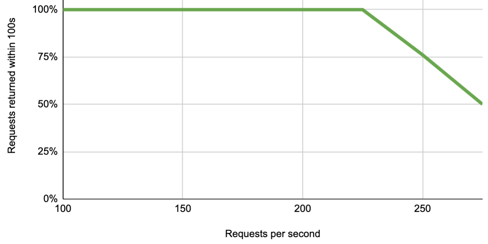
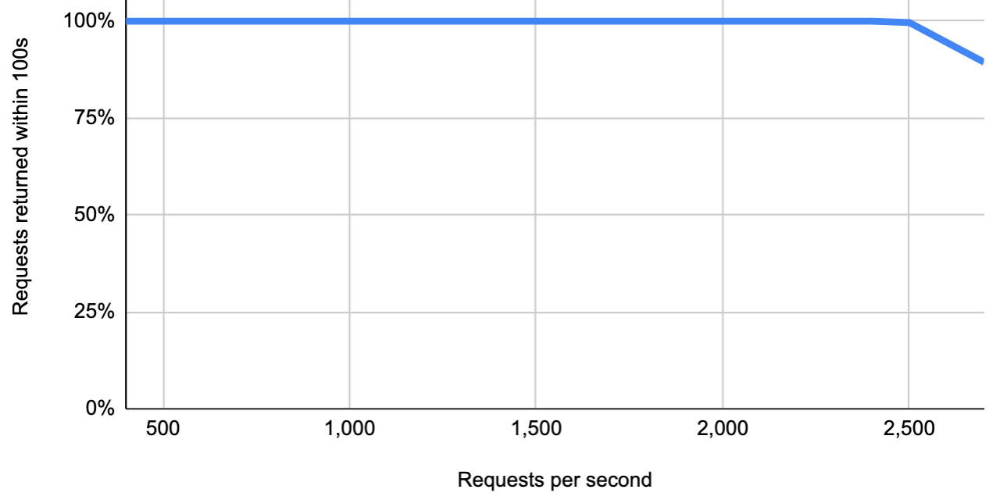

<!-- 简体中文翻译；来源 n8n-io/n8n-docs；原文版本见 upstream.json。 -->

# 性能与基准测试 

单个 n8n 实例每秒最多可处理 220 次工作流执行，还可以通过增加实例进一步扩展。

本文介绍 n8n 的性能基准测试，说明影响性能的因素，并提供两个基准测试示例。

## 性能影响因素 

n8n 性能受以下因素影响：

* 工作流类型。
* n8n 可用的资源。
* n8n 扩展选项的配置方式。

## 运行你自己的基准测试 

要准确估算你的使用场景，请运行 n8n 的[基准测试框架](https://github.com/n8n-io/n8n/tree/master/packages/quality/efficiency/scale/benchmark)。仓库中提供了更多基准测试说明。

## 示例：单实例性能 

此测试衡量每秒请求数增加时，响应时间如何变化，观察调用 Webhook Trigger 节点时的响应时间。

测试配置：

- 硬件：ECS c5a.large 实例，4 GB RAM。
- n8n 配置：单个 n8n 实例，以主进程模式运行，使用 Postgres 数据库。
- 工作流：Webhook Trigger 节点、Edit Fields 节点。

<figure markdown>
  
  <figcaption>此图显示向 Webhook Trigger 节点发出的请求中，在 100 秒内收到响应的百分比，以及该比例如何随负载变化。负载较高时，n8n 通常仍会处理数据，但响应时间会超过 100 秒。</figcaption>
</figure>

## 示例：多实例性能 

此测试衡量每秒请求数增加时，响应时间如何变化，观察调用 Webhook Trigger 节点时的响应时间。

测试配置：

- 硬件：七个 ECS c5a.4xlarge 实例，每个 8 GB RAM。
- n8n 配置：两个 webhook 实例、四个工作进程实例、一个数据库实例（MySQL），以及一个运行 n8n 和 Redis 的主实例。
- 工作流：Webhook Trigger 节点、Edit Fields 节点。
- 多实例配置使用[队列模式](enable-queue-mode.md)。

<figure markdown>
  
  <figcaption>此图显示向 Webhook Trigger 节点发出的请求中，在 100 秒内收到响应的百分比，以及该比例如何随负载变化。负载较高时，n8n 通常仍会处理数据，但响应时间会超过 100 秒。</figcaption>
</figure>

## 相关资源 

* [扩展](../scaling.md)
* [启用队列模式](enable-queue-mode.md)
* [控制并发](control-concurrency.md)
* [管理执行数据](manage-execution-data.md)
* [处理二进制数据](handle-binary-data.md)
* [使用外部存储](use-external-storage.md)
* [解决内存问题](fix-memory-issues.md)
