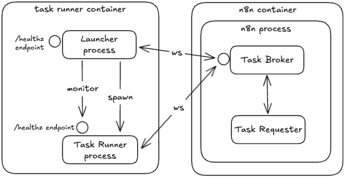

<!-- 简体中文翻译；来源 n8n-io/n8n-docs；原文版本见 upstream.json。 -->


# 设置任务运行器 <a id="set-up-task-runners"></a>

任务运行器是一种安全、高效执行任务的通用机制，用于执行 [Code 节点](../../../integrations/builtin/core-nodes/n8n-nodes-base.code/README.md)中用户提供的 JavaScript 和 Python 代码。

本文介绍任务运行器的工作原理及配置方式。


**生产环境始终使用任务运行器**

任务运行器是用户代码与 n8n 之间唯一的隔离层。不使用运行器，或使用[内部模式](set-up-task-runners.md#internal-mode)时，任何能编辑工作流的人都可能读取数据库、[加密密钥](basic-configuration/configuration-examples/set-a-custom-encryption-key.md)、已存储的凭据和环境变量。

在生产环境和任何保存敏感数据的实例上，请使用[外部模式](set-up-task-runners.md#external-mode)，并采取[加固任务运行器](security/harden-task-runners.md)中的措施。只有不包含敏感数据、仅保存可信数据或模拟数据的隔离实例，才适合为节省托管成本而不使用外部模式。


## 工作原理 <a href="#how-it-works" id="how-it-works"></a>

任务运行器功能由以下组件组成：一个或多个任务运行器、任务代理和任务请求方。

.png>)

任务运行器通过 WebSocket 连接到任务代理。任务请求方向代理提交任务请求，由可用的任务运行器领取并执行。

运行器执行任务，并将结果提交给任务请求方。任务代理协调运行器与请求方之间的通信。

n8n 实例，包括主实例和工作进程，充当代理；此处 Code 节点是任务请求方。

## 任务运行器模式 <a href="#task-runner-modes" id="task-runner-modes"></a>

任务运行器有两种模式：内部模式和外部模式。

### 内部模式 <a href="#internal-mode" id="internal-mode"></a>

内部模式下，n8n 实例将任务运行器作为子进程启动，这种设计本身不安全。n8n 进程监控并管理任务运行器的生命周期。任务运行器进程与 n8n 共享相同的 `uid` 和 `gid`。


**功能可用范围**

自 n8n 3.0 起，内部模式已弃用，未来版本会移除。以内部模式运行时，包括未设置 `N8N_RUNNERS_MODE` 的情况，n8n 会在启动时记录弃用警告。请迁移到[外部模式](set-up-task-runners.md#external-mode)，获得更安全的隔离和扩展能力。

不建议在生产环境使用内部模式。运行器与 n8n 在同一主机上以相同用户运行，一旦代码逃逸运行器沙箱，就具有与 n8n 相同的访问权限，包括已存储的凭据，参阅本页顶部警告。仅在不包含敏感数据的隔离实例上使用内部模式。


### 外部模式 <a href="#external-mode" id="external-mode"></a>

外部模式下，[启动器应用](https://github.com/n8n-io/task-runner-launcher)按需启动任务运行器并管理其生命周期。通常需要在 n8n 旁增加一个边车容器，运行 [`n8nio/runners`](https://hub.docker.com/r/n8nio/runners) 镜像，其中包含启动器、JS 任务运行器和 Python 任务运行器。此边车容器独立于 n8n 实例。启动器提供健康检查端点，用于监控任务运行器进程。



使用[队列模式](scaling/enable-queue-mode.md)时，每个工作进程都需要自己的任务运行器边车容器。

此外，如果 [`OFFLOAD_MANUAL_EXECUTIONS_TO_WORKERS=false`](basic-configuration/use-environment-variables/queue-mode.md#queue-mode-environment-variables)，主实例就会运行手动执行，也需要自己的任务运行器边车容器。请注意，不建议在生产环境关闭执行卸载。

## 设置外部模式 <a href="#setting-up-external-mode" id="setting-up-external-mode"></a>

外部模式下，在 n8n 旁将 `n8nio/runners` 镜像作为边车容器运行。以下 Docker Compose 配置供参考。请注意，`n8nio/runners` 镜像版本必须与 `n8nio/n8n` 镜像版本一致，且 n8n 版本必须 >=1.111.0。

```yaml
services:
  n8n:
    image: n8nio/n8n:1.111.0
    container_name: n8n-main
    environment:
      - N8N_RUNNERS_ENABLED=true
      - N8N_RUNNERS_MODE=external
      - N8N_RUNNERS_BROKER_LISTEN_ADDRESS=0.0.0.0
      - N8N_RUNNERS_AUTH_TOKEN=your-secret-here
      - N8N_NATIVE_PYTHON_RUNNER=true
    ports:
      - "5678:5678"
    volumes:
      - n8n_data:/home/node/.n8n
    # etc.

  task-runners:
    image: n8nio/runners:1.111.0
    container_name: n8n-runners
    environment:
      - N8N_RUNNERS_TASK_BROKER_URI=http://n8n-main:5679
      - N8N_RUNNERS_AUTH_TOKEN=your-secret-here
      # etc.
    depends_on:
      - n8n

volumes:
  n8n_data:
```

配置分三层：n8n 容器、运行器容器，以及运行器容器内的启动器。

### 配置外部模式下的 n8n 容器 <a href="#configuring-n8n-container-in-external-mode" id="configuring-n8n-container-in-external-mode"></a>

以下是在外部模式下，可为 n8n 容器设置的主要环境变量：


**功能可用范围**

`N8N_RUNNERS_ENABLED` 自 n8n 2.0 起已弃用，无需再设置。n8n 1.x 仍支持此变量，必须设为 `true` 才能启用任务运行器。在 1.x 中禁用任务运行器，会使 Code 节点脚本直接在 n8n 主进程中运行，完全没有隔离。任何包含敏感凭据或数据的实例都不应这样配置。


| 环境变量 | 说明 |
| ------------------------------------------------------ | ----------------------------------------------------------------------------------------------------------------------------------------------------------------------------- |
| `N8N_RUNNERS_ENABLED=true` | 启用任务运行器。自 n8n 2.0 起已弃用，n8n 1.x 仍支持。 |
| `N8N_RUNNERS_MODE=external` | 以外部模式使用任务运行器。 |
| `N8N_RUNNERS_AUTH_TOKEN=<random secure shared secret>` | 任务运行器用于连接代理的共享密钥。 |
| `N8N_RUNNERS_BROKER_LISTEN_ADDRESS=0.0.0.0` | 任务代理默认仅监听 localhost。使用多个容器时，例如 Docker Compose，需要能够接受外部连接。 |

完整环境变量列表请参阅[任务运行器环境变量](basic-configuration/use-environment-variables/task-runners.md)。

### 配置外部模式下的运行器容器 <a href="#configuring-runners-container-in-external-mode" id="configuring-runners-container-in-external-mode"></a>

以下是在外部模式下，可为运行器容器设置的主要环境变量：

| 环境变量 | 说明 |
| ------------------------------------------------------ | --------------------------------------------------------------------------------------------------------------------------------------------------------------------------------------------------------------------------- |
| `N8N_RUNNERS_AUTH_TOKEN=<random secure shared secret>` | 任务运行器用于连接代理的共享密钥。 |
| `N8N_RUNNERS_TASK_BROKER_URI=localhost:5679` | n8n 实例中任务代理服务器的地址。 |
| `N8N_RUNNERS_AUTO_SHUTDOWN_TIMEOUT=15` | 任务运行器进程在关闭前等待的空闲秒数。有新任务需要执行时，启动器会自动再次启动运行器。设为 `0` 可禁用自动关闭。 |

完整环境变量列表请参阅[任务运行器环境变量](basic-configuration/use-environment-variables/task-runners.md)。

### 配置外部模式下运行器容器内的启动器 <a href="#configuring-launcher-in-runners-container-in-external-mode" id="configuring-launcher-in-runners-container-in-external-mode"></a>

启动器从运行器容器的环境中读取环境变量，并执行以下操作：

* 将自身环境中的环境变量传递给所有运行器（`allowed-env`）。
* 为特定运行器设置特定环境变量（`env-overrides`）。

要传递和设置哪些环境变量，由运行器镜像中包含的[启动器配置文件](https://github.com/n8n-io/n8n/blob/master/docker/images/runners/n8n-task-runners.json)定义。此文件在容器内位于 `/etc/task-runners.json`。更多信息请参阅[配置文件文档](https://github.com/n8n-io/task-runner-launcher/blob/main/docs/setup.md#config-file)。

默认启动器配置文件采用严格限制，但可以编辑，例如将第一方或第三方模块加入允许列表。要自定义启动器配置文件，请挂载到此路径：

```
path/to/n8n-task-runners.json:/etc/n8n-task-runners.json
```

## 添加额外依赖 <a href="#adding-extra-dependencies" id="adding-extra-dependencies"></a>

### 1. 扩展 `n8nio/runners` 镜像 <a href="#id-1-extend-the-n8niorunners-image" id="id-1-extend-the-n8niorunners-image"></a>

可以扩展 `n8nio/runners` 镜像，为运行器添加额外依赖。这至少需要 `n8nio/runners:1.121.0`。

```dockerfile
FROM n8nio/runners:1.121.0
USER root
RUN cd /opt/runners/task-runner-javascript && pnpm add moment uuid
RUN cd /opt/runners/task-runner-python && uv pip install numpy pandas
COPY n8n-task-runners.json /etc/n8n-task-runners.json
USER runner
```

还必须将 Code 节点要使用的第一方或第三方包加入允许列表。请编辑 `n8n-task-runners.json` 配置文件，包含扩展镜像中的包。

```json
{
  "task-runners": [
    {
      "runner-type": "javascript",
      "env-overrides": {
        "NODE_FUNCTION_ALLOW_BUILTIN": "crypto",         // <-- allowlist Node.js builtin modules here
        "NODE_FUNCTION_ALLOW_EXTERNAL": "moment,uuid",   // <-- allowlist third-party JS packages here
      }
    },
    {
      "runner-type": "python",
      "env-overrides": {
        "PYTHONPATH": "/opt/runners/task-runner-python",
        "N8N_RUNNERS_STDLIB_ALLOW": "json",              // <-- allowlist Python standard library packages here
        "N8N_RUNNERS_EXTERNAL_ALLOW": "numpy,pandas"     // <-- allowlist third-party Python packages here
      }
    }
  ]
}
```

* `NODE_FUNCTION_ALLOW_BUILTIN`：以逗号分隔的允许使用的 Node.js 内置模块列表。
* `NODE_FUNCTION_ALLOW_EXTERNAL`：以逗号分隔的允许使用的 JS 包列表。
* `N8N_RUNNERS_STDLIB_ALLOW`：以逗号分隔的允许使用的 Python 标准库包列表。
* `N8N_RUNNERS_EXTERNAL_ALLOW`：以逗号分隔的允许使用的 Python 包列表。

### 2. 构建自定义镜像 <a href="#id-2-build-your-custom-image" id="id-2-build-your-custom-image"></a>

例如，在 n8n 仓库根目录中运行：

```bash
docker buildx build \
  -f docker/images/runners/Dockerfile \
  -t n8nio/runners:custom \
  .
```

### 3. 运行镜像 <a href="#id-3-run-the-image" id="id-3-run-the-image"></a>

例如：

```bash
docker run --rm -it \
  -e N8N_RUNNERS_AUTH_TOKEN=test \
  -e N8N_RUNNERS_LAUNCHER_LOG_LEVEL=debug \
  -e N8N_RUNNERS_TASK_BROKER_URI=http://host.docker.internal:5679 \
  -p 5680:5680 \
  n8nio/runners:custom
```

## 相关资源 <a id="related-resources"></a>

* [配置 n8n](./)
