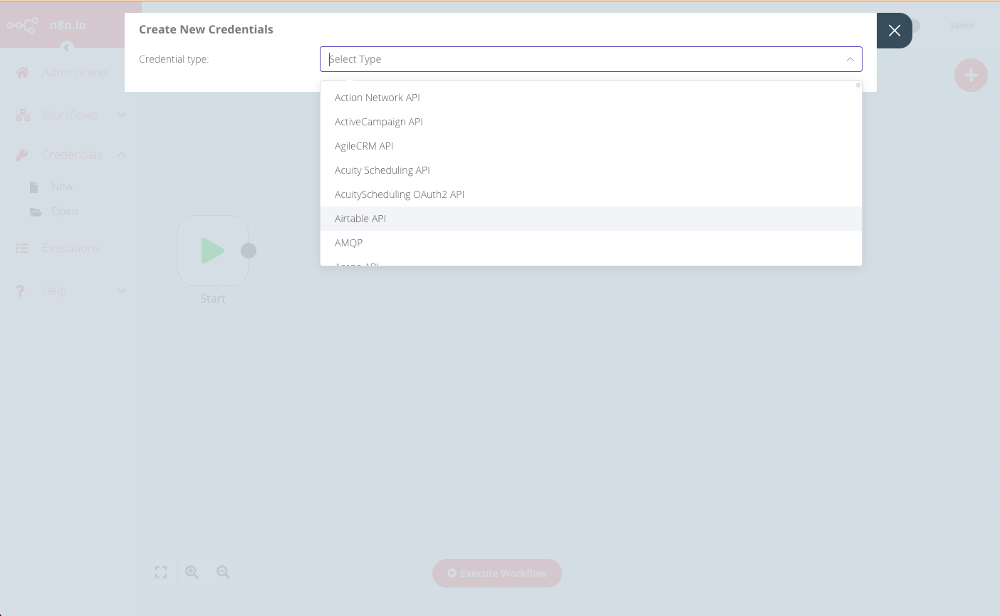
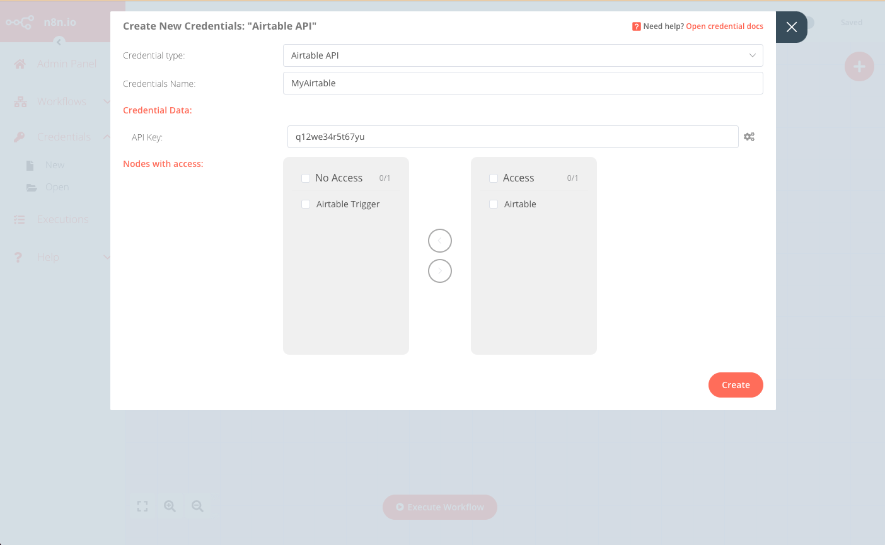
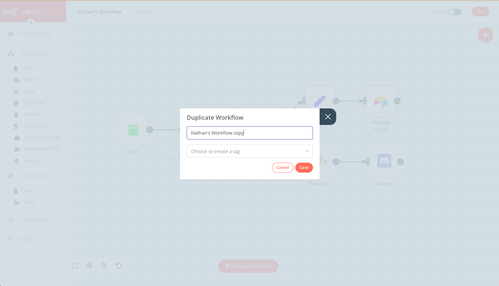

<!-- 简体中文翻译；来源 n8n-io/n8n-docs；原文版本见 upstream.json。 -->


# 管理工作流 <a href="#managing-workflows" id="managing-workflows"></a>



管理跨团队或组织的 n8n OEM 部署时，通常需要为多个用户运行相同或相似的工作流。有两种方式：

| 方案 | 优点 | 缺点 |
| -------- | ---- | ---- |
| 为每个用户创建一个工作流 | 不限制工作流启动方式，可使用任意触发器 | 需要管理多个工作流。 |
| 创建单个工作流，执行时传入用户凭据 | 简化工作流管理，只需修改一个工作流 | 必须由你的产品调用，才能运行工作流。 |



本文引用的 API 可能随时更改。每次升级版本时，都应检查其功能是否仍然正常。


## 每个用户一个工作流 <a href="#workflow-per-user" id="workflow-per-user"></a>

一般分为三个步骤：

* 获取每个用户的凭据，以及工作流可能需要的其他参数。
* 为该用户创建 [n8n 凭据](#user-content-fn-1)[^1]。
* 创建工作流。

### 1. 获取用户凭据 <a href="#1-obtain-user-credentials" id="1-obtain-user-credentials"></a>

需要收集该用户在所有需身份验证的节点或服务上使用的凭据，以及特定工作流要求的其他参数。具体凭据和参数取决于工作流及要完成的任务。

### 2. 创建用户凭据 <a href="#2-create-user-credentials" id="2-create-user-credentials"></a>

获取所有相关凭据详情后，可以在 n8n 中创建对应服务凭据，通过编辑器界面或 API 调用完成。


#### 使用编辑器界面 <a href="#using-the-editor-ui" id="using-the-editor-ui"></a>

1. 从菜单选择 **Credentials**（凭据）> **New**（新建）。
1. 使用下拉菜单选择要创建的 **Credential type**（凭据类型），例如 *Airtable*。
    
1. 在 **Create New Credentials**（创建新凭据）弹窗中，输入该用户的对应凭据详情，并选择可以访问这些凭据的节点。
    
1. 点击 **Create**（创建）完成并保存。

#### 使用 API <a href="#using-the-api" id="using-the-api"></a>

也可以调用编辑器界面所用的前端 API，实现相同结果。API 端点格式为：`https://<n8n-domain>/rest/credentials`。

例如，要创建上面编辑器界面示例中的凭据，请发送以下请求：
```
POST https://<n8n-domain>/rest/credentials
```

请求体如下：
```json
{
   "name":"MyAirtable",
   "type":"airtableApi",
   "nodesAccess":[
      {
         "nodeType":"n8n-nodes-base.airtable"
      }
   ],
   "data":{
      "apiKey":"q12we34r5t67yu"
   }
}
```

响应包含新凭据的 ID，之后为该用户创建工作流时会用到：
```json
{
   "data":{
      "name":"MyAirtable",
      "type":"airtableApi",
      "data":{
         "apiKey":"q12we34r5t67yu"
      },
      "nodesAccess":[
         {
            "nodeType":"n8n-nodes-base.airtable",
            "date":"2021-09-10T07:41:27.770Z"
         }
      ],
      "id":"29",
      "createdAt":"2021-09-10T07:41:27.777Z",
      "updatedAt":"2021-09-10T07:41:27.777Z"
   }
}
```

### 3. 创建工作流 <a href="#3-create-the-workflow" id="3-create-the-workflow"></a>

最佳实践是维护一个“基础”工作流，再为每个新用户复制，并使用其凭据和其他详情进行定制。

可以通过编辑器界面或 API 调用复制和定制模板工作流。

#### 使用编辑器界面 <a href="#using-the-editor-ui" id="using-the-editor-ui"></a>

1. 从菜单选择 **Workflows**（工作流）> **Open**（打开），打开要复制的模板工作流。

1. 选择 **Workflows**（工作流）> **Duplicate**（复制），输入新工作流名称，然后点击 **Save**（保存）。
    

1. 更新所有相关节点，使用上文为此用户创建的凭据。

1. **Save**（保存）工作流，并点击右上角 **Publish**（发布）将其发布。

#### 使用 API <a href="#using-the-api" id="using-the-api"></a>

1. 使用以下端点获取模板工作流的 JSON：`https://<n8n-domain>/rest/workflows/<workflow_id>`
``` 
GET https://<n8n-domain>/rest/workflows/1012
```

响应包含所选工作流的 JSON 数据：
```json
{
  "data": {
    "id": "1012",
    "name": "Nathan's Workflow",
    "active": false,
    "nodes": [
      {
        "parameters": {},
        "name": "Start",
        "type": "n8n-nodes-base.start",
        "typeVersion": 1,
        "position": [
          130,
          640
        ]
      },
      {
        "parameters": {
          "authentication": "headerAuth",
          "url": "https://internal.users.n8n.cloud/webhook/custom-erp",
          "options": {
            "splitIntoItems": true
          },
          "headerParametersUi": {
            "parameter": [
              {
                "name": "unique_id",
                "value": "recLhLYQbzNSFtHNq"
              }
            ]
          }
        },
        "name": "HTTP Request",
        "type": "n8n-nodes-base.httpRequest",
        "typeVersion": 1,
        "position": [
          430,
          300
        ],
        "credentials": {
          "httpHeaderAuth": "beginner_course"
        }
      },
      {
        "parameters": {
          "operation": "append",
          "application": "appKBGQfbm6NfW6bv",
          "table": "processingOrders",
          "options": {}
        },
        "name": "Airtable",
        "type": "n8n-nodes-base.airtable",
        "typeVersion": 1,
        "position": [
          990,
          210
        ],
        "credentials": {
          "airtableApi": "Airtable"
        }
      },
      {
        "parameters": {
          "conditions": {
            "string": [
              {
                "value1": "={{$json[\"orderStatus\"]}}",
                "value2": "processing"
              }
            ]
          }
        },
        "name": "IF",
        "type": "n8n-nodes-base.if",
        "typeVersion": 1,
        "position": [
          630,
          300
        ]
      },
      {
        "parameters": {
          "keepOnlySet": true,
          "values": {
            "number": [
              {
                "name": "=orderId",
                "value": "={{$json[\"orderID\"]}}"
              }
            ],
            "string": [
              {
                "name": "employeeName",
                "value": "={{$json[\"employeeName\"]}}"
              }
            ]
          },
          "options": {}
        },
        "name": "Set",
        "type": "n8n-nodes-base.set",
        "typeVersion": 1,
        "position": [
          800,
          210
        ]
      },
      {
        "parameters": {
          "functionCode": "let totalBooked = items.length;\nlet bookedSum = 0;\n\nfor(let i=0; i < items.length; i++) {\n  bookedSum = bookedSum + items[i].json.orderPrice;\n}\nreturn [{json:{totalBooked, bookedSum}}]\n"
        },
        "name": "Function",
        "type": "n8n-nodes-base.function",
        "typeVersion": 1,
        "position": [
          800,
          400
        ]
      },
      {
        "parameters": {
          "webhookUri": "https://discord.com/api/webhooks/865213348202151968/oD5_WPDQwtr22Vjd_82QP3-_4b_lGhAeM7RynQ8Js5DzyXrQEnj0zeAQIA6fki1JLtXE",
          "text": "=This week we have {{$json[\"totalBooked\"]}} booked orders with a total value of {{$json[\"bookedSum\"]}}. My Unique ID: {{ $(\"HTTP Request\").params.headerParameters.parameters[0].value }}"
        },
        "name": "Discord",
        "type": "n8n-nodes-base.discord",
        "typeVersion": 1,
        "position": [
          1000,
          400
        ]
      },
      {
        "parameters": {
          "triggerTimes": {
            "item": [
              {
                "mode": "everyWeek",
                "hour": 9
              }
            ]
          }
        },
        "name": "Cron",
        "type": "n8n-nodes-base.cron",
        "typeVersion": 1,
        "position": [
          220,
          300
        ]
      }
    ],
    "connections": {
      "HTTP Request": {
        "main": [
          [
            {
              "node": "IF",
              "type": "main",
              "index": 0
            }
          ]
        ]
      },
      "Start": {
        "main": [
          []
        ]
      },
      "IF": {
        "main": [
          [
            {
              "node": "Set",
              "type": "main",
              "index": 0
            }
          ],
          [
            {
              "node": "Function",
              "type": "main",
              "index": 0
            }
          ]
        ]
      },
      "Set": {
        "main": [
          [
            {
              "node": "Airtable",
              "type": "main",
              "index": 0
            }
          ]
        ]
      },
      "Function": {
        "main": [
          [
            {
              "node": "Discord",
              "type": "main",
              "index": 0
            }
          ]
        ]
      },
      "Cron": {
        "main": [
          [
            {
              "node": "HTTP Request",
              "type": "main",
              "index": 0
            }
          ]
        ]
      }
    },
    "createdAt": "2021-07-16T11:15:46.066Z",
    "updatedAt": "2021-07-16T12:05:44.045Z",
    "settings": {},
    "staticData": null,
    "tags": []
  }
}
```

1. 保存返回的 JSON 数据，并为新用户更新相关凭据和字段。

1. 将更新后的 JSON 作为请求体，通过以下端点创建新工作流：`https://<n8n-domain>/rest/workflows`
``` 
POST https://<n8n-domain>/rest/workflows/
```

响应包含新工作流的 ID，下一步会用到。

1. 最后，发布新工作流：
```
PATCH https://<n8n-domain>/rest/workflows/1012
```

在 JSON 请求体中传入额外值 `active`：
```json
// ...
"active":true,
"settings": {},
"staticData": null,
"tags": []
```

## 单个工作流 <a href="#single-workflow" id="single-workflow"></a>

实现此方式分为四个步骤：

* 获取各用户的凭据，以及工作流可能需要的其他参数。参阅上文[获取用户凭据](#1-obtain-user-credentials)。
* 为该用户创建 n8n 凭据。参阅上文[创建用户凭据](#2-create-user-credentials)。
* 创建工作流。
* 按需调用工作流。

### 创建工作流 <a href="#create-the-workflow" id="create-the-workflow"></a>

工作流的具体内容和范围会因使用场景而有很大差异，但有几个设计要点需要注意：

* 此工作流必须由 [Webhook](../../../integrations/builtin/core-nodes/n8n-nodes-base.webhook/README.md) 节点触发。
* 入站 webhook 调用必须包含用户凭据，以及所需的其他工作流参数。
* 每个需要用户凭据的节点都应使用[表达式](../../../build/work-with-data/expressions-versus-data-nodes.md)，让节点的凭据字段读取 webhook 调用提供的凭据。
* 保存并发布工作流，确保 Webhook 节点选择生产 URL。更多信息请参阅 [Webhook 节点](../../../integrations/builtin/core-nodes/n8n-nodes-base.webhook/README.md)。

### 调用工作流 <a href="#call-the-workflow" id="call-the-workflow"></a>

对于每个新用户，或按需为现有用户，调用作为工作流触发器的 webhook，并提供必要凭据及其他工作流参数。

<a id="user-content-fn-1"></a>
[^1]: 在 n8n 中，凭据保存连接特定应用和服务所需的身份验证信息。使用用户名和密码、API 密钥、OAuth 密钥等信息创建凭据后，就可以通过相应应用节点与服务交互。

## 相关资源 <a id="related-resources"></a>

* [作为 OEM 集成部署](./)
* [前提条件](prerequisites.md)
* [设置令牌交换](set-up-token-exchange.md)
