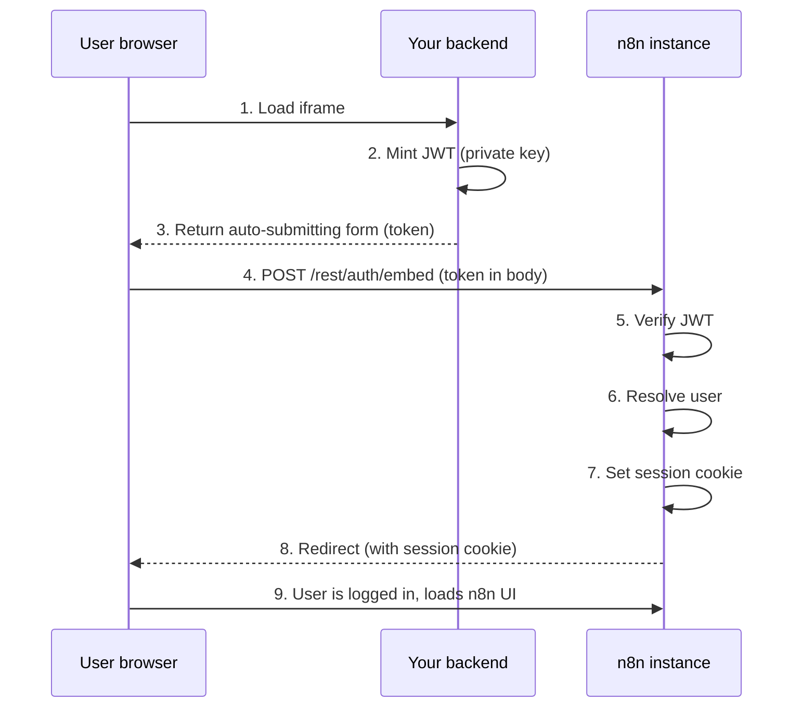
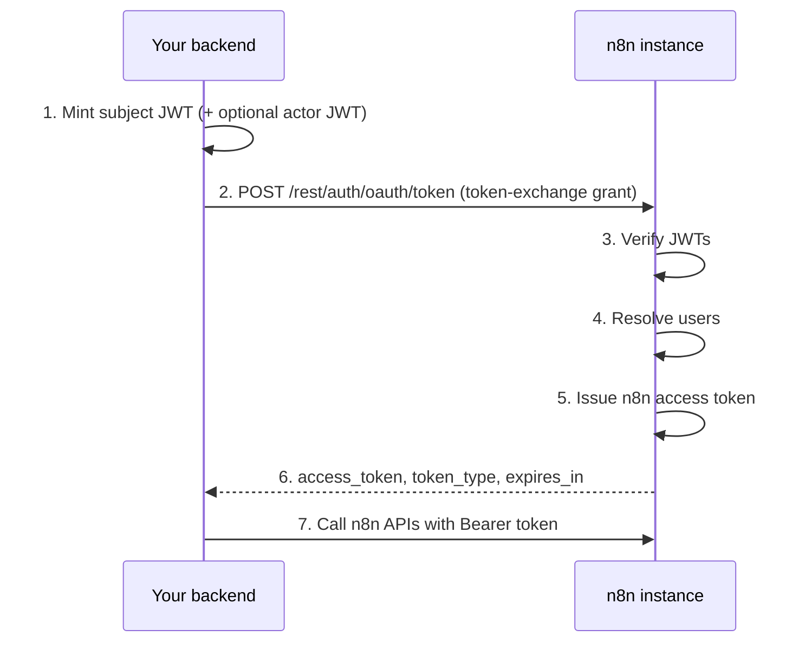

<!-- 简体中文翻译；来源 n8n-io/n8n-docs；原文版本见 upstream.json。 -->


# 嵌入合作伙伴的令牌交换 <a id="token-exchange-for-embedding-partners"></a>


**功能可用范围**

令牌交换可用于：

- **n8n Cloud：**Enterprise。
- **自托管：**企业版。

将 `N8N_ENV_FEAT_TOKEN_EXCHANGE` 环境变量设为 `true` 即可启用。自托管实例可直接设置，n8n Cloud 用户请联系 n8n 支持团队申请启用。

面向运行外部身份提供商（IdP），或能签发已签名 JWT 的后端的嵌入合作伙伴。



**预览状态**

令牌交换是通过环境变量开关控制的预览功能。正式发布前，环境变量、端点路径和 JWT 声明约定都可能更改。请固定 n8n 版本，并在每次升级后重新测试集成。


OAuth 2.0 Token Exchange（[RFC 8693](https://datatracker.ietf.org/doc/html/rfc8693)）允许嵌入合作伙伴在嵌入式 n8n 实例中验证用户，并代表用户操作。令牌交换支持两个场景：

* **Iframe SSO**：将外部 JWT 交换为 n8n 会话 Cookie，让用户在 iframe 嵌入的 n8n 中无缝登录。
* **委托 API 访问**：将外部 JWT 交换为 n8n 访问令牌，代表用户调用 n8n API，例如触发工作流或管理凭据。

两种流程的起点相同：后端使用私钥签发短期 JWT，n8n 用已注册公钥验证它，解析用户，并返回会话 Cookie 或访问令牌。

## 开始之前 <a id="before-you-begin"></a>

你需要：

* 已启用令牌交换功能的 Enterprise 许可证。
* 在实例上设置预览功能开关：`N8N_ENV_FEAT_TOKEN_EXCHANGE=true`。
* RSA 或 EC 密钥对，或 IdP 已发布的 JWKS 端点。参阅[生成密钥对](#generate-a-key-pair)。
* 通过 HTTPS 提供服务的 n8n 实例。浏览器会拒绝通过普通 HTTP 设置的 `SameSite=None; Secure` 会话 Cookie，缺少 HTTPS 时，iframe SSO 流程会无提示失败。如果 n8n 位于终止 TLS 的代理之后，请确保代理设置 `X-Forwarded-Proto` 标头。

## 生成密钥对 <a id="generate-a-key-pair"></a>

需要非对称密钥对。后端使用**私钥**签名 JWT，n8n 使用**公钥**验证。



```bash
# Generate a 2048-bit RSA private key
openssl genrsa -out private.pem 2048

# Extract the public key
openssl rsa -in private.pem -pubout -out public.pem
```



```bash
# Generate an EC private key using P-256
openssl ecparam -name prime256v1 -genkey -noout -out private.pem

# Extract the public key
openssl ec -in private.pem -pubout -out public.pem
```



在后端妥善保密 `private.pem`，将 `public.pem` 的内容注册到 n8n 的可信密钥配置中。

如果 IdP 已发布 JWKS 端点，大多数 OAuth 2.0 和 OIDC 提供商都是如此，就可以跳过密钥生成，直接让 n8n 指向 JWKS URL。参阅 [JWKS 密钥源](#jwks-key-source)。

## 环境变量 <a id="environment-variables"></a>

### 所有配置都需要的变量 <a id="required-for-all-setups"></a>

```bash
# Enable the preview module
N8N_ENV_FEAT_TOKEN_EXCHANGE=true

# Register your public key(s) - see Configure trusted keys
N8N_TOKEN_EXCHANGE_TRUSTED_KEYS='[{ ... }]'
```

### 各流程独立开关 <a id="per-flow-toggles"></a>

两种流程相互独立，请仅启用所需端点：

```bash
# Iframe SSO: enable the embed login endpoint (POST or GET /rest/auth/embed)
N8N_EMBED_LOGIN_ENABLED=true

# Delegated API access: enable the token exchange endpoint (POST /rest/auth/oauth/token)
N8N_TOKEN_EXCHANGE_ENABLED=true
```

嵌入登录端点不需要 `N8N_TOKEN_EXCHANGE_ENABLED`，令牌交换端点也不需要 `N8N_EMBED_LOGIN_ENABLED`。


**基于文件的配置**

可以为单个变量添加 `_FILE` 后缀，在独立文件中提供配置。更多信息请参阅[将敏感数据保存在独立文件中](../configure-n8n/basic-configuration.md#keeping-sensitive-data-in-separate-files)。


例如，对于较大或多行 JSON，可以将可信密钥保存在文件中，并设置 `N8N_TOKEN_EXCHANGE_TRUSTED_KEYS_FILE=/path/to/trusted-keys.json`。

### 可选调优设置 <a id="optional-tuning-settings"></a>

这些选项具有合理默认值，通常无需更改：

| 变量 | 默认值 | 说明 |
| :------- | :------ | :---------- |
| `N8N_TOKEN_EXCHANGE_MAX_TOKEN_TTL` | `900`，15 分钟 | 已签发 n8n 令牌的最长有效期，单位为秒。实际过期时间取此值、主体令牌剩余有效期和操作者令牌剩余有效期（如果提供）三者中的最小值。 |
| `N8N_TOKEN_EXCHANGE_KEY_REFRESH_INTERVAL_SECONDS` | `300`，5 分钟 | 端点未提供缓存有效期时，刷新 JWKS 密钥的回退间隔。每个实例都在启动时刷新密钥；多主实例部署中，仅领导者实例定期刷新。 |
| `N8N_TOKEN_EXCHANGE_JTI_CLEANUP_INTERVAL_SECONDS` | `60`，1 分钟 | n8n 清理过期重放保护记录的频率。 |
| `N8N_TOKEN_EXCHANGE_JTI_CLEANUP_BATCH_SIZE` | `1000` | 每轮清理删除的最大过期记录数。 |
| `N8N_TOKEN_EXCHANGE_EMBED_LOGIN_PER_MINUTE` | `20` | 嵌入登录端点的速率限制，每个 IP 每分钟请求数。 |
| `N8N_TOKEN_EXCHANGE_TOKEN_EXCHANGE_PER_MINUTE` | `20` | 令牌交换端点的速率限制，每个 IP 每分钟请求数。 |

## 配置可信密钥 <a id="configure-trusted-keys"></a>

`N8N_TOKEN_EXCHANGE_TRUSTED_KEYS` 环境变量接受可信密钥源的 JSON 数组。每个条目告知 n8n 如何验证来自 IdP 的 JWT。

有两种源类型：`static`，内联公钥；`jwks`，远程 JWKS 端点。可以在同一数组中混合使用。

### 静态密钥源 <a id="static-key-source"></a>

自行生成密钥对，希望直接嵌入公钥时使用。

```json
{
	"type": "static",
	"kid": "my-key-1",
	"algorithms": ["RS256"],
	"key": "-----BEGIN PUBLIC KEY-----\nMIIBIjAN...contents-of-public.pem...\n-----END PUBLIC KEY-----",
	"issuer": "https://your-backend.example.com",
	"expectedAudience": "https://your-n8n.example.com",
	"allowedRoles": ["global:member"]
}
```

| 字段 | 必填 | 说明 |
| :---- | :------- | :---------- |
| `type` | 是 | 必须为 `"static"`。 |
| `kid` | 是 | 密钥 ID，必须与传入 JWT 中的 `kid` 标头匹配。 |
| `algorithms` | 是 | 允许的签名算法数组，例如 `["RS256"]`。参阅[支持的算法](#supported-algorithms)。 |
| `key` | 是 | PEM 编码的公钥。在 JSON 中使用 `\n` 表示换行。 |
| `issuer` | 是 | 传入 JWT 中预期的 `iss` 声明。 |
| `expectedAudience` | 否 | 设置后，JWT 的 `aud` 声明必须与此值匹配。未设置时，n8n 完全跳过受众验证。生产环境始终应设置为实例特有的值，例如 n8n 基础 URL。 |
| `allowedRoles` | 否 | 设置后，只允许通过 `role` 声明分配这些角色。只有明确希望集成管理管理员用户时，才包含 `global:admin`。参阅[角色处理](#role-handling)。 |

### JWKS 密钥源 <a id="jwks-key-source"></a>

IdP 发布了 JWKS 端点时使用。

```json
{
	"type": "jwks",
	"url": "https://idp.example.com/.well-known/jwks.json",
	"issuer": "https://idp.example.com",
	"expectedAudience": "https://your-n8n.example.com",
	"allowedRoles": ["global:member"]
}
```

| 字段 | 必填 | 说明 |
| :---- | :------- | :---------- |
| `type` | 是 | 必须为 `"jwks"`。 |
| `url` | 是 | JWKS 端点的 URL。 |
| `issuer` | 是 | 传入 JWT 中预期的 `iss` 声明。 |
| `expectedAudience` | 否 | 设置后，JWT 的 `aud` 声明必须与此值匹配。未设置时，n8n 完全跳过受众验证。生产环境始终应设置为实例特有的值，例如 n8n 基础 URL。 |
| `allowedRoles` | 否 | 设置后，只允许通过 `role` 声明分配这些角色。参阅[角色处理](#role-handling)。 |
| `cacheTtlSeconds` | 否 | JWKS 端点未发送 `Cache-Control: max-age` 标头时的回退缓存时长。存在该标头时，优先采用标头。默认 3600 秒，有效值限制在 60 到 86400 秒之间。 |

### 完整示例 <a id="full-example"></a>

```json
[
	{
		"type": "static",
		"kid": "my-static-key-1",
		"algorithms": ["RS256"],
		"key": "-----BEGIN PUBLIC KEY-----\nMIIBIjAN...your-key-here...\n-----END PUBLIC KEY-----",
		"issuer": "https://your-backend.example.com",
		"expectedAudience": "https://your-n8n.example.com",
		"allowedRoles": ["global:member"]
	},
	{
		"type": "jwks",
		"url": "https://idp.example.com/.well-known/jwks.json",
		"issuer": "https://idp.example.com",
		"expectedAudience": "https://your-n8n.example.com"
	}
]
```

### 支持的算法 <a id="supported-algorithms"></a>

n8n 仅接受非对称算法，排除 HMAC 和 `none`。

| 算法族 | 算法 |
| :----- | :--------- |
| RSA | `RS256`、`RS384`、`RS512` |
| RSA-PSS | `PS256`、`PS384`、`PS512` |
| 椭圆曲线 | `ES256`、`ES384`、`ES512` |
| Edwards 曲线 | `EdDSA` |

静态密钥配置中的算法必须属于同一算法族，并与密钥类型匹配。对于 JWKS 密钥，n8n 根据 JWK 的 `alg` 和 `kty` 或 `crv` 字段自动推断算法。

## 必需和可选 JWT 声明 <a id="required-and-optional-jwt-claims"></a>

### 必需声明 <a id="required-claims"></a>

IdP 令牌必须包含以下声明，n8n 才会接受：

| 声明 | 类型 | 说明 |
| :---- | :--- | :---------- |
| `sub` | 字符串 | 主体标识符，即 IdP 中的唯一用户 ID。 |
| `iss` | 字符串，URL | 签发者，必须与可信密钥配置中的 `issuer` 匹配。 |
| `aud` | 字符串或字符串数组 | 受众，必须存在。只有可信密钥源配置了 `expectedAudience` 时，n8n 才验证其值。 |
| `iat` | 数字 | 签发时间戳，Unix 纪元秒数。 |
| `exp` | 数字 | 过期时间戳，Unix 纪元秒数。 |
| `jti` | 字符串 | 唯一令牌 ID。每个值 n8n 仅接受一次，用于重放保护。 |

### 可选声明 <a id="optional-claims"></a>

| 声明 | 类型 | 说明 |
| :---- | :--- | :---------- |
| `email` | 字符串，有效邮箱 | 用户邮箱，用于匹配已有 n8n 用户。n8n 尚不认识的用户首次登录时，即时预配（JIT）需要此字段。除非确认所有用户都已存在，否则始终应发送。 |
| `given_name` | 字符串 | 名，同步到 n8n 用户资料。 |
| `family_name` | 字符串 | 姓，同步到 n8n 用户资料。 |
| `role` | 字符串 | 要分配的 n8n 角色，例如 `global:member` 或 `global:admin`。参阅[用户预配](#user-provisioning)。 |
| `nbf` | 数字 | 不早于此时生效的时间戳。 |

## Iframe SSO 流程 <a id="iframe-sso-flow"></a>

在 iframe 中嵌入 n8n 时使用此流程。n8n 通过会话 Cookie 为用户无缝登录。



### 第 1 步：在后端签发 JWT <a id="step-1-mint-a-jwt-in-your-backend"></a>

后端使用私钥签发短期 JWT。

```javascript
const fs = require('fs');
const jwt = require('jsonwebtoken');
const { randomUUID } = require('crypto');

const privateKey = fs.readFileSync('private.pem', 'utf8');
const now = Math.floor(Date.now() / 1000);

const token = jwt.sign(
	{
		sub: 'user-id-in-your-system',           // unique user identifier
		iss: 'https://your-backend.example.com', // must match trusted key config
		aud: 'https://your-n8n.example.com',     // must match expectedAudience (if set)
		iat: now,
		exp: now + 30,                           // short-lived: 30 seconds
		jti: randomUUID(),                       // unique per request
		email: 'user@example.com',               // required for first-time users
		given_name: 'Jane',                      // optional
		family_name: 'Doe',                      // optional
		role: 'global:member',                   // optional
	},
	privateKey,
	{ algorithm: 'RS256', header: { kid: 'my-key-1' } }
);
```


**最长有效期为 60 秒**

嵌入登录流程的 JWT 有效期（`exp - iat`）不能超过 60 秒，n8n 会在服务器端强制执行此限制。


### 第 2 步：将令牌发送到嵌入端点 <a id="step-2-send-the-token-to-the-embed-endpoint"></a>

以表单提交方式，将令牌发送到 `POST /rest/auth/embed`。将 iframe 的 `src` 指向后端上的一个页面，该页面返回自动提交的表单：

```html
<form method="POST" action="https://your-n8n.example.com/rest/auth/embed">
	<input type="hidden" name="token" value="<jwt>">
	<input type="hidden" name="redirectTo" value="/workflow/abc123">
</form>
<script>document.forms[0].submit();</script>
```

可选的 `redirectTo` 字段仅接受以 `/` 开头的相对路径。对于绝对 URL 或其他值，n8n 回退到 `/`。

还提供 `GET /rest/auth/embed?token=<jwt>&redirectTo=/workflow/abc123` 形式。优先使用 POST 表单：使用 GET 时，令牌会出现在服务器和代理日志、浏览器历史中，也可能出现在 `Referer` 标头中。如果必须使用 GET，请确保基础设施从日志中清除查询字符串。

### 第 3 步：n8n 验证并签发会话 <a id="step-3-n8n-verifies-and-issues-a-session"></a>

n8n 验证 JWT 签名，解析或预配用户，参阅[用户预配](#user-provisioning)，设置安全会话 Cookie（`SameSite=None; Secure`），并重定向到指定路径。

### 第三方 Cookie 限制 <a id="third-party-cookie-restrictions"></a>

n8n 与产品位于不同的可注册域名时，会话 Cookie 属于第三方 Cookie。Safari 智能防跟踪和 Chrome 第三方 Cookie 限制等浏览器隐私功能，可能阻止或分区存储此 Cookie，导致 iframe 登录失败。将 n8n 托管在产品站点的子域名上，例如 `automation.your-product.example.com`，可避免此问题。

## 委托 API 访问流程 <a id="delegated-api-access-flow"></a>

后端需要代表用户调用 n8n API 时使用此流程，例如通过程序触发工作流或管理凭据。

此流程支持可选的**操作者令牌（actor token）**来实现委托。服务账号或管理员等操作者（actor），代表最终用户这一主体（subject）执行操作，以支持审计归属，记录谁执行了操作，以及代表谁操作。

提供操作者令牌时，n8n 使用**操作者的**身份和权限授权 API 调用。主体仅用于审计归属，不限制令牌能执行的操作。这与 RFC 8693 不同，后者通常仍以主体作为实际权限主体。请使用仅授予集成所需权限的 n8n 角色作为操作者。



### 第 1 步：在后端签发 JWT <a id="step-1-mint-jwts-in-your-backend"></a>

创建代表最终用户的主体令牌。嵌入流程的 60 秒限制不适用于此处。签发的 n8n 访问令牌有效期取主体令牌剩余有效期、操作者令牌剩余有效期（如果提供）和 `N8N_TOKEN_EXCHANGE_MAX_TOKEN_TTL`，默认 15 分钟，三者中的最小值。

```javascript
const now = Math.floor(Date.now() / 1000);

const subjectToken = jwt.sign(
	{
		sub: 'end-user-id',
		iss: 'https://your-backend.example.com',
		aud: 'https://your-n8n.example.com',
		iat: now,
		exp: now + 900,                         // bounds the issued token's lifetime
		jti: randomUUID(),
		email: 'user@example.com',
		role: 'global:member',
	},
	privateKey,
	{ algorithm: 'RS256', header: { kid: 'my-key-1' } }
);
```

如需委托，再签发代表执行操作的服务或管理员的操作者令牌。操作者的 n8n 角色决定签发令牌的权限，因此请尽量使用最低权限：

```javascript
const actorToken = jwt.sign(
	{
		sub: 'service-account-id',
		iss: 'https://your-backend.example.com',
		aud: 'https://your-n8n.example.com',
		iat: now,
		exp: now + 900,
		jti: randomUUID(),
		email: 'service@example.com',
	},
	privateKey,
	{ algorithm: 'RS256', header: { kid: 'my-key-1' } }
);
```

### 第 2 步：交换 n8n 访问令牌 <a id="step-2-exchange-for-an-n8n-access-token"></a>

```bash
curl -X POST https://your-n8n.example.com/rest/auth/oauth/token \
	-H "Content-Type: application/x-www-form-urlencoded" \
	-d "grant_type=urn:ietf:params:oauth:grant-type:token-exchange" \
	-d "subject_token=<subject-jwt>" \
	-d "actor_token=<actor-jwt>"
```

请求字段（`application/x-www-form-urlencoded`）：

| 字段 | 必填 | 说明 |
| :---- | :------- | :---------- |
| `grant_type` | 是 | 必须为 `urn:ietf:params:oauth:grant-type:token-exchange`。 |
| `subject_token` | 是 | 代表最终用户的 JWT。 |
| `subject_token_type` | 否 | 令牌类型标识符。n8n 接受但忽略此字段。RFC 8693 要求此字段，因此使用符合规范的客户端库时，请发送 `urn:ietf:params:oauth:token-type:jwt`。 |
| `actor_token` | 否 | 代表操作者的 JWT，用于委托。 |
| `actor_token_type` | 否 | 操作者令牌类型标识符，与 `subject_token_type` 一样，接受但忽略。 |
| `requested_token_type` | 否 | 请求的令牌类型标识符，接受但忽略。n8n 始终签发访问令牌。 |
| `scope` | 否 | 请求的权限范围，最多 1024 个字符。记录到签发令牌和审计事件中，但不强制限制权限。 |
| `audience` | 否 | 目标受众，最多 1024 个字符，接受但忽略。 |
| `resource` | 否 | 目标资源 URI，以空格分隔，最多 2048 个字符。记录到签发令牌和审计事件中，但不强制限制。 |


**不强制执行权限范围限制**

签发的访问令牌包含实际操作用户的完整权限：提供操作者令牌时为操作者权限，否则为主体权限。n8n 仅为审计记录 `scope` 和 `resource`，不会据此限制令牌。要限制集成能执行的操作，请使用低权限操作者和 `allowedRoles` 设置。


成功响应（`200 OK`）：

```json
{
	"access_token": "<n8n-jwt>",
	"token_type": "Bearer",
	"expires_in": 900,
	"issued_token_type": "urn:ietf:params:oauth:token-type:access_token"
}
```

### 第 3 步：使用访问令牌 <a id="step-3-use-the-access-token"></a>

在后续 n8n API 调用中包含令牌：

```bash
curl https://your-n8n.example.com/api/v1/workflows \
	-H "Authorization: Bearer <access-token>"
```

令牌在 `expires_in` 秒后过期，过期时请请求新令牌。不要复用原外部 JWT，因为每个 `jti` 只能使用一次。

## 用户预配 <a id="user-provisioning"></a>

交换令牌时，n8n 按以下顺序将外部身份解析为 n8n 用户：

1. **已知身份**：n8n 在身份存储中查找 `sub` 声明。如果先前交换已将此 `sub` 关联到 n8n 用户，就返回该用户。
2. **邮箱回退**：如果 `sub` 未知，但 JWT 包含 `email` 声明，n8n 会搜索使用该邮箱的已有用户。找到后，今后将外部身份关联到该用户。
3. **即时预配（JIT）**：两者都未匹配时，n8n 自动创建新用户，JWT 必须包含 `email` 声明。新用户禁用密码登录，仅能通过令牌交换验证身份。

### 角色处理 <a id="role-handling"></a>

如果包含 `role` 声明，IdP 就成为该用户全局角色的权威来源：n8n 每次交换都应用此值，覆盖界面中分配的角色。除非在 IdP 中管理角色，否则请省略此声明。

| 场景 | 行为 |
| :------- | :------- |
| 新用户，无 `role` 声明 | 分配 `global:member`。 |
| 新用户，存在 `role` 声明 | 分配声明的角色。角色不受识别、为 `global:owner`，或不在 `allowedRoles` 中时，交换失败。 |
| 已有用户，无 `role` 声明 | 角色保持不变。 |
| 已有用户，有效的 `role` 声明 | 与现值不同时更新角色。不在 `allowedRoles` 中时，交换失败。 |
| 已有用户，角色声明不受识别或为 `global:owner` | 忽略声明，并在服务器端记录警告。继续登录，角色不变。 |
| 角色为 `global:owner` 的已有用户 | 完全跳过角色同步。无法通过令牌交换更改所有者角色。 |

### 用户资料同步 <a id="profile-sync"></a>

每次登录时，n8n 将 `given_name` 和 `family_name` 声明同步到用户资料，仅在与存储值不同时应用更改，并截断超过 32 个字符的值。

## 安全注意事项 <a id="security-considerations"></a>

### 短期令牌 <a id="short-lived-tokens"></a>

* 嵌入流程的外部 JWT 有效期不得超过 60 秒（`exp - iat <= 60`）。
* 令牌交换流程中，签发的 n8n 令牌有效期取主体令牌剩余有效期、操作者令牌剩余有效期（如果提供）和 `N8N_TOKEN_EXCHANGE_MAX_TOKEN_TTL`，默认 900 秒，三者中的最小值。
* 令牌交换流程中，如果计算出的签发令牌距离过期不足五秒，n8n 会拒绝请求。

### 重放保护 <a id="replay-protection"></a>

每个外部 JWT 都必须包含唯一的 `jti`（JWT ID）声明。n8n 记录每个 `jti`，并拒绝 `jti` 已被使用的令牌。n8n 会自动清理过期的 `jti` 记录。

### 仅允许非对称签名 <a id="asymmetric-signatures-only"></a>

n8n 仅接受非对称算法，包括 RSA、EC、EdDSA，按设计拒绝 `HS256` 等 HMAC 算法和 `none`，确保 n8n 始终无需访问你的签名密钥。

### 受众限制 <a id="audience-restriction"></a>

始终为每个可信密钥源设置 `expectedAudience`。未设置时，n8n 跳过受众验证，配置的签发者发出的任何有效令牌都能交换，包括 IdP 为其他服务或其他 n8n 实例签发的令牌。请使用实例特有的值，例如 n8n 基础 URL。

### 角色约束 <a id="role-constraints"></a>

可信密钥源上的 `allowedRoles` 字段限制通过令牌交换可分配的角色。可用它强制最小权限，例如限制嵌入集成仅预配 `global:member` 用户。OAuth 请求中的 `scope` 和 `resource` 字段不会限制权限。参阅[第 2 步：交换 n8n 访问令牌](#step-2-exchange-for-an-n8n-access-token)。

### 限制嵌入来源 <a id="restrict-framing"></a>

嵌入会话 Cookie 使用 `SameSite=None`，因此浏览器会在任何第三方 iframe 上下文中发送它。请限制哪些站点能嵌入 n8n 实例：配置反向代理发送 `Content-Security-Policy: frame-ancestors` 标头，仅列出产品的来源。不要完全关闭防嵌入保护。

### 密钥轮换与泄露 <a id="key-rotation-and-compromise"></a>

要无停机轮换密钥，请使用新的 `kid`，向 `N8N_TOKEN_EXCHANGE_TRUSTED_KEYS` 添加新条目，让后端改用新密钥签名，然后移除旧条目。私钥泄露时，应立即移除对应条目。这会阻止新交换，但已签发的 n8n 令牌和会话仍会在各自短期有效期内保持有效，直到过期。

### 审计归属 <a id="audit-attribution"></a>

n8n 为全部令牌交换活动生成审计事件：

| 事件 | 发生时机 |
| :---- | :--- |
| `n8n.audit.token-exchange.succeeded` | 令牌交换成功。 |
| `n8n.audit.token-exchange.failed` | 令牌交换失败，包含失败原因。 |
| `n8n.audit.token-exchange.embed-login` | 嵌入登录成功。 |
| `n8n.audit.token-exchange.embed-login-failed` | 嵌入登录失败，包含失败原因。 |
| `n8n.audit.token-exchange.user-provisioned` | 通过 JIT 预配创建新用户。 |
| `n8n.audit.token-exchange.identity-linked` | 已有用户关联到新的外部身份。 |
| `n8n.audit.token-exchange.role-updated` | 用户角色通过令牌交换更改。 |

使用操作者令牌流程时，n8n 同时记录主体，即代表谁，以及操作者，即谁执行操作，实现完整审计归属。

## 验证配置 <a id="verify-your-setup"></a>

签发一次性 JWT 并交换。将[第 1 步示例](#step-1-mint-a-jwt-in-your-backend)保存为 `mint-token.js`，在末尾添加 `console.log(token);`，然后运行：

```bash
node mint-token.js
```

再调用令牌交换端点：

```bash
curl -X POST https://your-n8n.example.com/rest/auth/oauth/token \
	-H "Content-Type: application/x-www-form-urlencoded" \
	-d "grant_type=urn:ietf:params:oauth:grant-type:token-exchange" \
	-d "subject_token=<jwt>"
```

返回 `200` 响应并包含 `access_token`，即可确认密钥、声明和配置有效。对于嵌入流程，请在浏览器中向 `POST /rest/auth/embed` 提交新令牌，预期会加载 n8n 界面。

## 故障排查 <a id="troubleshooting"></a>

| 现象 | 可能原因 |
| :------ | :----------- |
| 两个端点都返回 `404` | 预览开关 `N8N_ENV_FEAT_TOKEN_EXCHANGE` 不是 `true`，或许可证不包含令牌交换功能。n8n 完全不加载此模块。 |
| `501 - Token exchange is not enabled on this instance` | `N8N_TOKEN_EXCHANGE_ENABLED` 不是 `true`。 |
| `501 - Embed login is not enabled on this instance` | `N8N_EMBED_LOGIN_ENABLED` 不是 `true`。 |
| `400 - unsupported_grant_type` | 缺少 `grant_type` 字段，或其值不完全等于 `urn:ietf:params:oauth:grant-type:token-exchange`。 |
| `400 - invalid_grant`，描述为 `Token exchange failed` | 令牌交换端点的任何令牌验证失败：签名无效、未知 `kid`、缺少 `kid` 标头、重放的 `jti`、令牌已过期或即将过期、受众不匹配，或角色不被允许。n8n 按设计返回通用描述，请查看 n8n 服务器日志了解具体原因。 |
| `400 - invalid_request`，描述为 `Token claims validation failed` | 令牌交换端点上，JWT 缺少必需声明（`sub`、`iss`、`aud`、`iat`、`exp`、`jti`），或声明类型错误。 |
| 嵌入端点返回 `401` | 响应包含具体失败消息，例如 `Token has already been used`，表示重放 `jti`；`Token lifetime exceeds maximum allowed`，表示嵌入令牌必须满足 `exp - iat <= 60` 秒；或 `Token header missing kid`。 |
| 嵌入端点返回 `500` | JWT 缺少必需声明，或声明类型错误。 |
| iframe 显示原始 JSON 错误 | 嵌入登录失败返回 JSON 响应，不进行错误重定向。请对照上方条目检查消息。 |
| 嵌入登录后未设置会话 Cookie | 实例未通过 HTTPS 提供服务，或终止 TLS 的代理未转发 `X-Forwarded-Proto`。浏览器会拒绝通过普通 HTTP 设置的 `SameSite=None; Secure` Cookie。第三方 Cookie 限制也可能阻止 Cookie，参阅[第三方 Cookie 限制](#third-party-cookie-restrictions)。 |
| 首次登录时未创建用户 | JWT 缺少 JIT 预配必需的 `email` 声明。 |
| 角色未应用 | 对于已有用户，n8n 忽略不受识别和 `global:owner` 角色声明，并在服务器端警告。有效角色不在 `allowedRoles` 中时，则拒绝交换。参阅[角色处理](#role-handling)。 |

## 相关资源 <a id="related-resources"></a>

* [OEM 部署概览](./README.md)：在产品内嵌入并展示 n8n 界面。
* [前提条件](prerequisites.md)
* [管理工作流](manage-workflows.md)
* [设置 SSO](../configure-n8n/security/configure-sso.md)：通过 SAML 或 OIDC 实现组织级单点登录。
* [HTTP Request 凭据：使用 OAuth2](../../../integrations/builtin/credentials/httprequest.md#using-oauth2)：设置通用 OAuth 2.0 凭据。
* [OAuth 2.0 Token Exchange（RFC 8693）](https://datatracker.ietf.org/doc/html/rfc8693)：令牌交换规范。