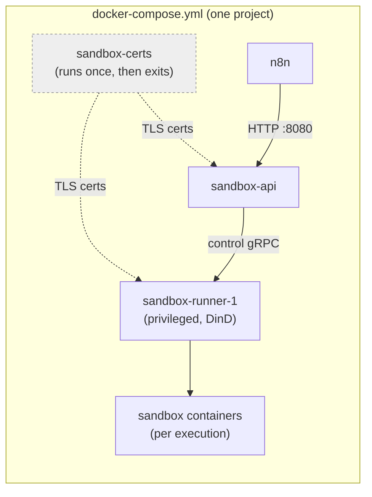

<!-- 简体中文翻译；来源 n8n-io/n8n-docs；原文版本见 upstream.json。 -->


# 使用 Docker Compose 安装 <a id="install-using-docker-compose"></a>

## 适用人群 <a id="who-this-is-for"></a>

本指南介绍如何手动构建 Docker Compose 配置，包括支持 n8n Assistant 的沙箱服务堆栈。如果希望完全控制配置，或需要将 n8n 整合进现有 Compose 项目，可以使用本指南。

如果只想快速运行 n8n 和 n8n Assistant，不希望自己编写文件，请改用[一行命令安装](one-line-setup.md)。它会自动完成下面的全部配置。

## 开始之前需要准备什么 <a id="what-you-need-before-you-start"></a>

* Docker Engine 和 Docker Compose v2。运行 `docker compose version` 进行检查。
* 至少 4 GB 内存和 2 个 vCPU。运行 AI 生成代码的沙箱（`sandbox-runner-1`）使用 Docker-in-Docker，比普通容器需要更多资源余量。


**Windows 用户：** 请使用 WSL，并搭配 Docker Desktop（WSL2 后端），或在 Linux 发行版内直接安装 Docker Engine。将项目文件夹放在 WSL 文件系统中，例如 `~/n8n`，不要放在 `/mnt/c/...` 下。跨文件系统边界的绑定挂载较慢，也可能导致权限问题。


## 步骤 1：创建项目文件夹 <a id="step-1-create-a-project-folder"></a>

```bash
mkdir n8n && cd n8n
```

## 步骤 2：创建 `.env` <a id="step-2-create-env"></a>

此文件保存要运行的版本，以及沙箱服务彼此通信所需的密钥。创建名为 `.env` 的文件，用自己的值替换占位符，并确保该文件不纳入版本控制。

```
# n8n version - get the version number of the latest stable release from https://github.com/n8n-io/n8n/releases
N8N_VERSION=change-me-version-number

# Sandbox service version - the API, runner, and sandbox images share one release.
# Get the number of the latest stable "service" release (not a staging prerelease) from https://github.com/n8n-io/n8n-sandbox-service/releases
N8N_SANDBOX_VERSION=change-me-sandbox-version-number

# n8n task runner authentication. Use a random secret you generate.
N8N_RUNNERS_AUTH_TOKEN=change-me-runner-auth-token

# Sandbox service secrets — pick your own values
SANDBOX_API_KEYS=change-me-api-key
SANDBOX_API_RUNNER_REGISTRATION_TOKEN=change-me-registration-token
SANDBOX_API_RUNNER_API_KEY=change-me-runner-key

# Must match a value in SANDBOX_API_KEYS above — this is how n8n authenticates to the sandbox
N8N_SANDBOX_SERVICE_API_KEY=change-me-api-key

# Web search: secret for the bundled SearXNG instance — pick your own value
SEARXNG_SECRET=change-me-searxng-secret
N8N_INSTANCE_AI_SEARXNG_URL=http://searxng:8080
```

此时还不需要 AI 服务商密钥；全部服务运行后，再参阅下方的[启用 n8n Assistant](install-using-docker-compose.md#optional-turn-on-n8n-assistant)。

## 步骤 3：创建 `searxng-settings.yml` <a id="step-3-create-searxng-settingsyml"></a>

原始 SearXNG 镜像只提供 HTML；n8n 的网络搜索需要其 JSON API，此文件会将其启用。

```yaml
use_default_settings: true
search:
  formats:
    - html
    - json
```

## 步骤 4：创建 `compose.yml` <a id="step-4-create-composeyml"></a>

此文件定义要配置的全部服务：n8n 本身、供 n8n Assistant 安全运行代码的沙箱堆栈，以及用于网络搜索的 SearXNG。



## 刚刚配置了哪些内容 <a id="what-youve-just-set-up"></a>

| 组件 | 用途 |
| -------------------- | -------------------------------------------------------------------------------------------------- |
| **n8n** | 工作流编辑器本身，访问地址为 `http://localhost:5678`。 |
| **sandbox-certs** | 运行一次，生成其他沙箱服务需要的 TLS 证书，然后退出。 |
| **sandbox-api** | n8n Assistant 需要运行代码时，n8n 与其通信的控制平面。 |
| **sandbox-runner-1** | 实际执行任务的特权 Docker-in-Docker 容器，负责创建和运行沙箱。 |
| **searxng** | n8n Assistant 内置的网络搜索后端。 |

此配置包含 n8n 自带的沙箱（`n8n-sandbox`），适合本地开发和测试。对于生产实例，n8n 当前建议改用 Daytona 作为沙箱服务商。配置 Daytona 沙箱的方法请参阅[设置 n8n Assistant](../configure-n8n/set-up-n8n-assistant.md)。

这里没有定义数据库服务。n8n 会使用内置 SQLite 数据库。`n8n-data` 卷定义在 `get-n8n-compose.yml` 中，保存数据库和 n8n 加密密钥，使数据在重启或重新创建容器后仍然保留。生产实例应改用 Postgres，详见下方[使用 PostgreSQL 替代 SQLite](install-using-docker-compose.md#optional-use-postgresql-instead-of-sqlite)。

## 步骤 5：启动全部服务 <a id="step-5-start-everything"></a>

```bash
docker compose up -d
docker compose ps
```

等待 `sandbox-api` 显示为 `healthy`，然后 `sandbox-runner-1` 和 `n8n` 会自动启动。

## 步骤 6：验证运行情况 <a id="step-6-verify-its-working"></a>

```bash
# sandbox-api is reachable from n8n
docker compose exec n8n wget -qO- http://sandbox-api:8080/healthz

# the runner registered itself with the API
docker compose logs sandbox-api | grep -i runner

# n8n is up
curl -sf http://localhost:5678/healthz
```

在浏览器中打开 `http://localhost:5678`，启动 n8n 界面。

## 可选：启用 n8n Assistant <a id="optional-turn-on-n8n-assistant"></a>

上述配置会运行完整沙箱堆栈，但在提供可用模型之前，n8n Assistant 本身保持关闭。n8n 运行后，你可以在界面的实例 AI 设置中配置；如果希望首次登录前完成配置，也可以使用 `.env`：

1. 将 AI 服务商密钥添加到 `.env`：

    ```
    N8N_INSTANCE_AI_MODEL_API_KEY=sk-ant-xxx
    ```
2. 重启 n8n，使修改生效：

    ```bash
    docker compose up -d n8n
    ```

网络搜索默认使用内置 SearXNG 服务。如果希望改用 Brave Search，可以在界面中设置，或将 Brave API 密钥添加到 `.env`；设置后会优先使用 Brave Search，而不是 SearXNG：

```
INSTANCE_AI_BRAVE_SEARCH_API_KEY=BSA-xxx
```

完整配置步骤和受支持的模型服务商，请参阅[设置 n8n Assistant](../configure-n8n/set-up-n8n-assistant.md)。

## 可选：使用 PostgreSQL 替代 SQLite <a id="optional-use-postgresql-instead-of-sqlite"></a>

SQLite 适合试用，但对于需要支持较多用户，或全天候运行工作流的生产实例，应改用 Postgres。

1. 将 Postgres 凭据添加到 `.env`，与沙箱密钥一起保存：

    ```
    POSTGRES_USER=change-me-user
    POSTGRES_PASSWORD=change-me-password
    POSTGRES_DB=n8n
    ```
2. 添加 `postgres` 服务到 `compose.yml`，并为其数据添加存储卷：

    ```yaml
    volumes:
      db-storage:

    services:
      postgres:
        image: postgres:18
        restart: always
        environment:
          POSTGRES_USER: ${POSTGRES_USER}
          POSTGRES_PASSWORD: ${POSTGRES_PASSWORD}
          POSTGRES_DB: ${POSTGRES_DB}
          PGDATA: /var/lib/postgresql/data
        volumes:
          - db-storage:/var/lib/postgresql/data
        healthcheck:
          test: ["CMD-SHELL", "pg_isready -h localhost -U ${POSTGRES_USER} -d ${POSTGRES_DB}"]
          interval: 5s
          timeout: 5s
          retries: 10
    ```

    <div data-gb-custom-block data-tag="hint" data-style="warning" class="hint hint-warning"><p>Postgres 18 更改了默认数据存储位置。设置 `PGDATA` 可让数据继续保存在与旧版本相同的文件夹中，从而保持卷挂载不变。不要删除这一行：否则 Postgres 18 会将数据写入卷未覆盖的位置，启动时数据库将为空。</p></div>

    <div data-gb-custom-block data-tag="hint" data-style="warning" class="hint hint-warning"><p>已经在运行旧版 Postgres？直接切换到 18 属于大版本升级，而 Postgres 无法打开旧主版本写入的数据目录。在现有配置中直接提高镜像标签会导致 `database files are incompatible with server` 错误，原有数据仍会保持完整。请先使用 `pg_dumpall` 备份，再按照官方 [PostgreSQL 升级指南](https://www.postgresql.org/docs/18/upgrading.html)操作。</p></div>
3. 在 n8n 服务的环境变量配置块中添加以下内容，使其连接 Postgres，并等待 Postgres 就绪：

    ```yaml
    environment:
          # ...your existing N8N_ENABLED_MODULES, N8N_INSTANCE_AI_* settings stay as they are
          DB_TYPE: postgresdb
          DB_POSTGRESDB_HOST: postgres
          DB_POSTGRESDB_PORT: '5432'
          DB_POSTGRESDB_DATABASE: ${POSTGRES_DB}
          DB_POSTGRESDB_USER: ${POSTGRES_USER}
          DB_POSTGRESDB_PASSWORD: ${POSTGRES_PASSWORD}
      depends_on:
        sandbox-api:
          condition: service_healthy
        postgres:
          condition: service_healthy
    ```
4. 重启全部服务：

    ```bash
    docker compose up -d
    ```

    n8n 启动时会在新的 Postgres 数据库中执行自身数据库迁移。现有 SQLite 数据不会自动迁入。此配置用于全新实例，不用于就地迁移。

    <div data-gb-custom-block data-tag="hint" data-style="info" class="hint hint-info"><p>如需更严格的安全配置，例如专用的非 root Postgres 用户和外部任务运行器，请参阅 n8n 托管仓库中的 [`withPostgres` 示例](https://github.com/n8n-io/n8n-hosting/tree/main/docker-compose/withPostgres)。</p></div>

## 故障排查 <a id="troubleshooting"></a>

| 现象 | 可能原因 |
| ----------------------------------------------------------------------- | --------------------------------------------------------------------------------------------------------------------------------------------------------------------------------------------------------------------------------------------------------------------------------------------------------------- |
| `sandbox-api` 或 `sandbox-runner-1` 无法启动，出现证书错误 | `sandbox-certs` 未完成。检查 `docker compose logs sandbox-certs`。 |
| `sandbox-api` 始终无法达到 `healthy` 状态 | 检查日志，并确认该镜像中确实存在 `wget`。 |
| `sandbox-runner-1` 启动时反复崩溃，并出现 `... must be set` 错误 | 缺少必需的环境变量，最常见的是 `SANDBOX_RUNNER_API_KEYS` 或 `SANDBOX_RUNNER_REGISTRATION_TOKEN`。要查看运行器需要的完整环境变量列表，请在运行器容器中执行 `strings /usr/local/bin/sandbox-runner \| grep -oE 'SANDBOX_[A-Z_]+ must be set'`。 |
| 运行器始终无法向 API 注册 | `SANDBOX_RUNNER_REGISTRATION_TOKEN` 不匹配，或 `SANDBOX_RUNNER_API_GRPC_ADDR` 错误。 |
| n8n 的沙箱调用失败 | `.env` 中的沙箱 URL 或密钥，与 `sandbox-api` 的地址或 `SANDBOX_API_KEYS` 不匹配。 |
| 在 Linux 中正常，但在 WSL 中失败 | 通常是绑定挂载路径问题。请将项目保存在 WSL 文件系统中，不要放在 `/mnt/c/...`。 |

## 安全检查清单 <a id="security-checklist"></a>

* `sandbox-runner-1`（`privileged: true`，Docker-in-Docker）始终不暴露到公共互联网。应将其视为拥有主机 root 权限。
* 云防火墙只开放 n8n 的端口。
* `SANDBOX_API_KEYS`、注册令牌和运行器密钥应各不相同，不能保留为 `change-me-...`，并应定期轮换。
* `sandbox-api` 和 `sandbox-runner-1` **不使用** `env_file: .env`。它们只通过各自的 `environment` 块，显式接收必需的变量。模型 API 密钥、Brave 密钥、Postgres 密码和 n8n 加密密钥不会传入沙箱容器。
* `sandbox-tls` 卷中的 mTLS 密钥，包括根 CA 密钥，应将权限限制为 `0600`，并只由需要它们的服务拥有：`sandbox-api` 拥有自身密钥，root 拥有运行器密钥和 CA 密钥。所有这些密钥都不允许所有用户读取。
* 应准备重新生成 `sandbox-tls` 卷的方案。`sandbox-certs` 生成的证书不会自动续期。

## 服务架构 <a id="service-architecture"></a>



n8n 将代码执行请求发送给 `sandbox-api`，后者将请求交给 `sandbox-runner-1`，由其创建并运行实际的沙箱容器。`sandbox-certs` 在启动时运行一次，生成另外两个服务需要的 TLS 证书后退出；其余服务都会等待它完成。

## 相关资源 <a id="related-resources"></a>

* [安装方式](./)
* [一行命令安装](one-line-setup.md)
* [使用 npm 安装](install-with-npm.md)
* [使用 Docker 安装](install-with-docker.md)
* [使用云服务商](use-a-cloud-provider/README.md)
