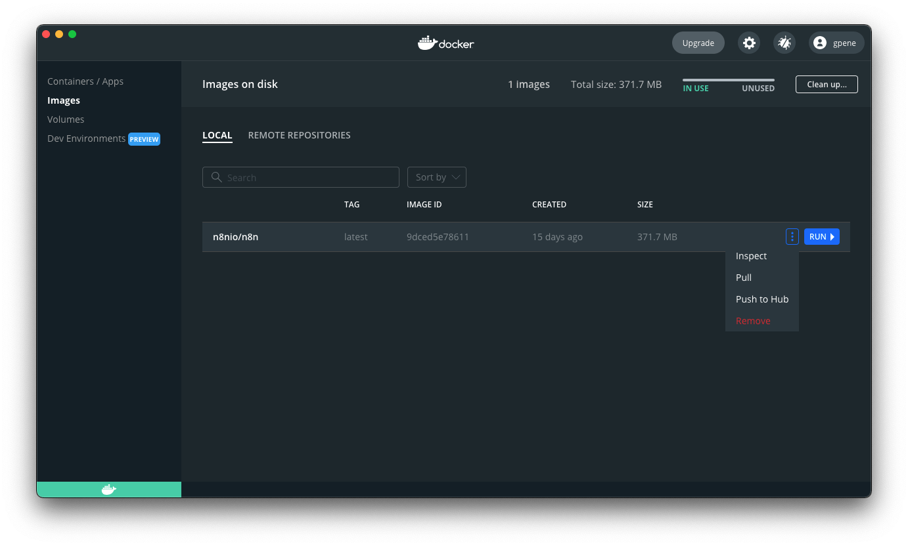

<!-- 简体中文翻译；来源 n8n-io/n8n-docs；原文版本见 upstream.json。 -->


# 使用 Docker 安装 <a id="install-with-docker"></a>


**此内容已过时。** 推荐的安装方式请参阅[使用 Docker Compose 安装](install-using-docker-compose.md)。


## Docker 安装 <a href="#docker-installation" id="docker-installation"></a>

对于大多数自托管需求，n8n 建议使用 [Docker](https://www.docker.com/)。它提供干净且隔离的环境，避免操作系统和工具兼容性问题，并简化数据库与环境管理。

你也可以通过 [Docker Compose](use-a-cloud-provider/use-docker-compose.md) 在 Docker 中运行 n8n。[n8n-hosting 仓库](https://github.com/n8n-io/n8n-hosting)提供了适用于不同架构的 Docker Compose 配置。



你也可以跟随以下视频指南操作：



### 前置条件 <a href="#prerequisites" id="prerequisites"></a>

继续之前，请先安装 Docker：

* [Docker Desktop](https://docs.docker.com/get-docker/) 支持 Mac、Windows 和 Linux，包含 Docker Engine 和 Docker Compose。
* [Docker Engine](https://docs.docker.com/engine/install/) 和 [Docker Compose](https://docs.docker.com/compose/install/linux/) 也提供独立的 Linux 软件包。对于没有图形环境的 Linux 计算机，或不想使用 Docker Desktop 界面的情况，可以选择这种方式。



### 启动 n8n <a href="#starting-n8n" id="starting-n8n"></a>

在终端中运行以下命令，并将 `<YOUR_TIMEZONE>` 占位符替换为[你的时区](https://en.wikipedia.org/wiki/List_of_tz_database_time_zones#List)：

```shell
docker volume create n8n_data

docker run -it --rm \
 --name n8n \
 -p 5678:5678 \
 -e GENERIC_TIMEZONE="<YOUR_TIMEZONE>" \
 -e TZ="<YOUR_TIMEZONE>" \
 -e N8N_ENFORCE_SETTINGS_FILE_PERMISSIONS=true \
 -v n8n_data:/home/node/.n8n \
 n8nio/n8n
```

该命令创建用于持久化数据的卷，下载所需的 n8n 镜像，并使用以下设置启动容器：

* 映射并在主机上开放端口 `5678`。
* 设置容器时区：
  * `TZ` 环境变量设置系统时区，决定脚本及 `date` 等命令返回的时间。
  * [`GENERIC_TIMEZONE` 环境变量](../configure-n8n/basic-configuration/use-environment-variables/timezone-and-localization.md)为 [Schedule Trigger 节点](../../../integrations/builtin/core-nodes/n8n-nodes-base.scheduletrigger/README.md)等依赖时间计划的节点设置正确时区。
* 为 n8n 配置文件强制使用安全的文件权限。
* 将 `n8n_data` 卷挂载到 `/home/node/.n8n` 目录，使数据在容器重启后仍然保留。


**功能可用范围**

`N8N_RUNNERS_ENABLED` 从 n8n 2.0 开始弃用，无需再设置。n8n 1.x 仍支持该变量，在这些版本中必须将其设为 `true` 才能启用任务运行器。


运行后，打开 [http://localhost:5678](http://localhost:5678) 即可访问 n8n。

### 配合 PostgreSQL 使用 <a href="#using-with-postgresql" id="using-with-postgresql"></a>

默认情况下，n8n 使用 SQLite 保存凭据[^1]、历史执行和工作流。n8n 也支持 PostgreSQL，可通过环境变量配置，具体如下。


**仍建议持久化 `.n8n` 目录**

使用 PostgreSQL 时，n8n 不再需要将 SQLite 数据库文件放在 `.n8n` 目录中。不过，该目录仍包含加密密钥、实例日志和源代码管理功能所需资源等重要数据。虽然部分需求可以通过其他方式满足，例如设置 [`N8N_ENCRYPTION_KEY` 环境变量](../configure-n8n/basic-configuration/use-environment-variables/deployment.md)，但仍建议为该目录映射持久化卷，以避免潜在问题。


要将 n8n 与 PostgreSQL 配合使用，请执行以下命令，将尖括号内的占位符，例如 `<POSTGRES_USER>`，替换为实际值：

```shell
docker volume create n8n_data

docker run -it --rm \
 --name n8n \
 -p 5678:5678 \
 -e GENERIC_TIMEZONE="<YOUR_TIMEZONE>" \
 -e TZ="<YOUR_TIMEZONE>" \
 -e N8N_ENFORCE_SETTINGS_FILE_PERMISSIONS=true \
 -e DB_TYPE=postgresdb \
 -e DB_POSTGRESDB_DATABASE=<POSTGRES_DATABASE> \
 -e DB_POSTGRESDB_HOST=<POSTGRES_HOST> \
 -e DB_POSTGRESDB_PORT=<POSTGRES_PORT> \
 -e DB_POSTGRESDB_USER=<POSTGRES_USER> \
 -e DB_POSTGRESDB_SCHEMA=<POSTGRES_SCHEMA> \
 -e DB_POSTGRESDB_PASSWORD=<POSTGRES_PASSWORD> \
 -v n8n_data:/home/node/.n8n \
 n8nio/n8n
```

适用于 PostgreSQL 的完整 `docker-compose` 文件可在 [n8n 托管仓库](https://github.com/n8n-io/n8n-hosting/tree/main/docker-compose/withPostgres)中找到。

### 更新 <a href="#updating" id="updating"></a>

要更新 n8n，请在 Docker Desktop 中进入 **Images（镜像）** 标签页，在右键菜单中选择 **Pull（拉取）**，下载最新 n8n 镜像：



你也可以使用命令行拉取最新版本或指定版本：

```shell
# Pull latest (stable) version <a href="#pull-latest-stable-version" id="pull-latest-stable-version"></a>
docker pull n8nio/n8n

# Pull specific version <a href="#pull-specific-version" id="pull-specific-version"></a>
docker pull n8nio/n8n:1.81.0

# Pull next (unstable) version <a href="#pull-next-unstable-version" id="pull-next-unstable-version"></a>
docker pull n8nio/n8n:next
```

拉取更新后的镜像后，停止 n8n 容器并重新启动。你也可以使用命令行，将以下命令中的 `<container_id>` 替换为通过第一条命令查到的容器 ID：

```shell
# Find your container ID <a href="#find-your-container-id" id="find-your-container-id"></a>
docker ps -a

# Stop the container with the `<container_id>` <a href="#stop-the-container-with-the-lesscontaineridgreater" id="stop-the-container-with-the-lesscontaineridgreater"></a>
docker stop <container_id>

# Remove the container with the `<container_id>` <a href="#remove-the-container-with-the-lesscontaineridgreater" id="remove-the-container-with-the-lesscontaineridgreater"></a>
docker rm <container_id>

# Start the container <a href="#start-the-container" id="start-the-container"></a>
docker run --name=<container_name> [options] -d n8nio/n8n
```

#### 更新 Docker Compose 安装 <a href="#updating-docker-compose" id="updating-docker-compose"></a>





#### 完整堆栈 <a href="#full-stack" id="full-stack"></a>

此方式让 n8n 和 cloudflared 一起运行在容器中。启动时会输出隧道 URL，并自动完成连接配置：

```shell
pnpm stack --tunnel
```

#### 仅服务 <a href="#services-only" id="services-only"></a>

如果希望通过 `pnpm dev` 或 `pnpm start` 在本地运行 n8n，可以将 cloudflared 作为独立服务启动：

```shell
# Terminal 1: Start the cloudflared tunnel service <a href="#terminal-1-start-the-cloudflared-tunnel-service" id="terminal-1-start-the-cloudflared-tunnel-service"></a>
pnpm --filter n8n-containers services --services cloudflared

# Terminal 2: Start n8n locally <a href="#terminal-2-start-n8n-locally" id="terminal-2-start-n8n-locally"></a>
pnpm dev
```

`services` 命令会：

1. 启动 cloudflared，将其指向 `host.docker.internal:5678`，即本地 n8n。
2. 从 cloudflared 的指标端点获取公共隧道 URL。
3. 将 `.env` 文件写入 `packages/cli/bin/.env`，其中包含 `WEBHOOK_URL` 和 `N8N_PROXY_HOPS=1`。
4. `pnpm dev` 和 `pnpm start` 会使用 dotenv 自动读取该 `.env`。

完成后清理：

```shell
pnpm --filter n8n-containers services:clean
```

### 后续步骤 <a href="#next-steps" id="next-steps"></a>

* 在 [Docker 镜像](https://github.com/n8n-io/n8n/tree/master/docker/images/n8n)的 README 文件中查阅更多 Docker 配置信息。



[^1]: 在 n8n 中，凭据保存连接特定应用和服务所需的身份验证信息。使用用户名和密码、API 密钥、OAuth 密钥等验证信息创建凭据后，可以通过对应的应用节点与服务交互。

## 相关资源 <a id="related-resources"></a>

* [安装方式](./)
* [一行命令安装](one-line-setup.md)
* [使用 Docker Compose 安装](install-using-docker-compose.md)
* [使用 npm 安装](install-with-npm.md)
* [使用云服务商](use-a-cloud-provider/README.md)
