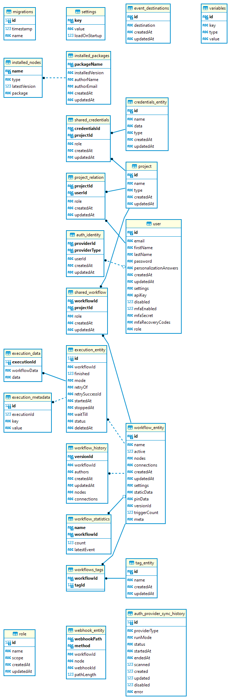

<!-- 简体中文翻译；来源 n8n-io/n8n-docs；原文版本见 upstream.json。 -->

# 数据库结构 

本页介绍 n8n 数据库中各个表的用途。

## 数据库与查询技术 

n8n 默认使用 SQLite。如果使用其他数据库，结构会相似，但数据类型可能因数据库不同而有所差异。

n8n 使用 [TypeORM](https://github.com/typeorm/typeorm) 进行查询和数据库迁移。

可以使用开源通用数据库工具 [DBeaver](https://dbeaver.io) 查看 n8n 数据库。

## 数据表 

以下是 n8n 在设置过程中创建的表。

### auth_identity 

使用 [SAML](../../../administer/manage-users-and-access/verify-user-identity/use-saml/README.md) 时，保存外部身份验证提供商的详细信息。

### auth_provider_sync_history 

保存 SAML 连接的历史记录。

### credentials_entity 

保存用于对集成服务进行身份验证的凭据[^1]。

### event_destinations 

包含[日志流](../../../administer/observe-and-log/stream-logs-to-external-systems.md)的目标配置。

### execution_data 

包含运行时的工作流及执行数据。

### execution_entity 

保存所有已存储的工作流执行记录。工作流设置会影响 n8n 保存哪些执行记录。

### execution_metadata 

保存[自定义执行数据](../../../build/understand-workflows/understand-executions/customize-executions-data.md)。

### installed_nodes 

列出 n8n 实例中已安装的[社区节点](../../../integrations/community-nodes/installation-and-management/README.md)。

### installed_packages 

保存实例中已安装的 npm 社区节点包的详细信息。[`installed_nodes`](#installednodes) 列出每个单独的节点，`installed_packages` 列出可能包含多个节点的 npm 包。

### migrations 

记录所有数据库迁移。更多信息请参阅 TypeORM 文档中的[迁移](https://typeorm.io/docs/advanced-topics/migrations/)。

### project 

列出实例中的[项目](../../../administer/manage-users-and-access/set-permissions-and-roles-rbac/organize-work-in-projects.md)。

### project_relation 

描述用户与[项目](../../../administer/manage-users-and-access/set-permissions-and-roles-rbac/organize-work-in-projects.md)之间的关系，包括用户的[角色类型](../../../administer/manage-users-and-access/set-permissions-and-roles-rbac/see-available-roles.md)。

### role 

目前未使用，将用于后续的自定义角色功能。

### settings 

记录自定义实例设置，即无法通过环境变量控制的设置，包括：

* 是否已设置实例所有者。
* 用户是否选择跳过所有者及用户管理设置。
* 是否启用 SAML、LDAP 等特定身份验证方式。
* 许可证密钥。

### shared_credentials 

记录凭据与用户的映射关系。

### shared_workflow 

记录工作流与用户的映射关系。

### tag_entity 

记录 n8n 实例中创建的所有工作流标签。此表列出标签，[`workflows_tags`](#workflowstags) 记录哪些工作流具有哪些标签。

### user 

包含用户数据。

### variables 

保存[变量](../../../build/code-in-n8n/define-custom-variables.md)。

### webhook_entity 

记录 n8n 实例工作流中处于激活状态的 Webhook。不仅包括 Webhook 节点使用的 Webhook，也包括所有触发器节点使用的激活 Webhook。

### workflow_entity 

保存 n8n 实例中已存储的工作流。

### workflow_history 

保存工作流的历史版本。

### workflow_statistics 

统计工作流 ID 及其状态。

### workflows_tags 

记录标签与工作流的映射关系。[`tag_entity`](#tagentity) 包含标签详情。

## 实体关系图（ERD） 

[^1]: 在 n8n 中，凭据保存连接特定应用和服务所需的身份验证信息。使用用户名和密码、API 密钥、OAuth 密钥等信息创建凭据后，就可以通过相应应用节点与服务交互。

## 相关资源 

* [理解架构](./)
* [n8n 的工作原理](how-n8n-works.md)
