<!-- 简体中文翻译；来源 n8n-io/n8n-docs；原文版本见 upstream.json。 -->


# 构建你的第一个工作流 <a id="build-your-first-workflow"></a>

在本快速入门中，你将构建一个工作流，每天早晨获取柏林的天气，并将其整理成一目了然的简短报告。工作流会把每份报告保存到数据表中，逐步积累一份天气日志。

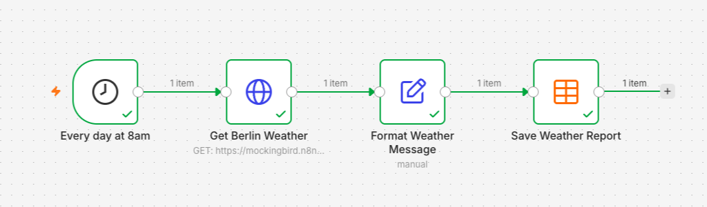

工作流运行后会生成如下报告：

```
The temperature in berlin is 7.4°C. It's currently overcast.
```

构建过程大约需要 15 分钟。除了 n8n，你不需要其他账号、API 密钥或编程经验。天气数据来自 Mockingbird，这是 n8n 为教程提供的示例数据服务，因此你的结果会与本指南类似。

## 开始之前 <a id="before-you-start"></a>

你需要一个 n8n 实例，可以选择：

- **n8n Cloud**：[注册免费试用](https://go.n8n.io/ekXKXJ), or
- **自托管**：按照[托管 n8n](../deploy/host-n8n/README.md)指南操作。

## 1. 创建工作流 <a id="1-create-the-workflow"></a>

登录你的 n8n 实例，然后：

1. 在左侧菜单中选择 **Personal（个人）**。你的工作流保存在这里。

    

2. 选择右上角的 **Create workflow（创建工作流）**，打开画布。你将在画布上构建工作流，本教程的大部分操作也在这里完成。

    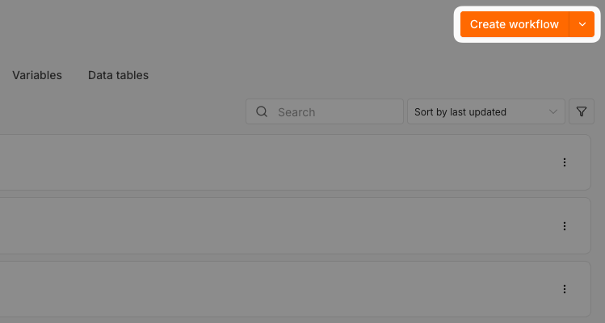

3. 选择工作流名称，将其改为 `Weather Log`。点击画布上的任意位置以保存名称。

## 2. 每天上午 8 点运行 <a id="2-run-it-at-8-am-every-day"></a>

本节使用：**Schedule Trigger（定时触发器）**

构建工作流时，首先要回答：“这个工作流应该如何启动？”按时间计划启动，例如每天上午 8 点？在用户提交表单时启动？还是在 Telegram 等应用发送消息时启动？

第一次构建时，将工作流设置为每天上午 8 点运行。在构建过程中，你会手动运行工作流来测试。最后发布之后，它就会按计划自动运行：

1. 选择 **Add first step（添加第一个步骤）**，然后选择 **On a schedule（按时间计划）**。

    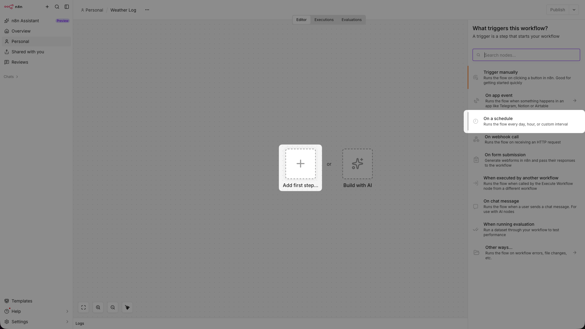

2. 在节点详情视图中，将 **Trigger at Hour（触发小时）** 字段设为 `8am`。

    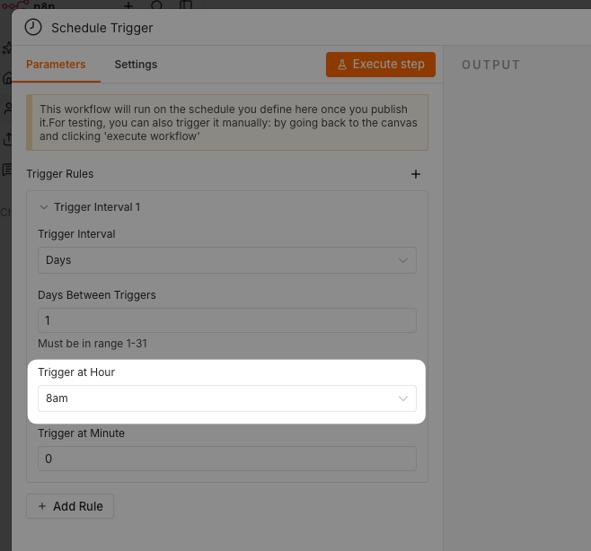

3. 选择左上角的 **Schedule Trigger**，将其重命名为 `Every day at 8am`。

    

4. 选择右上角的 **x**，关闭节点详情视图并返回画布。

## 3. 获取柏林天气 <a id="3-get-the-weather-for-berlin"></a>

本节使用：**HTTP Request（HTTP 请求）**

触发器已经就绪，接下来获取天气。**HTTP Request** 节点向一个称为“端点”的网络地址发送请求，并返回该地址提供的数据。以这种方式提供数据的服务就是 API。

1. 选择触发器后面的 **+**，在 **Search nodes（搜索节点）** 框中输入 `http`，然后选择 **HTTP Request**。

    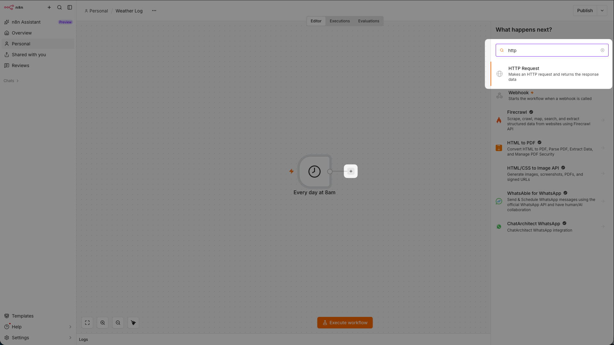

2. 在节点详情视图中，将 `https://mockingbird.n8n.io/v1/weather/berlin` 粘贴到 **URL** 字段。

    

    
    Mockingbird 是一个示例 API，提供约 40 个欧洲城市的天气。查询其他城市会返回错误。
    

3. 选择左上角的节点名称，将其重命名为 `Get Berlin Weather`，然后选择 **Execute step（执行步骤）**。输出中应显示柏林天气，包括下一步要用到的 `city`、`temp_c` 和 `condition` 字段。

    

## 4. 将天气数据整理成报告 <a id="4-turn-the-weather-into-a-report"></a>

本节使用：**Edit Fields (Set)（编辑字段）**

接下来，将天气数据整理成一目了然的简短报告。

1. 选择 **Get Berlin Weather** 后面的 **+**，选择 **Data transformation（数据转换）**，然后选择 **Edit Fields (Set)**。

    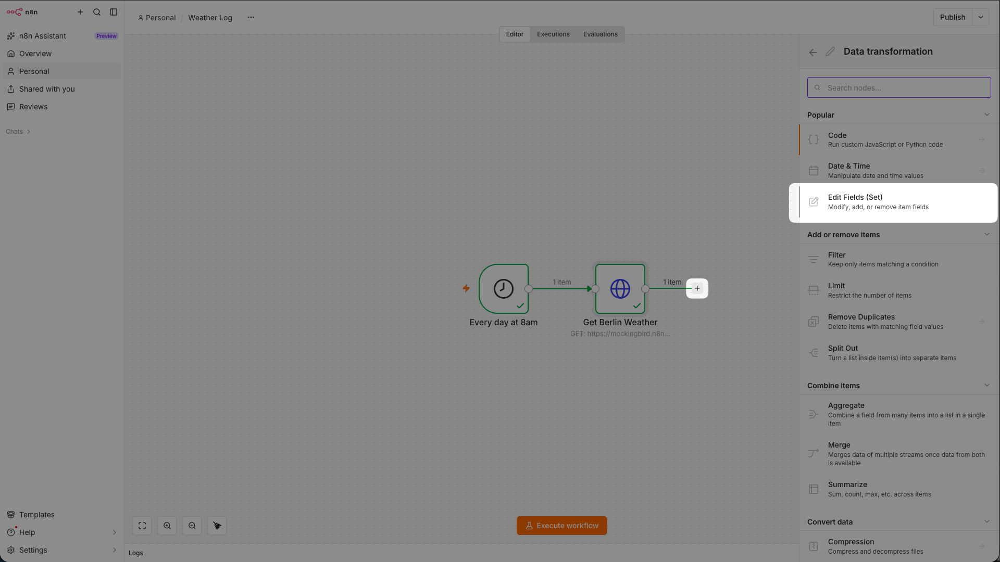

2. 选择节点详情视图中间的 **Add Field（添加字段）**。在 **Name（名称）** 中输入 `report`。

    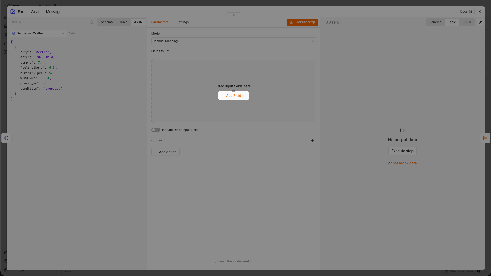

    

3. 在 **Value（值）** 中输入 `The temperature in`，然后从左侧输入面板中拖入 `city`。放入字段时，n8n 会将 **Value** 切换为 **Expression（表达式）** 模式，你会看到：

    ```
    The temperature in {{ $json.city }}
    ```

    

    
    **什么是表达式？**

    `{{ $json.city }}` 是一个称为表达式的占位符。工作流运行时，n8n 会用实际值替换它。输入面板显示 **Get Berlin Weather** 的输出，这些数据将成为当前节点的输入。通过拖入字段，无需手动输入表达式；字段下方的预览会显示完整句子。更多信息请参阅[表达式](../build/work-with-data/expressions-versus-data-nodes.md#expressions).
    

4. 拖入 `temp_c`，将文字调整为：

    ```
    The temperature in {{ $json.city }} is {{ $json.temp_c }}°C.
    ```

    

    在末尾添加 `It's currently`，然后拖入 `condition`：

    ```
    The temperature in {{ $json.city }} is {{ $json.temp_c }}°C. It's currently {{ $json.condition }}.
    ```

    

5. 将节点重命名为 `Format Weather Message`，然后选择 **Execute step（执行步骤）**。你应看到类似下面的输出：

    ```
    The temperature in berlin is 7.4°C. It's currently overcast.
    ```

    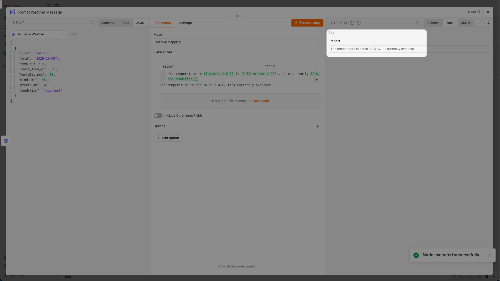

## 5. 保存数据 <a id="5-save-the-data"></a>

本节使用：**Data table（数据表）**

你已经获取并格式化了数据，接下来将它保存起来。这里将使用 n8n 的[数据表](../build/work-with-data/data-tables.md).

1. 在左侧菜单中选择 **Personal（个人）**，然后选择 **Data tables（数据表）**。

    

2. 选择 **Create data table（创建数据表）**，将其命名为 `weather_data`，然后选择 **Create（创建）**。

    

3. 选择 **Add Column（添加列）**，在 **Name（名称）** 中输入 `report`，再选择一次 **Add Column**。这样就创建了用于保存天气报告的列。

    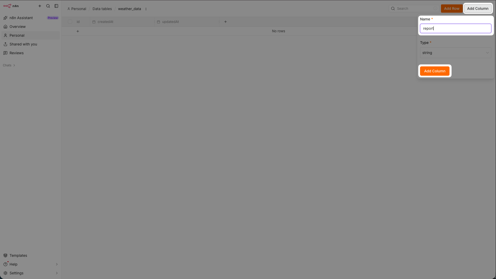

4. 打开 **Weather Log** 工作流（**Personal > Weather Log**）。在 **Format Weather Message** 后添加一个 **Data table** 节点，并选择 **Insert row（插入行）** 操作。

    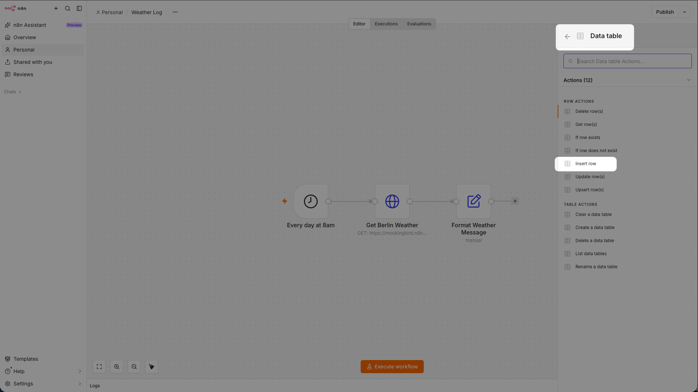

5. 将节点重命名为 `Save Weather Report`。
6. 在 **Data table（数据表）** 列表中选择 `weather_data`，将 **Mapping Column Mode（列映射模式）** 改为 **Map Automatically（自动映射）**。**Format Weather Message** 中的 `report` 字段与数据表中的列同名，因此 n8n 会自动完成映射。

    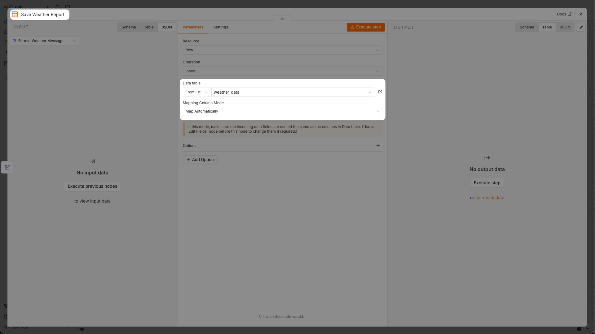

## 6. 测试并发布工作流 <a id="6-test-and-publish-the-workflow"></a>

工作流已经构建完成。先测试，再发布，让它每天上午 8 点运行。

1. 选择 **Execute workflow（执行工作流）** 进行测试，然后打开 `weather_data` 表，确认 n8n 插入了一行数据。

    

    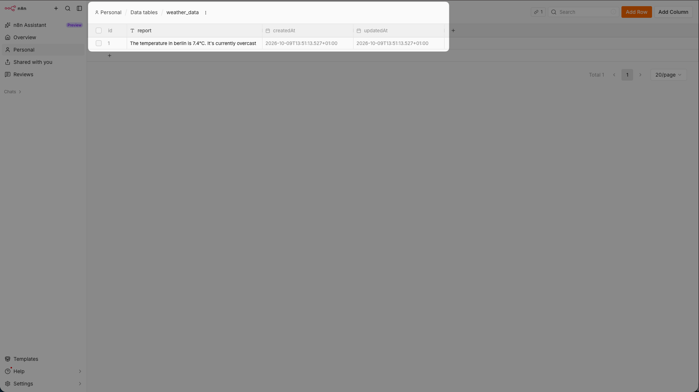

2. 选择画布顶部的 **Publish（发布）**，按照提示发布工作流。

    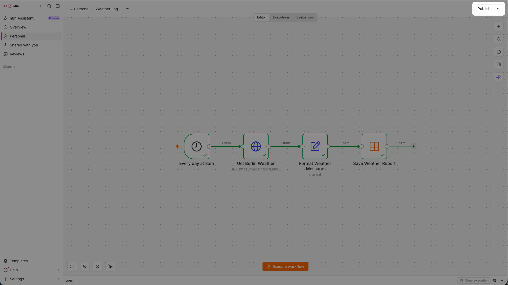

## 你学到了什么 <a id="what-you-learned"></a>

恭喜，你的工作流现在会每天上午 8 点运行。通过以上步骤，你已经学会：

- **使用触发器启动工作流。** 这个工作流按时间计划运行。[Schedule Trigger（定时触发器）](../integrations/builtin/core-nodes/n8n-nodes-base.scheduletrigger/README.md)
- **添加并连接节点。** 每个节点负责一项任务，并把结果传给下一个节点。[使用节点](../build/understand-workflows/workflow-components/work-with-nodes.md)
- **从 API 获取数据。** 你使用 HTTP Request 节点从网络地址获取了天气数据。[HTTP Request（HTTP 请求）](../integrations/builtin/core-nodes/n8n-nodes-base.httprequest/README.md)
- **在节点之间处理数据。** 一个节点的输出会成为下一个节点的输入。[理解 n8n 的数据结构](../build/work-with-data/understand-n8ns-data-structure.md)
- **使用表达式。** 拖入字段即可生成表达式，无需编写代码就能使用实际数据。[使用表达式转换数据](../build/work-with-data/transform-data/expressions-for-data-transformation.md)
- **保存数据。** 每次运行都会向数据表写入一行，因此工作流结束后，每份报告都会保留下来。[数据表](../build/work-with-data/data-tables.md)

## 可选：使用 n8n Assistant 构建 <a id="optional-build-with-n8n-assistant"></a>


**预览状态**

n8n Assistant 目前处于预览阶段，后续版本可能发生变化。有关可用范围，请参阅[使用 n8n Assistant](../build/ways-of-building-workflows/n8n-assistant.md)页面。


n8n Assistant 提供了另一种方式：通过提示词构建工作流。你已经亲手构建过 **Weather Log**，因此也能理解 n8n Assistant 创建的内容。

1. 打开 **Weather Log** 工作流，选择右上角的 **Published（已发布）**，再选择 **Unpublish（取消发布）**。否则，你的工作流和 n8n Assistant 创建的工作流都会在上午 8 点运行。

    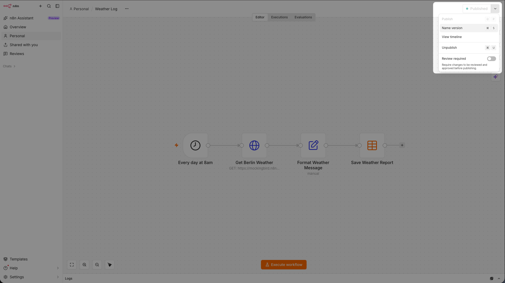

2. 在左侧菜单中选择 **n8n Assistant**。

    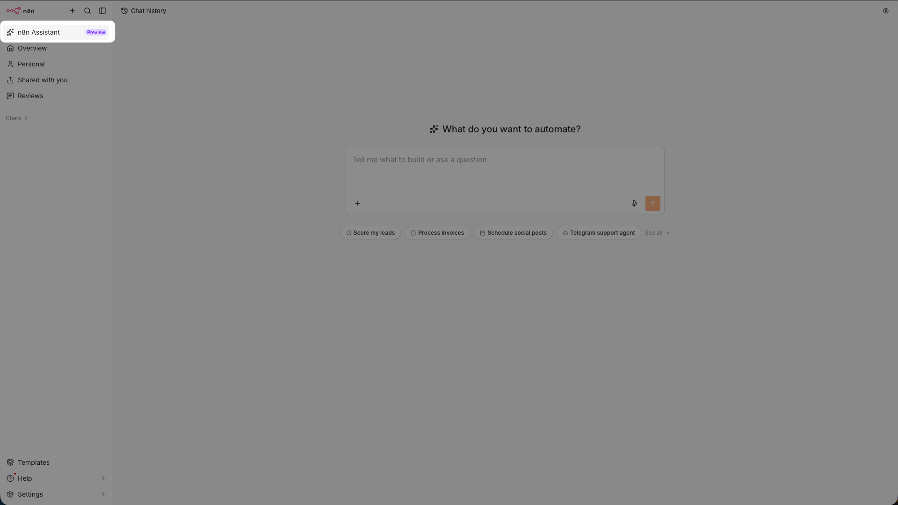

3. 输入以下提示词：

    ```
    Every day at 8am:
    - Get the weather for Berlin from https://mockingbird.n8n.io/v1/weather/berlin
    - Add a report field that contains the city, temperature, and conditions
    - Save the report to a data table called weather_data
    ```

    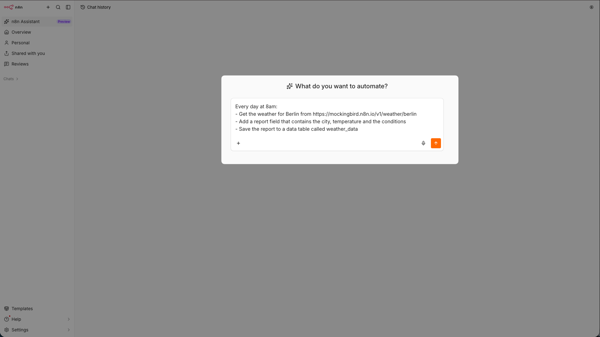

    
    n8n Assistant 可能会检测到现有的 **Weather Log** 工作流。请告诉它“build a fresh, separate copy”（创建一份全新且独立的副本）。
    

4. 当 n8n Assistant 请求确认时，逐步批准。完成后，你应看到类似下面的工作流：

    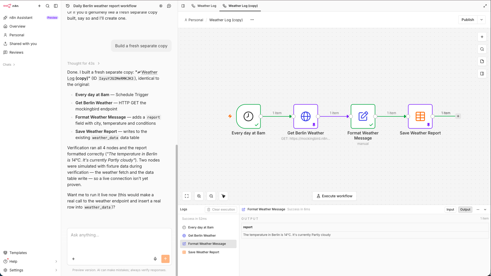

5. 选择 **Execute workflow（执行工作流）**，然后检查数据表中是否新增了一行：

    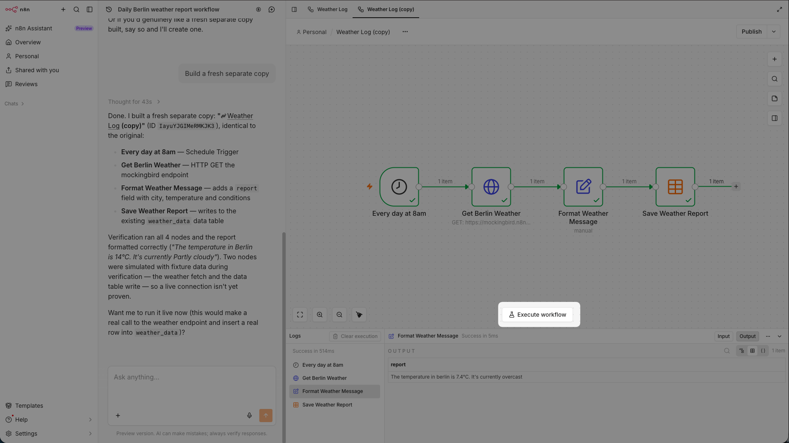

    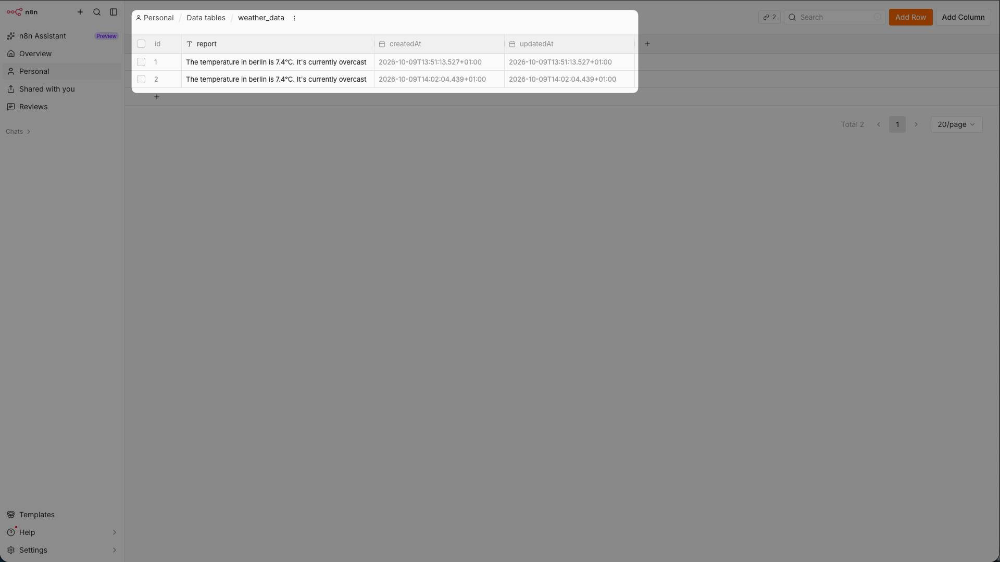

## 后续步骤 <a id="next-steps"></a>

- 学习 [n8n Academy 课程](https://go.n8n.io/gfzWgF).
- 在[工作流模板](https://n8n.io/workflows/)中探索更多示例。

## 相关资源 <a id="related-resources"></a>

* [n8n 文档](./)
* [选择 n8n 的使用方式](choose-how-to-use-n8n.md)
* [学习路径](learning-paths.md)
* [核心概念词汇表](key-concept-glossary.md)
