<!-- 简体中文翻译；来源 n8n-io/n8n-docs；原文版本见 upstream.json。 -->


# 构建你的第一个工作流 <a id="build-your-first-workflow"></a>

在本快速入门中，你将构建一个工作流，每天早晨获取柏林的天气，并将其整理成一目了然的简短报告。工作流会把每份报告保存到数据表中，逐步积累一份天气日志。

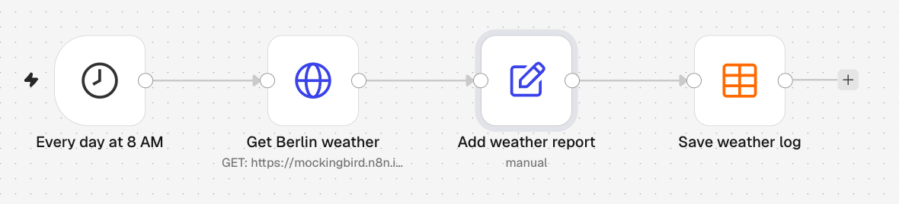

工作流运行后会生成如下报告：

```
The temperature in Berlin is 6.8 degrees C and it's currently cloudy.
```

你将使用 n8n Assistant 构建工作流，它能将提示词转换为可运行的流程，整个过程不到五分钟。如果更愿意逐个节点搭建，末尾的可选章节会介绍如何手动构建相同工作流。

也可以跟随以下视频操作：



除了 n8n，你不需要任何编程经验。天气数据来自 Mockingbird，这是 n8n 为教程提供的示例数据服务，因此结果会与本指南类似。

## 开始之前 <a id="before-you-start"></a>

你需要一个 n8n 实例，可以选择：

- **n8n Cloud**：[注册免费试用](https://go.n8n.io/ekXKXJ), or
- **自托管**：按照[托管 n8n](../deploy/host-n8n/README.md)指南操作，然后使用自己的 AI 服务商账号[设置 n8n Assistant](../deploy/host-n8n/configure-n8n/set-up-n8n-assistant.md)。

## 使用 n8n Assistant 构建工作流 <a id="build-the-workflow-with-n8n-assistant"></a>


**功能可用范围**

n8n Assistant 适用于：

- **n8n Cloud：**Starter、Pro。
- **自托管：**Community、Registered Community、Business。

对于 n8n Cloud Enterprise 和自托管 Enterprise，请联系客户成功经理申请预览访问。



你的结果可能与本指南截图不同。


n8n Assistant 根据提示词构建工作流。你描述需求、批准每个步骤，最后得到可以打开、编辑和发布的工作流。

1. 登录 n8n 实例，在左侧菜单中选择 **New chat（新建聊天）**，与 n8n Assistant 对话。

    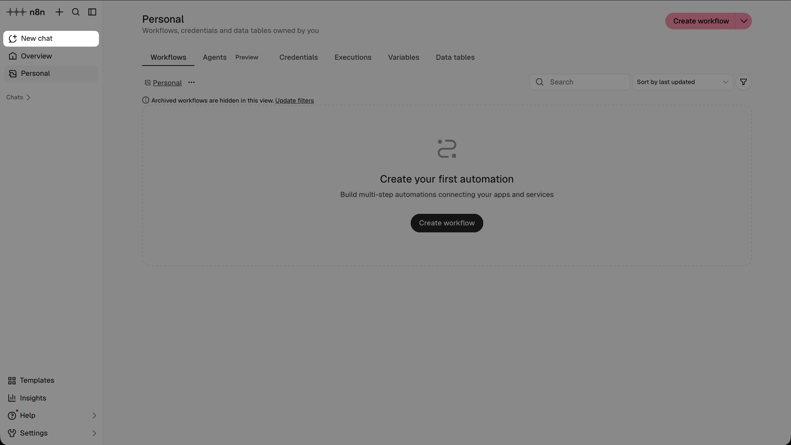

2. 输入或口述以下提示词，然后选择发送箭头：

    ```
    构建一个名为 Weather Log 的工作流，每天上午 8 点运行：
    - 从 https://mockingbird.n8n.io/v1/weather/berlin 获取柏林天气
    - 添加一个 report 字段，包含城市、温度和天气状况，例如：柏林的温度为 10°C。目前是阴天。
    - 将报告保存到新的数据表
    ```

    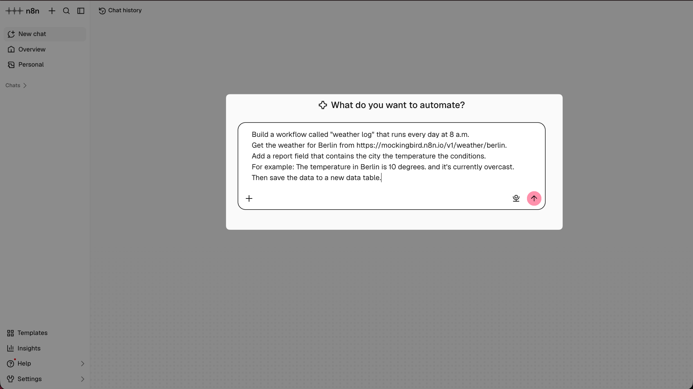

    
    Mockingbird 是一个示例 API，提供约 40 个欧洲城市的天气。查询其他城市会返回错误。
    

3. 对 n8n Assistant 的权限请求选择 **Allow once（允许一次）**。构建工作流时，聊天右侧画布会显示进度。

    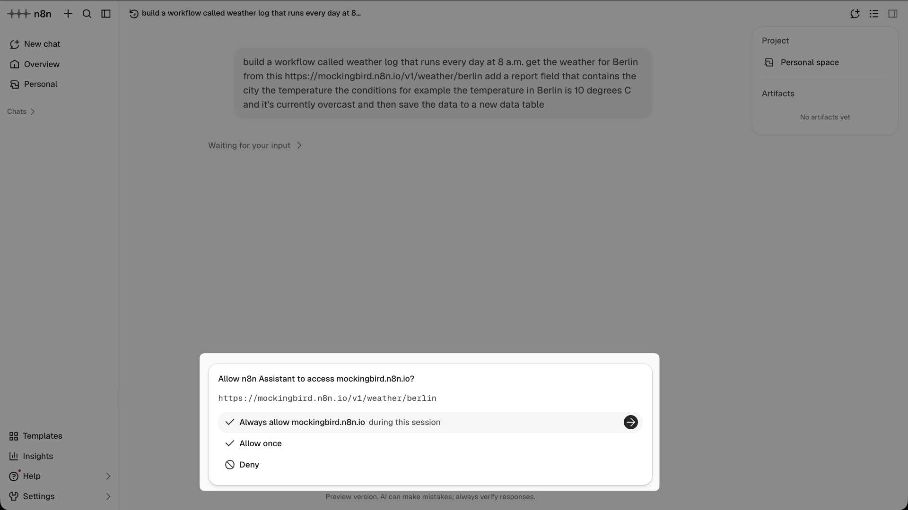

4. 如果 n8n Assistant 请求运行，请批准。否则，让 n8n Assistant 帮你运行一次测试。

    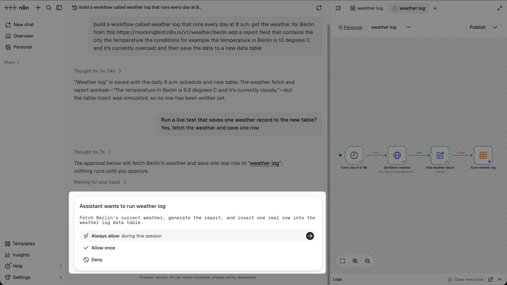

5. 如果 n8n Assistant 提示，请选择 **Publish and enable the schedule（发布并启用计划）**，因为工作流只有发布后才会每天上午 8 点运行。否则，让 n8n Assistant 帮你发布。

    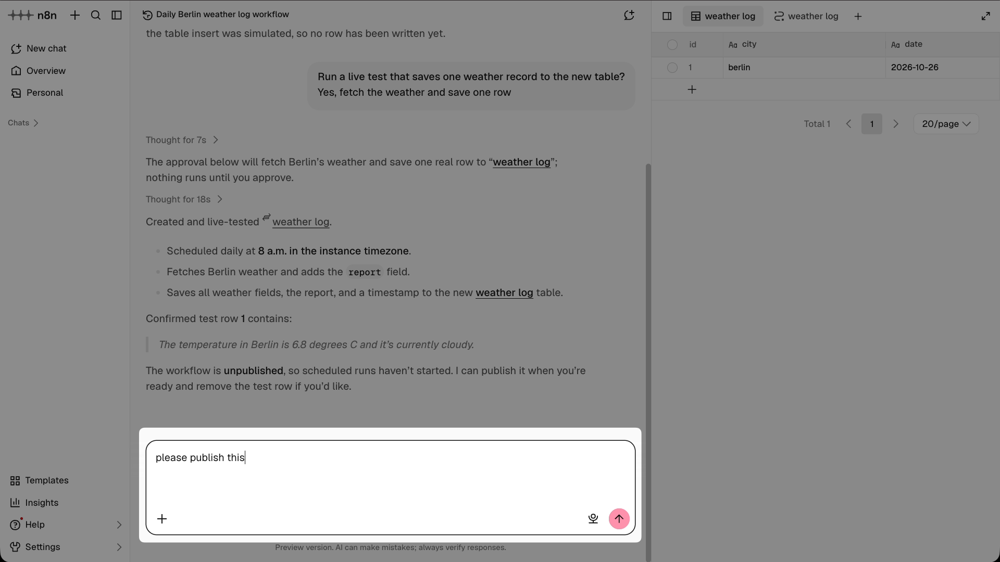

6. 选择右侧面板顶部的 `weather log` 数据表，检查工作流是否按预期运行。也可以让 n8n Assistant 展示该数据表。

    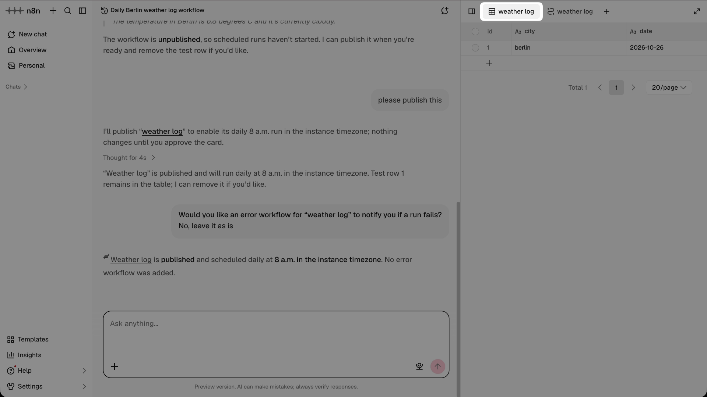

7. 在左侧菜单中选择 **Personal（个人）**查看工作流。n8n Assistant 会将所有工作流保存到 Personal 下。

    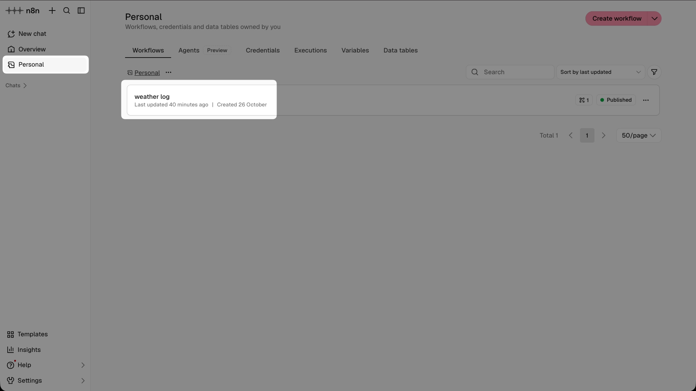

## 工作流执行了什么 <a id="what-your-workflow-does"></a>

在画布上打开 **weather log**，会看到四个[节点](../build/understand-workflows/workflow-components/work-with-nodes.md)，各自完成一项任务，再将结果传给下一个节点：

| 节点 | 作用 |
| --- | --- |
| **Every day at 8 AM** | [Schedule Trigger](../integrations/builtin/core-nodes/n8n-nodes-base.scheduletrigger/README.md) 节点，每天上午 8 点启动工作流。 |
| **Get Berlin weather** | [HTTP Request](../integrations/builtin/core-nodes/n8n-nodes-base.httprequest/README.md) 节点，从 Mockingbird API 获取天气。 |
| **Add weather report** | [Edit Fields (Set)](../integrations/builtin/core-nodes/n8n-nodes-base.set.md) 节点，使用[表达式](../build/work-with-data/transform-data/expressions-for-data-transformation.md)获取实时天气值，构建 `report` 文本。 |
| **Save weather log** | [Data table](../integrations/builtin/core-nodes/n8n-nodes-base.datatable/README.md) 节点，将报告作为新行插入数据表。 |


n8n Assistant 会自行选择节点名称，因此你的名称可能与上表不同。


## 可选：自行构建工作流 <a id="optional-build-the-workflow-yourself"></a>

本节不使用 n8n Assistant，而是逐个节点手动搭建天气日志工作流。

最终会得到第二个由相同四个节点组成的工作流：**Every day at 8 AM**、**Get Berlin weather**、**Add weather report** 和 **Save weather log**。过程中还会创建新的数据表。

### 1. 创建工作流 <a id="1-create-the-workflow"></a>

1. 在左侧菜单中选择 **Personal（个人）**，然后选择 **Create workflow（创建工作流）**。这会打开画布，你将在画布上构建工作流，并完成本节大部分操作。

    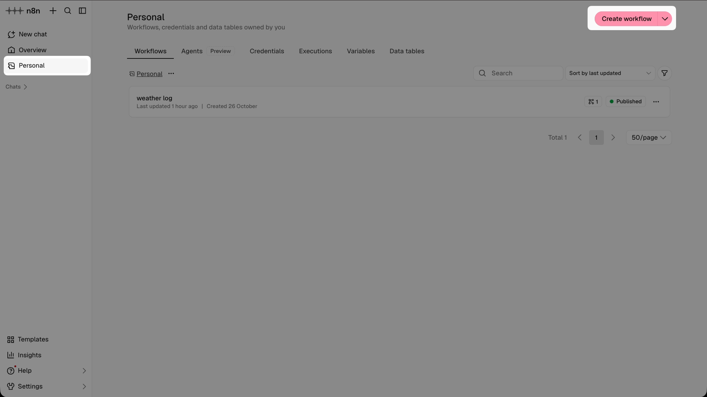

2. 选择工作流名称，改为 `Weather Log 2`（也可以发挥创意取名）。选择画布任意位置以保存名称。

### 2. 每天上午 8 点运行 <a id="2-run-it-at-8-am-every-day"></a>

本节使用：**Schedule Trigger（定时触发器）**

构建工作流时，首先要回答：“这个工作流应该如何启动？”按时间计划启动，例如每天上午 8 点？在用户提交表单时启动？还是在 Telegram 等应用发送消息时启动？

本次构建将工作流设为每天上午 8 点运行。搭建过程中，你会手动运行以测试；最后发布后，计划会自动运行：

1. 选择 **Add first step（添加第一个步骤）**，然后选择 **On a schedule（按时间计划）**。

    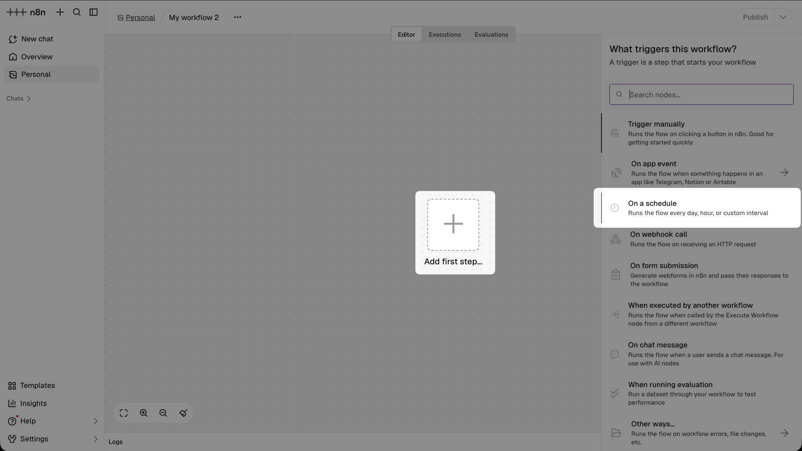

2. 在节点详情视图的 **Trigger at Hour（触发小时）**字段中选择 `8am`，然后选择右上角关闭按钮，关闭窗口。

    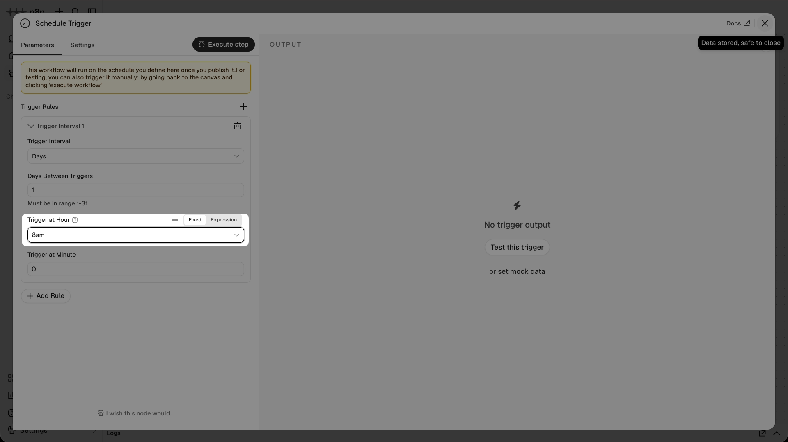

3. 选择 **Schedule Trigger** 节点，按空格键打开重命名对话框，将其重命名为 `Every day at 8 AM`。

    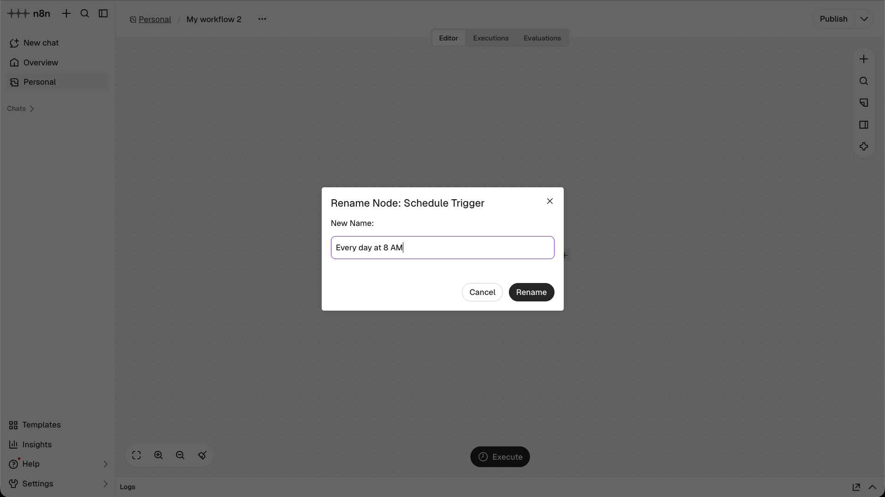

### 3. 获取柏林天气 <a id="3-get-the-weather-for-berlin"></a>

本节使用：**HTTP Request（HTTP 请求）**

触发器已经就绪，接下来获取天气。**HTTP Request** 节点向一个称为“端点”的网络地址发送请求，并返回该地址提供的数据。以这种方式提供数据的服务就是 API。

1. 选择触发器后面的 **+**，在 **Search nodes（搜索节点）** 框中输入 `http`，然后选择 **HTTP Request**。

    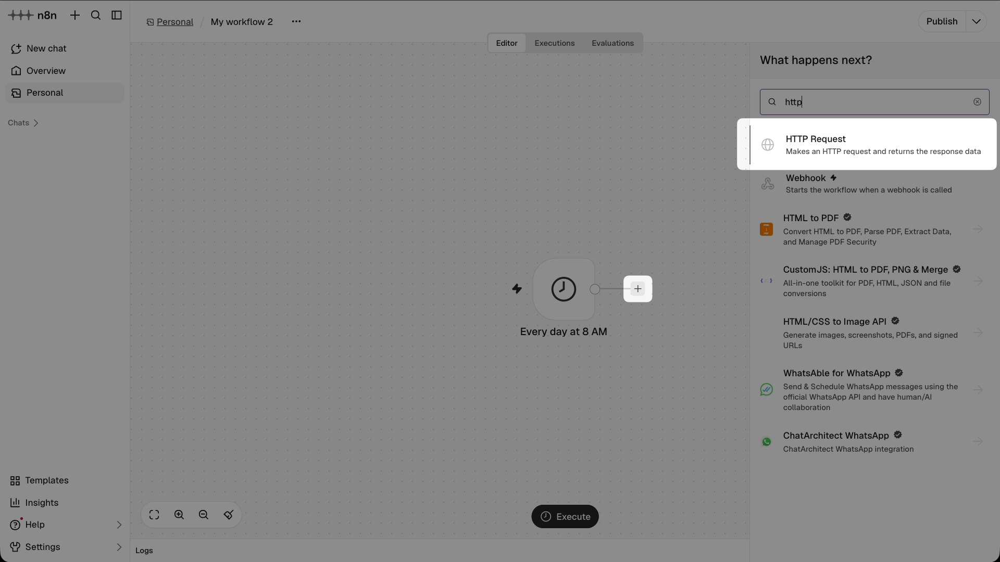

2. 将 `https://mockingbird.n8n.io/v1/weather/berlin` 粘贴到节点详情视图的 **URL** 字段。

    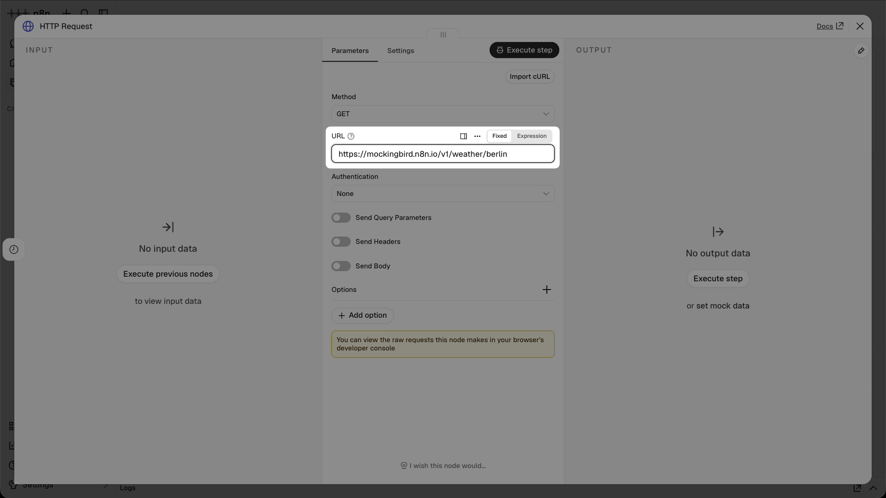

    
    Mockingbird 是一个示例 API，提供约 40 个欧洲城市的天气。查询其他城市会返回错误。
    

3. 选择 **Execute step（执行步骤）**。输出应显示柏林天气，包括下一步要使用的 `city`、`temp_c` 和 `condition` 字段。

    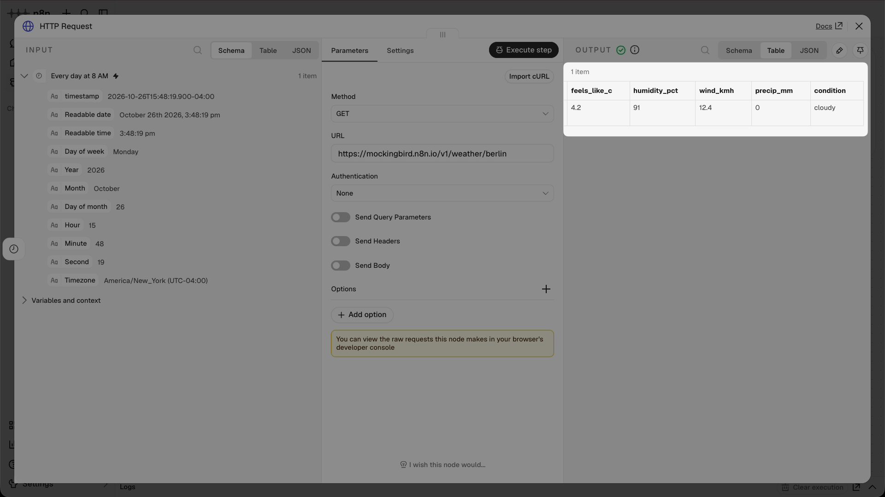

4. 将节点重命名为 `Get Berlin weather`。

### 4. 将天气整理为报告 <a id="4-turn-the-weather-into-a-report"></a>

本节使用：**Edit Fields (Set)（编辑字段）**

接下来，将天气数据整理成一目了然的简短报告。

1. 选择 **Get Berlin weather** 后面的 **+**，选择 **Data transformation（数据转换）**，然后选择 **Edit Fields (Set)**。

    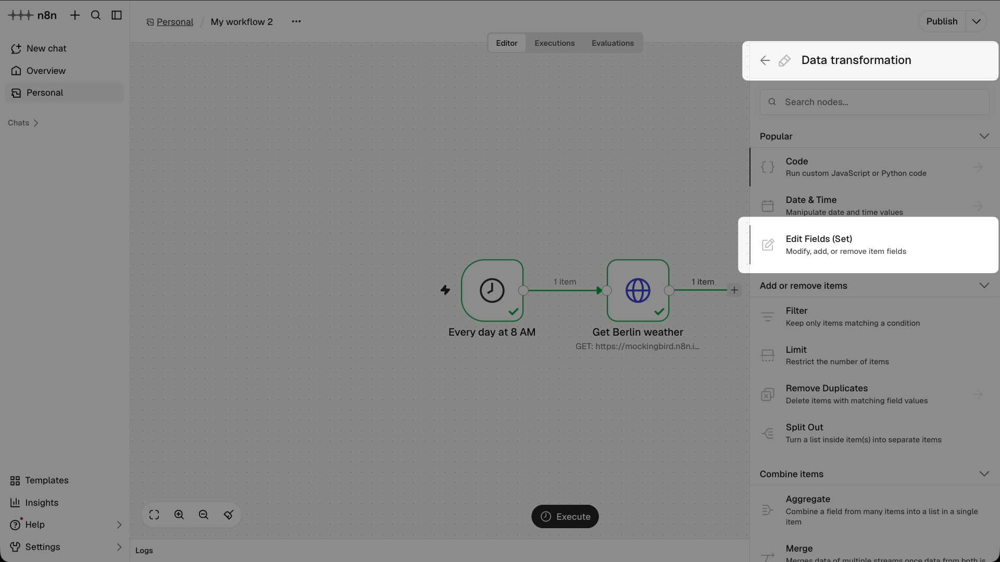

2. 选择节点详情视图中间的 **Add Field（添加字段）**。在 **Name（名称）** 中输入 `report`。

    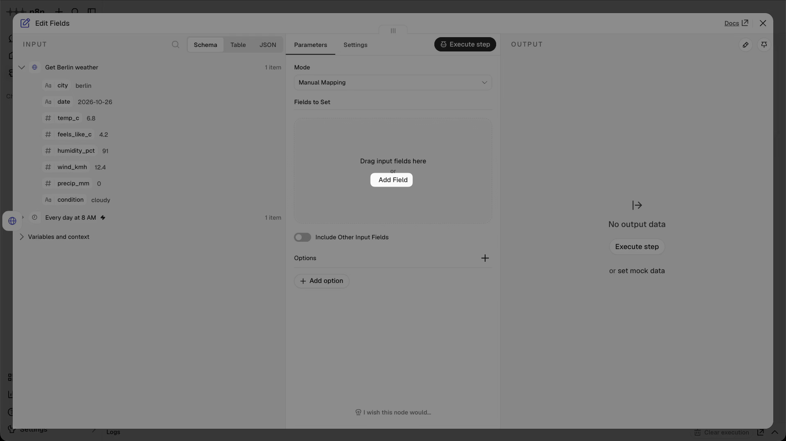

    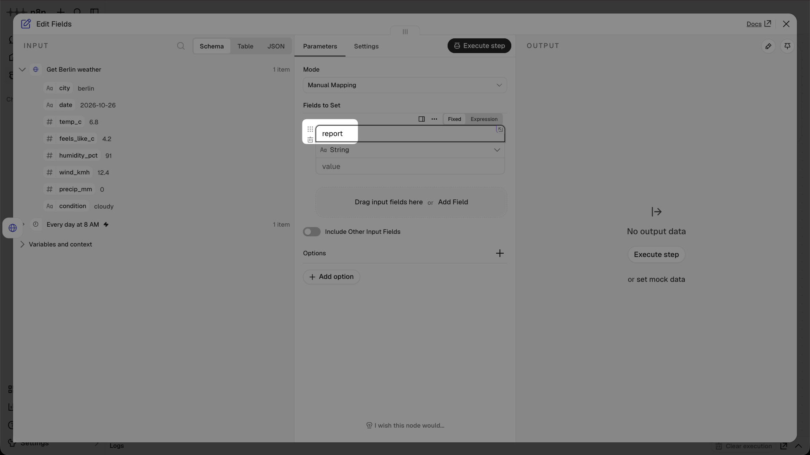

3. 在 **Value（值）**中输入 `The temperature in`，然后从左侧输入面板拖入 `city`。放入字段后，n8n 会将 Value 切换为 **Expression（表达式）**模式，显示：

    ```
    The temperature in {{ $json.city }}
    ```

    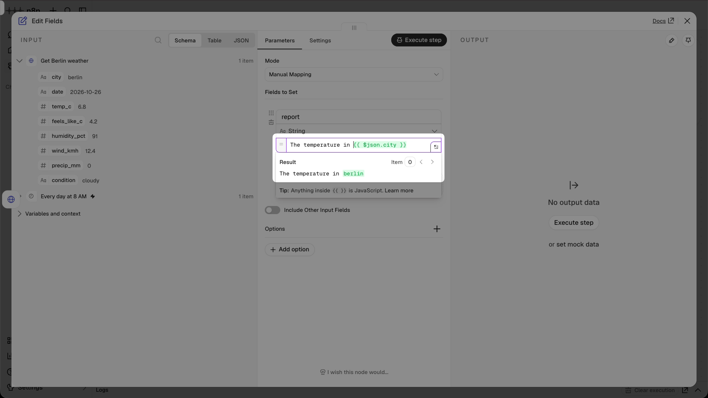

    
    **什么是表达式？**

    `{{ $json.city }}` 是称为表达式的占位符。工作流运行时，n8n 会用实际值替换它。输入面板显示 **Get Berlin weather** 的输出，这些数据成为当前节点的输入。通过拖动而非手动输入来引用字段，字段下方预览会显示完整句子。了解更多，请参阅[表达式](../build/work-with-data/expressions-versus-data-nodes.md#expressions)。
    

4. 拖入 `temp_c`，将文字调整为：

    ```
    The temperature in {{ $json.city }} is {{ $json.temp_c }}°C.
    ```

    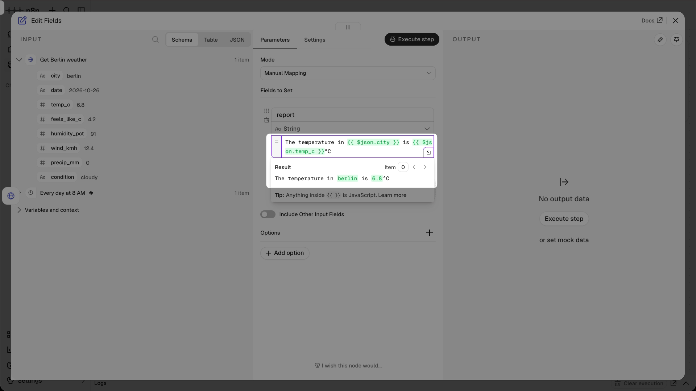

    在末尾添加 `It's currently`，然后拖入 `condition`：

    ```
    The temperature in {{ $json.city }} is {{ $json.temp_c }}°C. It's currently {{ $json.condition }}.
    ```

    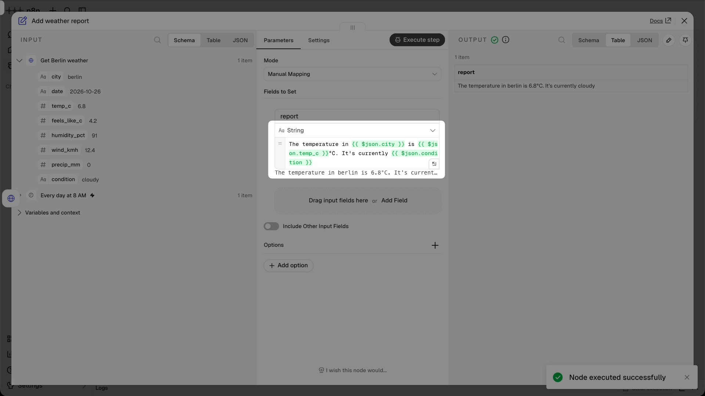

5. 将节点重命名为 `Add weather report`，然后选择 **Execute step（执行步骤）**。

### 5. 保存数据 <a id="5-save-the-data"></a>

本节使用：**Data table（数据表）**

已经获取并格式化数据，接下来进行存储。过程中将创建一个数据表。

1. 在 **Add weather report** 后添加 **Data table** 节点，并选择 **Insert row（插入行）**操作。

    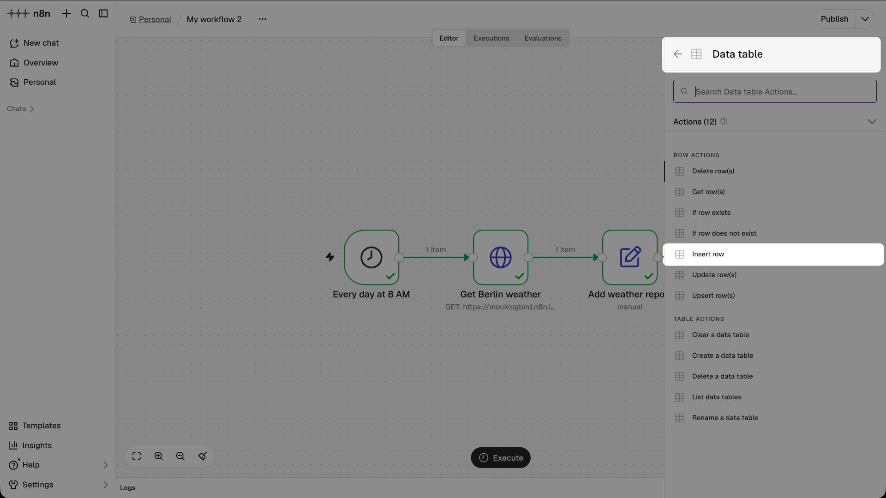

2. 打开节点，选择 **Data table（数据表）**下的下拉框，然后选择 **Create new data table（创建新数据表）**：

    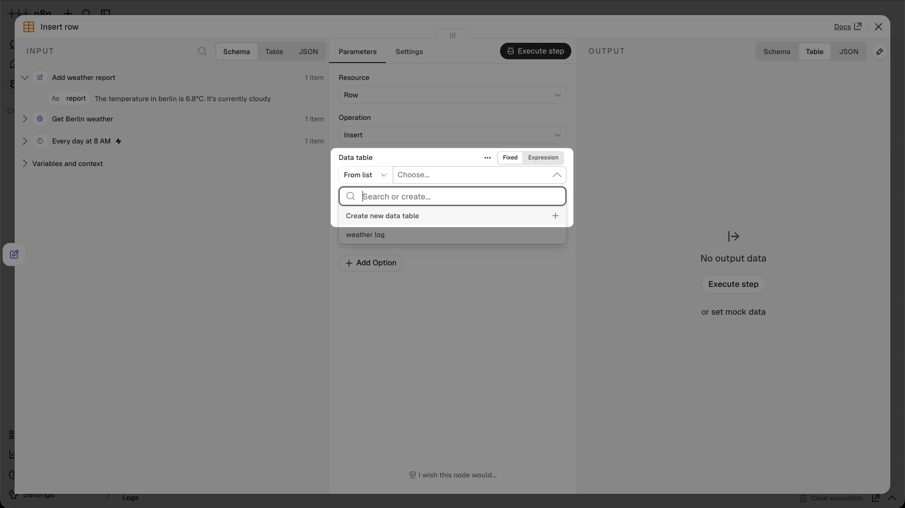

    浏览器会打开新选项卡。

3. 将数据表命名为 `weather log 2`（也可以发挥创意取名），然后选择 **Create（创建）**：

    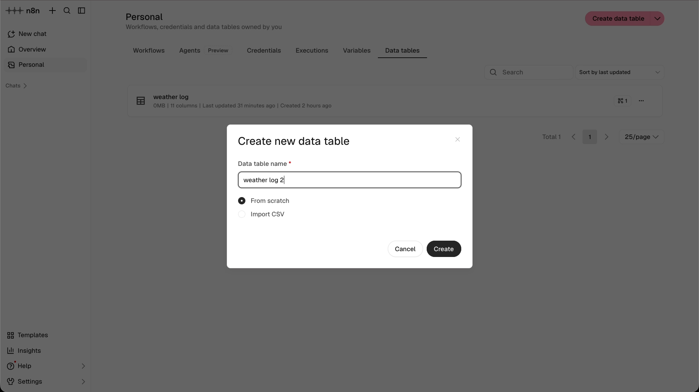

4. 选择右上角的 **Add Column（添加列）**，输入 `report`，再选择 Add Column。`Add weather report` 节点的数据将保存在这一列。

    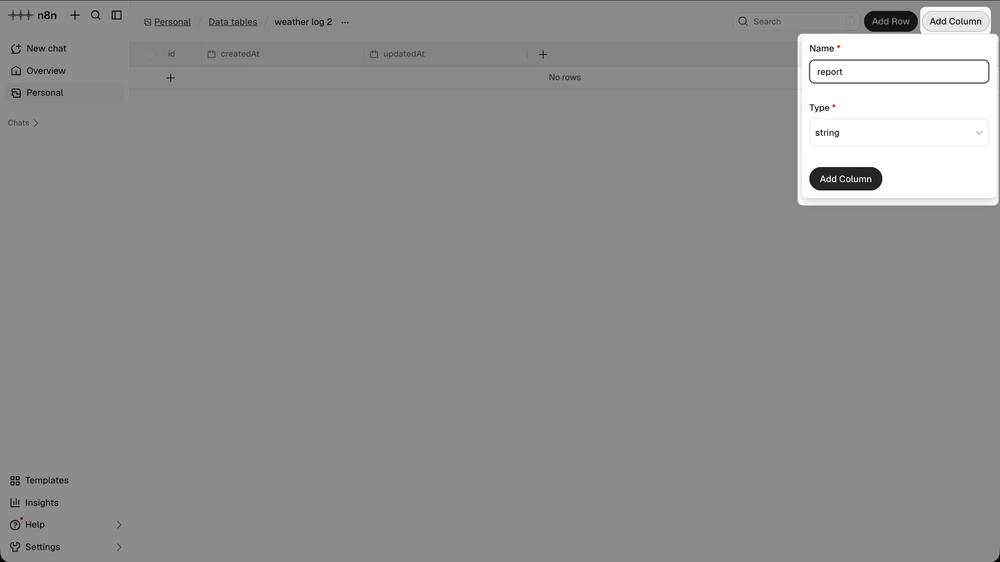

    返回工作流选项卡。

5. 从 **Data table（数据表）**列表选择刚创建的表，将 **Mapping Column Mode（列映射模式）**改为 **Map Automatically（自动映射）**。**Add weather report** 中的 `report` 字段与数据表列同名，n8n 会自动映射。

    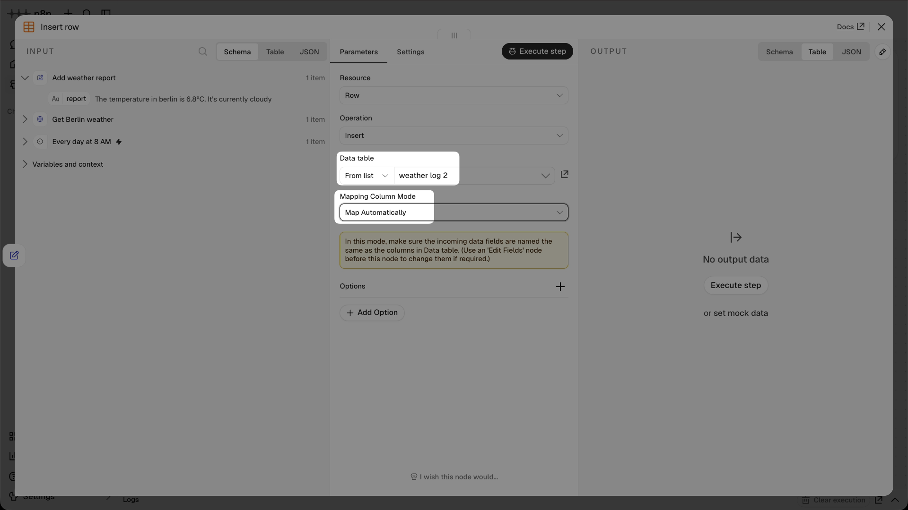

6. 将节点重命名为 `Save weather log`。

### 6. 测试并发布工作流 <a id="6-test-and-publish-the-workflow"></a>

工作流已经构建完成。先测试，再发布，让它每天上午 8 点运行。

1. 选择画布下方的 **Execute（执行）**进行测试，四个节点都应出现绿色对勾：

    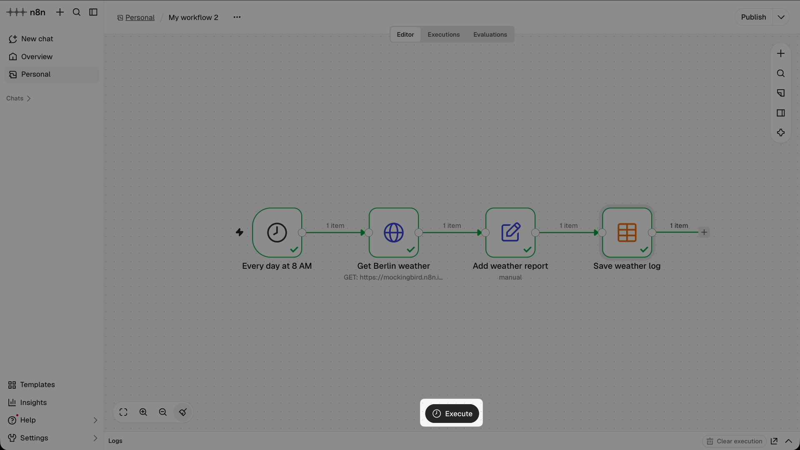

2. 进入 **Personal（个人）** > **Data tables（数据表）**查看新增行。

3. 选择画布顶部的 **Publish（发布）**，按照提示发布工作流。

    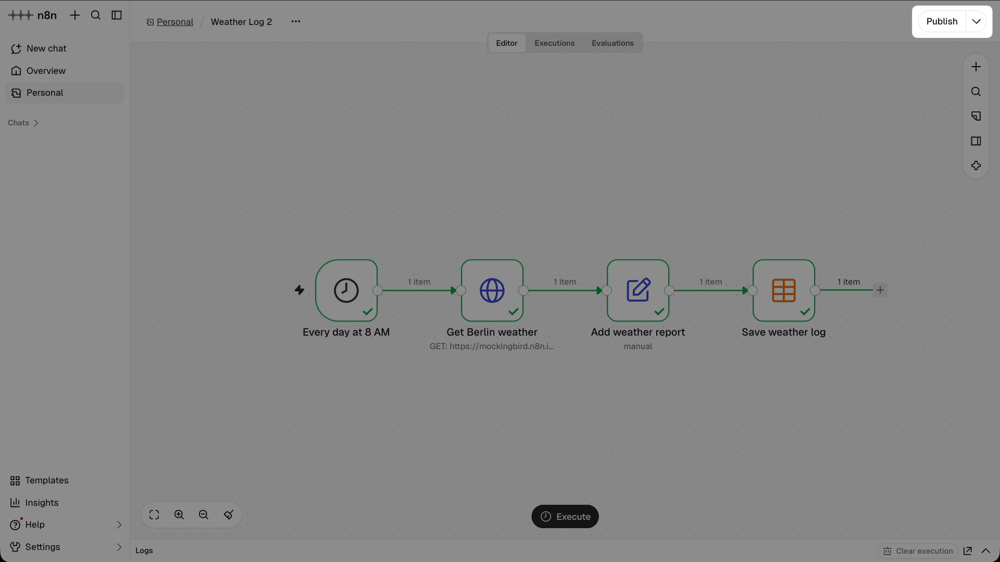

## 后续步骤 <a id="next-steps"></a>

- 学习 [n8n Academy 课程](https://go.n8n.io/gfzWgF).
- 在[工作流模板](https://n8n.io/workflows/)中探索更多示例。

## 相关资源 <a id="related-resources"></a>

* [n8n 文档](./)
* [选择 n8n 的使用方式](choose-how-to-use-n8n.md)
* [使用 n8n Assistant](../build/ways-of-building-workflows/n8n-assistant.md)
* [学习路径](learning-paths.md)
* [核心概念词汇表](key-concept-glossary.md)
