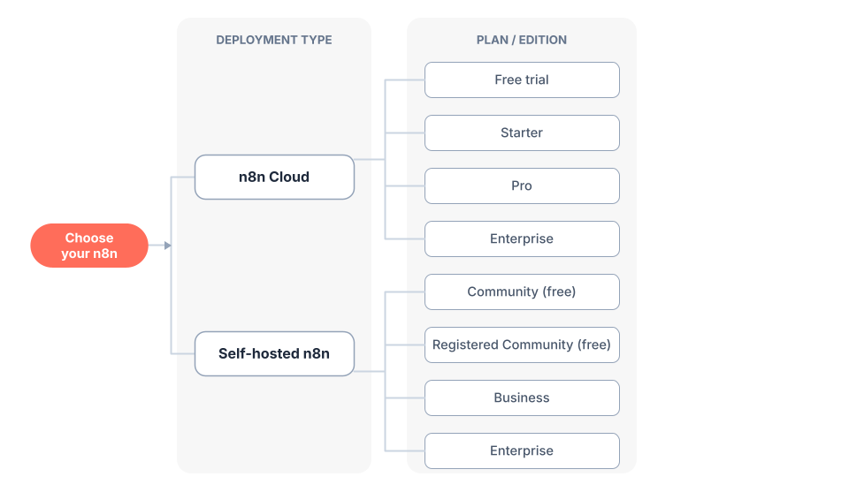

<!-- 简体中文翻译；来源 n8n-io/n8n-docs；原文版本见 upstream.json。 -->

# 选择适合你的 n8n 

n8n 提供两种主要部署方式：**n8n Cloud**（完全托管）和**自托管**（部署在你自己的基础设施上）。选择时需要做出两个决定：

1. **云服务还是自托管？** 决定由 n8n 管理基础设施，还是由你自行管理。
2. **选择哪个套餐或版本？** 在所选部署方式中，选择功能和用量限制符合需求的档位。

本页将帮助你做出这两个决定。

<figure>
  <picture>
    <source
      srcset=".gitbook/assets/choose-your-n8n-diag-dark.png"
      media="(prefers-color-scheme: dark)"
    />
    
  </picture>
  <figcaption>选择 n8n 的部署方式、套餐和版本</figcaption>
</figure>


**想快速试用 n8n？**

**从 n8n Cloud 开始**，无需安装即可立即使用。

[开始免费试用](https://n8n.io/cloud/)


## 决定一：云服务还是自托管 

参考下表选择部署方式：

| 你的情况 | 推荐方式 | 原因 |
|----------------|-------------------|---------|
| 希望立即开始使用 | **n8n Cloud** | 无需安装 |
| 不具备技术专长 | **n8n Cloud** | 完全托管，无需自行配置和维护 |
| 需要可用于生产环境的部署 | **两种方式均可** | n8n Cloud 和自托管均支持生产使用 |
| 不想管理基础设施 | **n8n Cloud** | n8n 负责托管、更新和扩容 |
| 需要完全控制部署 | **自托管** | 由你掌控运行环境和配置 |
| 存在定制需求 | **自托管** | 可以完全控制部署和配置 |
| 需要企业功能（SSO、环境、项目等） | **两种方式均可** | 两者均提供付费企业套餐 |
| 已有基础设施和技术资源 | **自托管** | 可以自行管理部署 |
| 希望免费运行 n8n | **自托管（社区版）** | 免费提供几乎完整的功能集 |

各套餐具体提供哪些功能，请参阅[价格页面](https://n8n.io/pricing/)。

### 优缺点比较 

| 比较项 | n8n Cloud | 自托管 |
|--------|-----------|-------------|
| **设置与部署** |
| 安装 | ✅ 无需安装 | ❌ 需要配置 npm、Docker 或服务器 |
| 技术要求 | ✅ 无技术要求 | ❌ 安装和配置需要技术能力 |
| **基础设施管理** |
| 托管 | ✅ 由 n8n 完全托管 | ❌ 需要自行提供并管理基础设施 |
| 维护 | ✅ 由 n8n 负责 | ❌ 由你负责 |
| **控制与定制** |
| 部署控制权 | ❌ 由 n8n 管理 | ✅ 完全控制部署 |
| 定制 | ❌ 受限于平台提供的选项 | ✅ 适合有定制需求的场景 |
| **成本** |
| 免费选项 | ⚠️ 提供免费试用 | ✅ 免费社区版包含大部分功能 |
| 付费选项 | ✅ 提供多种付费套餐 | ✅ 提供付费 Business 和 Enterprise 选项 |
| **功能** |
| 核心功能 | ✅ 包含 | ✅ 免费社区版包含 |
| 企业功能 | ❌ 需要付费套餐 | ❌ 需要付费套餐（免费社区版功能有限） |
| **使用场景** |
| 快速开始 | ✅ 适合快速入门 | ⚠️ 部署耗时较长 |
| 生产使用 | ✅ 支持 | ✅ 推荐用于生产环境 |
| 定制需求 | ⚠️ 定制能力有限 | ✅ 适合定制场景 |

**图例**：✅ 优点 | ❌ 缺点 | ⚠️ 各有利弊，取决于需求

各套餐具体提供哪些功能，请参阅[价格页面](https://n8n.io/pricing/)。

## 决定二：选择套餐或版本 

选定部署方式后，再选择套餐或版本。具体功能、用量限制和价格以[价格页面](https://n8n.io/pricing/)为准。

### 为 n8n Cloud 选择套餐 

所有套餐都运行相同的基础产品，但提供的功能、用量限制和计算资源不同。

| 套餐 | 适用人群 |
|------|--------------|
| **免费试用** | 希望使用 Pro 功能试用 n8n Cloud 14 天的用户 |
| **Starter** | 刚开始使用的个人和小型项目 |
| **Pro** | 需要更高用量限额、管理员账号和洞察功能的高级用户及小团队 |
| **Enterprise** | 需要高级安全、扩展能力和专属支持的组织 |

如何开始试用及升级，请参阅[免费试用并选择套餐](../deploy/use-n8n-cloud/start-your-free-trial.md). 各套餐包含哪些内容，请参阅[价格页面](https://n8n.io/pricing/)。

### 为自托管 n8n 选择套餐或版本 

所有自托管安装都运行相同的基础产品。你可以一直使用免费社区版，也可以免费注册以解锁额外功能。如需付费功能，请订阅套餐并获取许可证密钥以解锁这些功能。

| 版本／套餐 | 费用 | 适用人群 |
|---------|------|--------------|
| **社区版（Community）** | 免费 | 需要以自托管方式使用几乎完整功能集的用户 |
| **注册社区版（Registered Community）** | 免费 | 在社区版基础上增加文件夹、编辑器内调试和自定义执行数据，注册邮箱即可解锁 |
| **Business** | 付费（订阅 Business 套餐后获得许可证密钥） | 需要 SSO、环境、项目等付费功能的团队 |
| **Enterprise** | 付费（订阅 Enterprise 套餐后获得许可证密钥） | 需要最高级别安全、扩展能力和治理功能的组织 |

各版本的区别，以及如何注册实例或为实例配置许可，请参阅[比较套餐和版本](../deploy/host-n8n/community-edition-features.md). 各套餐包含哪些内容，请参阅[价格页面](https://n8n.io/pricing/)。

要为社区版实例注册并解锁额外的免费功能，请进入 **Settings > Usage and plan（设置 > 用量与套餐）**，然后选择 **Unlock（解锁）**。

## 哪些功能需要付费套餐或版本 

部分功能需要订阅特定的付费套餐，包括：

- 自定义变量
- 环境
- 外部密钥
- 二进制数据外部存储
- 日志流（标准日志功能已包含）
- 多主实例模式（队列模式已包含）
- 项目
- SSO 单点登录（SAML、LDAP）
- 工作流和凭据共享
- 使用 Git 进行版本控制

功能提供情况会随时间变化，也因套餐和版本而异。各套餐和版本的具体内容以[价格页面](https://n8n.io/pricing/)为准。另请参阅[比较套餐和版本](../deploy/host-n8n/community-edition-features.md) 了解自托管套餐与版本之间的差异。

## 开始使用 

准备开始了吗？

- **[开始使用 n8n Cloud](https://n8n.io/cloud/)** — 注册后即可立即使用，然后[选择套餐](../deploy/use-n8n-cloud/start-your-free-trial.md)
- **[开始使用自托管](../deploy/host-n8n/README.md)** — 按照指南完成安装和部署，然后[选择套餐或版本](../deploy/host-n8n/community-edition-features.md)

最新套餐、版本、许可和价格，请始终以[价格页面](https://n8n.io/pricing/)为准。

## 相关资源 

* [n8n 文档](./)
* [构建你的第一个工作流](build-your-first-workflow.md)
* [学习路径](learning-paths.md)
* [核心概念词汇表](key-concept-glossary.md)
