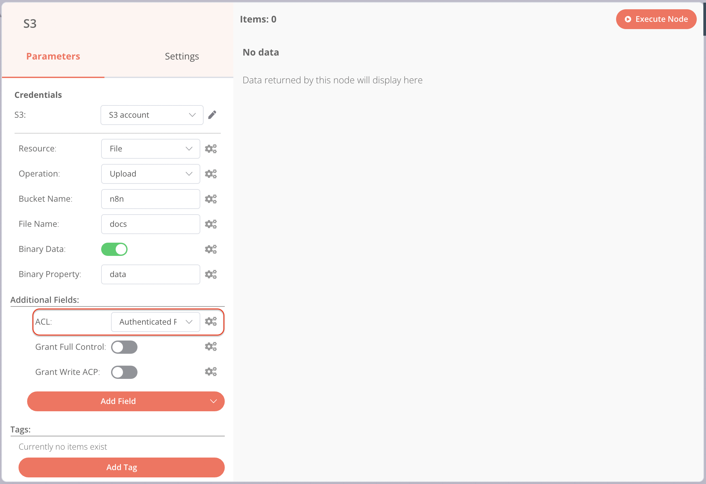

<!-- 简体中文翻译；来源 n8n-io/n8n-docs；原文版本见 upstream.json。 -->

# S3 

使用 S3 节点自动处理非 AWS 的 S3 存储，并将其与其他应用集成。n8n 内置支持多种 S3 功能，包括创建、删除和获取存储桶、文件及文件夹。对于 AWS S3，请使用 [AWS S3](n8n-nodes-base.awss3.md)。

S3 节点适用于以下非 AWS 的 S3 解决方案：

* [MinIO](https://min.io/)
* [Wasabi](https://wasabi.com/)
* [DigitalOcean Spaces](https://www.digitalocean.com/products/spaces)

本页列出了 S3 节点支持的操作，并提供更多资源的链接。


**凭据**

有关身份验证设置，请参阅 [S3 凭据](../credentials/s3.md)。




## 操作 

* Bucket（存储桶）
  * Create a bucket（创建存储桶）
  * Delete a bucket（删除存储桶）
  * Get all buckets（获取全部存储桶）
  * Search within a bucket（在存储桶中搜索）
*   File（文件） 

    * Copy a file（复制文件）
    * Delete a file（删除文件）
    * Download a file（下载文件）
    * Get all files（获取全部文件）
    * Upload a file（上传文件）

    

<strong>附加要上传的文件</strong>

要附加文件进行上传，请用其他节点将文件作为数据属性传入。例如，可以使用 <a href="../core-nodes/n8n-nodes-base.readwritefile.md">Read/Write Files from Disk</a> 节点或 <a href="../core-nodes/n8n-nodes-base.httprequest/README.md">HTTP Request</a> 节点。

* Folder（文件夹）
  * Create a folder（创建文件夹）
  * Delete a folder（删除文件夹）
  * Get all folders（获取全部文件夹）

## 模板与示例 

[浏览 S3 集成模板](https://n8n.io/integrations/s3)，或[搜索所有模板](https://n8n.io/workflows/)

## 节点参考 

### 在 Wasabi 中设置文件权限 

向 [Wasabi](https://wasabi.com/) 上传文件时，必须通过 **ACL** 下拉菜单设置文件权限，而不是使用开关。

