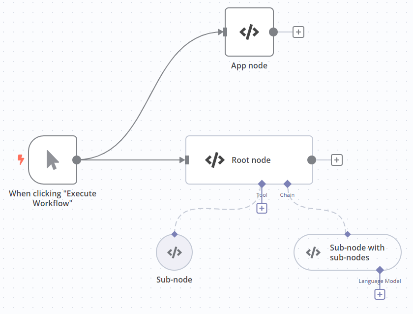

<!-- 简体中文翻译；来源 n8n-io/n8n-docs；原文版本见 upstream.json。 -->

# LangChain Code（LangChain 代码） 

使用 LangChain Code 节点导入 LangChain。如果 n8n 尚未为你需要的功能提供节点，仍可通过此方式使用该功能。配置 LangChain Code 节点的连接器后，可将其用作普通节点、根节点或子节点。

本页列出了节点参数、节点配置指南，并提供更多资源的链接。


**功能可用性**

LangChain Code 节点存在严重安全问题，使用不安全。它从 n8n 2.35.0 起弃用，并从节点面板中隐藏。请避免在工作流中使用此节点。



**Cloud 不提供此节点**

此节点仅适用于自托管 n8n。


## 节点参数 

### Add Code（添加代码） 

添加自定义代码，选择 **Execute**（执行）或 **Supply Data**（提供数据）模式，只能使用其中一种。

与 [Code 节点](../../core-nodes/n8n-nodes-base.code/README.md)不同，LangChain Code 节点不支持 Python。

* **Execute**（执行）：像使用 n8n 自带的 Code 节点一样使用 LangChain Code 节点。它从工作流接收输入数据，处理后作为节点输出返回。此模式需要主输入和主输出，必须在 **Inputs**（输入）和 **Outputs**（输出）中创建这些连接。
* **Supply Data**（提供数据）：将 LangChain Code 节点用作子节点，向根节点发送数据，使用主输出以外的输出。

默认情况下，不能在此节点中加载内置或外部模块。自托管用户可以[启用内置和外部模块](../../../../deploy/host-n8n/configure-n8n/basic-configuration.md)。

### Inputs（输入） 

选择输入类型。

主输入是所有 n8n 工作流中常见的普通连接器。如果节点设置了主输入和主输出，则必须提供 **Execute**（执行）代码。

### Outputs（输出） 

选择输出类型。

主输出是所有 n8n 工作流中常见的普通连接器。如果节点设置了主输入和主输出，则必须提供 **Execute**（执行）代码。

## 节点输入与输出配置 

配置 LangChain Code 节点的连接器（输入和输出）后，可将其用作应用节点、根节点或子节点。

| 节点类型 | 输入 | 输出 | 代码模式 |
| ---------------------------------------------------------------------------- | ----------------------------- | ------------------------------------------------------------------------- | ----------- |
| 应用节点，类似 [Code 节点](../../core-nodes/n8n-nodes-base.code/README.md)。 | Main（主输入） | Main（主输出） | Execute（执行） |
| 根节点 | Main（主输入）；至少一种其他类型 | Main（主输出） | Execute（执行） |
| 子节点 | - | 主输出以外的类型，必须与要连接的输入类型匹配。 | Supply Data（提供数据） |
| 带子节点的子节点 | 主输入以外的类型 | 主输出以外的类型，必须与要连接的输入类型匹配。 | Supply Data（提供数据） |

## 内置方法 

n8n 提供以下方法，方便在 LangChain Code 节点中执行常见任务。



## 模板与示例 

[浏览 LangChain Code（LangChain 代码） 集成模板](https://n8n.io/integrations/langchain-code)，或[搜索所有模板](https://n8n.io/workflows/)

## 相关资源 


