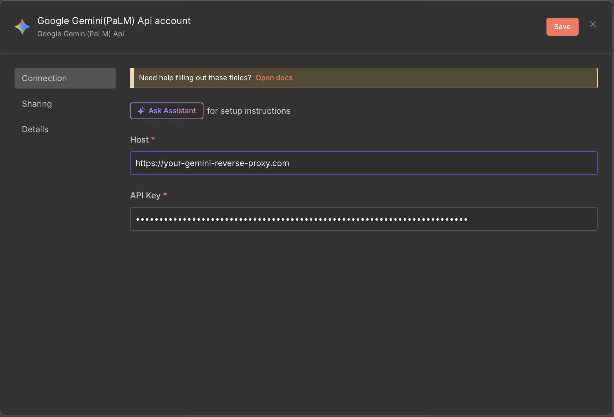

<!-- 简体中文翻译；来源 n8n-io/n8n-docs；原文版本见 upstream.json。 -->

# Google Gemini Chat Model（Google Gemini 聊天模型） 节点 


在 n8n Cloud 上，可使用 [Gateway 额度](../../../../deploy/use-n8n-cloud/gateway-credits/README.md)运行 Google Gemini Chat Model 节点，无需自己的 Google API 密钥。在节点的凭据字段选择 **Use Gateway credits**（使用 Gateway 额度），即可在没有 Google 账户的情况下运行节点。


使用 Google Gemini Chat Model 节点，将 Google 的 Gemini 聊天模型与对话智能体配合使用。

本页列出了 Google Gemini Chat Model 节点的参数，并提供更多资源的链接。


**凭据**

此节点的身份验证信息，请参阅 [Google Gemini(PaLM) 凭据文档](../../credentials/googleai.md)。




## 节点参数 

* **Model**（模型）：选择用于生成补全的模型。

n8n 从 Google Gemini API 动态加载模型，你只会看到自己的账户可用的模型。

## 节点选项 

* **Maximum Number of Tokens**（最大 token 数）：输入使用的 token 数量上限，以设置补全长度。
* **Sampling Temperature**（采样温度）：控制采样过程的随机性。温度越高，采样结果越多样，但产生幻觉的风险也越高。
* **Top K**：输入模型生成下一个 token 时考虑的候选 token 数量。
* **Top P**：设置补全使用的概率范围。较低值会忽略概率较低的选项。
* **Safety Settings**（安全设置）：Gemini 支持可调整的安全设置。可用筛选器及级别的详情，请参阅 Google 的 [Gemini API 安全设置](https://ai.google.dev/docs/safety_setting_gemini)。

## 限制 

### 不支持代理 

Google Gemini Chat Model 节点使用 Google SDK，该 SDK 不支持代理配置。

如果需要通过代理连接，可采用变通方案：为 Gemini 请求设置专用反向代理，并将 [Google Gemini 凭据](../../credentials/googleai.md)中的 **Host**（主机）参数改为代理地址：

## 模板与示例 

[浏览 Google Gemini Chat Model（Google Gemini 聊天模型） 集成模板](https://n8n.io/integrations/google-gemini-chat-model)，或[搜索所有模板](https://n8n.io/workflows/)

## 相关资源 

该服务的更多信息，请参阅 [LangChain 的 Google Gemini 文档](https://docs.langchain.com/oss/javascript/integrations/chat/google_generative_ai)。



