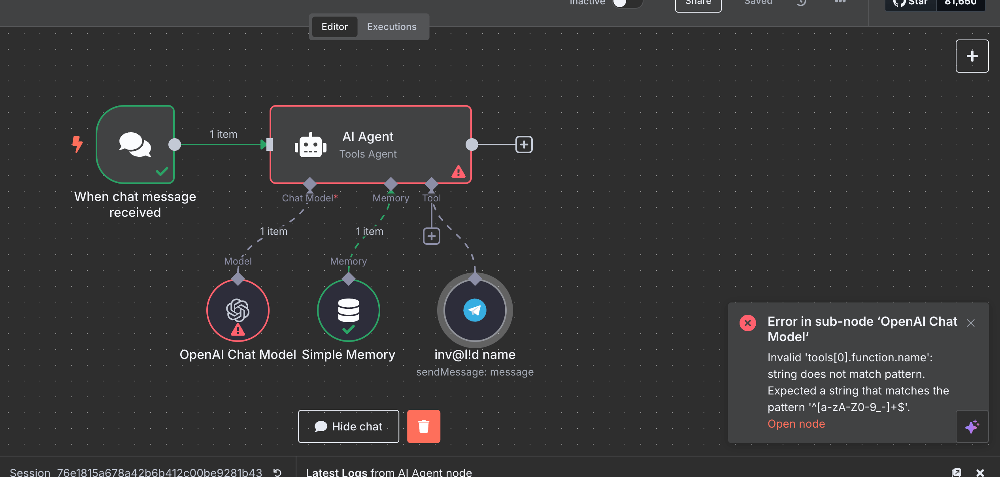

<!-- 简体中文翻译；来源 n8n-io/n8n-docs；原文版本见 upstream.json。 -->


# Vector Store Question Answer Tool（向量存储问答工具） 节点 <a href="#vector-store-question-answer-tool-node" id="vector-store-question-answer-tool-node"></a>

Vector Store Question Answer 节点是一种工具[^1]，让智能体[^2]能够根据[向量存储](#user-content-fn-3)[^3]中的文本块汇总结果并回答问题。

本页列出了 Vector Store Question Answer 节点的参数，并提供更多资源的链接。


**示例与模板**

入门用法示例和模板，请参阅 n8n 的 [Vector Store Question Answer Tool 集成](https://n8n.io/integrations/vector-store-tool/)页面。




## 节点参数 <a href="#node-parameters" id="node-parameters"></a>

### Description of Data（数据描述） <a href="#description-of-data" id="description-of-data"></a>

输入向量存储中数据的描述。

### Limit（上限） <a href="#limit" id="limit"></a>

返回结果的最大数量。

## n8n 如何填充工具描述 <a href="#how-n8n-populates-the-tool-description" id="how-n8n-populates-the-tool-description"></a>

n8n 使用节点名称（选择名称即可编辑）和 **Description of Data**（数据描述）参数，按以下格式填充供 AI 智能体使用的工具描述：

> 当需要回答关于 [node name] 的问题时，此工具很有用。只要需要关于 [Description of Data] 的信息，就应始终使用此工具。输入应是完整的问题。

工具描述中的节点名称空格会转换为下划线。


**节点名称避免使用特殊字符**

节点名称中的特殊字符会使智能体运行出错，例如：

```
Error in sub-node 'OpenAI Chat Model'

Invalid 'tools[0].function.name': string does not match pattern. Expected a string that matches the pattern '^[a-zA-Z0-9_-]+$'.
```



节点名称仅使用字母、数字、空格、连字符和下划线。


## 相关资源 <a href="#related-resources" id="related-resources"></a>

在 n8n 网站查看[示例工作流和相关内容](https://n8n.io/integrations/vector-store-tool/)。





[^1]: 在 AI 场景中，工具是附加资源，AI 可在响应请求时调用它获取特定信息或功能。AI 模型可以通过工具与外部系统交互，或完成具体、专门的任务。
[^2]: AI 智能体是能够响应请求、作出决策并为用户执行现实任务的人工智能系统。它们使用大型语言模型（LLM）理解用户输入，并根据可用的信息和资源，决定如何最好地处理请求。
<a id="user-content-fn-3"></a>
[^3]: 向量存储或向量数据库用于存储信息的数学表示。将其与嵌入模型和检索器配合使用，可创建供 AI 在回答问题时访问的数据库。
